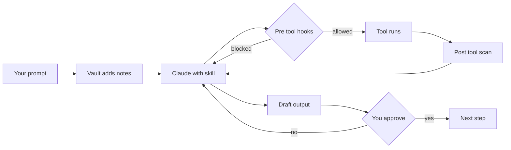
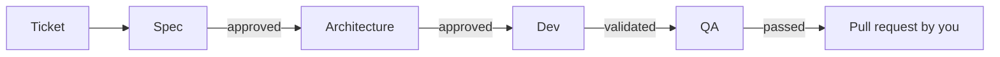

# Tollgate

**A governed harness for Claude Code. Claude proposes, you approve.**

Context engineering, structured skills and PHI safeguards take each ticket from specification to review, with human approval at every checkpoint.

Created by Dipen Patel.

## Why it exists

An AI assistant doing real data work fails in three predictable ways. Tollgate closes each one.

| Failure | What Tollgate does |
|---|---|
| It forgets between sessions | **Context engineering.** Every prompt is searched against your notes vault and relevant excerpts are injected. Standards, memory and per ticket state files load automatically. |
| It skips steps | **A skill chain with gates.** Spec, architecture, build and QA are separate roles with defined handoffs. Hooks refuse to start a later step until the earlier one is approved. |
| It sees or writes what it should not | **Guardrail hooks.** PHI, credentials, sensitive paths, writes into the read-only code folder (`TOLLGATE_CODE_DIR`) and Databricks row queries are checked before and after each tool call. |

What happens on every prompt:



## How a ticket moves

Every Tollgate command starts with `tg-`, so the ticket command is `/tg-ticket` and the session commands are `/tg-start` and `/tg-close`.

```
Coordination:  /tg-start → /tg-ticket → /tg-close
Bug:           /tg-start → /tg-ticket → support → spec → arch → dev → qa → /tg-close
Build:         /tg-start → /tg-ticket → spec → arch → dev → qa → /tg-close
```



Each skill is a role: product manager, architect, engineer, adversary. State is written to the vault in `02-tickets/{KEY}/{KEY}-state.md`, so any session picks up where the last one stopped. Every output is a draft. Nothing is sent or committed without you.

See the [Walkthrough](docs/walkthrough.md) for a full bug ticket with fake data.

## Repo layout


## Vault layout

The installer creates the vault. Skills read from it and write to it.


The folder names come from `scripts/core/paths.py` (`LAYOUT`). The full tree is in [File Structure](docs/structure.md).

## Safeguards and their limits

Hooks block or ask before PHI or credentials are written, run in a command, or returned by a tool. They also ask before reading sensitive paths and before Databricks commands that return rows. A hook that cannot start blocks the action (fails closed) only on Claude Code 2.1.295 or newer; on older versions the action goes through. The installer checks this (`install.sh` line 8) and [Setup](docs/setup.md) explains it.

PHI detection is a safety net built from fixed text patterns. It does not understand meaning, it raises false alarms, and it is not deidentification. It misses names with no nearby clue, non US formats, images and PDFs, and anything typed in the chat prompt. When it fires, replace the value with a placeholder. Do not add an exception. The levels, the rules and the full list of what is not caught are in the [Hook Reference](docs/hooks.md).

These hooks are guardrails for a cooperative model, not a sandbox. Approvals are plain `Status:` lines that a model can write, so any text it reads (Jira, Slack, pull request bodies, vault notes) can try to talk it into writing one. Check what Claude writes into approval lines yourself. The git commit and push ask hook can be bypassed by indirection (shell variables, `xargs`, `sh -c`, aliases); treat it as a safety net, not a lock. The guard that protects Tollgate's own files also has known gaps (a bare subshell, `sudo` options, `rsync`, `xargs`). Native Windows is unsupported; use WSL. Running chromadb in server mode is unsupported, and chromadb has open advisories with no fixed release as of 2026-11-21. The Slack MCP server is an npm package its author no longer supports; it is kept for now. These gaps are tracked for v2.

## Quick start

1. Collect your tokens: see [Prerequisites](docs/prerequisites.md).
2. Clone the repo and run `./install.sh`. It sets up your identity, vault, symlinks, MCP servers and search index. Tokens go to the OS credential store. On Linux without `secret-tool` the installer stores nothing and tells you to install `libsecret-tools`. It also asks how the vault is saved (`vault_git`: `none`, `local` or `remote`; see [Setup](docs/setup.md)), and installs 28 commands (`commands/tg-*.md`).
3. Reload your shell, open VSCode and run `/tg-start`.

Details: [Setup](docs/setup.md). Python 3.12 or later; the check is `python3 --version`.

## Documentation

| Read | Covers |
|---|---|
| [Overview](docs/overview.md) | What the system is and why |
| [Skill Chains](docs/skill-chains.md) | Which chain for which ticket |
| [System Design](docs/system-design.md) | Architecture and how to adapt it |
| [Hook Reference](docs/hooks.md) | Every hook, with testing and recovery |
| [File Structure](docs/structure.md) | Where everything lives |

## License

MIT. See [LICENSE](LICENSE). Copyright (c) 2026 Dipen Patel.
