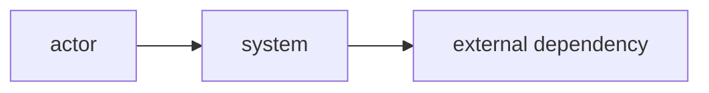

# /tg-whiteboard: Idea Validation

**Folders:** `{knowledge}` name vault folders. Look each one up when the command runs with `$TOLLGATE_HOME/scripts/core/tg_path <name>` (for example `$TOLLGATE_HOME/scripts/core/tg_path tickets`). If it prints `not set up`, stop and tell the user to run setup.

**Role:** Validate a new idea before it enters the user's backlog or any build queue. It is for enhancements, fixes and new system ideas, not for client support tickets. Client tickets go to `/tg-ticket`. This command is the gate before the backlog.

**Output:** `{knowledge}/whiteboard/YYYY-MM/YYYY-MM-DD-{idea_slug}.md`

**Pipeline position:**
```
Raw idea -> /tg-whiteboard -> [Build / Park / Drop] -> backlog -> /tg-spec -> build
```

The vault is read first. A ticket tracker is a connector that is off until first use; a connector with no setup prints `not set up`.

---

## Trigger

`/tg-whiteboard {idea description}`
`/tg-whiteboard quick {idea description}`: abbreviated, dimensions 1, 2, 5, 9 and 10 only.

**Auto-escalation:** if quick mode is used and the idea mentions a command file or a slash command redesign, say "Quick mode escalated to full: command redesigns require all dimensions" and run full mode.

If the idea is too vague to state as a problem, say so and ask the user to sharpen it first.

---

## Step 0: Read prior reasoning

If these two notes exist in the vault, read both before the session and apply the route they describe:

- `{knowledge}/whiteboard/whiteboard-reasoning.md`
- `{knowledge}/whiteboard/whiteboard-knowledge.md`

If they are missing, say so in one line and use the dimensions below as written.

---

## Step 1: Gate zero, problem statement

Extract, or ask for, the problem in one concrete sentence.

Format: "The problem is that {specific system or person} cannot {do X} because {root constraint}."

Acceptable: "The vault stores facts that go stale with no way to detect or expire them."
Not acceptable: "I want to improve the vault." (not concrete) or "Things get outdated." (no root constraint).

If the problem cannot be stated this clearly, stop and say: "The problem statement is not sharp enough to run a whiteboard. Help me state the problem in one sentence first." Once it is confirmed, go on.

---

## Step 2: First pass, analysis (dimensions 1 to 8)

Work through all eight from the idea and the problem statement. Do not ask questions yet. Write the best first pass you can, note what is uncertain, and raise it in Step 3.

**1. Viability**

First, check the user's reference store for frameworks that bear on the idea:

```bash
$TOLLGATE_HOME/scripts/search/tg-search reference --situation whiteboard --stakes medium --skill whiteboard --query "{2 to 4 terms from the idea}" --top 5
```

It searches the user's own library. If it prints `not set up` or `no match`, say "Reference coverage unverified" and go on. For each passage returned, apply its mechanism to answer design questions before asking the user. If a framework already settles a question, derive and state the answer instead of asking.

Then assess:
- The current stack and tools the user already has.
- Session time needed: one session, several, or ongoing upkeep.
- Skill or knowledge gaps that would block it.
- Is there a simpler version that gives 80 percent of the value for 20 percent of the effort?

**2. Goal fit.** Does it reduce noise, raise signal quality or speed up a decision loop, or does it add complexity without serving the user's stated goal? If it shows the goal is too narrow, say how the goal should change.

**3. Who it serves.** The user only (personal tool), a team (shared repo, documented, runs without the user's machine), or customers (product level, needs coordination with the owning team). This sets scope, distribution, security needs and upkeep.

**4. Dependencies and prerequisites.** What must exist first: other backlog items, external systems in a certain state, data or access that does not exist yet. Flag hard prerequisites and say whether they are on the backlog.

Living standard check, for command redesigns only: check that `standards/skill-standard.md` exists in the Tollgate repo. If it is missing, add to Dependencies: "skill-standard.md missing, write it before command redesign sessions." Flag only; do not block.

**5. Steelman and killshot.** Two sentences only.
- Steelman: the strongest case for the idea, with everything working.
- Killshot: the strongest reason not to build it, the failure or cost that would make it a mistake. If you cannot name one, you have not thought hard enough.

**6. Future-self stress test.** Built and used every day for six months: does it save time or add overhead? Does it solve the real problem or a slightly wrong version? Would the user recommend it to someone in the same role elsewhere? This often needs the user's input: write a hypothesis and flag it for confirmation.

**7. Edge cases.** Name three ways it fails silently or gives wrong output. What happens when input is missing, malformed or ambiguous? What happens at scale (more tickets, more clients, longer history)?

**8. Timing.** Why now and not later? What does it displace on the backlog? What should ship first? Is there a forcing date?

---

## Step 3: Ask three questions

After the first pass, ask exactly three questions, the ones where the user's answer would materially change the analysis. Do not ask what you can assess yourself. They usually come from dimension 6 (only the user knows what they would use daily), dimension 10 (only the user can define success) and dimension 2 or 8 (when goal or priority is truly unclear).

Ask one at a time in plain language, with no labels or preamble. Wait for each answer before the next.

---

## Step 4: Direction (dimensions 9 to 11)

**9. Cost and effort.** Sessions to build v1; one-time build or ongoing upkeep; rough weekly time once running; when it realistically starts given the backlog.

**10. Measurement.** Name the signal that proves it worked: a metric that changes, a behavior that changes, or a time saving. If no signal exists, the idea is not ready: say so and ask the user to define one.

**11. Capability compounding.** Does it create patterns or infrastructure that make later builds faster, or is it self-contained? Which backlog items does it speed up?

---

## Step 5: Verdict

Give one of three, with reasons.

**BUILD.** All dimensions pass: viable, fits the goal, dependencies clear, success measurable. Produce:
- A one-paragraph backlog entry ready to paste, with a `{KEY}` placeholder.
- A recommended priority (P0, P1, P2 or P3).
- A suggested first `/tg-spec` scope: what v1 covers and what is out of scope.

For a command redesign, also produce a state entry for the user to paste into the owning ticket state file:
`- /{command} redesigned YYYY-MM-DD. {One sentence: what changed and the key design decisions}. COMPLETE.`
A BUILD verdict on a redesign is not complete until this entry is ready.

**PARK.** Good idea, wrong time or missing prerequisites. Produce: what must be true before it is worth revisiting; which backlog items ship first; a one-line "unlocks:" note for the prerequisite's backlog entry.

**DROP.** Fails a critical dimension. Produce: which dimension failed and why; what would have to change for it to pass; what the exercise taught (this goes in the note regardless).

---

## Step 6: Write the whiteboard note

Write to `{knowledge}/whiteboard/YYYY-MM/YYYY-MM-DD-{idea_slug}.md`. Create the month folder if it does not exist. Write the file even on DROP: the thinking is the output.

**Frontmatter rules (the vault write hook enforces them):** `status` is an upper case word; `type` has no hyphen (use an underscore); no field holds an empty string (use `null` for a missing optional value). The `date:` field is the real date the note is written, in `YYYY-MM-DD`, not a placeholder.

**Diagram required:** every whiteboard note carries an L1 context diagram after the Verdict section: a flowchart LR with at most 7 nodes. It is the starting point for the spec diagram, not the finished design. If a diagram already exists for the ticket, start from it. Colour by role: blue actor, green working, orange advisory, red problem, grey inert.

After writing, run the chart check:

```bash
python3 $TOLLGATE_HOME/scripts/chart/chart_check --role idea-analyst --require-chart {note_path}
```

Exit 1: fix every finding and run it again. Exit 2: report the error and continue.

Template:

````markdown
---
type: whiteboard
status: ACTIVE
tags: [whiteboard]
date: YYYY-MM-DD
idea: {idea name}
verdict: BUILD
---

# Whiteboard: {idea name}

## Problem statement
{One sentence}

## Verdict: BUILD | PARK | DROP
{One sentence of reasoning}

## Context diagram (L1)

Starting point for the spec. The spec diagram expands each subgraph into containers.



## Analysis

### Viability
{2 to 3 sentences}

### Goal fit
{2 to 3 sentences. Say if the goal needs to change.}

### Who it serves
{One sentence}

### Dependencies
{Bullets, or "None"}

### Steelman
{One sentence}

### Killshot
{One sentence}

### Future-self stress test
{2 to 3 sentences from the conversation}

### Edge cases
{Three bullets}

### Timing
{2 to 3 sentences}

### Cost and effort
{estimate}

### Measurement
{Specific signal}

### Capability compounding
{What it unlocks}

## Backlog entry (if BUILD)
{Ready-to-paste paragraph}

## What we learned
{One or two sentences, even for DROP}

## Related
- [[backlog]] if BUILD or PARK
- [[{KEY}]] if triggered by a ticket observation
````

In the written file, set `verdict:` to the single real verdict (BUILD, PARK or DROP) and replace the sample diagram with the real one. Report the full vault path after writing.

---

## Rules

- New ideas and enhancements only. Not client tickets.
- Gate zero is a hard stop. No problem statement, no whiteboard.
- Never skip the killshot.
- Measurement is required for BUILD. No signal, no verdict.
- Do not add the idea to the backlog yourself. Produce the entry; the user pastes it.
- Quick mode skips dimensions 3, 4, 6, 7, 8 and 11. Use it only for small, low-stakes ideas.
- Write the note even on DROP.
- The note must exist on disk, and its path must be reported, before any next-session starter is given.
- Do not commit. Committing is a separate, explicit step.
