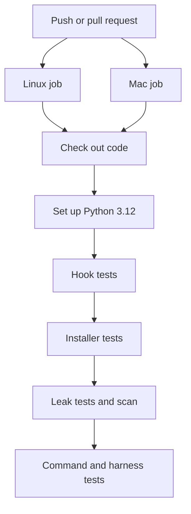

## Purpose

A GitHub Actions workflow named `tests`. It runs the hook tests, the installer tests, the leak scanner tests, the command file tests and the harness tests on Linux and macOS each time code is pushed or a pull request is opened, then scans the repo itself for leaked private names. {src:.github/workflows/tests.yml:1}

## Dependencies

**Depends on.** GitHub Actions as the runner. Two actions, each pinned to a full commit hash with the release number in a trailing comment: `actions/checkout` (comment `v7.0.1`) {src:.github/workflows/tests.yml:21} and `actions/setup-python` (comment `v7.1.0`) {src:.github/workflows/tests.yml:24}. The scripts and test files it runs: `tests/hooks/run.sh` {src:.github/workflows/tests.yml:29}, `tests/hooks/check_hook_inventory.py` {src:.github/workflows/tests.yml:32}, the `test_*.py` files in `tests/hooks` {src:.github/workflows/tests.yml:35}, `tests/installer/run.sh` {src:.github/workflows/tests.yml:38}, `tests/leak/run.sh` {src:.github/workflows/tests.yml:41}, `tests/commands/run.sh` {src:.github/workflows/tests.yml:47} and `tests/harness/run.sh` {src:.github/workflows/tests.yml:50}. Related docs: [check_hook_inventory](../../tests/hooks/check_hook_inventory.md), [run (hooks)](../../tests/hooks/run.md), [run (installer)](../../tests/installer/run.md), [run (leak)](../../tests/leak/run.md), [scan_leaks](../../tests/leak/scan_leaks.md), [run (commands)](../../tests/commands/run.md), [run (harness)](../../tests/harness/run.md), [dependabot](../dependabot.md).

**Used by.** GitHub Actions reads it from `.github/workflows/`. No file in the repo imports it. The comment on the checkout step says the pins are bumped by the weekly Dependabot pull request, which `.github/dependabot.yml` sets up {src:.github/workflows/tests.yml:20}.

## Behavior

Triggers: every `push` and every `pull_request`, with no branch filter. {src:.github/workflows/tests.yml:4} {src:.github/workflows/tests.yml:5}

Token rights: the workflow grants `contents: read` only. {src:.github/workflows/tests.yml:8}

One job, `test`, runs once per operating system: `ubuntu-latest` and `macos-latest`. {src:.github/workflows/tests.yml:12} {src:.github/workflows/tests.yml:17} `fail-fast` is false, so one failing system does not cancel the other. {src:.github/workflows/tests.yml:15} A job that runs longer than 30 minutes is cancelled. {src:.github/workflows/tests.yml:13}

Steps, in order:

| Step | Command |
|---|---|
| Check out repository | `actions/checkout`, pinned to a commit {src:.github/workflows/tests.yml:21} |
| Set up Python 3.12 | `actions/setup-python`, pinned to a commit, with `python-version: "3.12"` {src:.github/workflows/tests.yml:24} {src:.github/workflows/tests.yml:26} |
| Hook shell tests | `bash tests/hooks/run.sh` {src:.github/workflows/tests.yml:29} |
| Hook inventory check | `python3 tests/hooks/check_hook_inventory.py` {src:.github/workflows/tests.yml:32} |
| Python unit tests | `python3 -m unittest discover -s tests/hooks -p 'test_*.py'` {src:.github/workflows/tests.yml:35} |
| Installer tests | `bash tests/installer/run.sh` {src:.github/workflows/tests.yml:38} |
| Leak scanner tests | `bash tests/leak/run.sh` {src:.github/workflows/tests.yml:41} |
| Leak scan of the repo | `bash tests/leak/run.sh scan .` {src:.github/workflows/tests.yml:44} |
| Command file tests | `bash tests/commands/run.sh` {src:.github/workflows/tests.yml:47} |
| Harness tests | `bash tests/harness/run.sh` {src:.github/workflows/tests.yml:50} |

The two leak steps differ by one word. With no argument, `tests/leak/run.sh` runs the unit tests in its own folder. {src:tests/leak/run.sh:10} With `scan` as the first argument, it hands the rest of the arguments to `scan_leaks.py`, so the scan step checks the whole checkout. {src:tests/leak/run.sh:6} {src:tests/leak/run.sh:8}

A step that exits non zero fails the job. No step sets `continue-on-error` (searched the workflow file 2026-11-21).

## Diagram

## Notes

The end to end test, `tests/e2e/run.sh`, is not in this workflow (searched the workflow file 2026-11-21). `docs/hooks.md` describes it as a separate layer that starts a real Claude session. {src:docs/hooks.md:633}

Python is pinned to 3.12 on both systems, which is the minimum Tollgate supports; earlier runs used whatever `python3` the runner image held. {src:.github/workflows/tests.yml:26} The tests that need `chromadb` or other libraries are not installed by this workflow: no step runs `pip` (searched the workflow file 2026-11-21).

The steps `tests/hooks/run.sh` runs itself include the inventory check and the `test_*.py` discovery. {src:tests/hooks/run.sh:190} {src:tests/hooks/run.sh:198} The workflow then runs both again as separate steps, so each runs twice per system. `docs/hooks.md` says `run.sh` includes the inventory check. {src:docs/hooks.md:632}

Pinning to a commit stops a moved tag from changing what runs; the comment beside each hash carries the release it was taken from, and no check in the workflow compares the two. {src:.github/workflows/tests.yml:21} {src:.github/workflows/tests.yml:24}

The repo scan step has no denylist argument, so it relies on the scanner's own default behavior. See [scan_leaks](../../tests/leak/scan_leaks.md) for what that covers.
