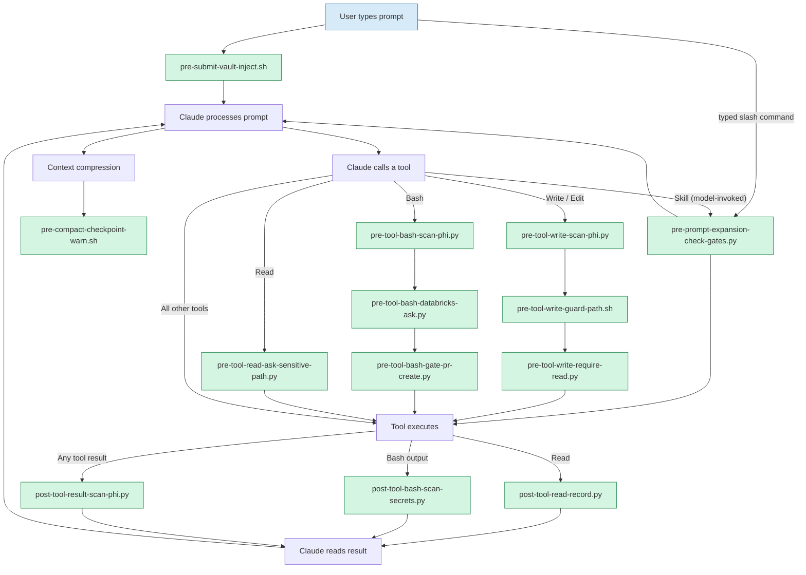
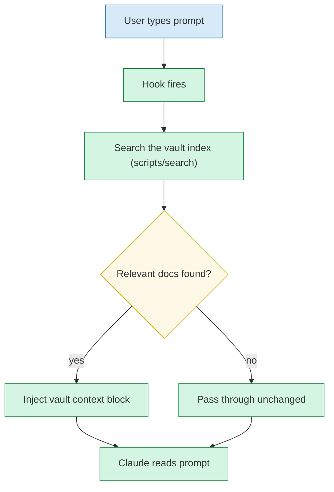
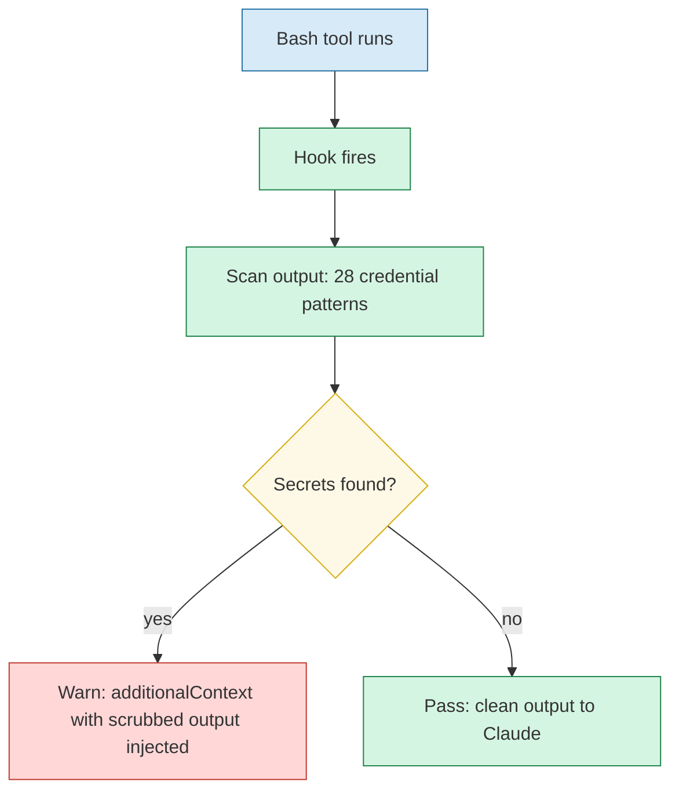
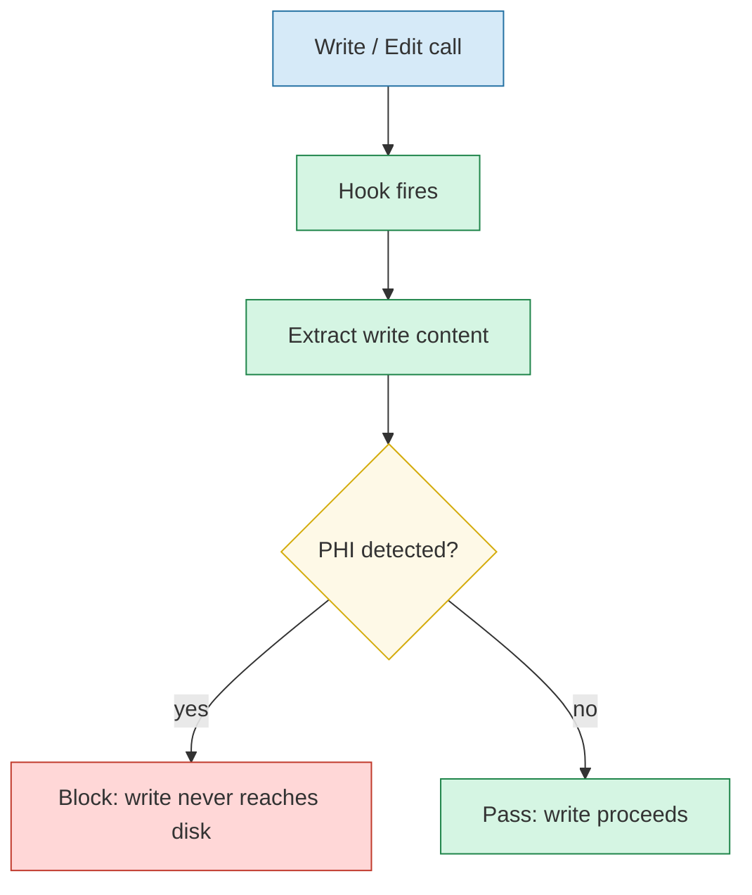
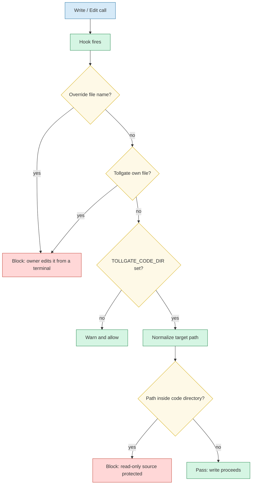
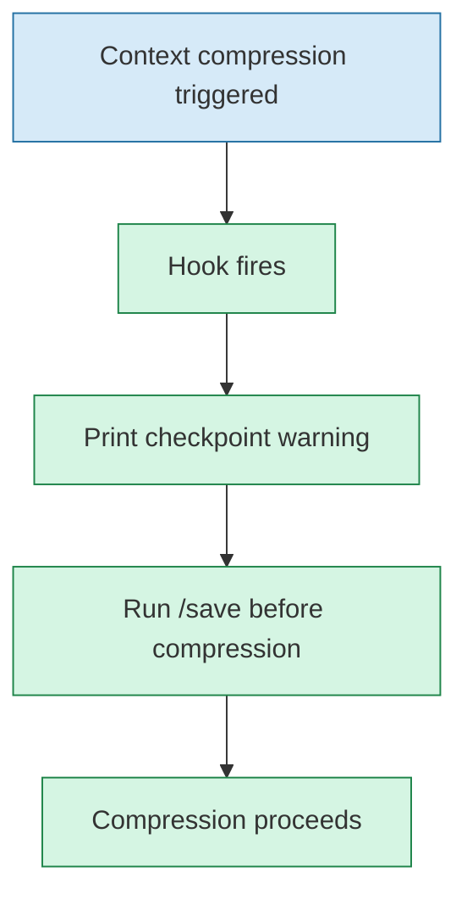
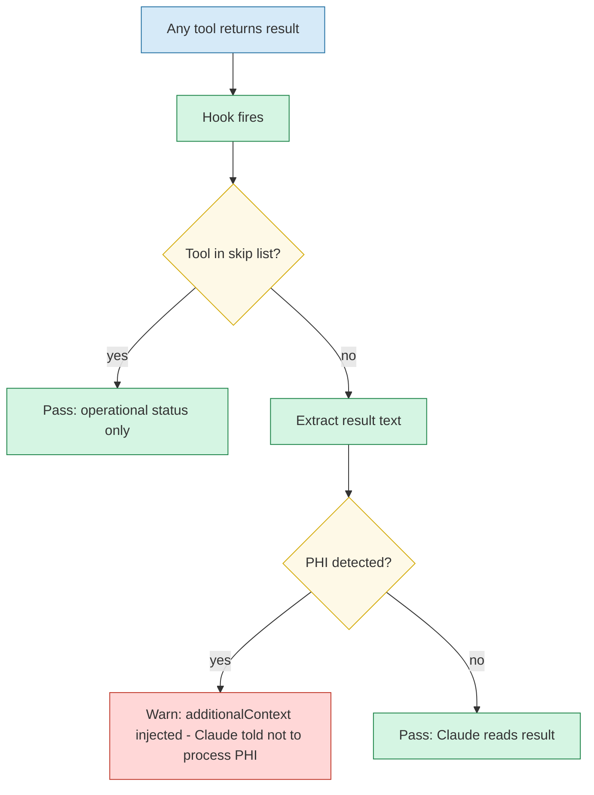
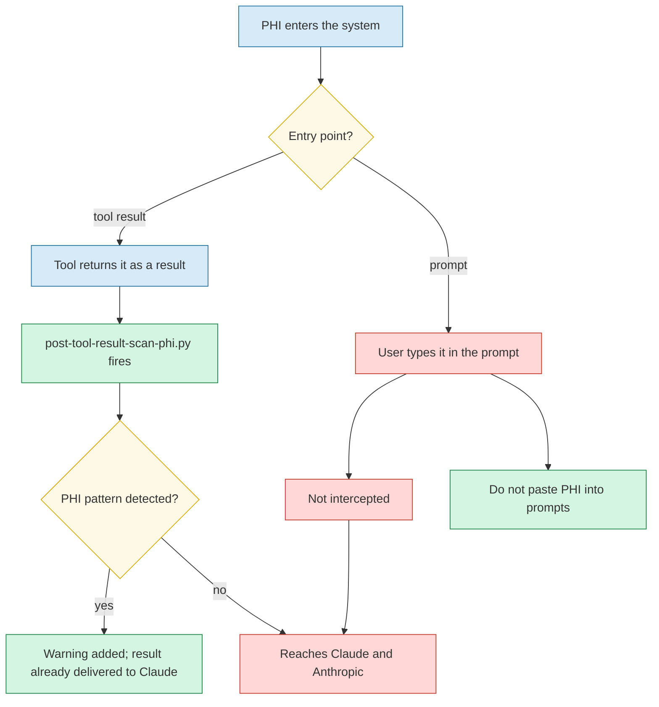

# Hook Reference

Created by Dipen Patel.

Claude Code hooks are shell or Python scripts that fire at defined points in the agent loop. Tollgate wires 25 hook scripts across five events in `settings.json` (UserPromptSubmit, UserPromptExpansion, PreToolUse, PostToolUse and PreCompact), plus five shared modules (`hooks/state_file_io.py` for atomic, locked writes to state files, `hooks/phi_patterns.py` for PHI detection and payload text extraction, `hooks/sql_summary.py` for the Databricks approval summary, `hooks/read_guard_common.py` for the read before write guard, `hooks/gate_rules.py` for the chain skill gate checks), one helper in the `hooks/lib/` folder (`hooks/lib/protected_paths.py`, the list of Tollgate's own files that the write and Bash guards keep the model from writing; see section 4) and two git hooks that are not Claude Code hooks (`hooks/git-pre-push`, `hooks/pre-commit-secrets`; see section 15). `python3 tests/hooks/check_hook_inventory.py` fails if a hook file, `settings.json` and this page disagree. Each section below shows what the hook does and when it fires.

The Python hooks need Python 3.12 or later; `install.sh` checks this by running `python3` before it changes anything. {src:install.sh:148}

Hooks are defined in the repo `settings.json` and merged into `~/.claude/settings.json` with absolute paths by `installer/merge_settings.py`. The merge keeps your own hooks, permissions, env, and other settings, and replaces only Tollgate's hook entries (including stale paths from a moved repo). It also writes an `env` block (`TOLLGATE_KNOWLEDGE`, `TOLLGATE_CODE_DIR`, `CLAUDE_DOTFILES`, plus `TOLLGATE_HOME`, `TOLLGATE_PATHS`, `TOLLGATE_CONNECTORS`, `TOLLGATE_INITIALS`, `TOLLGATE_TICKET_PREFIX` and, when the search venv exists, `TOLLGATE_PYTHON`) so hooks work in editors launched without your shell profile. An old `TOLLGATE_SKILL_PREFIX` from an earlier install is removed from that block on the next run. {src:installer/merge_settings.py:418}

## Output format (required)

Claude Code validates hook JSON. `hookSpecificOutput` **must** include `hookEventName` matching the event. Without it, Claude Code logs `Hook JSON output validation failed - hookSpecificOutput is missing required field "hookEventName"`, marks the hook as an error, and discards its output: no warning reaches Claude and no deny takes effect. Verified on Claude Code 2.1.220 (2026-09-23). Every Tollgate hook before that date omitted the field, so none of them worked in live sessions even though fixture tests passed.

```json
{"hookSpecificOutput": {"hookEventName": "PreToolUse", "permissionDecision": "deny", "permissionDecisionReason": "..."}}
{"hookSpecificOutput": {"hookEventName": "PostToolUse", "additionalContext": "..."}}
```

UserPromptSubmit and PreCompact hooks here print plain text, which does not need the field.

Real payload shapes (captured live, used by `phi_patterns.collect_texts`):
- Bash `tool_response`: `{"stdout", "stderr", "interrupted", "isImage", "noOutputExpected"}`
- Read `tool_response`: `{"type": "text", "file": {"filePath", "content", ...}}`, with the text nested under `file.content`

## What hooks can and cannot do

| Event | Can | Cannot |
|---|---|---|
| PreToolUse | Block (`deny`) or require approval (`ask`) before the tool runs. `ask` overrides an allow rule (verified). | See the result |
| PostToolUse | Add a warning for Claude (`additionalContext`) | Hide, redact, or undo a result. Claude has already received it. |

Controls that must prevent exposure belong in PreToolUse. PostToolUse is a second layer.

## Fail closed vs fail open

- `pre-tool-write-scan-phi.py` **fails closed**. An unreadable payload, an import error, or any exception denies the write.
- `pre-tool-bash-databricks-ask.py` fails to `ask` on an internal error and exits 2 on an unreadable payload.
- `pre-tool-bash-scan-phi.py` **fails closed** (owner decision, 2026-11-01). Bad JSON, an import error, or any exception denies the command with an "internal error" message. It used to fail open so Bash could be the recovery path; that path is gone, see Recovery.
- `pre-tool-bash-gate-pr-create.py` **fails closed** (exit 2) on an unreadable payload or any internal error. A command it cannot parse still falls back to a text match.
- `pre-prompt-expansion-check-gates.py` **fails closed for gated skills**. An unreadable payload exits 2. An internal error (an import error of `gate_rules.py`, a rule error or any other exception) while checking `arch`, `dev` or `qa` blocks that skill and logs `fail_closed`. An internal error on any other command is logged as `fail_open` and the command goes ahead, so a broken gate cannot lock every slash command.
- `pre-tool-write-require-read.py` **fails closed** (exit 2) on an unreadable payload, an invalid `GUARD_REGEX` or any internal error. `post-tool-read-record.py` fails open: a logging or parsing problem there never blocks work.
- Every other PreToolUse hook (`pre-tool-write-guard-path.sh`, `pre-tool-bash-guard-code-dir.py`, `pre-tool-bash-guard-gate-override.py`, `secret-command-guard.sh`, `scrub_secrets.py`, `co_authored_by_check.sh`, `guard_worktree_remove.sh`, `git_commit_guard.sh`, `git_push_guard.sh`, `git_readonly_guard.sh`, `pre_tool_write_scan_claims.py`, `pre_tool_write_vault_frontmatter.py`) now exits 2 when it cannot read its payload or hits an unexpected error. Bad JSON never comes from Claude Code itself; the point is that a broken hook blocks instead of allowing. The write guard also exits 2 when its protected file check crashes or its helper file is missing {src:hooks/pre-tool-write-guard-path.sh:76-79}, and the Bash code directory guard exits 2 when it cannot load that helper {src:hooks/pre-tool-bash-guard-code-dir.py:46-49}.
- `pre-tool-read-ask-sensitive-path.py` **fails closed**. Bad input or any exception denies the read, and its `settings.json` entry sets `onFailure: block`.

**What fail closed covers.** The two PHI pre hooks deny when they catch an error themselves: bad or wrongly shaped input, a missing or broken `phi_patterns.py`, or any exception inside the scan. Claude Code treats a hook that cannot start, exits with a code other than 0 or 2, prints invalid output, or is cancelled by its timeout as a non blocking error, and the action goes ahead (source: Claude Code hooks documentation, checked 2026-11-02). So a hook file with a syntax error, or a missing `python3`, does not block unless its entry sets `"onFailure": "block"`. Every PreToolUse and UserPromptExpansion entry in `settings.json`, and the PostToolUse secret and PHI scanners, set it (Claude Code 2.1.295 or later), so a hook that cannot start, exits with a code other than 0 or 2, or times out blocks the action. `tests/hooks/check_hook_inventory.py` fails if one of them loses the setting. Timeouts: the documented default for a command hook is 600 seconds, and `settings.json` sets none on the PHI hooks. Only two hooks set one: the vault inject hook (30 seconds) and the gate check hook (10 seconds). Measured scan times are in "PHI scan speed limits" below.

---

## Hook event map



---

## 1. pre-submit-vault-inject.sh

**Event:** UserPromptSubmit - fires before every prompt reaches Claude.

Searches the vault index with `scripts/search/query_index.py` and injects matching document excerpts into the conversation. Claude reads your vault context without you pasting it manually. {src:hooks/pre-submit-vault-inject.sh:55} It skips prompts shorter than 25 characters and prompts whose first line starts with a slash command, asks for the top 3 results with a score of at least 0.40, and withholds any excerpt that has a PHI finding at any level. The prompt goes to the search script on stdin, and the index folder comes from the path loader, not from a flag. It uses `TOLLGATE_PYTHON` when the installer set it (that interpreter has the search packages), else `python3`, and it always exits 0, so a missing index or an unset `TOLLGATE_KNOWLEDGE` never blocks a prompt. Commands call the same search through `scripts/search/tg-search`; the installer rewrites every `$TOLLGATE_HOME/` in each installed command to the absolute repo path, because Claude Code refuses a command that holds an unresolved variable {src:install.sh:1155}. See [tg-search](scripts/search/tg-search.md).



**Path portability:** The script derives its own location from `BASH_SOURCE[0]` so it works after the dotfiles directory is renamed or moved.

---

## 2. post-tool-bash-scan-secrets.py

**Event:** PostToolUse - fires after every tool call (empty matcher; Write, Edit, NotebookEdit, and TodoWrite are skipped). Scans Bash stdout and stderr, Read file content, and MCP text.

Scans tool output for credentials. When a match is found the hook injects an `additionalContext` warning into Claude's turn with a scrubbed copy of the output. It does not redact what Claude received. **PostToolUse hooks cannot suppress a result from reaching Claude** - the raw output and the warning both reach Claude. The text this hook adds names the credential types and shows the scrubbed copy {src:hooks/post-tool-bash-scan-secrets.py:118-122}; the sentence asking Claude not to use the raw values comes from `scrub_secrets.py`, which also runs on every result {src:hooks/scrub_secrets.py:248}. Output that is not plain ASCII is normalised first (zero-width characters dropped, look-alike forms folded) so a key with hidden characters is still matched {src:hooks/post-tool-bash-scan-secrets.py:103}.

> **Limitation:** Secrets in Bash output reach Claude's context. The hook reduces the risk that Claude will reproduce or forward them, but does not eliminate it.



**Patterns covered (28):** Anthropic key, AWS access key, Jira token, Databricks PAT, GitHub PAT, GitHub token, Slack token, OpenAI key (plain and `sk-proj-` style), Plane key, Stripe live key, Google API key, npm token, Hugging Face token, GitLab token, SendGrid key, JWT, credentials inside a URL, Slack webhook URL, a password given to `curl -u`, Bearer token, JSON credential member, Azure storage key, Azure SAS, PEM private key, auth header, credential assignment, exported env secret {src:hooks/post-tool-bash-scan-secrets.py:37-77}. The shapes added in v1 are borrowed from `scrub_secrets.py`, so the two scanners share them {src:hooks/post-tool-bash-scan-secrets.py:72-77}. This hook does not read the variable name registry; `scrub_secrets.py` does.

---

## 3. pre-tool-write-scan-phi.py

**Event:** PreToolUse - fires before Write, Edit, and NotebookEdit.

Scans the content being written to disk (`content`, `new_string`, `new_source`) with `scan_levels`: the labeled identifier rules, the context rules, and PHI columns in CSV or JSON row dumps. The target path is not scanned. The strongest finding sets the outcome: deny blocks the write, ask makes Claude Code prompt you, warn lets the write follow the normal permission flow and adds a visible message. The message names rules and levels, never the matched text. Fails closed on errors it catches.



**Rules covered:** see "PHI detection levels and rules" below.

---

## 4. pre-tool-write-guard-path.sh

**Event:** PreToolUse: fires before Write, Edit, and NotebookEdit. The path comes from `file_path`, or from `notebook_path` when `file_path` is empty.

Blocks model writes to three kinds of place, checked in this order {src:hooks/pre-tool-write-guard-path.sh:30-119}:

1. **Gate override files**, any file named `*-gate-override.md` (any letter case, also through a symlink). See "Gate override files" below.
2. **Tollgate's own files.** The model may not write `~/.claude/settings.json`, `~/.claude/credentials.sh`, `~/.claude/tollgate-config`, anything under `~/.tollgate/` or `~/.claude/tollgate/` (where the installer keeps the connector state file `connectors.yaml` and `paths.yaml`), the shell profiles `~/.zshrc`, `~/.bashrc`, `~/.bash_profile` and `~/.profile`, the files named by the variables `TOLLGATE_CONNECTORS`, `TOLLGATE_PATHS` and `TOLLGATE_CONFIG` when they are set, or the repo's `hooks/` folder and `settings.json` (the repo folder is found from where the helper sits and from `TOLLGATE_HOME` and `CLAUDE_DOTFILES`) {src:hooks/lib/protected_paths.py:28-32} {src:hooks/lib/protected_paths.py:69-70} {src:hooks/lib/protected_paths.py:62-63}. The list lives in `hooks/lib/protected_paths.py`, see [docs/hooks/lib/protected_paths.md](hooks/lib/protected_paths.md). A path is made absolute, symlinks are resolved, and both the typed and the resolved form are compared in lower case {src:hooks/lib/protected_paths.py:41-55}. Only writes are guarded; reading these files stays allowed. If the check cannot run (the helper crashes or is missing), the write is blocked with exit 2 {src:hooks/pre-tool-write-guard-path.sh:57-80}. The owner edits these files from a terminal.
3. **The read-only code directory** (`TOLLGATE_CODE_DIR`). That directory is a read-only mirror of production repos that the search index reads, and it must never be written to. If `TOLLGATE_CODE_DIR` is not set the hook does not block, but it prints a visible warning (a `systemMessage` plus the same text on stderr) so an unprotected setup is not silent {src:hooks/pre-tool-write-guard-path.sh:86-90}. Checks 1 and 2 do not depend on that variable.

Bash writes into the same places are covered by sections 12 and 12b.



**False positive guard:** Path comparison uses a trailing slash on both sides (`/code/` vs `/codebackup/`) so a directory whose name starts with the code dir name does not trigger a false block.

**Gate override files:** the same hook denies any model write to a file named `*-gate-override.md` (any letter case, also through a symlink), with the message that the owner creates it from a terminal {src:hooks/pre-tool-write-guard-path.sh:36-50}. This check runs first, so it holds even when `TOLLGATE_CODE_DIR` is unset. Bash commands that write the file are denied by section 12b, a pattern check on the command text. See section 13 for the terminal command.

**Limits of this guard** (checked 2026-11-21 against the code):
- The protected list is the files and folders named above and nothing else {src:hooks/lib/protected_paths.py:28-32}. `~/.claude/commands`, `CLAUDE.md`, other shell startup files such as `.zshenv` and `.zprofile`, and the ticket and state files that the chain gates read are not protected, so the model can still write them.
- A hard link to a protected file is not caught, because only symlinks are resolved {src:hooks/lib/protected_paths.py:46}.
- A typed path that starts with `-` is never reported as protected {src:hooks/lib/protected_paths.py:86}.
- Case folding also treats `.ZSHRC` as protected on a case-sensitive disk, where it is a different file; this blocks more than needed {src:hooks/lib/protected_paths.py:42}.

---

## 5. pre-compact-checkpoint-warn.sh

**Event:** PreCompact - fires before Claude Code compresses the context window.

Writes a checkpoint reminder to Claude Code's debug log before compaction fires. **This output does not reach Claude's context or the user's terminal.** PreCompact stdout goes to the debug log only; the feature request to allow PreCompact to inject into Claude's context (GitHub #43733) was closed as "not planned." The only user-visible PreCompact signal is `exit 2` with stderr output, which hard-blocks compaction entirely.

> **Current status: this hook is a functional no-op.** The warning reaches no one. If you want to preserve state across compaction, use `SessionStart` with an injected summary file written by a PreCompact side-effect instead.



---

## 6. post-tool-result-scan-phi.py

**Event:** PostToolUse - fires after every tool call (empty matcher).

Scans every tool result for PHI before Claude reads it. Covers Bash (Databricks CLI, git), Read (files), and all MCP tools (Jira, Notion, Slack, Databricks, any future connection). Write, Edit, NotebookEdit, and TodoWrite are skipped because they return operational status, not external data.

**PostToolUse hooks cannot suppress results.** When PHI is detected, the hook injects an `additionalContext` warning that lists each finding with its level, for example `PHONE (ask)`. If the strongest finding is deny or ask, the note starts with "PHI DETECTED" and tells Claude not to process, store, log, or forward the data. If every finding is warn, the note says "Weak PHI signal", says it may be a false alarm, and asks Claude to check whether the data identifies a person before storing or forwarding it. The raw result still reaches Claude.

> **Limitation:** PHI in tool results reaches Claude's context. The hook instructs Claude to halt processing, but does not technically prevent the data from being seen.



**Skip list:** Write, Edit, NotebookEdit, TodoWrite.

**Rules covered:** the same rules as the write hook, applied to tool results by `scan_levels`. See "PHI detection levels and rules" below.

**Why this is the critical gate:** MCP tools are the primary channel through which production data enters Claude's context. A Databricks query, a Jira issue, or a Notion page can all return PHI. This hook intercepts at the seam between external systems and Claude's context window, which is the last point before data enters the Anthropic API request body.

---

## PHI scrubbing: what it covers and what it does not

The PHI hooks use fixed text patterns. They catch labeled identifiers, dates next to birth words, full street addresses, names right after a patient label, and combinations of weak clues (see "PHI detection levels and rules" below). They do not read intent, and anything outside those shapes passes. The README lists what is not caught.

### What the hooks catch

The write and Bash hooks scan before the action runs. The result hook scans after the tool has run, so what it flags is already in Claude's context.

| Surface | Hook | Example caught |
|---|---|---|
| Bash command text, including heredocs and inline data | `pre-tool-bash-scan-phi.py` | An echo that writes a patient label and a capitalized name into a file |
| Script files named in a Bash command, read and never run | `pre-tool-bash-scan-phi.py` | `python3 run.py` where `run.py` holds a full street address |
| File content being written to disk | `pre-tool-write-scan-phi.py` | Write call containing `MRN: 9876543` |
| Bash command output | `post-tool-result-scan-phi.py` | Databricks CLI returning a row with `patient_id: 84729` |
| File content being read | `post-tool-result-scan-phi.py` | Read call returning a CSV with `SSN: 123-45-6789` |
| MCP tool result (Jira, Notion, Slack, Databricks) | `post-tool-result-scan-phi.py` | Jira issue body containing `DOB: 03/15/1982` |

**Structured patterns the hooks detect:**

| Identifier | Example that triggers a block |
|---|---|
| MRN | `MRN: 1234567`, `MRN#9876543`, `MRN 0045221` |
| SSN | `SSN: 123-45-6789`, `SSN 123-45-6789`, `SSN on file: 123-45-6789` - requires `SSN` or `social security` keyword; bare digits alone are not caught |
| Date of birth | `DOB: 03/15/1982`, `date of birth: 1/5/80`, `born: 12/31/1975` |
| Patient or member ID | `patient_id: 84729`, `member id: 00234`, `pt id: 9922` |
| NPI | `NPI: 1234567890` |
| Insurance or policy ID | `insurance_id: ABC123456`, `policy_number: XY-99001`, `subscriber_id: Z889900` |

### PHI detection levels and rules

`phi_patterns.scan_levels` returns findings, each with a level. The strongest level decides the outcome in the pre hooks.

| Level | Pre hook outcome | Rules at this level (verified in `phi_patterns.py`) |
|---|---|---|
| deny | `permissionDecision: deny` | The labeled identifier rules above, a date next to a birth word (also with month names, "born on" and "birthday"), a full street address (number, street words, street suffix, city, two letter state, ZIP), a capitalized name right after a patient, member or pt label (`NAME`; if the value holds a generic word such as form, team, portal or system it gives ask instead, because it is probably not a person), PHI column names that come with data (`COLUMN`, the column name itself is never shown). A label missing from the level map also defaults to deny. |
| ask | `permissionDecision: ask` | A phone number next to a phone label (`PHONE`). Two clues of different kinds within 200 characters (`CONTEXT`). |
| warn | No permission decision. A `systemMessage` and `additionalContext` are added and the normal permission flow runs. | A lone titled name (`Mr`, `Mrs`, `Ms`, `Mx` plus two capitalized words), a lone age with a sex word or `y/o`, or a lone date next to an admission, discharge, visit, surgery or procedure word (`CONTEXT_CLUE`). A phone number with separators and no label (`PHONE_UNLABELED`). |

Clue kinds are name, age and sex, event date, street part, phone and clinical term. A clinical term comes from a short list of generic words, with no drug or disease names. A street part alone and a clinical term alone are never findings. Clues whose text overlaps never pair, so one word cannot count twice. Large text is scanned in 64 KB pieces that overlap by 1 KB.

A pre hook message lists rule labels and levels only, never the matched text. `scan_for_phi` and `scan_structured` are the strict block rules. They keep their original outputs for the original labels and also gained the date of birth with a month name rule and the street address rule, so text that passed before can now be blocked. The vault inject hook withholds an excerpt that has a finding at any level.

### What the hooks do not catch

**1. User-typed PHI in the chat prompt.**
If you paste a patient record directly into the chat, that text goes to Anthropic before any hook can intercept it. No hook scans what you type - only what tools return.

What to avoid:
```
❌ "Here is the patient record: MRN 1234567, DOB 03/15/1982, SSN 123-45-6789. Help me debug this."
```

What to do instead:
```
✅ "The TAVR encounter record is missing encounter_date. 14 of 500 records have this issue. Help me debug the null check."
```

**2. Text with no clear clue.**
Names, addresses, dates and clinical notes are caught only in the shapes listed under "PHI detection levels and rules". A name with no patient label or title next to it, an address missing its city, state or ZIP, a date with no birth or care word nearby, and a clinical note with no personal clue all pass. A lone weak clue gives a warn at most. The full list of what the PHI hooks do not catch:

1. Names with no clue nearby. Only a name after a patient style label, or after a title, is looked at.
2. Addresses that lack a street, city, state and ZIP together. A street part alone is not flagged.
3. Phone numbers outside US style formats, and bare digit runs with no separators.
4. Dates with no birth word and no care event word nearby.
5. Clinical narrative with no personal clue. Rare conditions can still point to one person.
6. Split, encoded or generated text. A script that builds or fetches data at run time is never seen before it runs, and a script reached through a variable, `cd`, `-m`, `xargs` or a pipe is not found. A command longer than 32,768 characters is scanned as text only, so the script files it names are not read.
7. Files a script writes. They are seen only when Claude reads them, and by then the data is already in Claude's context.
8. Images, PDFs, other binary files and archives.
9. File names, paths, URLs and branch names. The Write hook reads content, not the target path.
10. Anything typed in the chat prompt. No hook scans it.
11. Non US and non English formats.
12. Other HIPAA identifiers: email values, IP addresses, vehicle and device IDs, account numbers, license numbers. Only email column names are flagged.
13. Results the post hook flags are already in Claude's context. It warns and cannot take them back.

**3. PHI already in the conversation from an earlier turn.**
If PHI entered Claude's context before a hook was active - for example, from a prompt you typed before the hook was installed - it remains in the conversation history that Anthropic receives on every subsequent turn. Hooks only gate new data as it enters; they do not scrub existing context.

**4. PHI in images or screenshots.**
Claude can read images. PHI visible in a screenshot of a patient dashboard or a lab report is not scanned by any hook.

### The rule that no hook can replace

Do not paste patient-level data into the chat. Work at the aggregate level.

| Instead of | Use |
|---|---|
| A query result showing individual rows with MRNs | A row count: "14 of 500 records failed" |
| A specific patient's record as an example | An anonymized example with the field names and value types, not real values |
| A real MRN in a bug report | A placeholder: `MRN: XXXXXXX` |
| A full encounter record in a Jira comment | The encounter type and the field that failed: "TAVR, encounter_date: NULL" |

The hooks are a defense layer, not a replacement for data hygiene. They catch mistakes. Your judgment prevents them.



---

## 7. pre-tool-bash-scan-phi.py

**Event:** PreToolUse - fires before every Bash command.

Scans the command text, and the script files the command names, with `scan_levels`. Deny blocks the command, ask makes Claude Code prompt you, warn adds a visible message and lets the normal permission flow run. The message lists sources and rule labels only, for example `Bash command text` or `script file run.py`, never the matched text.

**Script file scan.** The command is split with `shlex`. For `python`, `python3`, `bash`, `sh`, `zsh`, `node`, `ruby`, `perl`, `source` or `.`, and a command that starts with a path, the named file is read and scanned with the same rules. Wrappers (`sudo`, `env`, `timeout`, `nice`, `ionice`, `stdbuf`, `nohup`, `time`, `exec`, `command`, and `uv run`) and leading `VAR=value` words are skipped. At most 10 files per command. The file is only read, never run. A file larger than 256 KB is read in 256 KB blocks that overlap by 1 KB, so a value on a block edge is still found. The scan is best effort and degrades to the command text alone, never blocking, when the file is missing, unreadable, a directory or pipe, binary (a null byte in the first 8 KB), a path the system rejects, or the command cannot be parsed. Inline code (`-c`, `-m`, `-e`, `-p`) and a script read from stdin name no file. A command longer than 32,768 characters is not parsed, so its script files are not read, but its text is still scanned in full.

**Fails closed.** If the hook cannot run (bad payload, a payload of the wrong shape, missing `phi_patterns.py`, any exception in the core scan) it denies the command and says why. Decision by the owner on 2026-11-01: an unscanned command is treated as unsafe. Cost: a broken hook blocks all Bash, so fixes happen in an editor outside Claude Code (see Recovery). This covers errors the hook catches; see "What fail closed covers" above for the cases Claude Code treats as non blocking.

> **Known limits:** PHI that a script builds, fetches or writes at run time is not in the command text or the file, so it passes. Split or encoded strings (concatenation, base64) dodge the patterns. Scripts reached through variables, `cd`, `-m module`, `xargs` or pipes are not found. The file can change after the scan. `post-tool-result-scan-phi.py` still scans anything the script prints, but only after it is in Claude's context. Tests that pin these limits: `test_known_limit_script_writing_phi_is_not_caught`, `test_f06_split_value_in_script_passes`, `test_command_over_parse_cap_is_text_scanned_only`. If one of them starts failing, the limit moved and this page must change.

### PHI scan speed limits

Every repeat in the PHI patterns has an upper limit, because an open ended whitespace repeat on both sides of a separator once made the cost grow with the square of the run length (the old pattern took 2.9 seconds on 20,000 spaces after a label, measured). `tests/hooks/test_phi_safety_speed.py` holds the time budgets: 1 MB of clean text must scan in under 5 seconds, and 256 KB of adversarial text (long runs of whitespace, digits, label like words, packed near miss clues) in under 3 seconds each. On the development machine the worst cases measured about 2 seconds per MB, clean text about 0.5 seconds per MB, and a hook process adds about 35 milliseconds of start up. Run `PHI_TIMING_REPORT=1 python3 -m unittest discover -s tests/hooks -p 'test_phi_safety_speed.py'` to print the times on your machine.

## 8. pre-tool-bash-databricks-ask.py

**Event:** PreToolUse - fires before every Bash command. Acts only on Databricks CLI commands that return or copy row data. Verified against Databricks CLI v1.2.1:

- `api post|get` on `/sql/statements`
- `fs cat`, `fs cp`
- Genie query commands
- `jobs get-run-output`, `export-run`
- `workspace export`, `export-dir`
- `query-history list`

Metadata commands (catalogs, schemas, tables list/get, `fs ls`) pass through.

**Also gated (same deny, then ask flow):**
- Python (`python`, `uv`, `pyspark`, heredocs, `dbsqlcli`) that uses `databricks.sql`, `databricks_sql`, SDK row calls, `spark.sql`, `spark.table`, `spark.read` or `DatabricksSession`
- `curl`, `wget` or `http` against a workspace host, `$DATABRICKS_HOST` or an `/api/2.x/sql` path

**Not gated (known limits):** scripts run from a file, jobs and notebooks running inside Databricks, MCP tools, JDBC/ODBC/BI clients, dbt, obfuscated commands, hosts not named in `DATABRICKS_HOST`, other languages. Each of these can return row data without this approval step.

**Flow (deny first, then ask):**
1. First attempt: the hook returns `deny` with a summary and an approval code. The code is an 8 character hash of the exact command.
2. Claude shows the summary in chat and asks you.
3. If you approve, Claude re-runs the identical command prefixed with `TOLLGATE_DATA_APPROVED=<code>`.
4. The hook checks the code against the command and returns `ask`, so the normal Yes/No dialog appears for your final click.

Any change to the command changes the code, so it is blocked again with a new summary. Approving one query cannot release another.

**Why not a plain `ask`:** in the VS Code extension, no hook output reaches you before the approval click (verified 2026-09-23). `permissionDecisionReason` is not shown in the dialog, and `systemMessage` appears only after the command has run. A `deny` reason reaches Claude immediately, so the summary comes to you through chat. CLAUDE.md guardrail 13 tells Claude never to add the code without your approval. If it did, the code would still be visible in the command in the Yes/No dialog.

The summary covers what is being pulled:

- **Parsed from the command (authoritative):**
  - tables, with `⚠ PRODUCTION catalog` for `*prod*` catalogs
  - columns (`SELECT *` is shown as ALL columns)
  - filter
  - row level vs aggregated
  - LIMIT, or `⚠ no LIMIT`
  - PHI columns requested
  - write statements flagged `⚠ MODIFIES DATA`
- **Claude's description:** the Bash description, labeled as model authored.
- **The SQL**, truncated at 600 characters.

SQL the standard library parser cannot handle (CTEs, subqueries, multiple statements) is shown as "Could not parse, review the SQL below". It never guesses. Command parsing is quote aware, so `cd x && databricks ... | jq` and SQL containing `;` are handled.

## 9. pre-tool-bash-gate-pr-create.py

**Event:** PreToolUse, fires before every Bash command.

Blocks a PR creation command (exit 2) until Claude has shown you the PR title, body, base branch and diff summary and you have said to go ahead. Text that only mentions the phrase (a commit message, a quoted string) is allowed; `bash -c`, `eval` and substitutions are unwrapped. Why wired: it enforces the rule that Claude never opens a PR on its own, and it fires only on that one command, so it is quiet.

## 10. pre-tool-write-require-read.py

**Event:** PreToolUse, fires before Write and Edit.

For files matching `GUARD_REGEX` (default: names ending in `-state.md`) that already exist, blocks the write (exit 2) unless the file was read earlier in this session, as recorded by `post-tool-read-record.py`. New files pass. Why wired: handoff state files are rewritten by many skills, and a blind overwrite loses the previous state. Quiet, because the default pattern matches only state files. Fails closed: an unreadable payload, an invalid `GUARD_REGEX` or an internal error exits 2.

## 11. post-tool-read-record.py

**Event:** PostToolUse, matcher `Read`.

Appends the path of each guarded file that Claude reads to a per session log under the state folder (a `state` line in the paths file when the path loader can be imported through `TOLLGATE_HOME`, else `TOLLGATE_STATE_DIR`, default `$HOME/.tollgate/state`), which section 10 checks. Always exits 0. Both hooks share `hooks/read_guard_common.py`.

## 12. pre-tool-bash-guard-code-dir.py

**Event:** PreToolUse, fires before every Bash command.

Blocks Bash commands that write into the read-only code directory (`TOLLGATE_CODE_DIR`) or into Tollgate's own files (the same list as section 4: user settings, credentials, `~/.claude/tollgate-config`, `~/.tollgate/`, `~/.claude/tollgate/`, shell profiles, the files named by `TOLLGATE_CONNECTORS`, `TOLLGATE_PATHS` and `TOLLGATE_CONFIG`, the repo's `hooks/` and `settings.json`) {src:hooks/pre-tool-bash-guard-code-dir.py:261-267}: `rm`, `mv`, `touch`, `tee`, `mkdir`, `rmdir`, `truncate`, `dd`, `chmod`, `chown`, `sed -i`, redirects (`>`, `>>`, `&>`), git write commands run inside the code directory, and `cp`, `install` or `ln` when the protected place is the destination (copying out of it is allowed). It also reads the body of `sh -c` strings and of `python -c`, `node -e`, `perl -e` and similar inline code, and denies one that names a protected path and writes {src:hooks/pre-tool-bash-guard-code-dir.py:198-208} {src:hooks/pre-tool-bash-guard-code-dir.py:228-232}. `$HOME`, `$TOLLGATE_HOME`, `$CLAUDE_DOTFILES` and `$TOLLGATE_CODE_DIR` in the command are replaced by their values before the check {src:hooks/pre-tool-bash-guard-code-dir.py:265} {src:hooks/pre-tool-bash-guard-code-dir.py:268}. Before it splits the command, the hook turns an unquoted newline, carriage return, backtick, `$(` and `)` into `;`, so a write after any of them is checked as its own command; inside double quotes only `$(` and a backtick split, and single quoted text is left alone {src:hooks/pre-tool-bash-guard-code-dir.py:91-116} {src:hooks/pre-tool-bash-guard-code-dir.py:120}. The code directory part is silent when the variable is unset (section 4 carries the warning); the Tollgate files part is always on. Fails closed (exit 2) on bad input or a missing helper.

> **Known limits:** it matches command text, so it is a speed bump and not a sandbox. Checked by running the hook on 2026-11-21: these pass. Other variables expanded later, and a bare subshell `(rm ...)`: only `)` is split, so the opening word reads as `(rm` and is not on the write list (run on 2026-11-21: allowed) {src:hooks/pre-tool-bash-guard-code-dir.py:111} {src:hooks/pre-tool-bash-guard-code-dir.py:225}. A second command on a new line, inside `$(...)` or inside backticks is now caught (run on 2026-11-21: denied) {src:hooks/pre-tool-bash-guard-code-dir.py:111}. A side effect: an unquoted `)` also splits, so text such as `echo a) rm ~/.zshrc` outside quotes is denied although nothing would run `rm` (a rare false block; the same text inside double quotes is allowed) {src:hooks/pre-tool-bash-guard-code-dir.py:111} {src:hooks/pre-tool-bash-guard-code-dir.py:104}. A wrapper with options (`sudo -n rm ...`, since only the wrapper word is skipped) {src:hooks/pre-tool-bash-guard-code-dir.py:149-153}. Writers that are not on the list (`rsync`, `xargs rm`, `perl -pi -e '...' file`) {src:hooks/pre-tool-bash-guard-code-dir.py:55-56}. `git config` and `git remote` count as read-only, and git is checked only for the code directory, not for Tollgate's own folders {src:hooks/pre-tool-bash-guard-code-dir.py:57-58} {src:hooks/pre-tool-bash-guard-code-dir.py:227}. Obfuscated or encoded paths and scripts that write internally also pass. Per-file detail: [docs/hooks/pre-tool-bash-guard-code-dir.md](hooks/pre-tool-bash-guard-code-dir.md).

## 12b. pre-tool-bash-guard-gate-override.py

**Event:** PreToolUse, fires before every Bash command.

Blocks a Bash command that names a file matching `*-gate-override.md` (any letter case) together with an output redirect or a write verb (`echo`, `printf`, `tee`, `cp`, `mv`, `dd`, `install`, `ln`, `touch`, `truncate`, `sed`, `awk`, `perl`, `ruby`, `node`, `python`, `python3`, `sh`, `bash`, `zsh`, `rm`, `rsync`, `curl`, `wget`). It also treats a word as the override name when it holds `gate-` and then something that can expand to it: quotes that join to the name (`a-gate-"override".md`), a variable, a command substitution, a brace list, or a glob that would match `override.md` (`gate-over*`) {src:hooks/pre-tool-bash-guard-gate-override.py:62-64} {src:hooks/pre-tool-bash-guard-gate-override.py:75-83}. And it denies inline interpreter code (`python -c`, `node -e`, `perl -e` or a heredoc) that mentions `gate` or `override` and writes {src:hooks/pre-tool-bash-guard-gate-override.py:86-91}. Reading the file (`cat`, `ls`, `grep`, `head`) is allowed when nothing else in the command is a write verb or a redirect. It is the Bash side of the write guard in section 4. Fails closed (exit 2) on bad input. Detail: [docs/hooks/pre-tool-bash-guard-gate-override.md](hooks/pre-tool-bash-guard-gate-override.md).

> **Known limits:** it matches command text. A glob that hides the `gate-` part (`a-g*te-override.md`), a hard link to an override file, names built inside a script file, a script that writes the file internally, and encoded names (base64, hex) pass {src:hooks/pre-tool-bash-guard-gate-override.py:24-26}. It is also wide: a command that names an override file and holds any write verb or `>` is denied even if the write is aimed elsewhere {src:hooks/pre-tool-bash-guard-gate-override.py:98}.

## 13. pre-prompt-expansion-check-gates.py

**Event:** UserPromptExpansion, fires when a typed slash command expands, and PreToolUse with the matcher `Skill`, fires when Claude calls a skill itself. The UserPromptExpansion entry has no matcher: the script decides itself whether the command is a gated chain skill. Both entries set `onFailure: block` and a 10 second timeout.

Blocks the arch, dev and qa chain skills (`tg-arch`, `tg-dev`, `tg-qa`) when the earlier `Status:` values in the ticket's state, spec, design and validation files are missing. The command names are fixed; there is no per-install prefix and `TOLLGATE_SKILL_PREFIX` is not read. The rules live in `hooks/gate_rules.py`, a helper that is not a hook. If the command is not a gated skill, or no ticket id is in the arguments, it allows and logs. If an id is given but `TOLLGATE_KNOWLEDGE` is unset or no ticket folder matches, it allows but prints a visible warning that the gate checked nothing. {src:hooks/pre-prompt-expansion-check-gates.py:345-363} A block is `{"decision": "block", "reason": ...}` on stdout with exit 0, and the reason names the failed rule, the files, the skill to run first and the override file. Detail: [docs/hooks/pre-prompt-expansion-check-gates.md](hooks/pre-prompt-expansion-check-gates.md) and [docs/gate-lines.md](gate-lines.md).

- **Fail closed for gated skills:** an unreadable payload exits 2, and an internal error while checking `arch`, `dev` or `qa` blocks it; any other command is allowed with a `fail_open` log line (see "Fail closed vs fail open").
- **Model-invoked skills:** the same script is wired as a PreToolUse hook on the `Skill` tool, because a typed slash command reaches UserPromptExpansion but a skill Claude calls itself does not. It reads the skill name from `tool_input.skill` and the arguments from `tool_input.args`, and a block is a `permissionDecision` of `deny`.
- **Override file:** `02-tickets/{KEY}/{KEY}-gate-override.md` containing `Override: <skill> YYYY-MM-DD <reason>`. It is valid for that skill and that date only, needs a reason, and each use is logged. Lines inside fenced code blocks are ignored, a symlinked override file is refused, a file that is not a regular file (a named pipe, a device or a folder, which could hang the read) is refused before it is read {src:hooks/pre-prompt-expansion-check-gates.py:251-260}, and a leading BOM is stripped. The ticket folder is `02-tickets/KEY/` or `02-tickets/PREFIX/KEY/` (prefix matched without case).
- **Limit, the approvals are plain text:** the gate reads `Status:` lines from ordinary ticket files. Only the override file is protected from model writes (sections 4 and 12b); no hook protects the state, spec, design or validation files, so a model that writes those lines itself can satisfy the gate. The gate is a reminder to follow the chain, not a lock {src:hooks/lib/protected_paths.py:28-32}.
- **Create it from a terminal:** the write guard (section 4) blocks model writes to this file, so the owner creates it by hand. Example with the fake ticket `T-001`: `printf 'Override: arch %s hotfix for demo\n' "$(date +%F)" >> "$TOLLGATE_KNOWLEDGE/02-tickets/T-001/T-001-gate-override.md"`. Bash writes are denied by section 12b (a pattern check on the command text).
- **Audit log line:** one line per event in the log, `<YYYY-MM-DDTHH:MM:SS> <event> <detail>`. Events: `override <skill> <KEY>` (an override let a skill through), `block <skill> <KEY>` (adds ` unreadable` when a file was permission denied), `override_refused symlink <KEY>`, `override_refused not a regular file <KEY>`, `allow <reason>`, `fail_open <ErrorName>: <message>`, `fail_closed <ErrorName>: <message>`. Example: `2026-11-03T09:15:02 override arch T-001`.
- **Ticket id choice:** every argument token that looks like an id is a candidate (case insensitive, uppercased); the first whose folder exists under `02-tickets` is used, so a token like `UTF-8` is skipped. If none has a folder the command is allowed, logged, and a visible warning says nothing was checked.
- **Block message:** names the expected value and the file paths, never anything read from a file (not even the `Status:` value). A file that exists but cannot be read (permission denied) is named apart from a missing one.
- **Log:** `TOLLGATE_GATE_LOG`, when unset, `gate_check.log` in the state folder from the path loader (used first when `TOLLGATE_HOME` is set), else `~/.tollgate/state/gate_check.log`. {src:hooks/pre-prompt-expansion-check-gates.py:105-113}
- **Existing users:** re-run the installer. It wires the hook, installs the commands under the fixed `tg-` names (command files an older install put there under another name are moved to a backup folder) and removes an old `TOLLGATE_SKILL_PREFIX` from the settings `env` block. Nothing else needs setting for the gate to work.

## 14. pre-tool-read-ask-sensitive-path.py

**Event:** PreToolUse, matcher `Read`. Wired with `"onFailure": "block"`.

Asks you before Claude reads a file whose path is on the sensitive path list. It looks only at the path, never at the content, so the post read scan (section 6) still covers content. Why wired: a post read warning cannot take text back out of the conversation, so for files you already know are sensitive the check has to run before the read. The prompt names the matching pattern. `ask` overrides an allow rule (see the table above).

**The list.** Default patterns, with no company or client names: `.env`, `*.pem`, `*.key` and `.ssh/`. Add your own with `TOLLGATE_SENSITIVE_PATHS`, comma separated. Extra patterns are added to the defaults; the variable cannot remove one.

| Pattern form | Matches | Example |
|---|---|---|
| A name or glob with no slash | The file name | `*.pem` matches `certs/server.pem` |
| Text ending in a slash | Any path holding that folder | `.ssh/` matches `/home/user/.ssh/config`; `exports/` matches `a/exports/b/c.csv` |
| A glob with a slash | The whole path | `/data/raw/*` matches `/data/raw/a.csv` |

Case is ignored. Both the path as typed and the symlink resolved path are checked, so a file called `notes.txt` that points at a `.pem` file asks, and so does a file inside a `.ssh` folder that is itself a symlink.

**Fails closed.** Bad JSON, a wrongly shaped payload or any exception denies the read with a message. A missing path field allows. Because the setting is `onFailure: block`, a hook that cannot start or times out also blocks. `tests/hooks/check_hook_inventory.py` fails if that setting is removed.

> **Not covered:**
> - Bash reads such as `cat` or `head` on a listed path.
> - Grep, which can return file content, and Glob, which returns only path names.
> - A sensitive file that is not on the list.
> - PHI inside a file with an ordinary name. The post read scan warns about that after the fact, not before.
> - A file whose name differs from the list entry. The list is text matching, not file type detection.

## 15. Git hooks

`hooks/git-pre-push` blocks pushes to protected branches (`TOLLGATE_PROTECTED_BRANCHES`, default `main master`) and can run an optional check. `hooks/pre-commit-secrets` blocks commits whose staged diff contains known token patterns. Neither is in `settings.json`; copy them into a repo's `.git/hooks/` (see `install.sh`). They are exempt from the wiring check in `tests/hooks/check_hook_inventory.py`.

**Risk in `TOLLGATE_PRE_PUSH_CMD`.** The pre-push hook runs the value of this variable as a shell command (`bash -c`) with your privileges on every push. Anyone or anything that can set it in the environment git runs in (a shell profile, a direnv or `.env` file, a CI setting) can run code on each push. The feature is kept and not widened; set it only in places you control and point it at a script you own.

`pre-commit-secrets` checks 23 shapes {src:hooks/pre-commit-secrets:9-33}. Besides the first twelve (Atlassian, Slack bot and user tokens, Anthropic, Databricks, GitHub, OpenAI, Plane, a JSON member such as `"api_key": "<long value>"`, Azure storage key, private key header) it matches AWS access keys, `sk-proj-` style OpenAI keys, Stripe live keys, Google API keys, npm, Hugging Face, GitLab, SendGrid, JWT, Slack webhook URLs and credentials inside a URL {src:hooks/pre-commit-secrets:22-32}. Limits: it has no shape for Bearer or `Authorization` lines, `export NAME_KEY=` lines, `curl -u` passwords, Azure SAS strings or quoted `password = "..."` assignments, it is case sensitive and does no hidden-character folding, and when it blocks it prints up to three matching lines, which contain the secret itself {src:hooks/pre-commit-secrets:38} {src:hooks/pre-commit-secrets:47}. `git commit --no-verify` skips it. Detail: [docs/hooks/pre-commit-secrets.md](hooks/pre-commit-secrets.md).

## 16. Git and PR guard hooks

**Event:** PreToolUse, fire before every Bash command. Each one stays quiet unless the command is the one it guards.

- `git_commit_guard.sh` asks you to approve every `git commit`, showing the branch, staged files and draft message. It calls `hooks/git_ask_before_run.py commit`.
- `git_push_guard.sh` asks you to approve every `git push`, showing the commits going out and any force flag. It denies a push to a branch in `TOLLGATE_PROTECTED_BRANCHES` (default `main master`; also a push with `--all` or `--mirror`) unless `TOLLGATE_ALLOW_PROTECTED_PUSH=1` is set outside Claude. It calls `hooks/git_ask_before_run.py push`. The commit and push guards parse the command with `shlex` per shell segment, so `git -c k=v push`, `git --no-pager push`, `/usr/bin/git push`, `env git push`, `VAR=1 git push`, `(git push)`, `$(git push)`, `sudo git push`, `env -S "git push"`, and `sh -c`, `bash -c` and `eval` strings are all seen {src:hooks/git_ask_before_run.py:120-130} {src:hooks/git_ask_before_run.py:196-213}. The guards read command text, so a script that runs git itself, an alias, or a variable that expands later is not seen: the ask can be bypassed by indirection.
- `co_authored_by_check.sh` denies a `git commit` whose text holds a Co-Authored-By line, so no AI attribution reaches a commit. The model removes the line and retries. It matches any `git` word followed later by `commit`, so `git -c k=v commit`, `env git commit`, a path to git and `sh -c` strings are caught.
- `git_readonly_guard.sh` denies the ways an auto-approved `git status`, `log`, `diff`, `show` or `config` can run a program or overwrite a file: `git -c` or `--config-env`, `--output` and `--ext-diff` on `diff`, `log` and `show`, and `git config` writes of keys that name a program (`core.fsmonitor`, `core.pager`, `core.sshCommand`, `diff.external`, `*.textconv`, `alias.*`, and in v1 also `difftool`, `mergetool`, `browser` and `man` keys ending in `.cmd` or `.path`, `web.browser`, `interactive.diffFilter`, `trailer.*.cmd` and `core.alternateRefsCommand`) {src:hooks/git_ask_before_run.py:329-335}. v1 also denies reads of arbitrary files: `git diff --no-index` (with the flag spelled out in full or abbreviated to 7 or more characters, `--no-in` and longer) {src:hooks/git_ask_before_run.py:365-372} {src:hooks/git_ask_before_run.py:408-409}, and a `git diff` whose first two path words are both outside the repository, which git treats as `--no-index` and which prints any file on disk {src:hooks/git_ask_before_run.py:386-398} {src:hooks/git_ask_before_run.py:410-411}. It calls `hooks/git_ask_before_run.py readonly`. `settings.json` auto-approves only `git status`, `git log`, `git diff` and the read forms of `git config` (`--get`, `--get-all`, `--get-regexp`, `--list`, `-l`); every other `git config` form asks. Speed bump, not a sandbox.
- `guard_worktree_remove.sh` denies `git worktree remove` when the worktree's branch is not merged into the base branch (the first existing name in `TOLLGATE_PROTECTED_BRANCHES`).

All five print a JSON decision with `hookEventName` set to `PreToolUse` and exit 0. They fail closed: bad input or an internal error exits 2. Why wired: they put a person between Claude and the two actions that are hard to undo (commit and push), and they keep unmerged work from being deleted.

Helpers, not wired in `settings.json`: `hooks/git_ask_before_run.py` (shared by the commit and push guards) and `hooks/gh_pr_create_detect.py` (reads a command on stdin, prints `yes` if it really runs the PR create command). Tests: `tests/hooks/test_git_hooks.py`. Doc pages: [git_push_guard](hooks/git_push_guard.md), [git_commit_guard](hooks/git_commit_guard.md), [co_authored_by_check](hooks/co_authored_by_check.md), [guard_worktree_remove](hooks/guard_worktree_remove.md), [git_ask_before_run](hooks/git_ask_before_run.md), [gh_pr_create_detect](hooks/gh_pr_create_detect.md).


## 17. Secrets and vault hooks

Wired hooks:

- `hooks/scrub_secrets.py`: one secret scrubber. PreToolUse on Bash, Write, Edit and NotebookEdit denies a real credential value in a command or in text being written. PostToolUse on all tools redacts credentials from output and returns the clean copy as `additionalContext`. Fails closed (exit 2 on bad input or an internal error). It matches the Plane key shape (`plane_api_` plus 20 or more characters), a JSON member such as `"api_key": "<long value>"` (also `token` and `secret`), and, since v1, AWS access keys, `sk-proj-`, `sk-svcacct-` and `sk-admin-` OpenAI keys, Stripe live keys, Google API keys, npm, Hugging Face, GitLab and SendGrid tokens, JWTs, credentials inside a URL, Slack webhook URLs, passwords given to `curl -u`, and Bearer tokens {src:hooks/scrub_secrets.py:50-77}. For text being written to a file it adds a check for a quoted value of 8 or more characters assigned to a name ending in `password`, `passwd`, `secret`, `token` or `api_key` {src:hooks/scrub_secrets.py:81-89} {src:hooks/scrub_secrets.py:214-219}. Zero-width and look-alike characters are folded before matching {src:hooks/scrub_secrets.py:112-117}. Limits: a command is checked against the specific shapes and `export NAME=value` only, not the loose `password=...` shapes {src:hooks/scrub_secrets.py:202-209}; the variable name registry matches only unquoted values {src:hooks/scrub_secrets.py:143}; the quoted assignment check skips a value made only of letters, digits and underscores that holds an underscore {src:hooks/scrub_secrets.py:83-85}. `scripts/sync/vault_write_scan.py` imports `scrub_text` from it {src:scripts/sync/vault_write_scan.py:60} {src:scripts/sync/vault_write_scan.py:67}. It runs next to the output scan in `post-tool-bash-scan-secrets.py`, which stays in place and shares the added shapes. See `docs/hooks/scrub_secrets.md`.
- `hooks/secret-command-guard.sh`: PreToolUse on Bash. Exit 2 on commands that print a private key, dump the environment (bare `env`, `/usr/bin/env`, the environment listing command), echo a secret named variable, read the keychain with `security find-generic-password -w` or `-g`, run `security dump-keychain`, or read `.aws/credentials`, `.netrc`, `.databrickscfg` or `/proc/self/environ`. Exit 2 also when the payload cannot be read. A speed bump that reads command text, not a sandbox. See `docs/hooks/secret-command-guard.md`.
- `hooks/pre_tool_write_scan_claims.py`: PreToolUse on markdown writes. Denies uncited status words (done, shipped, approved, complete, written in capitals). Fails closed. See `docs/hooks/pre_tool_write_scan_claims.md`.
- `hooks/pre_tool_write_vault_frontmatter.py`: PreToolUse on markdown writes inside `TOLLGATE_KNOWLEDGE`. Denies a lowercase status, a hyphen in type, or an empty string value. Allows everything when the variable is unset. Fails closed on an unexpected error. See `docs/hooks/pre_tool_write_vault_frontmatter.md`.
- `hooks/vault_doc_standard_check.sh`: PostToolUse on markdown files inside the vault. Adds a reminder when frontmatter is missing or incomplete. Never blocks. See `docs/hooks/vault_doc_standard_check.md`.

Helpers (not wired): `hooks/lib/protected_paths.py` (the protected file list used by the write and Bash guards, section 4), `hooks/claim_patterns.py` (shared citation patterns), `hooks/scrub_secrets.sh` (wrapper), `hooks/secret_var_registry.txt` (placeholder variable names for the scrubber; replace with your own).

## Testing

| Tier | Command | What it proves |
|---|---|---|
| 1 | `bash tests/hooks/run.sh` | Fixture tests, the hook inventory check, plus `tests/hooks/test_hooks.py`: every hook's JSON validated against the schema above, detection cases (including metadata that must stay quiet), approval summaries, settings merge |
| 2 | `tests/e2e/run.sh` | Real `install.sh --non-interactive` into a temp HOME under macOS `/bin/bash` 3.2, then a real `claude -p` session using only the installed settings. Asserts each hook fired, succeeded, and its output was delivered. About 2 minutes and a few API calls. |
| 3 | `tests/hooks/e2e-wiring-checklist.md` | What a human sees: approval prompt rendering, vault context |

Run tiers 1 and 2 before shipping any hook change. Tier 1 alone would not have caught the missing `hookEventName`; the schema tests in `test_hooks.py` now do.

Test fixtures must not contain PHI shaped literals. The PHI write hook blocks Claude from writing them, correctly. Assemble values at runtime (`"MR" + "N"`).

## Recovery if a hook breaks

A bug in `pre-tool-write-scan-phi.py` blocks every Write and Edit, including the edit that would fix it, because it fails closed. A bug in `pre-tool-bash-scan-phi.py` or in the shared `phi_patterns.py` blocks every Bash command the same way, so Bash is no longer a way around a broken write hook. This happened once during development.

1. Fix the file yourself in an editor outside Claude Code.
2. Or temporarily remove the broken hook's entry from `~/.claude/settings.json` (step 3 below).
3. Last resort: remove the hook's entry from `~/.claude/settings.json`, fix the file, then re-run `install.sh` to restore it.

Then run `bash tests/hooks/run.sh` before continuing.

## Adding a new hook

1. Write the script in `hooks/` following the five-field header: Trigger / Scope / Action / On result / If filter. JSON output must include `hookEventName`.
2. Add an entry to the repo `settings.json` under the matching event key, then re-run `install.sh`.
3. Add schema and behavior tests to `tests/hooks/test_hooks.py` and a scenario to `tests/e2e/`.
4. Add a human visible check to `tests/hooks/e2e-wiring-checklist.md` if the hook shows anything to the user.
5. Update this file with the new section.

For the header format and naming convention see `docs/structure.md`.
