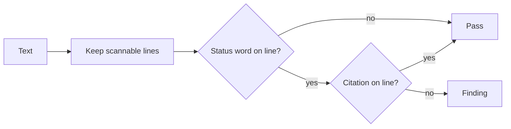

## Purpose

The shared pattern module for the citation check. It is a helper, not a hook. Its one caller is [pre_tool_write_scan_claims](pre_tool_write_scan_claims.md). The module once named a second caller, the validate-for-write helper, which has been removed. {src:hooks/claim_patterns.py:9}

## Dependencies

**Depends on.** Standard library `re` only. {src:hooks/claim_patterns.py:17}

**Used by.** Product code: `hooks/pre_tool_write_scan_claims.py` imports `scan_for_uncited_claims`. {src:hooks/pre_tool_write_scan_claims.py:88} Tests: `tests/hooks/test_vault_hooks.py` runs the hook that imports it (class `ClaimHook`). {src:tests/hooks/test_vault_hooks.py:74} `tests/hooks/check_hook_inventory.py` lists the file as a helper, so it is not expected to be wired in `settings.json`. {src:tests/hooks/check_hook_inventory.py:49} Searched `hooks/`, `tests/`, `settings.json` and `installer/` on 2026-11-19 for `claim_patterns`; no other importer. There is no page for `test_vault_hooks` yet.

## Behavior

- `STATUS_PATTERN` matches four whole words, the upper-case forms of done, shipped, approved and complete. It has no ignore-case flag, so the lowercase forms never match. {src:hooks/claim_patterns.py:21}
- `CITATION_PATTERN` matches `(source: ...)` with at least one character before the closing bracket, or the start of `(unverified`. It ignores case. {src:hooks/claim_patterns.py:27-29}
- `strip_to_scannable` returns `(line number, line)` pairs for the lines worth scanning. It skips:
  - YAML frontmatter, only when the first line of the text is `---`; everything up to and including the next `---` line is skipped. {src:hooks/claim_patterns.py:51-60}
  - Fenced blocks. Any line starting with three backticks or three tildes flips an in-fence flag, so the two fence kinds are not matched to each other. {src:hooks/claim_patterns.py:63-68}
  - Table separator rows: a line with two or more `|` made only of `|`, `-`, `:` and spaces. {src:hooks/claim_patterns.py:71-72}
- `has_citation` is true when `CITATION_PATTERN` is found anywhere on the line. {src:hooks/claim_patterns.py:81}
- `scan_for_uncited_claims` takes a list of texts and returns `(line number, matched word)` for lines that hold a status word and no citation. It reports only the first status word on a line. Line numbers count within each text, and the result does not say which text a finding came from. {src:hooks/claim_patterns.py:90-94}

## Diagram

## Notes

- Changing the status words or the citation forms here changes the caller at once. {src:hooks/pre_tool_write_scan_claims.py:88}
- The docstring of `strip_to_scannable` says frontmatter is "between the first --- pair". The code only treats frontmatter as such when `---` is the first line of the text; a `---` pair later in the text is not skipped. {src:hooks/claim_patterns.py:37} {src:hooks/claim_patterns.py:51}
- When the caller scans an Edit, the text is only the new fragment, so a first line of `---` inside a fragment starts a skipped YAML region that lasts until the next `---` line or the end of the fragment. {src:hooks/pre_tool_write_scan_claims.py:50}
- No input here reaches a file path, a command or the network, and the module writes nothing, so there is no shared-file write to lock.
