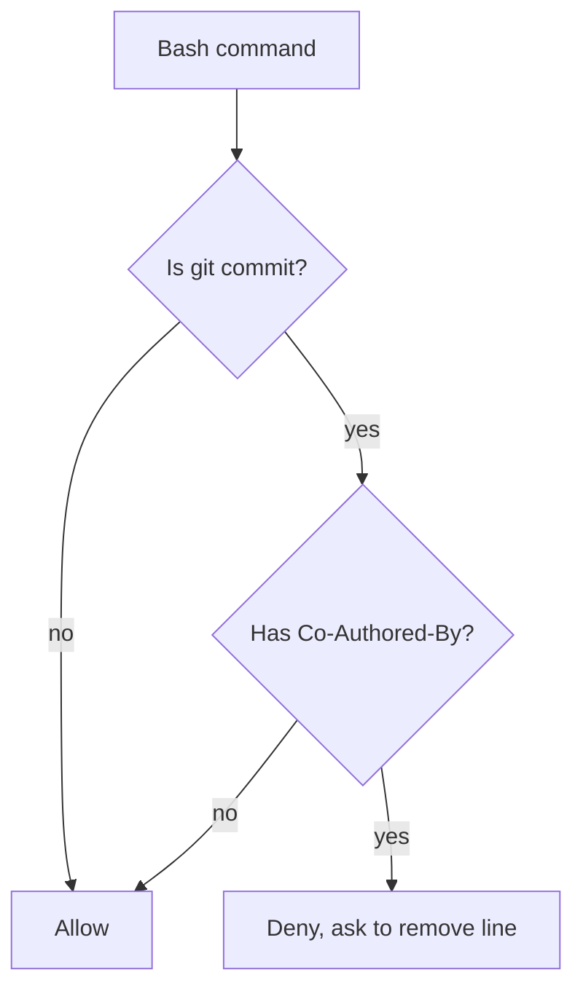

## Purpose

A PreToolUse hook for Bash. It denies a `git commit` whose command text contains a Co-Authored-By line, so no AI attribution reaches a commit. {src:hooks/co_authored_by_check.sh:1-14}

## Dependencies

bash, python3, grep. No environment variables. Tests: `tests/hooks/test_git_hooks.py` (HOK-02, HOK-04).

## Behavior

The hook reads `tool_input.command`. It acts only on `git commit` and `git -C <path> commit`. If the text holds `Co-Authored-By` in any letter case, it prints a deny and exits 0, and the model removes the line and retries. A command that only mentions the phrase (for example an `echo`) is allowed. {src:hooks/co_authored_by_check.sh:27-37}

## Diagram: module level (L2, required)

