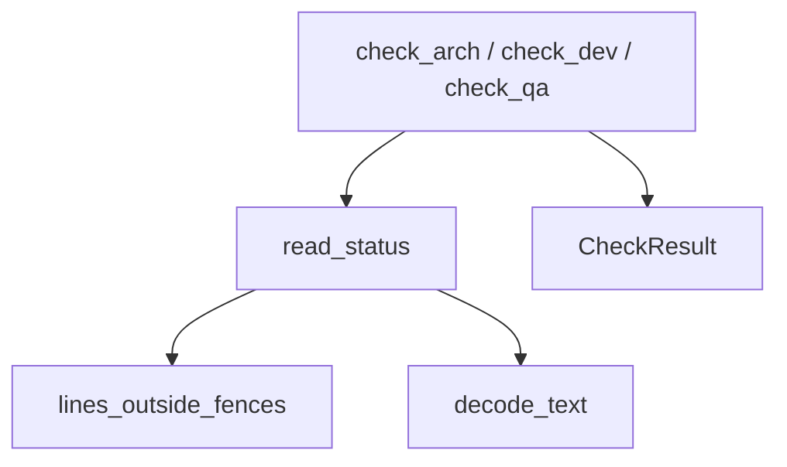

## Purpose

Pure functions that decide whether a chain skill may start. They take file text and return a verdict. They do no file reads, no hook framing and no environment reads, so a hook, a skill or a test can all call them and get the same answer. {src:hooks/gate_rules.py:1}

## Dependencies

Standard library only (`re`, `dataclasses`, `typing`). Nothing else in `hooks/` imports it yet. Tests: [test_gate_rules](../tests/hooks/test_gate_rules.md).

## Behavior

Status line: a top-level line that starts with `Status:` followed by one value, as in the spec file. The dated `Approved` and `Validated` lines are no longer read. {src:hooks/gate_rules.py:138-142}

Lines inside fenced code blocks never count. Fences follow CommonMark: a fence opens with 3 or more backticks or tildes (up to 3 spaces of indent) and closes only with the same character, at least as many markers and no info text. A tilde line does not close a backtick fence, a shorter run does not close a longer one, and a closing line with info text does not close. An unclosed fence hides the rest. {src:hooks/gate_rules.py:93-95} {src:hooks/gate_rules.py:104} {src:hooks/gate_rules.py:116-123}

Text handling: lines split only on LF and CRLF (U+2028 and a lone CR do not split). A leading BOM is stripped when decoding, so it cannot hide `Status:`. {src:hooks/gate_rules.py:84} {src:hooks/gate_rules.py:79}

`read_status` returns the first top-level `Status:` value from str or bytes. Malformed: missing, non UTF-8, empty, no `Status:` line, empty value, or two different values. {src:hooks/gate_rules.py:133-149}

Checks return `CheckResult(ok, reason)`. The reason names the file (`spec.md`, `design.md`, `edge-case-validation.md`, state file) and the expected line or values, never file contents. It does not print the `Status:` value found in the file.

| Skill | Passes when |
|---|---|
| arch | spec has `Status: APPROVED` {src:hooks/gate_rules.py:191}, and state is `SPEC_APPROVED` {src:hooks/gate_rules.py:192} |
| dev | design has `Status: DESIGN_APPROVED`, and state is `DESIGN_APPROVED` or `IN_DEV` |
| qa | state is `DEV_COMPLETE` {src:hooks/gate_rules.py:213}, spec is `APPROVED` {src:hooks/gate_rules.py:214}, design is `DESIGN_APPROVED` {src:hooks/gate_rules.py:215}, and the validation file has `Status: DOCUMENTED` or `VALIDATED` {src:hooks/gate_rules.py:38} |

## Diagram: module level (L2, required)

## Notes

A missing file is passed as `None` and reported as missing. The old state `DESIGN_COMPLETE` no longer lets dev through.
