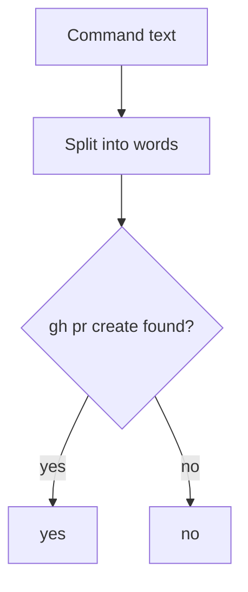

## Purpose

A small helper. It reads a Bash command from stdin and prints `yes` if the command really runs the GitHub CLI pull request create command, and `no` if the phrase only appears in text such as a commit message. {src:hooks/gh_pr_create_detect.py:1-12}

## Dependencies

Standard library only: `os`, `re`, `shlex`, `sys`. Not wired in `settings.json`. The PR gate hook `pre-tool-bash-gate-pr-create` (no doc page) holds its own copy of this logic.

## Behavior

The command is split into shell words. A `gh` word followed by `pr` and `create` counts {src:hooks/gh_pr_create_detect.py:70}, with `-R`, `--repo` and `--hostname` skipped {src:hooks/gh_pr_create_detect.py:46-48}. Scripts passed to `bash -c`, `eval` or a substitution are checked up to three levels deep {src:hooks/gh_pr_create_detect.py:72-74}. If the command cannot be parsed, a text match decides, so it fails closed. {src:hooks/gh_pr_create_detect.py:82-83}

## Diagram: module level (L2, required)

