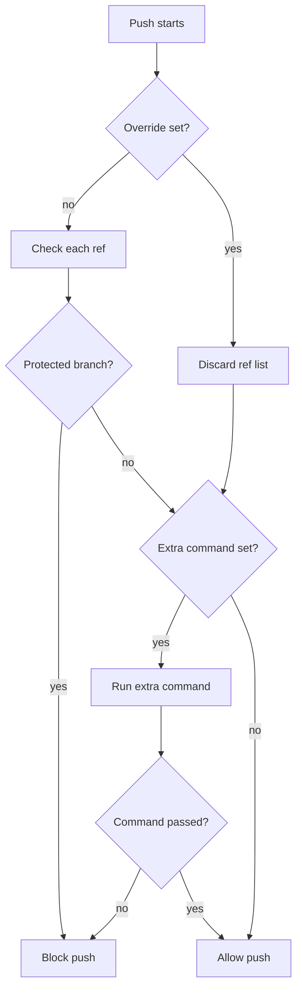

## Purpose

`hooks/git-pre-push` is a git pre-push hook (not a Claude Code hook). Git runs it before a push leaves the machine. It refuses a direct push to a protected branch, and it can run one extra command of the owner's choosing before every push. It exists so that work reaches `main` through a pull request, even when the push is typed by hand in a terminal and no Claude Code hook is watching.

## Dependencies

**Depends on.**
- `bash` and `cat`. No other program is called by name; the extra command (see Behavior) is whatever the owner sets.
- Environment variables: `TOLLGATE_PROTECTED_BRANCHES`, `TOLLGATE_ALLOW_PROTECTED_PUSH`, `TOLLGATE_PRE_PUSH_CMD`.
- `git`, which calls the hook and feeds it one line per ref on stdin {src:hooks/git-pre-push:22-23}.

**Related, not a dependency.** The Claude-side push guard in push mode of [[git_ask_before_run]] ([git_ask_before_run](git_ask_before_run.md)) applies the same two environment variables to pushes that Claude Code runs.

**Used by.**
- Product code: nothing wires it. It is not in `settings.json` (searched `settings.json`, `install.sh`, `scripts/`, `hooks/`, 2026-11-20). `install.sh` has no line naming `pre-push` (searched 2026-11-20). The header says to copy or symlink it to `.git/hooks/pre-push` or use `core.hooksPath` {src:hooks/git-pre-push:10}, so installation is manual.
- The hook inventory check lists it as a helper that need not be wired {src:tests/hooks/check_hook_inventory.py:39-46}.
- Tests: `tests/hooks/test_guard_hooks.py` class `GitPrePush` {src:tests/hooks/test_guard_hooks.py:157-162}; `tests/hooks/test_security_fixes.py` class `PrePushRiskDocumented` {src:tests/hooks/test_security_fixes.py:391-398}.

## Behavior

1. Strict mode is `-u` and `pipefail` but not `-e` {src:hooks/git-pre-push:25}, so a failing command does not end the script by itself; only the explicit `exit` lines do.
2. The protected list is `TOLLGATE_PROTECTED_BRANCHES`, default `main master` {src:hooks/git-pre-push:27}.
3. If `TOLLGATE_ALLOW_PROTECTED_PUSH` is exactly `1`, the branch check is skipped and stdin is drained with `cat` {src:hooks/git-pre-push:29} {src:hooks/git-pre-push:41-43}. Any other value, including `true` or `yes`, leaves the check on.
4. Otherwise each stdin line is read as four fields; a line with an empty remote ref is skipped {src:hooks/git-pre-push:30-31}. The remote ref has `refs/heads/` stripped {src:hooks/git-pre-push:32} and is compared for exact equality with each protected name {src:hooks/git-pre-push:33-34}.
5. On the first match the hook prints two lines to stderr and exits 1, which makes git abort the push {src:hooks/git-pre-push:35-37}. The local sha field is discarded {src:hooks/git-pre-push:30}, so deleting a protected branch on the remote is blocked the same way as updating it.
6. After the branch check (and also when the override is set), a non-empty `TOLLGATE_PRE_PUSH_CMD` is run with `bash -c` {src:hooks/git-pre-push:45-46}. A non-zero exit prints a message and exits 1 {src:hooks/git-pre-push:47-48}. The override therefore does not skip the extra command.
7. If nothing blocked, the hook exits 0 {src:hooks/git-pre-push:52}.
8. Git skips pre-push hooks when the push is run with `--no-verify` {src:docs:githooks(5)}. This hook cannot prevent that.

## Diagram

## Notes

**Code and description disagree.**
- The header says `TOLLGATE_ALLOW_PROTECTED_PUSH` allows a protected push "once" {src:hooks/git-pre-push:13}. The code reads the variable on every push {src:hooks/git-pre-push:29}; nothing makes it one-shot. If it is exported in a shell profile it allows every protected push.
- The header says protected branches are space separated {src:hooks/git-pre-push:12}, and the code splits on whitespace only (unquoted expansion) {src:hooks/git-pre-push:33}. The Claude-side guard also accepts commas {src:hooks/git_ask_before_run.py:253}. A value such as `main,master` works there and is read here as one name that matches no branch, so the hook lets the push through.
- The header says git passes the remote name and URL as `$1` and `$2` {src:hooks/git-pre-push:22}. The script never reads them (read in full, 2026-11-20), so a push to any remote is checked the same way.

**Inputs that reach a command or a pattern without a check.**
- `TOLLGATE_PRE_PUSH_CMD` is run as a shell command with the owner's privileges on every push, with no check on its value {src:hooks/git-pre-push:46}. The header documents this risk {src:hooks/git-pre-push:16-21}. There is no timeout, so a command that hangs hangs the push.
- `TOLLGATE_PROTECTED_BRANCHES` is expanded unquoted in `for blocked in $PROTECTED` {src:hooks/git-pre-push:33}. Besides word splitting, shell filename expansion applies: an entry with `*` or `?` is replaced by file names from the current directory when any match, and is otherwise compared as a literal string. Branch names are compared by equality only {src:hooks/git-pre-push:34}, so a pattern like `release/*` does not protect the release branches.
- The branch name from the pushed ref is printed inside a quoted `echo` argument {src:hooks/git-pre-push:35}. It is only displayed, never run.

**Writes to shared files.** None. The hook writes only to stderr.

**Limits.** Only `refs/heads/` refs are meaningfully compared; a tag ref such as `refs/tags/main` keeps its full name after the strip {src:hooks/git-pre-push:32} and is not blocked. Installation is manual and per repository, so a clone without the hook has no protection.
