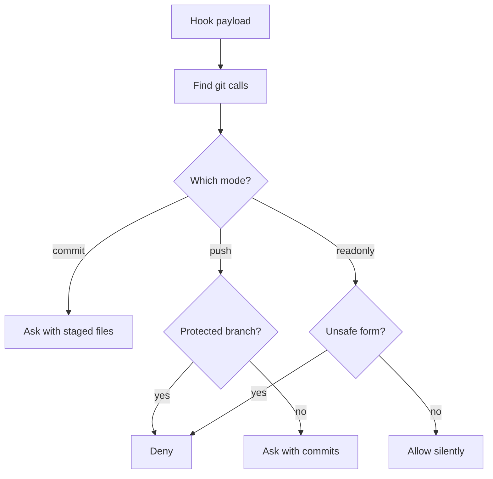
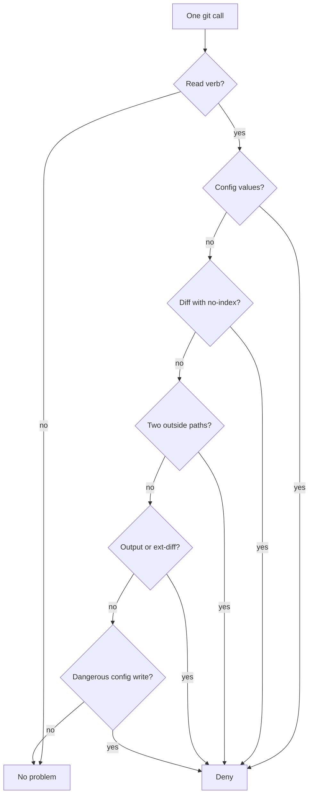

## Purpose

The shared helper behind the three git guards. It reads the hook payload, finds every git call in the Bash command, and then does one of three jobs: ask the user before a commit, ask before a push (and deny a push to a protected branch), or deny the git forms that can run a program, write a file or print any file on disk while the command would otherwise be auto-approved.

## Dependencies

**Depends on.** Standard library only: `json`, `logging`, `os`, `re`, `shlex`, `subprocess`, `sys`, `typing`. It runs `git` with a 5 second limit and no shell {src:hooks/git_ask_before_run.py:42} {src:hooks/git_ask_before_run.py:220-221}. It reads the environment variables `TOLLGATE_PROTECTED_BRANCHES` {src:hooks/git_ask_before_run.py:252} and `TOLLGATE_ALLOW_PROTECTED_PUSH` {src:hooks/git_ask_before_run.py:444}.

**Used by.** Product code, each through a one line `exec` that passes the mode:
- [git_commit_guard](git_commit_guard.md), mode `commit` {src:hooks/git_commit_guard.sh:18}
- [git_push_guard](git_push_guard.md), mode `push` {src:hooks/git_push_guard.sh:18}
- [git_readonly_guard](git_readonly_guard.md), mode `readonly` {src:hooks/git_readonly_guard.sh:20}

The inventory check lists the file by name {src:tests/hooks/check_hook_inventory.py:47}.

Tests: [test_security_fixes](../tests/hooks/test_security_fixes.md) imports it as `gar` and calls `git_calls` {src:tests/hooks/test_security_fixes.py:29} {src:tests/hooks/test_security_fixes.py:131} and `config_write_key` {src:tests/hooks/test_security_fixes.py:200}. [test_git_hooks](../tests/hooks/test_git_hooks.md) runs it through the wrapper scripts {src:tests/hooks/test_git_hooks.py:69}. [test_git_readonly_no_index](../tests/hooks/test_git_readonly_no_index.md) covers the `--no-index` and outside-repo diff denials {src:tests/hooks/test_git_readonly_no_index.py:28} {src:tests/hooks/test_git_readonly_no_index.py:60} {src:tests/hooks/test_git_readonly_no_index.py:71} {src:tests/hooks/test_git_readonly_no_index.py:79}.

## Behavior

**Entry point.** The script takes exactly one argument, `commit`, `push` or `readonly`. Anything else prints a usage line and exits 2 {src:hooks/git_ask_before_run.py:457-459}. A payload that is not JSON, or JSON that is not an object, exits 2 {src:hooks/git_ask_before_run.py:461-467}. When no decision is needed it prints nothing and exits 0 {src:hooks/git_ask_before_run.py:469-470}. Otherwise it prints one JSON decision, `ask` or `deny`, and exits 0 {src:hooks/git_ask_before_run.py:471-477}. Any error that escapes `main` also exits 2, so the hook fails closed {src:hooks/git_ask_before_run.py:481-486}.

**Finding git calls.** `git_calls` cuts the command at control operators, strips leading wrappers, and parses each piece as `git [global options] verb args` {src:hooks/git_ask_before_run.py:196-201}. It also looks inside `sh -c` and similar shell strings {src:hooks/git_ask_before_run.py:204-208}, inside `eval` {src:hooks/git_ask_before_run.py:209-210}, and inside `$( )` {src:hooks/git_ask_before_run.py:211-213}, to a depth of 5 {src:hooks/git_ask_before_run.py:194-195}. Newlines and backticks count as separators {src:hooks/git_ask_before_run.py:88}. If the quotes do not balance, a crude split on operators is used, so detection stays on {src:hooks/git_ask_before_run.py:93-98}.

**Wrapper prefixes.** `strip_prefixes` skips `VAR=value` words, shell keywords such as `then` and `do`, and the wrappers `env`, `sudo`, `nice`, `timeout`, `command`, `exec`, `nohup`, `time` and `builtin`, with their option values {src:hooks/git_ask_before_run.py:139-143} {src:hooks/git_ask_before_run.py:150-154}. For `env`, a split string given as `-S STRING`, `-SSTRING`, `--split-string STRING` or `--split-string=STRING` is cut into words and put back into the segment, so `env -S "git push"` is seen as a push {src:hooks/git_ask_before_run.py:120-130} {src:hooks/git_ask_before_run.py:146-149}. For that to work, `-S` is not in the list of `env` options that take a separate value {src:hooks/git_ask_before_run.py:54}.

**Parsing one git call.** Global options `-c` and `--config-env` (also in the `=` form) are collected as config values, `-C` sets the repository path, other value-taking globals are skipped with their value, and the first word without a dash is the verb {src:hooks/git_ask_before_run.py:171-187}. Any other word that starts with a dash is skipped {src:hooks/git_ask_before_run.py:184-185}.

**Commit mode.** When the command holds a `commit` call, the answer is always `ask`. The text names the repository, the branch, up to 15 staged files, and the draft message {src:hooks/git_ask_before_run.py:298-300} {src:hooks/git_ask_before_run.py:41}. The message is the first `-m` value when the line parses; if it is missing or holds `$(`, the text says the message is built inline {src:hooks/git_ask_before_run.py:234-237} {src:hooks/git_ask_before_run.py:297}. The raw command is added at the end {src:hooks/git_ask_before_run.py:321}.

**Push mode.** For each push call the hook works out the target branch names: the words after the remote, the part after `:` in a refspec, `HEAD` replaced by the current branch, `refs/heads/` removed, and the current branch when no refspec is given {src:hooks/git_ask_before_run.py:268-277}. `--all` and `--mirror` count as touching every branch {src:hooks/git_ask_before_run.py:258} {src:hooks/git_ask_before_run.py:284-285}. If a target is in the protected list, the hook denies, unless `TOLLGATE_ALLOW_PROTECTED_PUSH` is exactly `1` {src:hooks/git_ask_before_run.py:444-451}. The default protected list is `main master`; the variable may use spaces or commas {src:hooks/git_ask_before_run.py:40} {src:hooks/git_ask_before_run.py:253}. Any other push gets an `ask` showing the branch, the commits not yet on the remote (or the latest 5 when there is no upstream), and a warning when a force flag is present {src:hooks/git_ask_before_run.py:305-315} {src:hooks/git_ask_before_run.py:43}.

**Readonly mode.** Only `diff`, `log`, `show`, `status` and `config` calls are looked at {src:hooks/git_ask_before_run.py:324} {src:hooks/git_ask_before_run.py:403-404}. The hook denies, and the first problem found stops the scan {src:hooks/git_ask_before_run.py:428-431}:
1. any `-c` or `--config-env` value on those verbs {src:hooks/git_ask_before_run.py:405-406};
2. `git diff --no-index`, including `--no-index=...` and any abbreviation of at least 7 characters (`--no-in` and longer) {src:hooks/git_ask_before_run.py:408-409} {src:hooks/git_ask_before_run.py:365-372};
3. a `git diff` whose first two path words are both outside the repository, because git then compares them as if `--no-index` was given and prints any file on disk {src:hooks/git_ask_before_run.py:410-411} {src:hooks/git_ask_before_run.py:386-398};
4. `--output` or `--output=` on `diff`, `log` and `show` {src:hooks/git_ask_before_run.py:412-415};
5. `--ext-diff` on the same three {src:hooks/git_ask_before_run.py:416-417};
6. a `git config` write of an unknown key or a key on the dangerous list {src:hooks/git_ask_before_run.py:418-421}.

**How "outside the repository" is decided.** The repository top comes from `git rev-parse --show-toplevel` run in the `-C` folder, or the payload `cwd` {src:hooks/git_ask_before_run.py:395-396}. A path counts as outside when it holds `$` or starts with a backtick {src:hooks/git_ask_before_run.py:377-378}, when the top is unknown (not a repository, or the git call failed) {src:hooks/git_ask_before_run.py:380-381}, or when its resolved form is not the top or below it {src:hooks/git_ask_before_run.py:379} {src:hooks/git_ask_before_run.py:382-383}. Fewer than two path words means no deny {src:hooks/git_ask_before_run.py:393-394}.

**Config writes.** `config_write_key` decides whether `git config` arguments write. The subcommands `get` and `list` read; `set`, `unset`, `edit`, `rename-section` and `remove-section` write; otherwise a write flag, or two or more positional words, means a write, and a read flag returns early {src:hooks/git_ask_before_run.py:342-345} {src:hooks/git_ask_before_run.py:349-361}. The dangerous key list covers keys that make git run a program: `core.pager`, `core.fsmonitor`, `core.sshcommand`, `alias.*`, `filter.*`, `include*`, `url.*`, `http.*` and more {src:hooks/git_ask_before_run.py:329-333}. It also covers `difftool`, `mergetool`, `browser` and `man` keys ending in `.cmd` or `.path`, `web.browser`, `interactive.diffFilter`, `trailer.*.cmd` and `trailer.*.command`, and `core.alternateRefsCommand` {src:hooks/git_ask_before_run.py:334-335}. Matching ignores letter case {src:hooks/git_ask_before_run.py:335}.

## Diagram: module level (L2, required)

## Diagram: function level (L3, optional)

The readonly check has the most branches, so it gets the diagram.

## Notes

**Where the code and its own description disagree.**
- The header says push mode "asks before every git push" {src:hooks/git_ask_before_run.py:7}. It asks once per command, not once per push call: with several `git push` calls in one line, only the first call's repository is used in the text {src:hooks/git_ask_before_run.py:443} {src:hooks/git_ask_before_run.py:452}. The protected branch check does loop over every call {src:hooks/git_ask_before_run.py:445-447}.
- The header names two callers, `git_commit_guard.sh` and `git_push_guard.sh` {src:hooks/git_ask_before_run.py:23}. A third wrapper calls it with `readonly` {src:hooks/git_readonly_guard.sh:20}. That wrapper's own header does not mention the `--no-index` and outside-repo diff checks that the code now makes {src:hooks/git_readonly_guard.sh:3-6} {src:hooks/git_ask_before_run.py:408-411}.
- The condition `base not in ("git",)` can never be false, because `git` is not a key of the wrapper table {src:hooks/git_ask_before_run.py:141} {src:hooks/git_ask_before_run.py:53-63}. It does no harm.

**Inputs that reach a command or outbound text without a check.**
- The `-C` path, or the payload `cwd`, is passed as an argument to `git -C` in `run_git`. There is no shell, so no injection, but the value is not checked {src:hooks/git_ask_before_run.py:220} {src:hooks/git_ask_before_run.py:443}.
- The raw command is copied into the approval text with no cleaning {src:hooks/git_ask_before_run.py:321}. That text goes to the user's approval prompt.
- `TOLLGATE_PROTECTED_BRANCHES` is not validated. Set to an empty string, it gives an empty list, so no branch is protected {src:hooks/git_ask_before_run.py:252-253}.
- Diff path words are only resolved and compared, never opened {src:hooks/git_ask_before_run.py:379}.

**Limits.**
- This is a speed bump on the command text, not a sandbox. A git call hidden in a script file, an alias, a variable that expands later, or other indirection is not seen. The wrapper header says so {src:hooks/git_readonly_guard.sh:15}.
- The outside-repo check looks only at the first two words that do not start with a dash {src:hooks/git_ask_before_run.py:392} {src:hooks/git_ask_before_run.py:397}. An option whose value is a separate word would count as a path word and could shift the pair. Not run to confirm; tagged `[uncertain]`.
- Only a `-m` value is read for the draft message. A combined form such as `-am "text"` is not matched, so the text says the message is built inline {src:hooks/git_ask_before_run.py:235} {src:hooks/git_ask_before_run.py:297}.

**Writes to shared files.** None. The module writes only to stdout and stderr. Searched 2026-11-21: `hooks/git_ask_before_run.py` for `open(`, `write_text` and `os.replace`; no match.

**Constants.** The module has 23 module level constants. Tests read none by name (searched 2026-11-21 under `tests/` for `gar.` attributes; only `git_calls` and `config_write_key` appear), so none is listed in `exports`.
