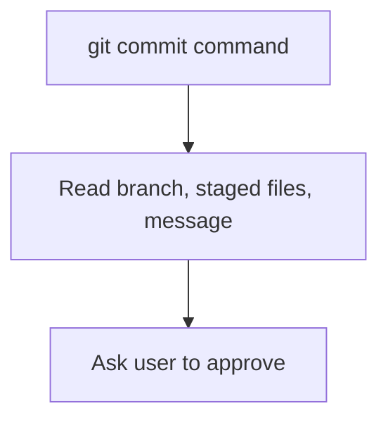

## Purpose

A PreToolUse hook for Bash. It stops a `git commit` and asks the user to approve it, showing the staged files and the draft message. {src:hooks/git_commit_guard.sh:1-12}

## Dependencies

bash, python3. Calls `hooks/git_ask_before_run.py` in commit mode. Tests: `tests/hooks/test_git_hooks.py` (HOK-02, HOK-04).

## Behavior

The script only runs the helper in commit mode {src:hooks/git_commit_guard.sh:18}. The helper finds a `git commit` call anywhere in the command, including after `env`, `VAR=value` words or other wrappers, with global options such as `-C <path>`, and inside `bash -c`, `eval` or `$( )` {src:hooks/git_ask_before_run.py:196-213}. It prints an ask with the branch, up to 15 staged files, the `-m` message when it can be read, and the raw command {src:hooks/git_ask_before_run.py:298-300} {src:hooks/git_ask_before_run.py:321}. It asks in every repo. Other commands print nothing and exit 0 {src:hooks/git_ask_before_run.py:441-442} {src:hooks/git_ask_before_run.py:469-470}. A payload that cannot be read, or an unexpected error, exits 2 and blocks the command {src:hooks/git_ask_before_run.py:462-467} {src:hooks/git_ask_before_run.py:483-486}.

The wrapper header says "exit 2 on unreadable input" {src:hooks/git_commit_guard.sh:12}, which matches the code: the script hands over to the helper with `exec`, so the helper's exit code is the hook's, and that code is 2 for bad input. Details: [git_ask_before_run](git_ask_before_run.md).

## Diagram: module level (L2, required)

