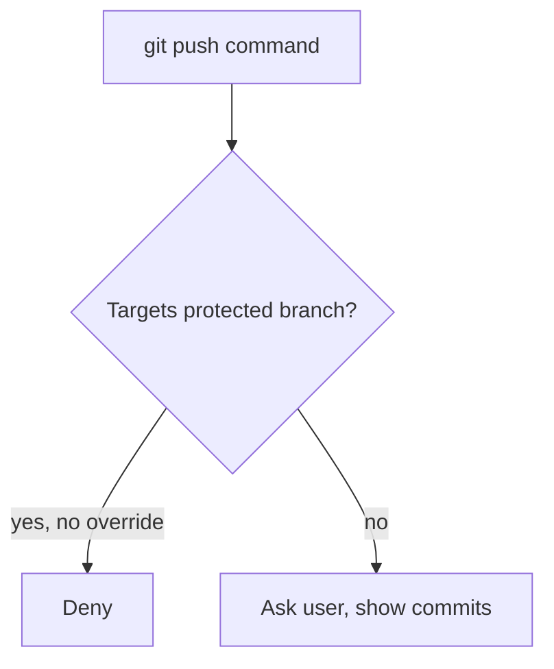

## Purpose

A PreToolUse hook for Bash. It stops a `git push` and asks the user to approve it, and it denies a push to a protected branch outright. {src:hooks/git_push_guard.sh:1-10}

## Dependencies

bash, python3. Calls `hooks/git_ask_before_run.py` in push mode. Reads `TOLLGATE_PROTECTED_BRANCHES` (default `main master`) and `TOLLGATE_ALLOW_PROTECTED_PUSH`. Tests: `tests/hooks/test_git_hooks.py` (HOK-02, HOK-04).

## Behavior

**Protected branch.** The hook finds the branch the push targets: the name after the remote, the part after `:` in a refspec, `HEAD` as the current branch, or the current branch when none is given. If it is on the protected list, or the push uses `--all` or `--mirror`, the hook prints a deny and exits 0. {src:hooks/git_ask_before_run.py:268-277} {src:hooks/git_ask_before_run.py:284-288} {src:hooks/git_ask_before_run.py:448-451}

**Override.** Set `TOLLGATE_ALLOW_PROTECTED_PUSH=1` outside Claude to turn the deny into the normal ask. {src:hooks/git_ask_before_run.py:444} {src:hooks/git_ask_before_run.py:452}

**Any other push.** The hook prints an ask that shows the branch, the commits going out, and a warning when a force flag is present. {src:hooks/git_ask_before_run.py:305-315}

**Other commands** print nothing and exit 0 {src:hooks/git_ask_before_run.py:441-442} {src:hooks/git_ask_before_run.py:469-470}. Bad input, or an unexpected error, exits 2 and blocks the command {src:hooks/git_ask_before_run.py:462-467} {src:hooks/git_ask_before_run.py:483-486}. The wrapper header says "exit 2 on unreadable input" {src:hooks/git_push_guard.sh:12}, which matches the code: the script hands over to the helper with `exec` {src:hooks/git_push_guard.sh:18}, so the helper's code is the hook's.

The helper finds a `git push` call anywhere in the command, including after `env` or `VAR=value` words and inside `bash -c`, `eval` or `$( )` {src:hooks/git_ask_before_run.py:196-213}. Details: [git_ask_before_run](git_ask_before_run.md).

## Diagram: module level (L2, required)

