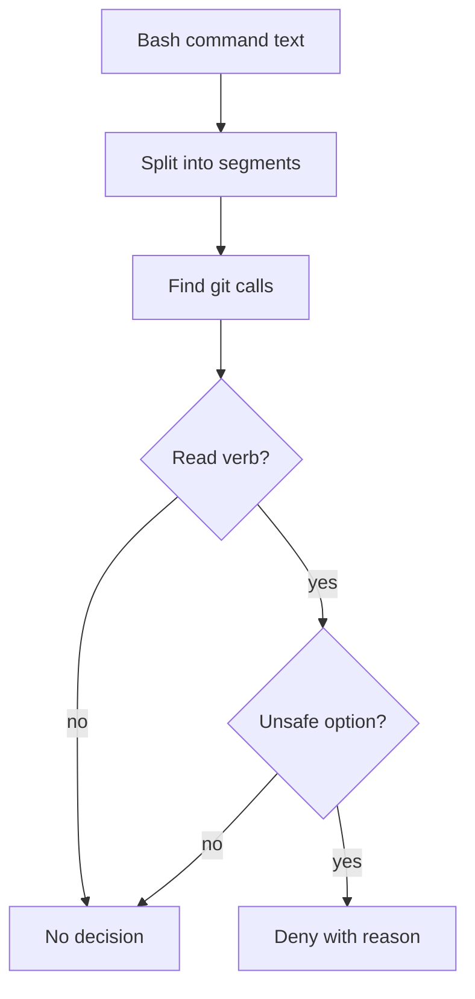

## Purpose

`hooks/git_readonly_guard.sh` is a Claude Code PreToolUse hook for Bash commands. The permission list in `settings.json` auto-approves `git status`, `git log`, `git diff` and a few read forms of `git config` without asking {src:settings.json:263-270}. Some options on those commands can run a program or write a file. This hook denies those options, so the auto-approval cannot be used to run code. The shell file is only a launcher; the decision logic lives in the `readonly` mode of [[git_ask_before_run]] ([git_ask_before_run](git_ask_before_run.md)).

## Dependencies

**Depends on.**
- `bash`, and `python3` found on `PATH` (the script does not pin an interpreter) {src:hooks/git_readonly_guard.sh:20}.
- [[git_ask_before_run]] ([git_ask_before_run](git_ask_before_run.md)), which holds all the logic {src:hooks/git_readonly_guard.sh:20}.
- The auto-approve entries in `settings.json` {src:settings.json:263-270}; the hook only has a purpose because of them.

**Used by.**
- Product code: `settings.json` runs it in the PreToolUse group whose matcher is `Bash` {src:settings.json:129} {src:settings.json:153}, last in that group, with `onFailure` set to `block` {src:settings.json:154}.
- Tests: `tests/hooks/test_security_fixes.py` class `ReadonlyGuardTests` {src:tests/hooks/test_security_fixes.py:148-152}, the wiring check {src:tests/hooks/test_security_fixes.py:241-243}, and the bad payload check {src:tests/hooks/test_security_fixes.py:207-208}; `tests/hooks/test_git_hooks.py` fail-closed loop {src:tests/hooks/test_git_hooks.py:88-94}.

## Behavior

The shell file sets strict mode {src:hooks/git_readonly_guard.sh:17}, works out its own folder {src:hooks/git_readonly_guard.sh:19}, and replaces itself with `python3 git_ask_before_run.py readonly` {src:hooks/git_readonly_guard.sh:20}. The Python side then does the following.

1. A call with anything other than exactly one mode argument of `commit`, `push` or `readonly` returns 2 {src:hooks/git_ask_before_run.py:457-459}. Stdin that is not JSON, or JSON that is not an object, also returns 2 {src:hooks/git_ask_before_run.py:460-467}. Any unexpected exception returns 2 {src:hooks/git_ask_before_run.py:481-486}.
2. The command text is `tool_input.command`; a missing command is treated as empty text, which finds no git call and allows {src:hooks/git_ask_before_run.py:425-428}.
3. The text is split into shell segments at `;`, `&`, `|`, `(` and `)`; newlines and backticks count as separators {src:hooks/git_ask_before_run.py:88} {src:hooks/git_ask_before_run.py:101-109}. Leading `VAR=value` words, shell keywords and wrappers such as `env` and `sudo` are dropped {src:hooks/git_ask_before_run.py:133-159}; an `env -S STRING` split string is cut into words and put back in the segment first {src:hooks/git_ask_before_run.py:146-149}. Each segment is parsed as `git [global options] verb args`, collecting every `-c` and `--config-env` value {src:hooks/git_ask_before_run.py:162-188}.
4. Calls hidden inside `sh -c`, `bash -c`, `eval` and `$( )` are parsed too {src:hooks/git_ask_before_run.py:204-213}, down to a nesting depth of 5 {src:hooks/git_ask_before_run.py:194-195}.
5. Only the verbs `diff`, `log`, `show`, `status` and `config` are examined {src:hooks/git_ask_before_run.py:324} {src:hooks/git_ask_before_run.py:403-404}. For those verbs the hook denies:
   - any `-c` or `--config-env`, whatever the key {src:hooks/git_ask_before_run.py:405-406};
   - `--output` (also `--output=...`) on diff, log and show {src:hooks/git_ask_before_run.py:412-415};
   - `--ext-diff` on diff, log and show {src:hooks/git_ask_before_run.py:416-417};
   - a `git config` write whose key matches the dangerous list, or whose key cannot be worked out {src:hooks/git_ask_before_run.py:418-421}. The list covers `core.fsmonitor`, `core.pager`, `core.sshCommand`, `core.editor`, `core.hooksPath`, `diff.external`, textconv and command keys, aliases, credential, filter, include, url and http keys, and more {src:hooks/git_ask_before_run.py:330-333}. A later change added `difftool`, `mergetool`, `browser` and `man` keys ending in `.cmd` or `.path`, `web.browser`, `interactive.diffFilter`, `trailer.*.cmd` and `trailer.*.command`, and `core.alternateRefsCommand` {src:hooks/git_ask_before_run.py:334-335}.
6. A config call counts as a write when it uses a write flag or the `set`, `unset`, `edit` forms, or gives a key and a value {src:hooks/git_ask_before_run.py:340-362}. Read forms (`--get`, `--list`, `get`, `list`) are not writes {src:hooks/git_ask_before_run.py:342-343} {src:hooks/git_ask_before_run.py:356-357}.
7. On a problem the hook prints one JSON object with a deny decision and a reason that begins `BLOCKED:` and exits 0 {src:hooks/git_ask_before_run.py:336-337} {src:hooks/git_ask_before_run.py:430-431} {src:hooks/git_ask_before_run.py:472-477}. With no problem it prints nothing and exits 0, which leaves the normal permission flow in charge {src:hooks/git_ask_before_run.py:469-470}.

In readonly mode no program is started: `decide_readonly` never calls the git subprocess helper {src:hooks/git_ask_before_run.py:382-388}.

## Diagram

## Notes

**Code and description disagree.**
- The header names `git diff or log` for `--output` and `--ext-diff` {src:hooks/git_readonly_guard.sh:5}. The code also checks `show` {src:hooks/git_ask_before_run.py:412}. `git show` is not in the auto-approve list {src:settings.json:263-270}, so this extra check guards a command that is asked about anyway.
- The header lists six config keys (`core.fsmonitor`, `core.pager`, `core.sshCommand`, `diff.external`, textconv, alias) {src:hooks/git_readonly_guard.sh:6-7}. The code denies a longer list {src:hooks/git_ask_before_run.py:330-335}. A config write to a key outside that list is allowed, for example `user.email` {src:tests/hooks/test_security_fixes.py:186}.
- The header says it denies the ways an auto-approved command "can run a program or overwrite a file" {src:hooks/git_readonly_guard.sh:4}. It checks only the option forms above. It does not look at `GIT_*` environment variables placed before the command: leading `VAR=value` words are dropped without inspection {src:hooks/git_ask_before_run.py:139-140}. Whether a variable such as `GIT_EXTERNAL_DIFF` runs a program on a plain `git diff` is git behavior I did not check [uncertain]. The header already calls the hook a speed bump, not a sandbox {src:hooks/git_readonly_guard.sh:15}.

**Gaps that follow from how it works.**
- Nesting deeper than 5 levels of `sh -c` or `eval` returns no calls, so the hook does not deny it {src:hooks/git_ask_before_run.py:194-195}. Whether the permission list would auto-approve such a wrapped command is decided by Claude Code, not by this hook.
- A command run through a script file, a git alias or a program other than `git` is not seen {src:hooks/git_readonly_guard.sh:15}.
- The launcher uses `exec`, so if `python3` is missing the shell reports its own failure code rather than 2. The repo's settings test requires `onFailure` of `block` on every PreToolUse entry so that a hook that cannot run does not let the command through {src:tests/hooks/test_security_fixes.py:223-227} {src:tests/hooks/check_hook_inventory.py:20-21}.

**Inputs that reach a path, command, address or outbound text.** In readonly mode no input reaches a file path, shell command or network address. The key name from a `git config` write is placed in the deny reason shown to the user and Claude without escaping {src:hooks/git_ask_before_run.py:421}; it is only displayed. In the other modes of the same file the `-C` value or the payload `cwd` is passed as an argument (not through a shell) to a git subprocess with no check on the path {src:hooks/git_ask_before_run.py:220}; that belongs to the page for [[git_ask_before_run]].

**Writes to shared files.** None.
