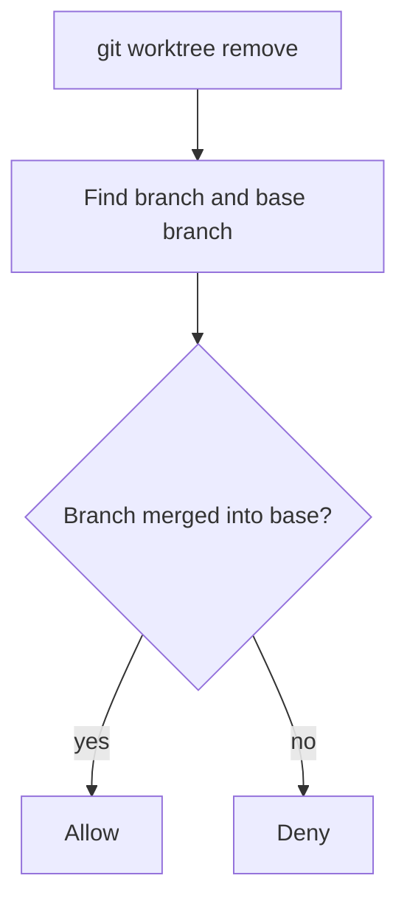

## Purpose

A PreToolUse hook for Bash. It denies `git worktree remove` when the branch checked out in that worktree is not merged into the base branch, so unmerged work is not lost. {src:hooks/guard_worktree_remove.sh:1-10}

## Dependencies

bash, python3, git. Reads `TOLLGATE_PROTECTED_BRANCHES` (default `main master`). Tests: `tests/hooks/test_git_hooks.py` (HOK-02, HOK-04).

## Behavior

The hook takes the last path in the command, then finds the branch checked out there and the main repo folder. The base branch is the first name in `TOLLGATE_PROTECTED_BRANCHES` that exists in the repo. If the branch is an ancestor of the base, the removal is allowed. Otherwise it prints a deny and exits 0. A missing path, a detached HEAD, no base branch, or bad input all allow. {src:hooks/guard_worktree_remove.sh:35-70}

## Diagram: module level (L2, required)

