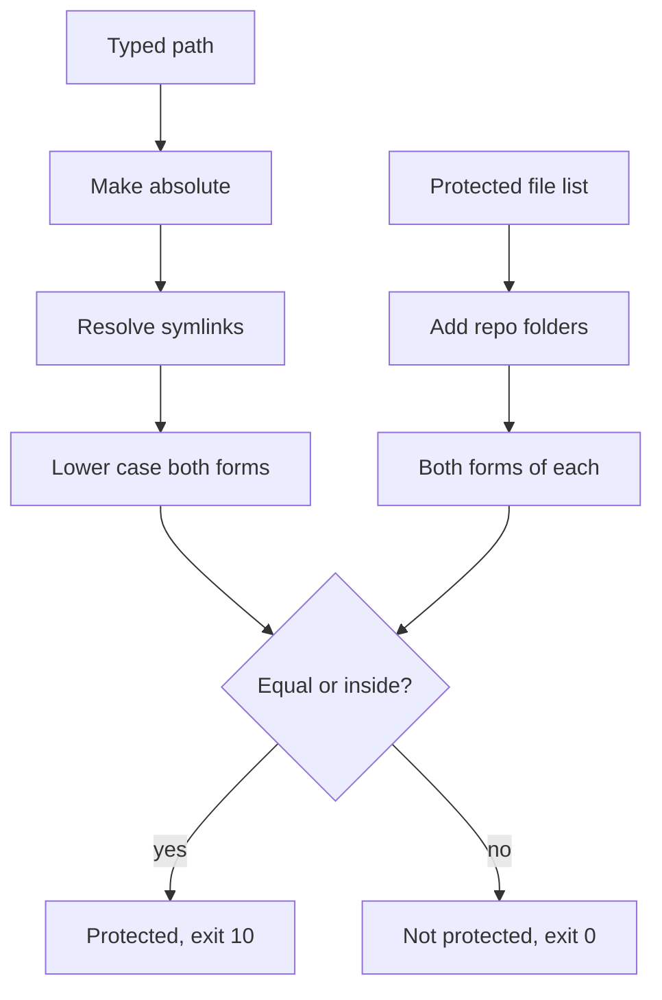

## Purpose

The one shared list of Tollgate's own files that the model must not write: the user settings file, the credentials file, the installer's `~/.claude/tollgate-config` file, the `~/.tollgate` and `~/.claude/tollgate` folders (the second holds the connector state file), the shell profiles, the files named by three environment variables, and the hooks folder and settings file of the Tollgate repo. Two guards use it, one for the Write and Edit tools and one for Bash, so the list lives in one place and cannot drift. It sits in `hooks/lib` because it is a helper, not a hook entry. It decides from a path alone; it never looks at what is written.

## Dependencies

**Depends on.** Standard library only: `os`, `sys`, `typing`. It reads the environment variables `HOME`, `TOLLGATE_HOME` and `CLAUDE_DOTFILES` {src:hooks/lib/protected_paths.py:33-34}, and `TOLLGATE_CONNECTORS`, `TOLLGATE_PATHS` and `TOLLGATE_CONFIG` {src:hooks/lib/protected_paths.py:35}. It reads no file.

**Used by.** Product code:
- [pre-tool-write-guard-path](../pre-tool-write-guard-path.md) runs it as a command, once per write, with the target path {src:hooks/pre-tool-write-guard-path.sh:59}.
- [pre-tool-bash-guard-code-dir](../pre-tool-bash-guard-code-dir.md) imports it as `pp` {src:hooks/pre-tool-bash-guard-code-dir.py:45} and calls `is_protected` {src:hooks/pre-tool-bash-guard-code-dir.py:88}, `protected_roots` {src:hooks/pre-tool-bash-guard-code-dir.py:261}, `dir_root` {src:hooks/pre-tool-bash-guard-code-dir.py:266} and `expand_vars` {src:hooks/pre-tool-bash-guard-code-dir.py:268}.

Tests: no test imports the module. [test_self_protection](../../tests/hooks/test_self_protection.md) checks it through the two guards: the write guard {src:tests/hooks/test_self_protection.py:65} {src:tests/hooks/test_self_protection.py:91} and the Bash guard {src:tests/hooks/test_self_protection.py:106} {src:tests/hooks/test_self_protection.py:125}, and the installer folder and the three variable files {src:tests/hooks/test_self_protection.py:153} {src:tests/hooks/test_self_protection.py:164}. Searched 2026-11-21: `tests/` for `import protected_paths`; no match.

## Behavior

**What is protected.** Four lists name the files. Under the home folder: `.claude/settings.json`, `.claude/credentials.sh`, `.claude/tollgate-config`, `.zshrc`, `.bashrc`, `.bash_profile` and `.profile` as files {src:hooks/lib/protected_paths.py:28-29}, and `.tollgate` and `.claude/tollgate` as folders {src:hooks/lib/protected_paths.py:30}. Under each Tollgate repo folder: `settings.json` as a file {src:hooks/lib/protected_paths.py:31} and `hooks` as a folder {src:hooks/lib/protected_paths.py:32}. A folder protects everything inside it, so `hooks/lib/protected_paths.py` guards itself, and the installer's `~/.claude/tollgate/connectors.yaml` and `paths.yaml` are covered by the folder rule.

**Files named by variables.** When `TOLLGATE_CONNECTORS`, `TOLLGATE_PATHS` or `TOLLGATE_CONFIG` is set and not empty, the file it names is protected too, in both spellings, wherever it lives {src:hooks/lib/protected_paths.py:35} {src:hooks/lib/protected_paths.py:69-70}. An unset or empty variable adds nothing {src:hooks/lib/protected_paths.py:70}. The variable value is used as typed, with no `~` expansion and no check that it points at a real file.

**Which repo folders count.** The home folder is `HOME`, or the system's home lookup when `HOME` is empty {src:hooks/lib/protected_paths.py:61}. The repo folder is worked out from where this file sits, three levels up, so a checkout in any location is covered {src:hooks/lib/protected_paths.py:62}. `TOLLGATE_HOME` and `CLAUDE_DOTFILES` each add one more repo folder when set, which covers an install that lives elsewhere {src:hooks/lib/protected_paths.py:63}.

**Two spellings per path.** `protected_roots` adds each file or folder twice: as typed (made absolute and tidied) and with symlinks resolved, both in lower case {src:hooks/lib/protected_paths.py:41-55} {src:hooks/lib/protected_paths.py:65-75}. `is_protected` does the same to the path it is asked about, so a symlink that points at a protected file is caught, and so is a different letter case on a case-insensitive disk {src:hooks/lib/protected_paths.py:90}. A path matches when it equals a protected file or folder, or sits below a protected folder {src:hooks/lib/protected_paths.py:91-93}.

**What the check is given.** A relative path is joined to the working directory, with a leading `~` expanded {src:hooks/lib/protected_paths.py:88-89}. An empty path, or one that starts with `-`, is never protected, because a word like that is a command option and not a file {src:hooks/lib/protected_paths.py:86-87}. `dir_root` turns any folder into protected roots in the same two spellings; the Bash guard uses it for the read-only code directory {src:hooks/lib/protected_paths.py:79-81}.

**Variables in command text.** `expand_vars` replaces `$NAME` and `${NAME}` for `HOME`, `TOLLGATE_HOME` and `CLAUDE_DOTFILES` with their values, so `$HOME/.zshrc` in a command is compared as the real path {src:hooks/lib/protected_paths.py:97-104}. A variable that is unset is left as written, except `HOME`, which falls back to the home lookup {src:hooks/lib/protected_paths.py:101-102}. The three file variables are not expanded in command text; only their values are protected.

**Command line.** `protected_paths.py <path>` exits 10 for a protected path, 0 for any other, and 2 when it gets the wrong number of arguments or hits any error {src:hooks/lib/protected_paths.py:107-113}. The write guard treats 2, and any other code, as a block, so a crash or a missing file stops the write {src:hooks/pre-tool-write-guard-path.sh:60-80}.

Reads are not guarded here. Callers ask only about writes, and the module has no read rule.

## Diagram: module level (L2, required)

## Diagram: function level (L3, optional)

None: no function has branching that the signature does not show.

## Notes

**Where the code and its own description disagree.** None found. The header says the typed and resolved paths are both checked and reads are never blocked, and the code does both {src:hooks/lib/protected_paths.py:14-16} {src:hooks/lib/protected_paths.py:90}. The header's list of protected files does not name `~/.claude/tollgate-config`, the `~/.claude/tollgate` folder or the three variable files {src:hooks/lib/protected_paths.py:11-13}; the code protects them {src:hooks/lib/protected_paths.py:28-30} {src:hooks/lib/protected_paths.py:35}.

**What is not on the list.** Only the entries at lines 28-32 and the three variable files are protected. `~/.claude/commands`, `~/.claude/CLAUDE.md` and other shell startup files such as `.zshenv` and `.zprofile` are not there, so the model can still write them. A hard link to a protected file is not caught either, because `realpath` follows symlinks and not hard links {src:hooks/lib/protected_paths.py:46}. A variable file is protected only while the variable is set in the hook's environment {src:hooks/lib/protected_paths.py:70}; a file set up through a different variable is not.

**Inputs reaching a path.** The path argument and the environment values are only compared, never opened, run or sent anywhere. The module opens no file and starts no command. A relative path is resolved against the hook's own working directory when run from the command line {src:hooks/lib/protected_paths.py:88} {src:hooks/lib/protected_paths.py:111}, which can differ from the session's folder. The Bash guard passes its payload `cwd` instead.

**Case folding.** Lower-casing both sides also treats `.ZSHRC` as protected on a case-sensitive disk, where it is a different file. This blocks more than needed and does no harm {src:hooks/lib/protected_paths.py:42}.

**Writes to shared files.** None. The module writes nothing. Searched 2026-11-21: `hooks/lib/protected_paths.py` for `open(`, `.write(` and `os.replace`; no match.
