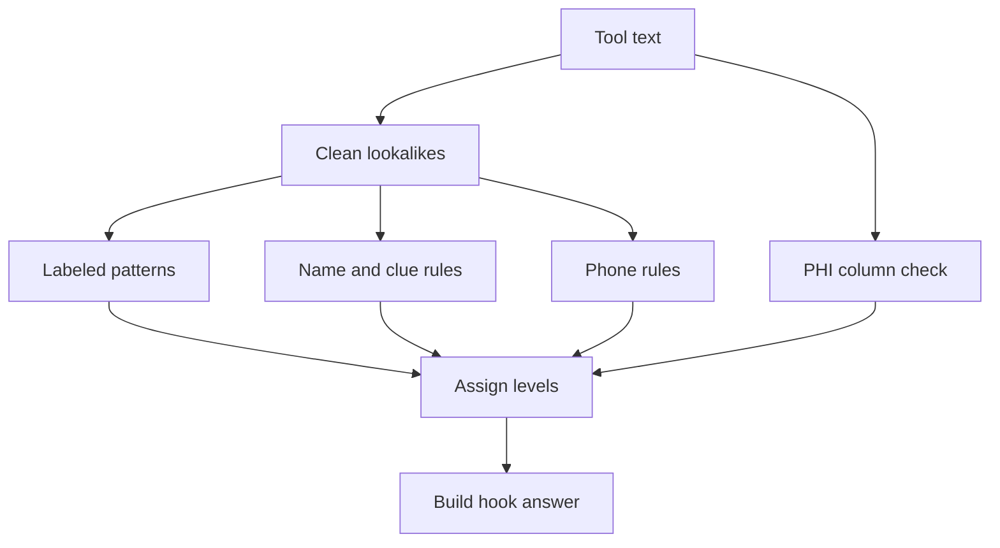
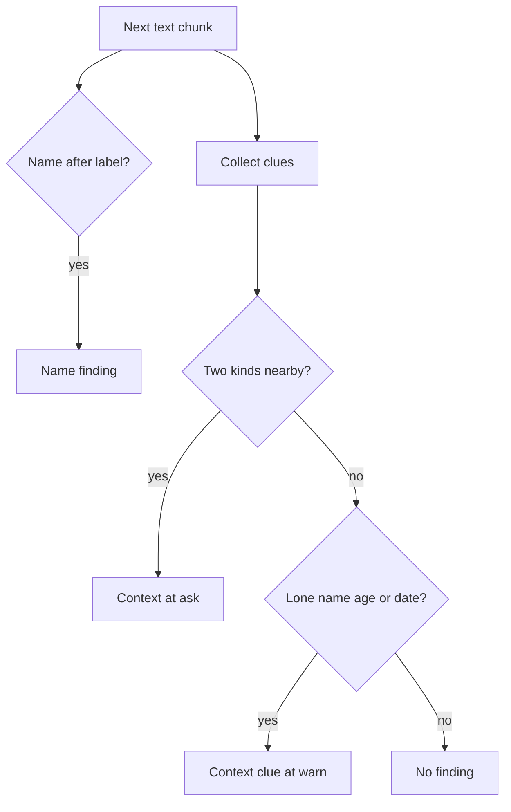

## Purpose

The shared rulebook for finding patient data (PHI) in text. It is not a hook itself. Hooks import it so that the write hook, the Bash hook and the after-tool hook all judge text by the same rules. It holds the label patterns (record numbers, birth dates, addresses and so on), the weaker context rules, the PHI column check for tables and JSON, the three response levels (deny, ask, warn), and the helpers that turn findings into hook output and pull text out of tool responses.

## Dependencies

**Depends on.** Standard library only: `json`, `re`, `unicodedata`, `dataclasses`, `enum`, `typing` {src:hooks/phi_patterns.py:39-44}. It imports nothing else from the repo.

**Used by.**

- Hooks: [pre-tool-bash-scan-phi](pre-tool-bash-scan-phi.md) takes `LEVEL_RANK`, `pre_tool_decision` and `scan_levels` {src:hooks/pre-tool-bash-scan-phi.py:316}. `pre-tool-write-scan-phi.py` takes `pre_tool_decision` and `scan_levels` {src:hooks/pre-tool-write-scan-phi.py:69}. `post-tool-result-scan-phi.py` takes `Finding`, `Level`, `extract_response_texts`, `level_summary`, `scan_levels` and `strongest_level` {src:hooks/post-tool-result-scan-phi.py:20} {src:hooks/post-tool-result-scan-phi.py:21}. `post-tool-bash-scan-secrets.py` takes `collect_texts` {src:hooks/post-tool-bash-scan-secrets.py:19}. `sql_summary.py` takes `phi_column` {src:hooks/sql_summary.py:18}. `pre-submit-vault-inject.sh` runs an inline Python step that takes `scan_levels` {src:hooks/pre-submit-vault-inject.sh:86}. These hooks have no doc page yet.
- Script: `scripts/sync/vault_write_scan.py` loads the module and calls `scan_levels` {src:scripts/sync/vault_write_scan.py:59} {src:scripts/sync/vault_write_scan.py:68}.
- Tests: [test_phi_baseline](../tests/hooks/test_phi_baseline.md) {src:tests/hooks/test_phi_baseline.py:30}, [test_phi_context_rules](../tests/hooks/test_phi_context_rules.md) {src:tests/hooks/test_phi_context_rules.py:25}, [test_hooks](../tests/hooks/test_hooks.md) {src:tests/hooks/test_hooks.py:33}, [test_phi_qa_regressions](../tests/hooks/test_phi_qa_regressions.md) {src:tests/hooks/test_phi_qa_regressions.py:26}, [test_phi_safety_speed](../tests/hooks/test_phi_safety_speed.md) {src:tests/hooks/test_phi_safety_speed.py:40}, [test_phi_hook_levels](../tests/hooks/test_phi_hook_levels.md) {src:tests/hooks/test_phi_hook_levels.py:170}, and `tests/hooks/test_phi_strong_rules.py` (no doc yet) {src:tests/hooks/test_phi_strong_rules.py:25}. [check_hook_inventory](../tests/hooks/check_hook_inventory.md) lists the file name {src:tests/hooks/check_hook_inventory.py:41}.
- Searched 2026-11-19: every file under the repo except `.git`, `docs/`, `__pycache__` and `.venv` for `phi_patterns`.

## Behavior

**Levels.** There are three levels: deny blocks, ask prompts the user, warn only reports {src:hooks/phi_patterns.py:190-195}. `LEVEL_RANK` puts deny first {src:hooks/phi_patterns.py:199}. A label missing from `LABEL_LEVELS` falls back to deny, so a new rule fails safe {src:hooks/phi_patterns.py:201} {src:hooks/phi_patterns.py:213} {src:hooks/phi_patterns.py:494} {src:hooks/phi_patterns.py:495}. The explicit levels are: `COLUMN`, `DOB`, `ADDRESS` and `NAME` deny, `PHONE` and `CONTEXT` ask, `PHONE_UNLABELED` and `CONTEXT_CLUE` warn {src:hooks/phi_patterns.py:203-212}. `MRN`, `SSN`, `PATIENT_ID`, `NPI` and `INSURANCE_ID` are not in the map, so they deny by the fallback {src:hooks/phi_patterns.py:147} {src:hooks/phi_patterns.py:149} {src:hooks/phi_patterns.py:153} {src:hooks/phi_patterns.py:154} {src:hooks/phi_patterns.py:155}.

**Label patterns (`scan_for_phi`).** Eight regular expressions map to labels: `MRN`, `SSN`, `DOB` (label then date), `PATIENT_ID`, `NPI`, `INSURANCE_ID`, `DOB` (birth word with an optional "on" or "is", then a numeric or month-name date) and `ADDRESS` {src:hooks/phi_patterns.py:146-159}. They are compiled case-insensitively {src:hooks/phi_patterns.py:182-184}. `scan_for_phi` returns the sorted labels found in any text {src:hooks/phi_patterns.py:247-254}. Every repeat in the patterns has an upper bound, so long runs of spaces or letters cannot make matching slow {src:hooks/phi_patterns.py:46-52} {src:hooks/phi_patterns.py:114-115}.

**Text clean-up.** `normalize_text` leaves plain ASCII alone. Other text loses zero-width characters, is folded to its compatibility form (NFKC), and has look-alike letters and dashes mapped to ASCII {src:hooks/phi_patterns.py:241-244} {src:hooks/phi_patterns.py:227-236}. `scan_for_phi`, `scan_phone_labels` and `scan_context` apply it first {src:hooks/phi_patterns.py:250} {src:hooks/phi_patterns.py:263} {src:hooks/phi_patterns.py:479}.

**Phone numbers.** The labeled phone rule sits in `LEVELED_PATTERNS`, which `scan_for_phi` never reads, so a phone number alone never blocks there {src:hooks/phi_patterns.py:161-165} {src:hooks/phi_patterns.py:182-184}. `scan_phone_labels` returns `PHONE` for a number next to a phone label (gap up to 50 characters), blanks that match, and returns `PHONE_UNLABELED` for a separated number left over {src:hooks/phi_patterns.py:134} {src:hooks/phi_patterns.py:264-268}.

**Names and context.** `scan_context` runs on each 64 KB chunk of the text, with chunks overlapping by 1024 characters {src:hooks/phi_patterns.py:274-276} {src:hooks/phi_patterns.py:432-438} {src:hooks/phi_patterns.py:481}.

- A person name placed after a patient style label gives a `NAME` finding {src:hooks/phi_patterns.py:482-484}. A capitalised name is deny unless a generic word such as "form" or "team" is in it, which makes it ask {src:hooks/phi_patterns.py:382-389} {src:hooks/phi_patterns.py:311-316}. A first word such as "summary" or "patient" is a heading, not a name, and gives nothing {src:hooks/phi_patterns.py:376-379} {src:hooks/phi_patterns.py:384} {src:hooks/phi_patterns.py:385}. A lower-case value after an explicit name label is ask at most {src:hooks/phi_patterns.py:400} {src:hooks/phi_patterns.py:401}. The strongest level among all matches wins {src:hooks/phi_patterns.py:402} {src:hooks/phi_patterns.py:403}.
- Weak clues are title names, street parts, age with sex, event dates, clinical words and phone numbers {src:hooks/phi_patterns.py:421-429}. A street part counts only when its suffix is capitalised {src:hooks/phi_patterns.py:415-418}.
- Two clues of different kinds, not overlapping, whose starts are within 200 characters of each other give `CONTEXT` at ask level {src:hooks/phi_patterns.py:274} {src:hooks/phi_patterns.py:441-443} {src:hooks/phi_patterns.py:450} {src:hooks/phi_patterns.py:455} {src:hooks/phi_patterns.py:486-488}.
- A clue left unpaired gives `CONTEXT_CLUE` at warn level, but only for the kinds name, age and sex, or event date. A lone street part or clinical word is never a finding {src:hooks/phi_patterns.py:285} {src:hooks/phi_patterns.py:286} {src:hooks/phi_patterns.py:489} {src:hooks/phi_patterns.py:490}.

**PHI columns.** `phi_column` lowercases a name, removes spaces, underscores and hyphens, and checks whether any token from the list is a substring {src:hooks/phi_patterns.py:562} {src:hooks/phi_patterns.py:563} {src:hooks/phi_patterns.py:170-175}. In JSON, a key counts only when it is a PHI column name holding a non-empty plain value; keys with a dot are skipped {src:hooks/phi_patterns.py:589-592}. A Databricks style result counts when column names come with a non-empty `data_array` {src:hooks/phi_patterns.py:585-588}. Nesting deeper than 20 levels is ignored {src:hooks/phi_patterns.py:577} {src:hooks/phi_patterns.py:578}. In a plain text table, only the first multi-column line is read as the header, and it counts when a data row follows {src:hooks/phi_patterns.py:609-619}. `scan_structured` tries JSON when the text starts with `{` or `[`, and falls back to the table reader when parsing fails {src:hooks/phi_patterns.py:626-633}.

**Putting it together.** `scan_levels` merges the label patterns, the column check reduced to the single label `COLUMN`, the phone labels and the context findings, and sorts strongest first {src:hooks/phi_patterns.py:498-500} {src:hooks/phi_patterns.py:508-511}.

**Hook output (`pre_tool_decision`).** No findings gives `None` {src:hooks/phi_patterns.py:540-543}. A strongest level of warn returns a visible message and extra context with no permission decision, so the normal permission flow still runs {src:hooks/phi_patterns.py:545-548}. A strongest level of ask or deny returns that decision with a reason {src:hooks/phi_patterns.py:549-555}. The text lists source names and labels with levels, never the matched text {src:hooks/phi_patterns.py:524-530}.

**Reading tool responses.** `collect_texts` walks a response of any shape and gathers strings under the keys `stdout`, `stderr`, `output`, `text`, `result` and `content`, plus nested `file.content` {src:hooks/phi_patterns.py:224} {src:hooks/phi_patterns.py:637-650}. `extract_response_texts` adds the whole response serialised as JSON, so an unknown shape is still scanned {src:hooks/phi_patterns.py:666-671}.

## Diagram: module level (L2, required)

## Diagram: function level (L3, optional)

The context scan has several decision gates.

## Notes

**Header and code disagree.**

- The header says text is normalised before matching {src:hooks/phi_patterns.py:27} {src:hooks/phi_patterns.py:28}. That holds for the label, phone and context rules. `scan_structured` reads the raw text and never normalises it, and `scan_levels` passes it the raw texts {src:hooks/phi_patterns.py:622-634} {src:hooks/phi_patterns.py:508}. Checked 2026-11-19 by running the module: a JSON key spelled with a Cyrillic letter in place of the Latin `p` in `mrn` gives no column finding, and the plain `mrn` key gives one.
- The header says column findings report as `COLUMN` only and the column name is no longer in the label {src:hooks/phi_patterns.py:25} {src:hooks/phi_patterns.py:26}. That holds for `scan_levels` {src:hooks/phi_patterns.py:500}. `scan_structured` itself still returns labels of the form `COLUMN:` plus the column name {src:hooks/phi_patterns.py:588} {src:hooks/phi_patterns.py:592} {src:hooks/phi_patterns.py:618}.
- The header says phone rules live in `LEVELED_PATTERNS` {src:hooks/phi_patterns.py:15}. Only the labeled rule does {src:hooks/phi_patterns.py:163-165}. The unlabeled rule is the separate `BARE_PHONE_RULE` {src:hooks/phi_patterns.py:141-144} {src:hooks/phi_patterns.py:186}.
- The header says the context window is 200 characters {src:hooks/phi_patterns.py:18} {src:hooks/phi_patterns.py:19}. The code measures from the start of one clue to the start of the other, and clues that overlap never pair {src:hooks/phi_patterns.py:443} {src:hooks/phi_patterns.py:450} {src:hooks/phi_patterns.py:455}.

**Limits found while reading.**

- The second `DOB` pattern has no left word boundary, unlike the first. Checked 2026-11-19 by running the module: `newborn 2020-05-05` gives `DOB` at deny level {src:hooks/phi_patterns.py:152} {src:hooks/phi_patterns.py:157} {src:hooks/phi_patterns.py:112}.
- Column matching is by substring, so a name that merely contains a token matches. Checked 2026-11-19 by running the module: the key `adobe_id` with a value gives `COLUMN:adobe_id` {src:hooks/phi_patterns.py:563}.
- When a text is split into chunks, each chunk can give its own `NAME` finding, so one text can report `NAME` at both deny and ask. The strongest level still decides {src:hooks/phi_patterns.py:481-484} {src:hooks/phi_patterns.py:518}. Read from the code, not run.
- `scan_structured` parses the whole text with `json.loads` and has no size cap before that call {src:hooks/phi_patterns.py:629}.
- Constants: the module has 74 public constants, mostly regex size bounds and rule objects. Only the 8 that other files import or read by attribute are listed under exports (`LEVEL_RANK`, `COLUMN_LABEL`, `LABEL_LEVELS`, `DEFAULT_LEVEL`, `CONTEXT_WINDOW`, `CHUNK_SIZE`, `CLINICAL_TERMS`, `PHONE_GAP_MAX`); the other 66 are internal tuning values such as the size bounds {src:hooks/phi_patterns.py:51-87}.

**Unchecked inputs.** The scanned text comes from tool payloads and is run through the patterns with no check on its content; the bounded repeats are the protection against slow matching {src:hooks/phi_patterns.py:114} {src:hooks/phi_patterns.py:115}. Source names passed in by callers, such as a script file's base name, go into the hook message unchecked {src:hooks/phi_patterns.py:530}. No input reaches a file path, a shell command or a network address.

**Shared file writes.** None. The module does no input or output of its own.
