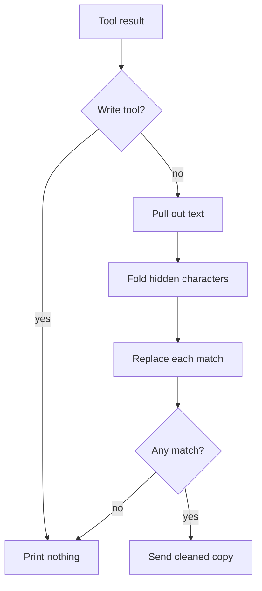

## Purpose

A PostToolUse hook that looks at what a tool just returned (Bash output, file contents, MCP text) for credential values. When it finds some, it hands Claude a copy with each one replaced by a label, and tells Claude to use that copy. It cannot take back the raw result, which the model has already received. It runs next to [scrub_secrets](scrub_secrets.md), which does a similar job with a longer pattern list and the variable-name registry.

## Dependencies

**Depends on.** Standard library (`json`, `os`, `re`, `sys`) and two sibling hook files, found by putting the hooks folder first on the import path {src:hooks/post-tool-bash-scan-secrets.py:18}:
- [phi_patterns](phi_patterns.md) supplies `collect_texts`, which pulls the text values out of a tool response {src:hooks/post-tool-bash-scan-secrets.py:19} {src:hooks/post-tool-bash-scan-secrets.py:27}.
- [scrub_secrets](scrub_secrets.md) supplies `normalize` and the list `SPECIFIC_PATTERNS` {src:hooks/post-tool-bash-scan-secrets.py:20}.

It reads the PostToolUse JSON on stdin {src:hooks/post-tool-bash-scan-secrets.py:81}. It reads no environment variable and no file.

**Used by.** Product code:
- `settings.json` binds it to PostToolUse for every tool, with no matcher {src:settings.json:204}.
- The progress check only tests that the file exists {src:scripts/state/system_progress.py:85}, see [system_progress](../scripts/state/system_progress.md).
- The inventory check lists it by name {src:tests/hooks/check_hook_inventory.py:55}.

Tests: [test_hooks](../tests/hooks/test_hooks.md) runs it on a secret and on clean output {src:tests/hooks/test_hooks.py:90} {src:tests/hooks/test_hooks.py:135}. [test_security_fixes](../tests/hooks/test_security_fixes.md) checks the Plane key and JSON member shapes {src:tests/hooks/test_security_fixes.py:355}. [run](../tests/hooks/run.md) feeds it fixture files {src:tests/hooks/run.sh:83}. [test_secret_shapes](../tests/hooks/test_secret_shapes.md) checks the added shapes, a key split by a zero-width character, clean output and a bad payload {src:tests/hooks/test_secret_shapes.py:151} {src:tests/hooks/test_secret_shapes.py:155} {src:tests/hooks/test_secret_shapes.py:159}.

## Behavior

**Reading the payload.** Standard input must be a JSON object. Text that does not parse, or a value that is not an object, exits 2 with a message on stderr {src:hooks/post-tool-bash-scan-secrets.py:82-89}.

**What is skipped.** A result from `Edit`, `Write`, `MultiEdit`, `NotebookEdit` or `TodoWrite` is not scanned, because those return only internal status {src:hooks/post-tool-bash-scan-secrets.py:35} {src:hooks/post-tool-bash-scan-secrets.py:91-92}. A payload with no `tool_response`, or with only blank text, exits 0 with no output {src:hooks/post-tool-bash-scan-secrets.py:94-100}.

**Getting the text.** `extract_text` joins the text values from the response. If none are found, it falls back to the response serialised as JSON {src:hooks/post-tool-bash-scan-secrets.py:27-30}.

**Which patterns run, in order.** The working list is built when the file loads. First come twelve shapes borrowed from `scrub_secrets`, chosen by label: AWS access key, Stripe, Google API key, npm, Hugging Face, GitLab, SendGrid, JWT, credentials inside a URL, Slack webhook, a password given to `curl -u`, and a Bearer token {src:hooks/post-tool-bash-scan-secrets.py:72-77}. Then the OpenAI key shape that has `proj` in it (such as `sk-proj-`) {src:hooks/post-tool-bash-scan-secrets.py:75}. Then this file's own list: Anthropic, Jira, Databricks, GitHub (fine-grained, then classic), Slack tokens, OpenAI, Plane, a JSON member such as `"api_key": "<20+ characters>"`, Azure storage key, Azure SAS, private key header, an `Authorization:` or `Bearer:` line, a loose `name = value` for names such as password or token with 16 or more characters, and an `export NAME=value` line {src:hooks/post-tool-bash-scan-secrets.py:37-68}. The Atlassian token is labelled `JIRA_TOKEN` here and `ATLASSIAN_TOKEN` in `scrub_secrets`, because this file keeps its own copy of that shape {src:hooks/post-tool-bash-scan-secrets.py:40} {src:hooks/post-tool-bash-scan-secrets.py:71}.

**Redacting.** The text is first normalised: zero-width characters are dropped and look-alike and compatibility forms are folded, so a key written with hidden characters is still matched {src:hooks/post-tool-bash-scan-secrets.py:103} {src:hooks/phi_patterns.py:239-244}. Plain ASCII text passes through unchanged {src:hooks/phi_patterns.py:241-242}. Each pattern in turn replaces every match with `[REDACTED:LABEL]` {src:hooks/post-tool-bash-scan-secrets.py:105-111}.

**Output.** With no match, it exits 0 and prints nothing {src:hooks/post-tool-bash-scan-secrets.py:113-114}. With a match, it prints one PostToolUse JSON object whose `additionalContext` gives the number of matches, the labels found, and the redacted text {src:hooks/post-tool-bash-scan-secrets.py:116-130}. The count is the number of matches, not the number of distinct secrets {src:hooks/post-tool-bash-scan-secrets.py:108} {src:hooks/post-tool-bash-scan-secrets.py:116}.

## Diagram: module level (L2, required)

## Diagram: function level (L3, optional)

None: no function has branching that the signature does not show.

## Notes

**Where the code and its own description disagree.**
- The header says the hook runs for all tools with matcher `""` {src:hooks/post-tool-bash-scan-secrets.py:3}. The binding in `settings.json` has no `matcher` key at all, which matches every tool as well {src:settings.json:200-206}. The effect is the same.
- The header says `additionalContext` instructs Claude not to use or repeat raw secrets {src:hooks/post-tool-bash-scan-secrets.py:8}. The text this file builds says only that credentials were scrubbed and shows the clean copy {src:hooks/post-tool-bash-scan-secrets.py:118-122}. The sentence "Do not use or repeat the raw values" is in `scrub_secrets`, not here {src:hooks/scrub_secrets.py:248}.
- The file name says Bash, but the hook scans the result of every tool {src:hooks/post-tool-bash-scan-secrets.py:91}.

**Differences from the other scanner.** This file does not read the variable-name registry, so a name listed there is redacted only by `scrub_secrets` {src:hooks/scrub_secrets.py:237}. It also keeps a private copy of the Anthropic, GitHub, Slack, Plane and other shapes, so a change to the shared list in `scrub_secrets` does not reach them {src:hooks/post-tool-bash-scan-secrets.py:37-68}.

**Failure behavior.** Only the two payload checks are caught on purpose. `main` runs at import time with no outer `try`, so any other error ends the process with Python's own exit code 1 and a traceback {src:hooks/post-tool-bash-scan-secrets.py:134}. The hook entry in `settings.json` carries `"onFailure": "block"` {src:settings.json:205}. What the harness does with that for a PostToolUse hook is not checked here [uncertain].

**Inputs reaching a path, command, address or outbound text.** No input reaches a path, a command or a network address; the module opens no file and starts nothing. Text outside the patterns is passed to Claude unchanged, so a credential in a shape the list does not know is not removed. The first 30 characters of each match are kept in a list in memory and never printed or written {src:hooks/post-tool-bash-scan-secrets.py:108}.

**Writes to shared files.** None. It writes only to stdout and stderr. Searched 2026-11-21: `hooks/post-tool-bash-scan-secrets.py` for `open(`, `write_text` and `os.replace`; no match.
