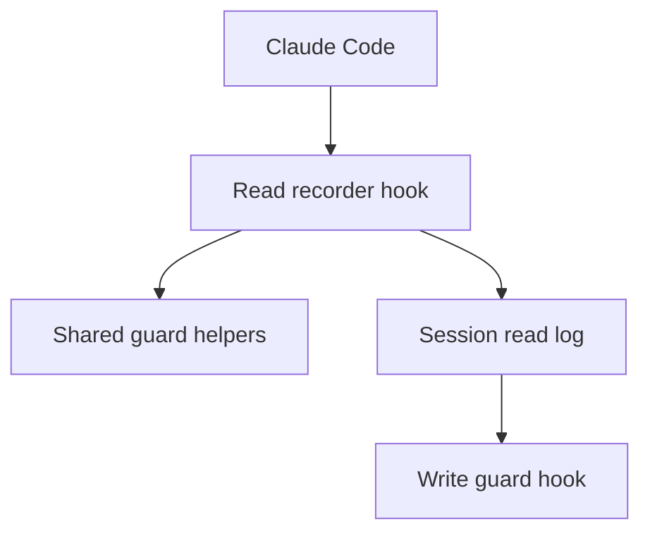
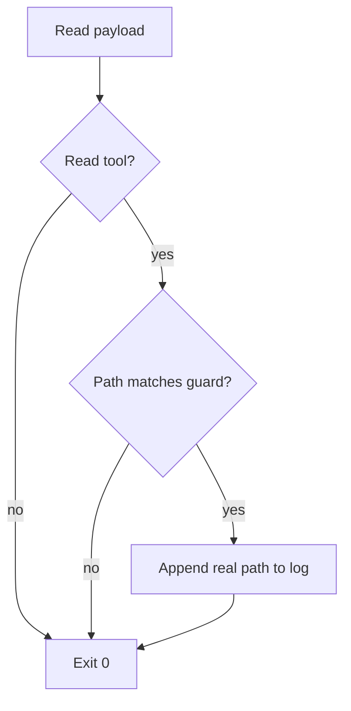

## Purpose

This is a Claude Code PostToolUse hook for the Read tool. When Claude reads a file that the read-before-write guard cares about (by default, files named `*-state.md`), the hook adds that file's real path to a per-session log. A companion PreToolUse hook, `hooks/pre-tool-write-require-read.py`, uses the log to allow a later Write or Edit of the same file only if it was read first in the same session. This hook only records; it never blocks.

## Dependencies

**Depends on.**
- Standard library: `json`, `os`, `sys`.
- `read_guard_common` (no doc yet): imported inside `main`, not at the top of the file {src:hooks/post-tool-read-record.py:23-24}. It supplies `guard_pattern`, `normalize` and `read_log_path` {src:hooks/read_guard_common.py:30} {src:hooks/read_guard_common.py:59} {src:hooks/read_guard_common.py:65}. [[read_guard_common]] (no doc yet)
- Environment variables read through that module: `GUARD_REGEX` {src:hooks/read_guard_common.py:32}, `TOLLGATE_STATE_DIR` {src:hooks/read_guard_common.py:55}, `TOLLGATE_HOME` {src:hooks/read_guard_common.py:37}, and `HOME` through `~` expansion {src:hooks/read_guard_common.py:56}.
- When `TOLLGATE_HOME` is set, the state folder comes from `core.paths` under `$TOLLGATE_HOME/scripts` {src:hooks/read_guard_common.py:40-45}. There a `state` line in the paths file wins, then `TOLLGATE_STATE_DIR`, then `~/.tollgate/state` {src:scripts/core/paths.py:126-127} {src:scripts/core/paths.py:103-105}.

**Used by.**
- Product code: `settings.json` runs it after every Read (matcher `Read`) and sets no `onFailure` {src:settings.json:218-225}. The log it writes is read by `hooks/pre-tool-write-require-read.py` {src:hooks/read_guard_common.py:10} (no doc yet: [[pre-tool-write-require-read]]).
- Tests: `tests/hooks/test_guard_hooks.py` class `ReadBeforeWrite` {src:tests/hooks/test_guard_hooks.py:58-59} {src:tests/hooks/test_guard_hooks.py:91-94} {src:tests/hooks/test_guard_hooks.py:110} {src:tests/hooks/test_guard_hooks.py:118}.

## Behavior

1. `main` puts its own folder first on the import path and imports the helper functions {src:hooks/post-tool-read-record.py:23-24}.
2. It parses stdin as JSON {src:hooks/post-tool-read-record.py:26}. A payload whose `tool_name` is not `Read` is ignored {src:hooks/post-tool-read-record.py:27-28}.
3. `file_path` is taken from `tool_input`, defaulting to empty {src:hooks/post-tool-read-record.py:29}. An empty path, or a path where the guard regular expression finds no match, is ignored {src:hooks/post-tool-read-record.py:30-31}. The match is made on the path as given, before it is resolved {src:hooks/post-tool-read-record.py:30}.
4. The log file is `<state dir>/read_log/<session id>.log`; the session id has every character outside letters, digits, `_`, `.` and `-` replaced by `_`, and an empty id becomes `unknown` {src:hooks/read_guard_common.py:26-27} {src:hooks/read_guard_common.py:59-62}.
5. The log folder is created if missing {src:hooks/post-tool-read-record.py:33}, and the resolved path (symlinks and `..` removed, `~` expanded) is appended as one line {src:hooks/post-tool-read-record.py:34-35} {src:hooks/read_guard_common.py:65-67}.
6. The guard regular expression defaults to `-state\.md$` when `GUARD_REGEX` is unset or empty {src:hooks/read_guard_common.py:23} {src:hooks/read_guard_common.py:30-32}.
7. Any exception is swallowed and the process exits 0 {src:hooks/post-tool-read-record.py:38-43}. Bad JSON, a payload that is not an object, an invalid `GUARD_REGEX` and a full disk all end this way with nothing logged. A test asserts exit 0 for `not json`, an empty string and `[]` {src:tests/hooks/test_guard_hooks.py:91-94}.

## Diagram: module level (L2, required)

## Diagram: function level (L3, optional)

## Notes

**Code and description disagree.** None found. The docstring says the hook always exits 0 and fails open {src:hooks/post-tool-read-record.py:12}, and the wrapper does that {src:hooks/post-tool-read-record.py:39-43}. The helper's docstring says a `state` line in the paths file wins when the loader can be imported {src:hooks/read_guard_common.py:13-14}, and `core.paths` does that {src:scripts/core/paths.py:126-127}.

**Behavior worth knowing.**
- The failure modes are not symmetric. This hook fails open, but the guard that reads the log fails closed on an invalid `GUARD_REGEX` {src:tests/hooks/test_guard_hooks.py:96-100}. With a broken pattern nothing is recorded and every guarded write is refused.
- The pattern test uses the path as Claude passed it {src:hooks/post-tool-read-record.py:30}, while the log stores the resolved path {src:hooks/post-tool-read-record.py:35}. A symlink whose own name does not match, pointing at a file whose real name does, is therefore not recorded.
- Failures are silent by design, so a read that was not logged is not visible anywhere.

**Inputs that reach a file path, command, address or outbound text.**
- `session_id` becomes part of a file name. Path separators are replaced, so it cannot leave the log folder {src:hooks/read_guard_common.py:27} {src:hooks/read_guard_common.py:61}; a test covers a `../../evil` id {src:tests/hooks/test_guard_hooks.py:121-124}.
- `file_path` is written as text and resolved with `realpath`, never opened {src:hooks/post-tool-read-record.py:35} {src:hooks/read_guard_common.py:67}. It is stored unescaped, so a path containing a newline would write two lines to the log; no check exists.
- `TOLLGATE_STATE_DIR` decides where folders are created {src:hooks/post-tool-read-record.py:33} with no check on the value.
- `TOLLGATE_HOME` is added to the import path and `core.paths` is imported from it, so code in `$TOLLGATE_HOME/scripts` runs inside this hook, with no check on the value {src:hooks/read_guard_common.py:37-45}.
- `GUARD_REGEX` is compiled and run against every path with no limit on how expensive it is {src:hooks/read_guard_common.py:32}.

**Writes to shared files.** The hook appends to the session log with a plain append-mode open {src:hooks/post-tool-read-record.py:34-35}. It is not atomic and nothing prevents two writers from appending at once; each write is one short line, so a clash is unlikely but not excluded. There is no deduplication, trimming or deletion in this file or in `read_guard_common.py` (read in full, 2026-11-20), so the log grows for the life of the state folder.
