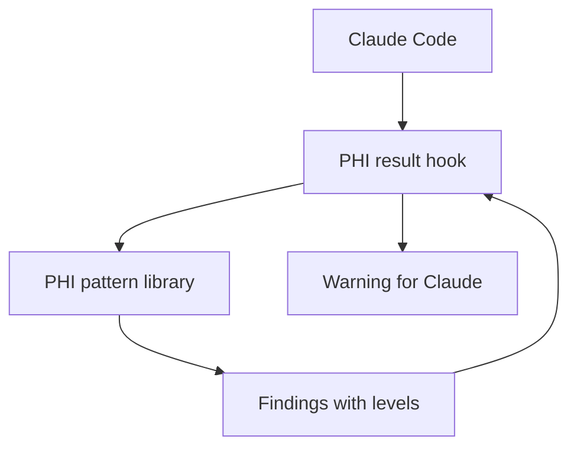
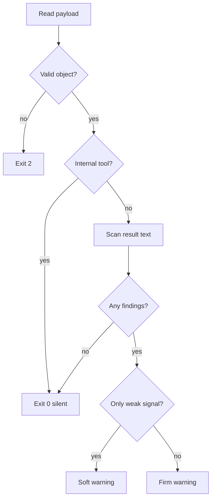

## Purpose

This is a Claude Code PostToolUse hook. After any tool returns data (command output, file contents, results from outside services), it scans the result for signs of protected health information (PHI) such as medical record numbers, birth dates, addresses, patient names and patient-style column names. If it finds something, it adds a warning to what Claude sees, telling Claude not to process or forward the data. It is the after-the-fact counterpart of the PreToolUse PHI hooks, which look at what Claude is about to send.

## Dependencies

**Depends on.**
- Standard library: `json`, `os`, `sys`.
- [[phi_patterns]] ([phi_patterns](phi_patterns.md)): all detection lives there. The hook adds its own folder to the import path {src:hooks/post-tool-result-scan-phi.py:19} and imports `Finding`, `Level`, `extract_response_texts`, `level_summary`, `scan_levels` and `strongest_level` {src:hooks/post-tool-result-scan-phi.py:20-22}.

**Used by.**
- Product code: `settings.json` registers it under PostToolUse with `onFailure` of `block` and no matcher key {src:settings.json:209-217}. The inventory check requires that `onFailure` setting {src:tests/hooks/check_hook_inventory.py:54-58}. Nothing else in the repo imports it (searched outside `docs/`, 2026-11-20).
- Tests: `tests/hooks/run.sh` fixtures {src:tests/hooks/run.sh:148-172}; `tests/hooks/test_hooks.py` {src:tests/hooks/test_hooks.py:80} {src:tests/hooks/test_hooks.py:85} {src:tests/hooks/test_hooks.py:135-137}; `tests/hooks/test_phi_hook_levels.py` {src:tests/hooks/test_phi_hook_levels.py:28}; `tests/hooks/test_phi_safety_speed.py` {src:tests/hooks/test_phi_safety_speed.py:44}.

## Behavior

`main` runs at import time: the file ends with a bare `main()` call and no `__main__` guard {src:hooks/post-tool-result-scan-phi.py:80}.

1. Stdin that is not JSON, or JSON that is not an object, writes a note to stderr and exits 2 {src:hooks/post-tool-result-scan-phi.py:56-63}.
2. A `tool_name` in `SKIP_TOOLS` (`Write`, `Edit`, `MultiEdit`, `NotebookEdit`, `TodoWrite`) exits 0 {src:hooks/post-tool-result-scan-phi.py:27} {src:hooks/post-tool-result-scan-phi.py:65-67}. A missing `tool_response` exits 0 {src:hooks/post-tool-result-scan-phi.py:69-71}.
3. The texts to scan come from `extract_response_texts`: every text value in the known keys, plus the full JSON dump of the response, so unknown response shapes are still scanned {src:hooks/post-tool-result-scan-phi.py:73} {src:hooks/phi_patterns.py:660-671}.
4. `scan_levels` returns findings, strongest first: labeled patterns (`MRN`, `SSN`, `DOB`, `ADDRESS` and others), PHI-like column names, phone numbers, and context rules where two weak clues sit close together {src:hooks/post-tool-result-scan-phi.py:74} {src:hooks/phi_patterns.py:503-511}. Each label has a level of deny, ask or warn; a label missing from the table is treated as deny {src:hooks/phi_patterns.py:201-213}.
5. No findings: exit 0 with no output {src:hooks/post-tool-result-scan-phi.py:75-77}.
6. Findings: one JSON object with `additionalContext` is printed and the hook exits 0 {src:hooks/post-tool-result-scan-phi.py:76-77}. If the strongest level is warn, the text is a soft note ("Weak PHI signal ... may be a false alarm") {src:hooks/post-tool-result-scan-phi.py:33-38}. For deny or ask the text says "PHI DETECTED", tells Claude not to process, store, log or forward the data, and to tell the user to revise the query {src:hooks/post-tool-result-scan-phi.py:39-43}. Deny and ask get the same wording; the level shows only in the label list, for example `PHONE (ask)` {src:hooks/phi_patterns.py:524-526}.
7. The message holds rule labels and levels only, never the matched text {src:hooks/phi_patterns.py:524-526}.
8. The hook cannot block or remove the result. It never prints a deny decision, and its own docstring says a PostToolUse hook cannot suppress results {src:hooks/post-tool-result-scan-phi.py:8}.

## Diagram: module level (L2, required)

## Diagram: function level (L3, optional)

## Notes

**Code and description disagree.**
- The docstring says the matcher is `""` {src:hooks/post-tool-result-scan-phi.py:3}. `settings.json` has no `matcher` key for this entry {src:settings.json:209-217}, while the secret scrubber entry sets `"matcher": ""` explicitly {src:settings.json:227-229}. Whether the two are treated the same is Claude Code behavior I did not check [uncertain].
- The stderr text says the hook "fails closed" {src:hooks/post-tool-result-scan-phi.py:59} {src:hooks/post-tool-result-scan-phi.py:62}. The docstring says PostToolUse cannot suppress results {src:hooks/post-tool-result-scan-phi.py:8}, so exit 2 cannot hold back a result that has already run. What exit 2 does here is decided by Claude Code [uncertain].
- The docstring says the output must include `hookEventName` or Claude Code rejects it, "verified 2.1.220" {src:hooks/post-tool-result-scan-phi.py:9}. I could not check that version claim {unverified}. The code does set it {src:hooks/post-tool-result-scan-phi.py:49-50}.
- The comment on `SKIP_TOOLS` says those tools return operational status, so there is no PHI risk {src:hooks/post-tool-result-scan-phi.py:26-27}. I did not check what Edit and Write return {unverified}.

**Limits.** Both findings and wording depend entirely on `phi_patterns`; a PHI shape that no rule matches passes silently. The full JSON dump is scanned in addition to the extracted texts {src:hooks/phi_patterns.py:666-670}, so most content is scanned twice, which costs time on large results.

**Inputs that reach a path, command, address or outbound text.** No input reaches a file path, shell command or network address. `tool_name` from the payload is placed in the warning text without any check {src:hooks/post-tool-result-scan-phi.py:35} {src:hooks/post-tool-result-scan-phi.py:40}; it is set by Claude Code, and the text goes only to Claude as context.

**Writes to shared files.** None. Output goes to stdout and stderr only.
