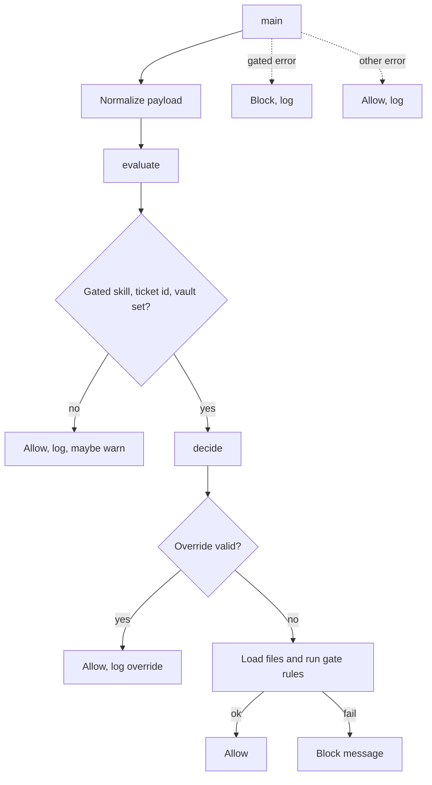

## Purpose

A gate hook that stops the arch, dev and qa chain commands from starting when the earlier `Status:` lines are missing. It reads the command name and ticket id, loads the ticket files, and asks `gate_rules` for a verdict. {src:hooks/pre-prompt-expansion-check-gates.py:5} It runs for a command the user types and for a skill the model calls itself. {src:hooks/pre-prompt-expansion-check-gates.py:29}

## Dependencies

**Depends on.** Standard library, and [gate_rules](gate_rules.md), imported only when a check runs. {src:hooks/pre-prompt-expansion-check-gates.py:375} The path loader `core.paths` from `$TOLLGATE_HOME/scripts`, which gives the tickets folder and the state folder for the log. {src:hooks/pre-prompt-expansion-check-gates.py:93-99} {src:hooks/pre-prompt-expansion-check-gates.py:162} Environment variables: `TOLLGATE_KNOWLEDGE`, `TOLLGATE_HOME`, `TOLLGATE_GATE_LOG`. {src:hooks/pre-prompt-expansion-check-gates.py:62-65} `TOLLGATE_SKILL_PREFIX` is no longer read; the command names are fixed. {src:hooks/pre-prompt-expansion-check-gates.py:8-9}

**Used by.** Product code: `settings.json` wires it twice. Once under `UserPromptExpansion` with no matcher and a 10 second timeout, for a typed slash command. {src:settings.json:14} {src:settings.json:19-20} Once under `PreToolUse` with the matcher `Skill`, with the same timeout, for a skill the model calls. {src:settings.json:118} {src:settings.json:122-123} Both set `onFailure` to `block`. {src:settings.json:21} {src:settings.json:124} Tests: [test_gate_hook](../tests/hooks/test_gate_hook.md), `tests/hooks/test_hooks.py` (installer merge adds exactly one expansion hook) {src:tests/hooks/test_hooks.py:276-277}, and the fixture `tests/hooks/fixtures/pre-prompt-expansion-check-gates/tc-01-typed-arch.json`. {src:tests/hooks/fixtures/pre-prompt-expansion-check-gates/tc-01-typed-arch.json:1}

## Behavior

- Input: JSON on stdin. A typed command carries `command_name` and `command_args`. {src:hooks/pre-prompt-expansion-check-gates.py:340-343} A `PreToolUse` payload for the `Skill` tool carries the skill in `tool_input.skill` (a leading `/` is stripped) and the arguments in `tool_input.args`. A `PreToolUse` payload for any other tool gets an empty command name, so nothing is gated. {src:hooks/pre-prompt-expansion-check-gates.py:394-400} A fixture of a typed command shows `command_name` as `tg-arch`. {src:tests/hooks/fixtures/pre-prompt-expansion-check-gates/tc-01-typed-arch.json:1}
- Skill name: the prefix is the fixed string `tg-`. A name is a chain skill only if it is `tg-` plus one of the six chain skills; anything else gives no skill and is allowed. {src:hooks/pre-prompt-expansion-check-gates.py:61} {src:hooks/pre-prompt-expansion-check-gates.py:70} {src:hooks/pre-prompt-expansion-check-gates.py:136-139} Only `arch`, `dev` and `qa` are gated. {src:hooks/pre-prompt-expansion-check-gates.py:71} {src:hooks/pre-prompt-expansion-check-gates.py:341}
- Ticket id: every argument token matching `^[A-Z][A-Z0-9]*-[0-9]+$` (case insensitive, uppercased) is a candidate, after trimming surrounding punctuation such as commas, brackets and quotes. {src:hooks/pre-prompt-expansion-check-gates.py:66-67} {src:hooks/pre-prompt-expansion-check-gates.py:144-145} The first candidate whose real folder sits under the tickets folder is used, so `UTF-8` and a symlink pointing outside are skipped. {src:hooks/pre-prompt-expansion-check-gates.py:173-175}
- Ticket folder: looked up with the loader's `ticket_folder` when it can be imported; the fallback checks `<tickets>/KEY` first, then `<tickets>/PREFIX/KEY` with the prefix matched without regard to case. A folder that resolves outside the tickets folder is ignored. {src:hooks/pre-prompt-expansion-check-gates.py:188-195} {src:hooks/pre-prompt-expansion-check-gates.py:196-210}
- Cannot check: no candidate, or `TOLLGATE_KNOWLEDGE` unset, allows and logs. When there was a candidate, the hook also prints a `systemMessage` warning that the command was allowed without a gate check. The same happens when the tickets folder cannot be resolved or no candidate has a folder. {src:hooks/pre-prompt-expansion-check-gates.py:344-363} {src:hooks/pre-prompt-expansion-check-gates.py:454-455}
- Files: `{KEY}-state.md`, `{KEY}-spec.md`, `{KEY}-design.md`, `{KEY}-edge-case-validation.md`, inside the ticket folder. {src:hooks/pre-prompt-expansion-check-gates.py:73-78} {src:hooks/pre-prompt-expansion-check-gates.py:239} The gate reads the `Status:` lines through `gate_rules` (table in [gate-lines](../gate-lines.md)). {src:hooks/pre-prompt-expansion-check-gates.py:272-280} A file whose real path is outside the tickets folder is treated as missing. {src:hooks/pre-prompt-expansion-check-gates.py:222-223}
- Override: `{KEY}-gate-override.md` with a line `Override: <skill> YYYY-MM-DD <reason>`, valid for that skill and today only, reason required. Lines inside fenced code blocks are ignored, a symlinked override file is refused with an `override_refused` log line {src:hooks/pre-prompt-expansion-check-gates.py:251-253}, a file that is not a regular file (a named pipe, a device or a folder) is refused the same way before it is read, so it cannot hang the read {src:hooks/pre-prompt-expansion-check-gates.py:254-260}, and a file that is not UTF-8 text does not count. {src:hooks/pre-prompt-expansion-check-gates.py:68} {src:hooks/pre-prompt-expansion-check-gates.py:261-269} Each use is logged. {src:hooks/pre-prompt-expansion-check-gates.py:378}
- Block output: for a typed command, one JSON line `{"decision": "block", "reason": "..."}` on stdout, exit 0. For a `Skill` tool call, a `PreToolUse` deny with the same reason. {src:hooks/pre-prompt-expansion-check-gates.py:446-453} The reason names the failed rule, the file paths involved, the skill to run first (`/tg-<skill> KEY`) and the override file. {src:hooks/pre-prompt-expansion-check-gates.py:293-304} A file that exists but gives permission denied is listed as not readable, apart from a missing file. {src:hooks/pre-prompt-expansion-check-gates.py:296-298} The message holds paths and expected lines, not file contents. {src:hooks/pre-prompt-expansion-check-gates.py:41}
- Fail closed for a gated skill: a payload that cannot be read or is not a JSON object exits 2. {src:hooks/pre-prompt-expansion-check-gates.py:427-430} An internal error while checking arch, dev or qa blocks that command. {src:hooks/pre-prompt-expansion-check-gates.py:436-440} An internal error on any other command allows it and logs `fail_open`. {src:hooks/pre-prompt-expansion-check-gates.py:441-444} This includes an import error in `gate_rules`: it raises inside the check, so a gated skill is blocked. {src:hooks/pre-prompt-expansion-check-gates.py:375}
- Log: one line per event to `TOLLGATE_GATE_LOG`, else `gate_check.log` in the loader's state folder, else `~/.tollgate/state/gate_check.log`. {src:hooks/pre-prompt-expansion-check-gates.py:109-113} {src:hooks/pre-prompt-expansion-check-gates.py:118} Reads only, so it takes no lock.

### Create the override and read the audit log

The model cannot write `*-gate-override.md`: the write guard denies a Write or Edit to such a file, and the Bash guard denies a command that names one. {src:hooks/pre-tool-write-guard-path.sh:37} {src:hooks/pre-tool-bash-guard-gate-override.py:37} See `docs/hooks.md` sections 4 and 12b. The owner creates it from a terminal. Example with the fake ticket `T-001`:

```
printf 'Override: arch %s hotfix for demo\n' "$(date +%F)" >> "$TOLLGATE_KNOWLEDGE/<tickets folder>/T-001/T-001-gate-override.md"
```

Log line format: `<YYYY-MM-DDTHH:MM:SS> <event> <detail>`. {src:hooks/pre-prompt-expansion-check-gates.py:80} {src:hooks/pre-prompt-expansion-check-gates.py:120} Events written: `override <skill> <KEY>`, `override_refused symlink <KEY>`, `override_refused not a regular file <KEY>`, `allow <reason>`, `block <skill> <KEY>` (plus ` unreadable`), `fail_closed <ErrorName>: <message>` and `fail_open <ErrorName>: <message>`. {src:hooks/pre-prompt-expansion-check-gates.py:378} {src:hooks/pre-prompt-expansion-check-gates.py:252} {src:hooks/pre-prompt-expansion-check-gates.py:259} {src:hooks/pre-prompt-expansion-check-gates.py:346} {src:hooks/pre-prompt-expansion-check-gates.py:384} {src:hooks/pre-prompt-expansion-check-gates.py:428} {src:hooks/pre-prompt-expansion-check-gates.py:442} Each detail is cut at 200 characters. {src:hooks/pre-prompt-expansion-check-gates.py:81}

## Diagram: module level (L2, required)



## Notes

- The block shape for a typed command, `decision: block`, comes from the Claude Code hooks documentation read during design, not from a live blocked run. Confirm in a live session that the reason is shown to the user. {unverified}
- Bash writes to the override file are denied by a pattern check on the command text. A name built from pieces (variables, command substitution) or a script that writes the file internally can still get through, so the override is a guard against accidents, not a sandbox. {src:hooks/pre-tool-bash-guard-gate-override.py:37}
- The ChangeLog still mentions the old prefix rule, but it now marks it as history: an empty `TOLLGATE_SKILL_PREFIX` used to gate the bare commands, "replaced by the fixed tg-arch, tg-dev and tg-qa names". {src:hooks/pre-prompt-expansion-check-gates.py:21-23} That matches the code, which reads no prefix variable and uses the fixed `tg-` prefix. {src:hooks/pre-prompt-expansion-check-gates.py:61} Earlier versions of the comment read as if the old rule still applied; no disagreement is left.
- Inputs that reach a file path: the ticket id (checked against the id pattern, and every resolved folder must sit under the tickets folder) {src:hooks/pre-prompt-expansion-check-gates.py:66} {src:hooks/pre-prompt-expansion-check-gates.py:222-223}. `TOLLGATE_GATE_LOG` is used as the log path with no check; it is set by the owner's environment, not by the model. {src:hooks/pre-prompt-expansion-check-gates.py:118}
- Log writes append one line at a time with no lock, so two hooks running at once can interleave lines. {src:hooks/pre-prompt-expansion-check-gates.py:123-124}
