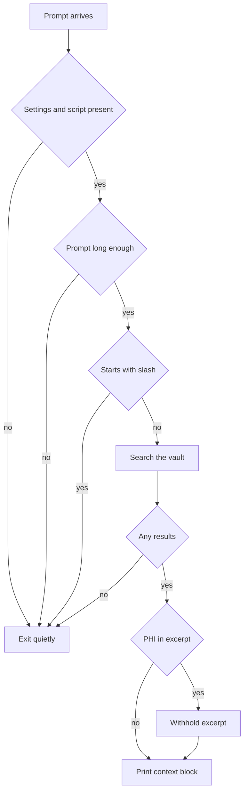

## Purpose

This is the prompt-submit hook that adds vault notes to a conversation. Each time the user sends a prompt, it asks the vault search script for the three best matching passages and prints them as a `<vault_context>` block, which Claude Code adds to the conversation. It exists so Claude sees relevant vault text without being asked. It is meant to be harmless: it never stops a prompt from being sent.

## Dependencies

**Depends on.**
- `scripts/search/query_index.py`, the search script it runs {src:hooks/pre-submit-vault-inject.sh:17} and {src:hooks/pre-submit-vault-inject.sh:55-57}. [[query_index]] (no doc yet). The sibling tool page [tg-search](../scripts/search/tg-search.md) / [[tg-search]] covers the search command line, not this script.
- `hooks/phi_patterns.py`, for `scan_levels` {src:hooks/pre-submit-vault-inject.sh:86}. [[phi_patterns]] / [phi_patterns](phi_patterns.md).
- Environment variable `TOLLGATE_KNOWLEDGE`: if unset or empty the hook exits at once {src:hooks/pre-submit-vault-inject.sh:24-26}.
- Environment variable `TOLLGATE_PYTHON`: the interpreter to use, default `python3` {src:hooks/pre-submit-vault-inject.sh:18}.
- Outside programs: bash, python3, grep, head, printf, cat.

**Used by.**
- Product code: `settings.json` registers it for the `UserPromptSubmit` event with a 30 second timeout {src:settings.json:3} and {src:settings.json:8-9}. `CLAUDE.md` describes it to the model {src:CLAUDE.md:47}.
- Installer: no line of `install.sh` names the file (searched with `git grep` on 2026-11-20); the installer only sets `TOLLGATE_PYTHON` for it {src:install.sh:1673}.
- Tests: `tests/hooks/run.sh` {src:tests/hooks/run.sh:64-76}, `tests/hooks/test_phi_hook_levels.py` {src:tests/hooks/test_phi_hook_levels.py:161-204}, `tests/scripts/search/test_review_fixes.py` {src:tests/scripts/search/test_review_fixes.py:274-302}.

## Behavior

Execution flow, top to bottom. Every early exit is `exit 0` with no output.

1. The hook finds its own folder and the repo root, then the search script path {src:hooks/pre-submit-vault-inject.sh:14-17}. Fixed settings: minimum score `0.40`, top `3` results, minimum prompt length `25` {src:hooks/pre-submit-vault-inject.sh:19-21}.
2. If `TOLLGATE_KNOWLEDGE` is empty, exit {src:hooks/pre-submit-vault-inject.sh:24-26}. If the search script file is missing, exit {src:hooks/pre-submit-vault-inject.sh:28-30}.
3. It reads the JSON from standard input and takes the `prompt` field with a small python command; any parse error gives an empty prompt {src:hooks/pre-submit-vault-inject.sh:33-41}.
4. A prompt shorter than 25 characters is skipped {src:hooks/pre-submit-vault-inject.sh:44-46}.
5. A prompt whose first line starts with optional spaces, a slash and a letter is skipped, on the idea that it is a skill command {src:hooks/pre-submit-vault-inject.sh:50-52}.
6. The prompt goes to the search script on standard input with `--stdin --top 3 --min-score 0.40`; errors are discarded {src:hooks/pre-submit-vault-inject.sh:55-57}. The search script does accept `--stdin` {src:scripts/search/query_index.py:40} and reads the query from it {src:scripts/search/query_index.py:47-48}.
7. Empty output, output that is not a JSON list, or an empty list ends the hook {src:hooks/pre-submit-vault-inject.sh:59-61} and {src:hooks/pre-submit-vault-inject.sh:65-79}.
8. Formatting: a python command builds the block. Tier 1, 2, 3 become `[V]`, `[D]`, `[O]`, default tier 2 {src:hooks/pre-submit-vault-inject.sh:88} and {src:hooks/pre-submit-vault-inject.sh:96}. The excerpt is cut to 200 characters {src:hooks/pre-submit-vault-inject.sh:100}.
9. PHI check: if `scan_levels` returns any finding for the excerpt or heading, at any level, the excerpt is replaced by a fixed "withheld" message and the heading is dropped {src:hooks/pre-submit-vault-inject.sh:101-103}. Each result prints one line with icon, score to two decimals, file and heading, then the excerpt {src:hooks/pre-submit-vault-inject.sh:104-105}. Any exception in this step ends silently {src:hooks/pre-submit-vault-inject.sh:109-110}.
10. The script ends with `exit 0` {src:hooks/pre-submit-vault-inject.sh:113}. Nothing else in the file exits with another code, so the prompt is never blocked.

Side effects: none on disk. The only output is the context block on standard output.

## Diagram

## Notes

**Where the code and its own header disagree.**
- The header says the index folder comes from the path loader, either the paths file or `TOLLGATE_KNOWLEDGE` {src:hooks/pre-submit-vault-inject.sh:9-10}. The code exits when `TOLLGATE_KNOWLEDGE` is empty {src:hooks/pre-submit-vault-inject.sh:24-26}, so a setup that has only a paths file and no variable gets no injection.
- The header says prompts "longer than 25 chars" {src:hooks/pre-submit-vault-inject.sh:3}. The code skips only prompts shorter than 25, so a prompt of exactly 25 characters is searched {src:hooks/pre-submit-vault-inject.sh:44}.
- The header says skill invocations (`/command`) are excluded {src:hooks/pre-submit-vault-inject.sh:3}. The code skips any first line that starts with a slash and a letter {src:hooks/pre-submit-vault-inject.sh:50}, so a prompt that begins with a file path such as `/Users/...` is skipped too.

**Inputs that reach a command, path or outbound text without a check.**
- `TOLLGATE_PYTHON` is run as a program with no check on its value {src:hooks/pre-submit-vault-inject.sh:18} and {src:hooks/pre-submit-vault-inject.sh:55}.
- The prompt text is never put on a command line: it goes only to standard input {src:hooks/pre-submit-vault-inject.sh:55}. The one value passed as an argument is the hooks folder, found by the script itself {src:hooks/pre-submit-vault-inject.sh:111}.
- The file path of each result is printed without a PHI scan; only the excerpt and heading are scanned {src:hooks/pre-submit-vault-inject.sh:98} and {src:hooks/pre-submit-vault-inject.sh:101} and {src:hooks/pre-submit-vault-inject.sh:104}.
- Search output reaches Claude as outbound text after the 200 character cut {src:hooks/pre-submit-vault-inject.sh:100}. The cut happens before the PHI scan, so only the first 200 characters are checked, which are also the only ones shown.

**Shared files.** The script writes no file, so there is no shared-file write to protect.

**Silent failure.** Standard error is thrown away at every step {src:hooks/pre-submit-vault-inject.sh:41}, {src:hooks/pre-submit-vault-inject.sh:57}, {src:hooks/pre-submit-vault-inject.sh:75} and {src:hooks/pre-submit-vault-inject.sh:111}, and the script does not log. If the search script breaks, the user sees no context and no error.

**Test notes.** Cases `tc-01` and `tc-02` in `run.sh` run with `TOLLGATE_KNOWLEDGE=` set to empty {src:tests/hooks/run.sh:68} and {src:tests/hooks/run.sh:72}. The hook then exits at its first check {src:hooks/pre-submit-vault-inject.sh:24-26}, so these two cases pass even if the short-prompt and skill-prompt checks were deleted: they cannot fail for the reason in their names. Case `tc-03` does test the missing variable {src:tests/hooks/run.sh:75-76}. The unit tests in `test_phi_hook_levels.py` use a stub search script and prove that excerpts with a finding at every level are withheld {src:tests/hooks/test_phi_hook_levels.py:187-191}, that clean text is injected {src:tests/hooks/test_phi_hook_levels.py:193-195} and that the prompt reaches the script by standard input only {src:tests/hooks/test_phi_hook_levels.py:197-204}. `test_review_fixes.py` runs the real search against a throwaway index and is skipped when the search packages are missing {src:tests/scripts/search/test_review_fixes.py:273}.

**Portability.** The skill-prompt check uses `\s` inside `grep -E` {src:hooks/pre-submit-vault-inject.sh:50}, which is not in the POSIX standard though common grep builds accept it.
