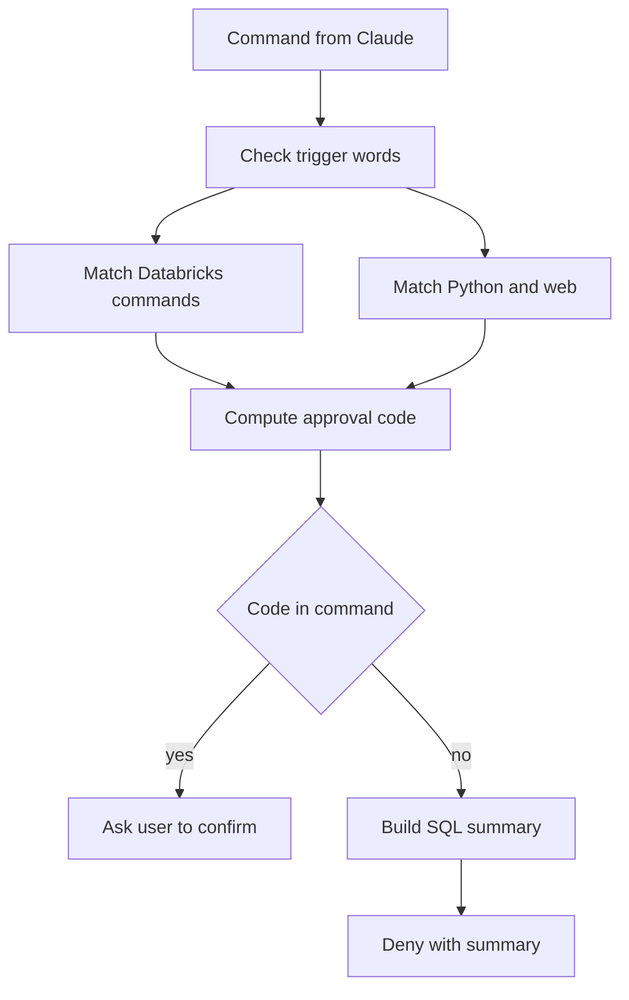

## Purpose

This is the approval gate for Databricks commands that can return or copy row data. Claude Code runs it before every Bash command. When the command looks like a Databricks data pull, the hook stops it and tells Claude to show the user a summary of what is being pulled; only after the user agrees can the same command run, and even then the user still clicks a confirmation dialog. It exists because a user cannot see a hook message before the dialog in VS Code, so the summary has to travel through Claude first. The file has 16 module-level constants; none is read by another file (searched 2026-11-20 with `git grep`, see Used by), so they are not listed in `exports`.

## Dependencies

**Depends on.**
- `hooks/sql_summary.py`, imported when the summary is built {src:hooks/pre-tool-bash-databricks-ask.py:234}. [[sql_summary]] / [sql_summary](sql_summary.md).
- `hooks/phi_patterns.py` indirectly, through `sql_summary` {src:hooks/sql_summary.py:18}. [[phi_patterns]] / [phi_patterns](phi_patterns.md).
- The folder of the hook is added to the import path so those imports resolve {src:hooks/pre-tool-bash-databricks-ask.py:57}.
- Environment variable `DATABRICKS_HOST`, read to extend the list of workspace hosts {src:hooks/pre-tool-bash-databricks-ask.py:204}.
- Standard library: `hashlib`, `json`, `os`, `re`, `shlex`, `sys`.

**Used by.**
- Product code: `settings.json` registers it for `PreToolUse` on `Bash` with `onFailure` set to `block` {src:settings.json:58} and {src:settings.json:62-63}. `sql_summary.py` names it in its header as its only caller {src:hooks/sql_summary.py:10}.
- Tests: `tests/hooks/test_guard_hooks.py` {src:tests/hooks/test_guard_hooks.py:31} and {src:tests/hooks/test_guard_hooks.py:306-368}; `tests/hooks/test_hooks.py` {src:tests/hooks/test_hooks.py:111-122} and {src:tests/hooks/test_hooks.py:218-241}; `tests/hooks/test_security_fixes.py` {src:tests/hooks/test_security_fixes.py:312-316}. All run it as a subprocess; none imports its constants.

## Behavior

**Entry.** `main` is called at the bottom of the file with no `__name__` guard, so importing the file runs the hook {src:hooks/pre-tool-bash-databricks-ask.py:287}. It reads one JSON object from standard input. Text that is not JSON, or JSON that is not an object, exits with code 2 and a message {src:hooks/pre-tool-bash-databricks-ask.py:257-264}. The command is read from `tool_input.command` {src:hooks/pre-tool-bash-databricks-ask.py:265-266}. If none of 14 trigger words occurs in it, the hook exits 0 with no output, which leaves the normal permission flow in charge {src:hooks/pre-tool-bash-databricks-ask.py:94-96} and {src:hooks/pre-tool-bash-databricks-ask.py:267-268}.

**Three outcomes.** `decide` prints one JSON object with a permission decision and reason, then exits 0 {src:hooks/pre-tool-bash-databricks-ask.py:99-102}.
- No valid code in the command: `deny`. The reason holds the summary, an instruction to Claude to show it to the user verbatim, and the code to put in front of the command on a re-run {src:hooks/pre-tool-bash-databricks-ask.py:118-131}.
- A matching code in the command: `ask`, so the user still approves in the dialog {src:hooks/pre-tool-bash-databricks-ask.py:276-277} and {src:hooks/pre-tool-bash-databricks-ask.py:251-252}.
- Any error while inspecting a command: `ask`, never a silent allow {src:hooks/pre-tool-bash-databricks-ask.py:282-283}.

**The approval code.** It is the first 8 hex characters of a SHA-256 hash {src:hooks/pre-tool-bash-databricks-ask.py:64} and {src:hooks/pre-tool-bash-databricks-ask.py:109-111}. The marker `TOLLGATE_DATA_APPROVED=<code>` is found anywhere in the command text with a regular expression {src:hooks/pre-tool-bash-databricks-ask.py:66} and {src:hooks/pre-tool-bash-databricks-ask.py:114-115}. For the Databricks command line path, the hash covers only the arguments that follow the `databricks` word, up to the next shell operator {src:hooks/pre-tool-bash-databricks-ask.py:275} and {src:hooks/pre-tool-bash-databricks-ask.py:151-156}. For the Python and web paths, it covers the whole command text with the marker removed {src:hooks/pre-tool-bash-databricks-ask.py:250} and {src:hooks/pre-tool-bash-databricks-ask.py:209-210}.

**Path 1: Databricks command line.** `databricks_invocations` splits the command into shell words with `shlex`, falling back to a plain space split if quoting is broken {src:hooks/pre-tool-bash-databricks-ask.py:134-141}. Each word whose base name is `databricks` starts one argument list {src:hooks/pre-tool-bash-databricks-ask.py:144-157}. `positionals_and_json` drops flags and the values of the flags listed in `VALUE_FLAGS`, and picks up the `--json` value {src:hooks/pre-tool-bash-databricks-ask.py:160-175} and {src:hooks/pre-tool-bash-databricks-ask.py:61-62}. `classify` gates `databricks api <verb> .../sql/statements` {src:hooks/pre-tool-bash-databricks-ask.py:192-196} and five command groups: `fs` (`cat`, `cp`), `genie` (six subcommands), `jobs` (`get-run-output`, `export-run`), `workspace` (`export`, `export-dir`), `query-history list` {src:hooks/pre-tool-bash-databricks-ask.py:69-77} and {src:hooks/pre-tool-bash-databricks-ask.py:197-199}. For an `api` call the SQL text comes from the `--json` value, inline or from a file named with a leading `@` {src:hooks/pre-tool-bash-databricks-ask.py:178-186}.

**Path 2: Python, SQL tools and web clients.** `classify_other` gates two shapes {src:hooks/pre-tool-bash-databricks-ask.py:218-230}:
- A web client (`curl`, `wget`, `http`, `https`, `xh`) {src:hooks/pre-tool-bash-databricks-ask.py:80} plus a Databricks host (Azure, cloud or gcp host names, `$DATABRICKS_HOST`, or the value of the variable) or a `/api/2.x/sql` path {src:hooks/pre-tool-bash-databricks-ask.py:89-90} and {src:hooks/pre-tool-bash-databricks-ask.py:203-206}.
- A Python-like program name (`python`, `ipython`, `uv`, `uvx`, `pyspark`, `spark-submit`, `dbsqlcli`) {src:hooks/pre-tool-bash-databricks-ask.py:79} whose command text matches one of three marker patterns: the SQL connector, SDK row calls, or Spark reads {src:hooks/pre-tool-bash-databricks-ask.py:81-88}.
The SQL shown comes from the first string after `.execute(`, `spark.sql(`, `.sql(` or `statement=`, with any combination of the prefix letters `r f b u` in either case {src:hooks/pre-tool-bash-databricks-ask.py:92-93} and {src:hooks/pre-tool-bash-databricks-ask.py:213-215}.

**The summary.** `build_reason` writes the label, the parsed facts, the table and column summary from [[sql_summary]], Claude's own description (labelled as such, or "none given"), and the SQL cut to 600 characters {src:hooks/pre-tool-bash-databricks-ask.py:233-243} and {src:hooks/pre-tool-bash-databricks-ask.py:63}.

## Diagram: module level (L2, required)

## Diagram: function level (L3, optional)

None: no function has branching that the signature does not show. The branching that matters is in `main`, drawn above.

## Notes

**Where the code and its own description disagree.**
- The header says the approval code is a hash of the whole command text with the marker removed, for every gated path {src:hooks/pre-tool-bash-databricks-ask.py:27-28}. For the Databricks command line path it hashes only the arguments after `databricks` {src:hooks/pre-tool-bash-databricks-ask.py:275}. Text before or after that command in the same shell line (for example a second command after `;`) is not covered by the code.
- The header says an internal error on a Databricks command returns `ask` and the hook "fails closed" {src:hooks/pre-tool-bash-databricks-ask.py:24}. That holds inside the `try` block {src:hooks/pre-tool-bash-databricks-ask.py:282-283}, but `tool_input` is read before the `try` {src:hooks/pre-tool-bash-databricks-ask.py:265-266}. Run on 2026-11-20 with a payload whose `tool_input` was a string, and again with a list, the hook exited with code 1 and an `AttributeError`, not 2 and not `ask`. Whether the harness blocks on code 1 depends on `onFailure: block` in settings {src:settings.json:63} `[uncertain]`.
- The header lists the Python launchers as `python, python3, ipython, uv, pyspark, spark-submit` {src:hooks/pre-tool-bash-databricks-ask.py:30}. The code also accepts `uvx` {src:hooks/pre-tool-bash-databricks-ask.py:79}. The header names `curl, wget or http` {src:hooks/pre-tool-bash-databricks-ask.py:35}; the code also accepts `https` and `xh` {src:hooks/pre-tool-bash-databricks-ask.py:80}.
- The header says the SQL text can follow any prefix "r, R, rb, fr, rf, f, u, b" {src:hooks/pre-tool-bash-databricks-ask.py:8}. The pattern accepts any one or two of those letters in any order, which is wider {src:hooks/pre-tool-bash-databricks-ask.py:93}.

**Gaps found while reading.**
- Only the first gated command is checked per run. After the first gated `databricks` command, `deny` or `ask` exits the program {src:hooks/pre-tool-bash-databricks-ask.py:102} and the loop stops {src:hooks/pre-tool-bash-databricks-ask.py:271-278}. If the first command carries a valid code, the hook asks and never looks at a second gated command or at the Python path in the same line {src:hooks/pre-tool-bash-databricks-ask.py:279}.
- Only the flags named in `VALUE_FLAGS` are known to take a value {src:hooks/pre-tool-bash-databricks-ask.py:61-62}. A different flag with a separate value puts that value among the positional words {src:hooks/pre-tool-bash-databricks-ask.py:173-174}, which shifts the group and subcommand check {src:hooks/pre-tool-bash-databricks-ask.py:198} and can let `databricks <flag> <value> fs cat ...` through. Not run; read from the code only.
- Gated paths the file names as out of reach: scripts run from a file, bundles and jobs, other languages, obfuscated commands {src:hooks/pre-tool-bash-databricks-ask.py:37-44}.

**Inputs that reach a path, command, network address or outbound text without a check.**
- The `--json` value starting with `@` is opened as a file path with only `~` expansion; no check on where it points {src:hooks/pre-tool-bash-databricks-ask.py:181-183}. Only the `statement` field of the parsed file is used {src:hooks/pre-tool-bash-databricks-ask.py:184}. A relative path is resolved against the hook's own working folder.
- The SQL text, including any values in a `WHERE` clause, is copied into the deny message up to 600 characters with no PHI scan {src:hooks/pre-tool-bash-databricks-ask.py:241-242}. The summary also prints the filter text {src:hooks/sql_summary.py:127}.
- The text matched by a Python marker is copied into the message {src:hooks/pre-tool-bash-databricks-ask.py:229}, and the first URL in a web command is echoed {src:hooks/pre-tool-bash-databricks-ask.py:222-224}.
- Claude's own description is placed in the message as given {src:hooks/pre-tool-bash-databricks-ask.py:239}.
- Nothing is run or fetched: the hook only parses text. The only file read is the `@` file above.

**Shared files.** The hook writes no file. No shared-file write exists.

**Tests.** `test_databricks_deny_then_ask` proves deny first, ask with the code, and deny again when the command changes {src:tests/hooks/test_hooks.py:111-122}. `test_approval_code_flow_for_new_path` proves the same for the Python path, including that adding an argument invalidates the code {src:tests/hooks/test_guard_hooks.py:351-355}. `test_new_paths_are_denied_with_code` proves eleven Python, SDK, SQL tool and web examples are denied {src:tests/hooks/test_guard_hooks.py:315-328}. `test_q09_*` proves the SQL text appears for each string prefix and quote style {src:tests/hooks/test_guard_hooks.py:335-344}. `test_unrelated_commands_pass_through` proves harmless lookalikes are not gated {src:tests/hooks/test_guard_hooks.py:357-360}. `test_summary_facts` and `test_unparsed_and_writes` prove table, production flag, filter, no limit and PHI column lines {src:tests/hooks/test_hooks.py:226-233}. `test_chained_and_quoted` only checks that the reason is not empty, so it would pass with a wrong summary {src:tests/hooks/test_hooks.py:235-236}. No test covers a non-object `tool_input`, a second gated command, or an unlisted value flag. The tests use `DATABRICKS_HOST` set to empty {src:tests/hooks/test_guard_hooks.py:307} and run the hook file directly {src:tests/hooks/test_guard_hooks.py:35}, so they depend on the hook being executable and on the `python3` named in its first line.
