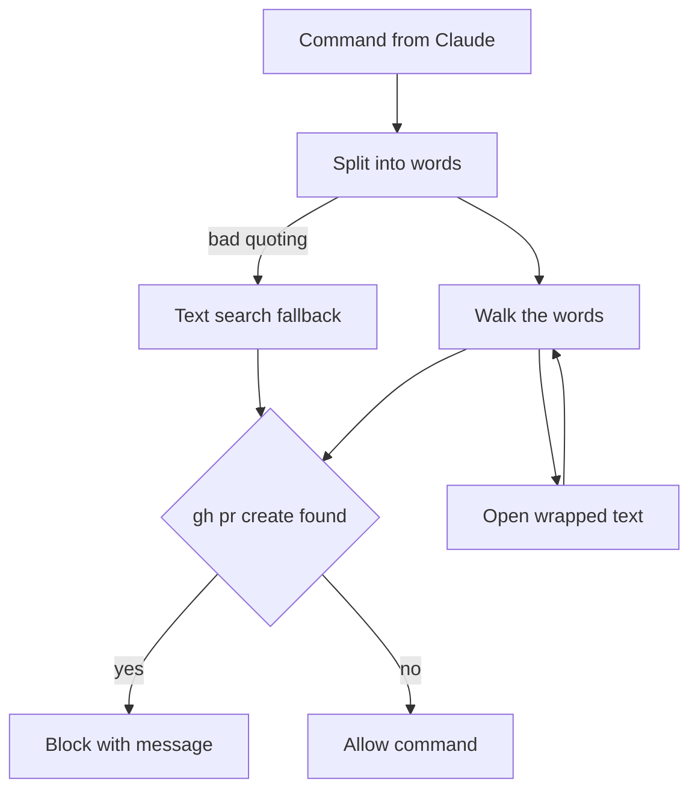

## Purpose

This hook stops Claude from opening a GitHub pull request until the user has seen the details and said to go ahead. Claude Code runs it before every Bash command. It looks for a real `gh pr create` call, not a mention of the phrase in a commit message or an echo, and refuses it with a message telling Claude to show the title, body, base branch and diff summary and wait.

## Dependencies

**Depends on.** Standard library only: `json`, `os`, `re`, `shlex`, `sys`. No repo file, no environment variable, no config file.

**Used by.**
- Product code: `settings.json` registers it for `PreToolUse` on `Bash` with `onFailure` set to `block` {src:settings.json:88} and {src:settings.json:92-93}.
- Tests: `tests/hooks/test_guard_hooks.py` runs it as a subprocess {src:tests/hooks/test_guard_hooks.py:27} and {src:tests/hooks/test_guard_hooks.py:127-154}. No other file mentions it by name (searched with `git grep` on 2026-11-20, outside `docs/`); the helper `hooks/gh_pr_create_detect.py` named in the inventory test is a separate file {src:tests/hooks/check_hook_inventory.py:48}.

## Behavior

**Entry.** The file runs `main` only when started as a program {src:hooks/pre-tool-bash-gate-pr-create.py:110-112}. `main` reads one JSON object from standard input; anything that is not an object raises an error {src:hooks/pre-tool-bash-gate-pr-create.py:98-100}. A payload whose `tool_name` is present and is not `Bash` returns 0 {src:hooks/pre-tool-bash-gate-pr-create.py:101-102}. The command is `tool_input.command` as text {src:hooks/pre-tool-bash-gate-pr-create.py:103}. A non-empty command that is a PR create call writes `MESSAGE` to standard error and returns exit code 2, which blocks the tool {src:hooks/pre-tool-bash-gate-pr-create.py:104-106} and {src:hooks/pre-tool-bash-gate-pr-create.py:26} and {src:hooks/pre-tool-bash-gate-pr-create.py:34-38}.

**Finding the call.**
- `tokenize` splits the command into shell words with `shlex`, treating operators such as `&&`, `;`, `|`, `(` and `)` as their own tokens {src:hooks/pre-tool-bash-gate-pr-create.py:43}. Comment characters are switched off, so text after a `#` is still read as words {src:hooks/pre-tool-bash-gate-pr-create.py:45}.
- `invokes_pr_create` walks the tokens. A token whose base name is `gh` (so `/usr/local/bin/gh` counts) followed by the words `pr` and `create` is a hit {src:hooks/pre-tool-bash-gate-pr-create.py:80-82}.
- `words_after_gh` takes the first two words after `gh`, skipping flags, and skipping the value of `-R`, `--repo` and `--hostname`; it stops at an operator token {src:hooks/pre-tool-bash-gate-pr-create.py:49-64} and {src:hooks/pre-tool-bash-gate-pr-create.py:30}. Fewer than two words are padded with empty text {src:hooks/pre-tool-bash-gate-pr-create.py:63}.
- Wrapped commands: a token that follows `eval`, follows a shell flag ending in `c` such as `-c` or `-lc`, or contains `$(` or a backtick, is parsed again as a command of its own {src:hooks/pre-tool-bash-gate-pr-create.py:67-74} and {src:hooks/pre-tool-bash-gate-pr-create.py:83-85}. This goes down at most 3 levels {src:hooks/pre-tool-bash-gate-pr-create.py:27} and {src:hooks/pre-tool-bash-gate-pr-create.py:83}.
- A phrase inside a quoted argument, such as a commit message, is one token and is not matched, so it is allowed {src:hooks/pre-tool-bash-gate-pr-create.py:80-82}.
- If `shlex` cannot parse the command (for example an unclosed quote), `is_pr_create` falls back to a text search for `gh`, optional flags, `pr`, `create` {src:hooks/pre-tool-bash-gate-pr-create.py:89-94} and {src:hooks/pre-tool-bash-gate-pr-create.py:33}.

**Failure.** Any other error, including bad JSON, prints the error class name and returns 2 {src:hooks/pre-tool-bash-gate-pr-create.py:111-116}.

## Diagram: module level (L2, required)

## Diagram: function level (L3, optional)

None: no function has branching that the signature does not show. The wrapper recursion is drawn above.

## Notes

**Where the code and its own description disagree.**
- None found. The header says a command that cannot be parsed falls back to a text match, and that "any other internal error fails closed (exit 2)" {src:hooks/pre-tool-bash-gate-pr-create.py:14-15}. The code does that: the outer handler turns any exception into exit code 2 {src:hooks/pre-tool-bash-gate-pr-create.py:113-115}, and the comment on that line says so. The test agrees {src:tests/hooks/test_guard_hooks.py:152-154}. An earlier version of the header said "fails open" and disagreed with the code; that wording is gone.

**What the gate does not see (read from the code, not run).**
- Only the words `gh`, `pr`, `create` in a row are matched {src:hooks/pre-tool-bash-gate-pr-create.py:81}. Other ways to open a PR (the `gh api` command, a web request to the GitHub API, another tool) are not matched.
- A variable or alias that stands for `gh`, or a command run from a script file, is not seen: the hook reads the command text only.
- Wrappers nested deeper than 3 levels are not opened {src:hooks/pre-tool-bash-gate-pr-create.py:83}.
- A value flag other than `-R`, `--repo`, `--hostname` placed between `gh` and `pr` is not known to take a value {src:hooks/pre-tool-bash-gate-pr-create.py:30}, so its value would count as one of the two words.

**Inputs that reach a path, command, network address or outbound text.** None reaches a file, a shell or the network: the hook only parses text. The outbound text is the fixed `MESSAGE` {src:hooks/pre-tool-bash-gate-pr-create.py:34-38} and, on error, the error class name {src:hooks/pre-tool-bash-gate-pr-create.py:114}. Every input is therefore checked by being parsed, and none is copied out.

**Shared files.** The hook writes no file. No shared-file write exists.

**Tests.** `test_real_invocations_blocked` proves eight forms are blocked: plain, with flags, after `cd ... &&`, with `-R`, with a full path, inside `bash -c`, inside `eval`, inside `$( )` {src:tests/hooks/test_guard_hooks.py:131-136}. `test_mentions_allowed` proves a commit message, an echo, `gh pr view`, `gh pr list`, `gh pr status` and `git push` pass {src:tests/hooks/test_guard_hooks.py:138-141}. `test_unparseable_command_falls_back_to_text_match` proves an unclosed quote around a real call is blocked and an unclosed quote around a mention is allowed {src:tests/hooks/test_guard_hooks.py:148-150}. `test_fails_closed_on_bad_input` proves four malformed payloads give code 2 {src:tests/hooks/test_guard_hooks.py:152-154}. `test_message_tells_model_to_wait` checks two words in the message and nothing about its meaning {src:tests/hooks/test_guard_hooks.py:143-146}. The tests build the phrase from two pieces so the test file does not trip the hook itself {src:tests/hooks/test_guard_hooks.py:28}. No test covers the 3 level limit or a value flag outside the known three. The tests do not use a machine path; they need `python3` on the path for the hook's first line.
