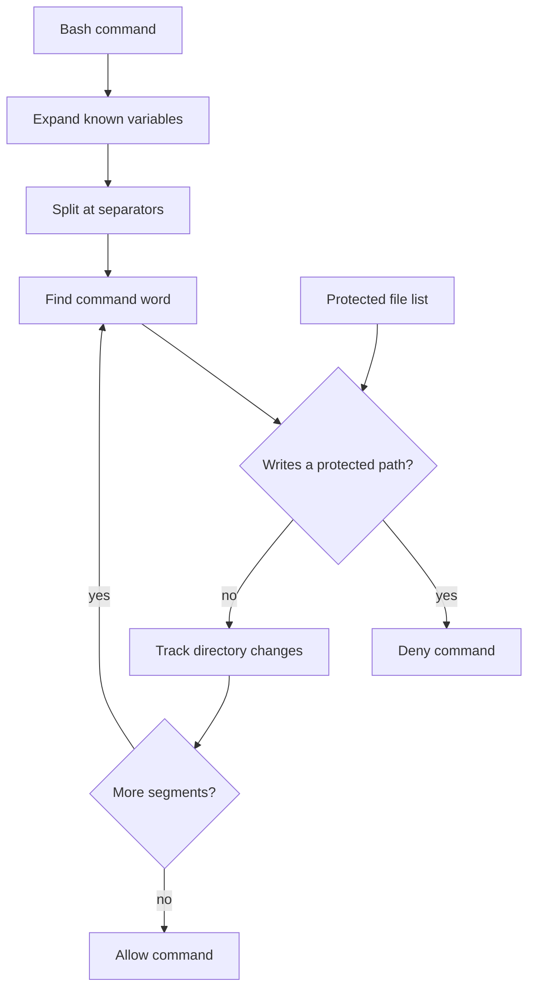

## Purpose

A PreToolUse hook for Bash. It denies a command that writes into the read-only code directory named by `TOLLGATE_CODE_DIR`, or into one of Tollgate's own files (user settings, credentials, the installer's `~/.claude/tollgate-config` file, `~/.tollgate` and `~/.claude/tollgate`, the files named by `TOLLGATE_CONNECTORS`, `TOLLGATE_PATHS` and `TOLLGATE_CONFIG`, shell profiles, the repo's `hooks` folder and `settings.json`). It is the Bash side of a pair: the Write, Edit and NotebookEdit side is [[pre-tool-write-guard-path]] ([pre-tool-write-guard-path](pre-tool-write-guard-path.md)). The file list is shared through [[protected_paths]] ([protected_paths](lib/protected_paths.md)). The hook reads the command text; it is a speed bump and not a sandbox.

## Dependencies

**Depends on.** Standard library (`json`, `os`, `re`, `shlex`, `sys`) and [protected_paths](lib/protected_paths.md), imported as `pp` from the `lib` folder next to this file {src:hooks/pre-tool-bash-guard-code-dir.py:41-45}. If that import fails, the hook exits 2 {src:hooks/pre-tool-bash-guard-code-dir.py:46-49}. It reads the environment variable `TOLLGATE_CODE_DIR` {src:hooks/pre-tool-bash-guard-code-dir.py:256}, and, through the helper, `HOME`, `TOLLGATE_HOME`, `CLAUDE_DOTFILES` and the three file variables. It reads the PreToolUse JSON on stdin: `tool_input.command` and `cwd` {src:hooks/pre-tool-bash-guard-code-dir.py:258-260}.

**Used by.** Product code: `settings.json` binds it to the Bash matcher {src:settings.json:72}. Tests: [test_guard_hooks](../tests/hooks/test_guard_hooks.md) {src:tests/hooks/test_guard_hooks.py:30} {src:tests/hooks/test_guard_hooks.py:203}. [test_self_protection](../tests/hooks/test_self_protection.md) covers the protected Tollgate files half {src:tests/hooks/test_self_protection.py:26} {src:tests/hooks/test_self_protection.py:106} {src:tests/hooks/test_self_protection.py:139} and the splitting of chained commands {src:tests/hooks/test_self_protection.py:182}.

## Behavior

**Entry point.** `main` reads the command and the working directory (the payload `cwd`, else the process directory) {src:hooks/pre-tool-bash-guard-code-dir.py:258-260}. The protected list always applies {src:hooks/pre-tool-bash-guard-code-dir.py:261}. When `TOLLGATE_CODE_DIR` is set, its resolved path is added as a protected folder, and `$TOLLGATE_CODE_DIR` and `${TOLLGATE_CODE_DIR}` in the command text are replaced by that path {src:hooks/pre-tool-bash-guard-code-dir.py:263-267}. When it is unset, the code folder part is silent and only the Tollgate files are guarded {src:hooks/pre-tool-bash-guard-code-dir.py:262-263}. `$HOME`, `$TOLLGATE_HOME` and `$CLAUDE_DOTFILES` are then replaced by their values {src:hooks/pre-tool-bash-guard-code-dir.py:268}. A violation prints a deny and exits 0 {src:hooks/pre-tool-bash-guard-code-dir.py:269-270} {src:hooks/pre-tool-bash-guard-code-dir.py:75-78}. Bad input, a missing `command` key or any other error exits 2 {src:hooks/pre-tool-bash-guard-code-dir.py:273-275}.

**Splitting the command.** First `mark_breaks` rewrites the text: outside quotes, a newline, a carriage return, a backtick, `$(` and `)` each become ` ; ` {src:hooks/pre-tool-bash-guard-code-dir.py:111-112}. Inside double quotes only `$(` and a backtick break; the quote is closed before the break and reopened after the closing `)` or backtick, so text around a substitution keeps its quoting {src:hooks/pre-tool-bash-guard-code-dir.py:102-103} {src:hooks/pre-tool-bash-guard-code-dir.py:107-108}. Inside single quotes nothing changes {src:hooks/pre-tool-bash-guard-code-dir.py:99-101}, and a backslash keeps the next character as it is outside single quotes {src:hooks/pre-tool-bash-guard-code-dir.py:97-98}. Then `tokenize` runs `shlex` over the rewritten text with `;`, `&`, `|`, `<` and `>` as their own tokens {src:hooks/pre-tool-bash-guard-code-dir.py:120-121}. If the quotes do not balance, it falls back to a plain blank split of the original command, without the rewrite {src:hooks/pre-tool-bash-guard-code-dir.py:122-125}. Tokens made only of `;`, `&` and `|` end a segment {src:hooks/pre-tool-bash-guard-code-dir.py:128-129} {src:hooks/pre-tool-bash-guard-code-dir.py:136-145}. After each segment the tracked directory follows a `cd` or `pushd` {src:hooks/pre-tool-bash-guard-code-dir.py:247-252} {src:hooks/pre-tool-bash-guard-code-dir.py:240-244}. The effect: a second command after a newline, inside `$(...)` or inside backticks is checked like any other segment (run on 2026-11-21: `echo a` then a newline then `rm ~/.zshrc`, `echo $(rm ~/.zshrc)` and `echo "$(rm ~/.zshrc)"` were all denied).

**Checking one segment.** In this order {src:hooks/pre-tool-bash-guard-code-dir.py:219-237}:
1. An output redirect (`>`, `>>`, `&>`) whose next word is protected is a violation {src:hooks/pre-tool-bash-guard-code-dir.py:156-160} {src:hooks/pre-tool-bash-guard-code-dir.py:132-133}.
2. The command word is found after leading `VAR=value` words and the wrappers `sudo`, `command`, `env`, `time`, `nice`, `nohup` and `exec` {src:hooks/pre-tool-bash-guard-code-dir.py:148-153} {src:hooks/pre-tool-bash-guard-code-dir.py:69}.
3. For `git`, only the code folder is checked: the target comes from `-C` or the tracked directory, and the subcommand must not be on the read-only list {src:hooks/pre-tool-bash-guard-code-dir.py:185-195} {src:hooks/pre-tool-bash-guard-code-dir.py:57-58}. With the code folder unset there is nothing to check {src:hooks/pre-tool-bash-guard-code-dir.py:227}.
4. For `sh`, `bash`, `zsh`, `dash` and `ksh`, the body of the first `-c` is checked again as a whole command {src:hooks/pre-tool-bash-guard-code-dir.py:211-216} {src:hooks/pre-tool-bash-guard-code-dir.py:228-230}.
5. For `python`, `node`, `perl`, `ruby` and `php`, the body after the first inline flag (`-c`, `-e`, `-E`, `-p`, `-r`, `--eval`, `--command`) is checked: it must hold a write word and name a protected path or a marker such as `.zshrc` or `.claude/settings.json` {src:hooks/pre-tool-bash-guard-code-dir.py:198-208} {src:hooks/pre-tool-bash-guard-code-dir.py:61-68} {src:hooks/pre-tool-bash-guard-code-dir.py:231-232}.
6. For `cp`, `install` and `ln`, only the destination counts: the last word, or a `-t` or `--target-directory` value, so reading from a protected place is allowed {src:hooks/pre-tool-bash-guard-code-dir.py:167-173} {src:hooks/pre-tool-bash-guard-code-dir.py:233-234}.
7. For `rm`, `mv`, `touch`, `tee`, `mkdir`, `rmdir`, `truncate`, `dd`, `chmod`, `chown`, and `sed` with `-i` or `--in-place`, any word that is protected counts, with `of=` removed for `dd` {src:hooks/pre-tool-bash-guard-code-dir.py:55-56} {src:hooks/pre-tool-bash-guard-code-dir.py:176-182} {src:hooks/pre-tool-bash-guard-code-dir.py:163-164} {src:hooks/pre-tool-bash-guard-code-dir.py:235-236}.
8. Anything else is allowed {src:hooks/pre-tool-bash-guard-code-dir.py:237}.

**How a path is judged.** A relative path is resolved against the tracked directory, symlinks are resolved, and the comparison is in lower case, as in [protected_paths](lib/protected_paths.md) {src:hooks/pre-tool-bash-guard-code-dir.py:85-88}. Reads (`cat`, `ls`, `grep`) are allowed.

## Diagram: module level (L2, required)

## Diagram: function level (L3, optional)

None: no function has branching that the signature does not show.

## Notes

**Where the code and its own description disagree.**
- The header lists command substitution as not caught {src:hooks/pre-tool-bash-guard-code-dir.py:24-25}. The code now splits at `$(` and a backtick, so a write inside a substitution is caught {src:hooks/pre-tool-bash-guard-code-dir.py:111-112}. The header limit list was not updated.
- The header says git subcommands other than a read-only one are denied when the target is in the code folder {src:hooks/pre-tool-bash-guard-code-dir.py:15-20}. The read-only list includes `config` and `remote`, which can write the repository's own config {src:hooks/pre-tool-bash-guard-code-dir.py:57-58}. Run on 2026-11-21: `git -C <code dir> config user.name x` was allowed.
- The header says the protected Tollgate files are always active {src:hooks/pre-tool-bash-guard-code-dir.py:28-29}. That holds for the write verbs, redirects and inline bodies. The git check still applies only to the code folder, so `git -C ~/.tollgate commit` is not checked {src:hooks/pre-tool-bash-guard-code-dir.py:227}.
- The docstring says the helper drops "wrapper commands such as sudo" {src:hooks/pre-tool-bash-guard-code-dir.py:149}. Only the wrapper word itself is skipped, not its options, so `sudo -n rm <protected file>` leaves `-n` as the command word and is allowed {src:hooks/pre-tool-bash-guard-code-dir.py:151}. Run on 2026-11-21 with a test home folder: allowed.

**Limits found by running the hook on 2026-11-21 (all allowed).** These go beyond the header's own limit list {src:hooks/pre-tool-bash-guard-code-dir.py:24-27}:
- A bare subshell `(rm ...)`. Only `)` is split, not `(`, so the verb is read as `(rm` {src:hooks/pre-tool-bash-guard-code-dir.py:111} {src:hooks/pre-tool-bash-guard-code-dir.py:225}. (`$(rm ...)` is caught; see above.)
- Commands that are not on the write list: `rsync`, `xargs rm`, and `perl -pi -e '...' <file>` (the inline check looks at the code text, not the file argument) {src:hooks/pre-tool-bash-guard-code-dir.py:55-56} {src:hooks/pre-tool-bash-guard-code-dir.py:198-208}.
- A path held in a variable that is not `HOME`, `TOLLGATE_HOME`, `CLAUDE_DOTFILES` or `TOLLGATE_CODE_DIR`, a script file that writes, an encoded name, and a symlink made after the check. The header names these {src:hooks/pre-tool-bash-guard-code-dir.py:24-27}.
- Writes through a tool that takes its target from a config file {src:hooks/pre-tool-bash-guard-code-dir.py:26-27}.
- A command whose quotes do not balance: the fallback splits on blanks only, so a newline or `$(` is not a break there {src:hooks/pre-tool-bash-guard-code-dir.py:122-125}. The shell itself would reject such text, so this is a small gap.

**False blocks from the new splitting.** An unquoted `)` also splits, so `echo a) rm ~/.zshrc` is denied although nothing would run `rm` {src:hooks/pre-tool-bash-guard-code-dir.py:111}; the same text inside double quotes is allowed {src:hooks/pre-tool-bash-guard-code-dir.py:104-106}. A heredoc body is read line by line as commands, so a body line that looks like a protected write (`rm ~/.zshrc` inside `cat <<EOF ... EOF`) is denied too (run on 2026-11-21). A newline or `)` inside single quotes is left alone {src:hooks/pre-tool-bash-guard-code-dir.py:99-101}.

**Inputs that reach a path, command, address or outbound text.** The command text is parsed and compared only. No path from it is opened, run or sent anywhere; the hook starts no command and opens no file. `TOLLGATE_CODE_DIR` is resolved with `realpath` and substituted into the command text before parsing; no check exists on its value {src:hooks/pre-tool-bash-guard-code-dir.py:264-265}. The deny text is fixed {src:hooks/pre-tool-bash-guard-code-dir.py:70-72}.

**Constants.** The module has 14 module level constants. No other file reads one by name (searched 2026-11-21 under `tests/` and `hooks/`; the tests run the file as a program), so none is listed in `exports`.

**Writes to shared files.** None. It writes only to stdout and stderr. Searched 2026-11-21: `hooks/pre-tool-bash-guard-code-dir.py` for `open(`, `write_text` and `os.replace`; no match.
