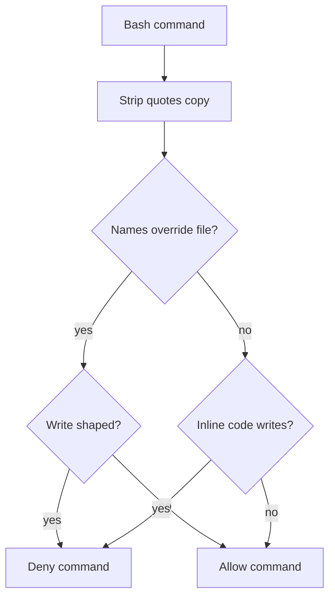

## Purpose

A PreToolUse hook for Bash. It denies a command that looks like it writes a file named `*-gate-override.md`. The owner creates those files from a terminal; they let a person skip a gate check once, so the model must not make them. It is the Bash side of a pair: the Write, Edit and NotebookEdit side is [pre-tool-write-guard-path](pre-tool-write-guard-path.md). The hook reads the command text. It is a speed bump and not a sandbox.

## Dependencies

**Depends on.** Standard library only: `fnmatch`, `json`, `re`, `sys` {src:hooks/pre-tool-bash-guard-gate-override.py:31-34}. It reads the PreToolUse JSON on stdin (`tool_input.command`) {src:hooks/pre-tool-bash-guard-gate-override.py:104-108}. No environment variable, no file.

**Used by.** Product code: `settings.json` binds it to the Bash matcher {src:settings.json:82}. Tests: [test_gate_override_bash_guard](../tests/hooks/test_gate_override_bash_guard.md) runs it as a program {src:tests/hooks/test_gate_override_bash_guard.py:21}, and [test_security_fixes](../tests/hooks/test_security_fixes.md) checks it exits 2 on a bad payload {src:tests/hooks/test_security_fixes.py:313-316}. [test_self_protection](../tests/hooks/test_self_protection.md) covers the built-name cases and the allowed commands {src:tests/hooks/test_self_protection.py:209} {src:tests/hooks/test_self_protection.py:232}.

## Behavior

**Entry point.** Input that is not JSON, not an object, or any error exits 2, which blocks the command {src:hooks/pre-tool-bash-guard-gate-override.py:103-107} {src:hooks/pre-tool-bash-guard-gate-override.py:113-115}. A `tool_input` that is not an object, or a command that is not text, is treated as no command and allowed {src:hooks/pre-tool-bash-guard-gate-override.py:107-109}. A violation prints a deny and exits 0 {src:hooks/pre-tool-bash-guard-gate-override.py:56-59} {src:hooks/pre-tool-bash-guard-gate-override.py:109-110}.

**The decision.** `violates` makes a second copy of the command with quotes and backslashes removed, the way the shell joins `a-gate-"override".md` {src:hooks/pre-tool-bash-guard-gate-override.py:62-64} {src:hooks/pre-tool-bash-guard-gate-override.py:95}. The command counts as naming an override file when either copy holds `-gate-override.md` in any letter case {src:hooks/pre-tool-bash-guard-gate-override.py:37} {src:hooks/pre-tool-bash-guard-gate-override.py:96}, or when a word could expand to one (next paragraph) {src:hooks/pre-tool-bash-guard-gate-override.py:97}. If it names one, the command is denied when it is write shaped {src:hooks/pre-tool-bash-guard-gate-override.py:98}. If it does not, the only remaining check is for inline interpreter code {src:hooks/pre-tool-bash-guard-gate-override.py:99}.

**Words that could expand to the name.** A word that holds `gate-` is cut at the first `gate-` {src:hooks/pre-tool-bash-guard-gate-override.py:43} {src:hooks/pre-tool-bash-guard-gate-override.py:77-78}. If the tail holds `$`, a backtick or `{`, it could become anything, so it counts {src:hooks/pre-tool-bash-guard-gate-override.py:44} {src:hooks/pre-tool-bash-guard-gate-override.py:79-80}. If the tail holds `*`, `?` or `[` and the glob would match `override.md`, it counts too {src:hooks/pre-tool-bash-guard-gate-override.py:45-46} {src:hooks/pre-tool-bash-guard-gate-override.py:81-82}.

**Write shaped.** Redirects that are harmless are removed first: a descriptor copy such as `2>&1`, and output to `/dev/null` {src:hooks/pre-tool-bash-guard-gate-override.py:41} {src:hooks/pre-tool-bash-guard-gate-override.py:68}. Any `>` left means write shaped {src:hooks/pre-tool-bash-guard-gate-override.py:69-70}. Otherwise it is write shaped when any word of the command is a write verb: `echo`, `printf`, `tee`, `cp`, `mv`, `dd`, `install`, `ln`, `touch`, `truncate`, `sed`, `awk`, `perl`, `ruby`, `node`, `python`, `python3`, `sh`, `bash`, `zsh`, `rm`, `rsync`, `curl`, `wget` {src:hooks/pre-tool-bash-guard-gate-override.py:38-40} {src:hooks/pre-tool-bash-guard-gate-override.py:71-72}. The verb can be anywhere in the command, not tied to the override file.

**Inline interpreter code.** With no override name in sight, a command is still denied when it has an interpreter (`python`, `node`, `perl`, `ruby`, `php`) {src:hooks/pre-tool-bash-guard-gate-override.py:47}, an inline marker (`-c`, `-e`, `-E`, `-p`, `-r`, `--eval` or a heredoc `<<`) {src:hooks/pre-tool-bash-guard-gate-override.py:48}, the word `gate` or `override` anywhere {src:hooks/pre-tool-bash-guard-gate-override.py:90-91}, and a write word such as `open(`, `write`, `unlink`, `rename` or `subprocess` {src:hooks/pre-tool-bash-guard-gate-override.py:49-51} {src:hooks/pre-tool-bash-guard-gate-override.py:88-91}.

**Reads.** `cat`, `ls`, `grep` and `head` on an override file stay allowed, as long as nothing in the command is write shaped {src:hooks/pre-tool-bash-guard-gate-override.py:98}.

## Diagram: module level (L2, required)

## Diagram: function level (L3, optional)

None: no function has branching that the signature does not show.

## Notes

**Where the code and its own description disagree.**
- The header lists the write verbs without `rsync`, `curl` and `wget` {src:hooks/pre-tool-bash-guard-gate-override.py:16-19}. The code has all three {src:hooks/pre-tool-bash-guard-gate-override.py:40}.
- The header lists "cat with a redirect" as a verb {src:hooks/pre-tool-bash-guard-gate-override.py:18-19}. `cat` is not in the verb set; the redirect rule is what catches it {src:hooks/pre-tool-bash-guard-gate-override.py:38-40} {src:hooks/pre-tool-bash-guard-gate-override.py:69-70}.

**Known limits.** The header names them: a glob that hides the `gate-` part (`a-g*te-override.md`), a script that writes the file inside itself, encoded names, and names built by code in a script file {src:hooks/pre-tool-bash-guard-gate-override.py:24-26}. Run on 2026-11-21: `printf x > t/PROJ-1-g*te-override.md` was allowed. Other cases not on the verb list, such as an editor, are also allowed {src:hooks/pre-tool-bash-guard-gate-override.py:38-40}. A hard link to an existing override file is not seen, because the hook sees only text.

**Too wide in places.** Because the write verb or `>` can be anywhere in the command, a harmless command that names an override file and also redirects, for example `ls <file> > list.txt`, is denied {src:hooks/pre-tool-bash-guard-gate-override.py:98} {src:hooks/pre-tool-bash-guard-gate-override.py:69-72}. Run on 2026-11-21: denied. The deny text says the owner creates these files from a terminal {src:hooks/pre-tool-bash-guard-gate-override.py:52-53}.

**Inputs that reach a path, command, address or outbound text.** The command text is only matched against patterns. It is never opened, run or sent; the hook opens no file and starts no command {src:hooks/pre-tool-bash-guard-gate-override.py:94-99}. The deny text is fixed {src:hooks/pre-tool-bash-guard-gate-override.py:52-53}.

**Constants.** The module has 13 module level constants. No other file reads one by name (searched 2026-11-21 under `tests/`; the tests run the file as a program), so none is listed in `exports`.

**Writes to shared files.** None. It writes only to stdout and stderr. Searched 2026-11-21: `hooks/pre-tool-bash-guard-gate-override.py` for `open(`, `write_text` and `os.replace`; no match.
