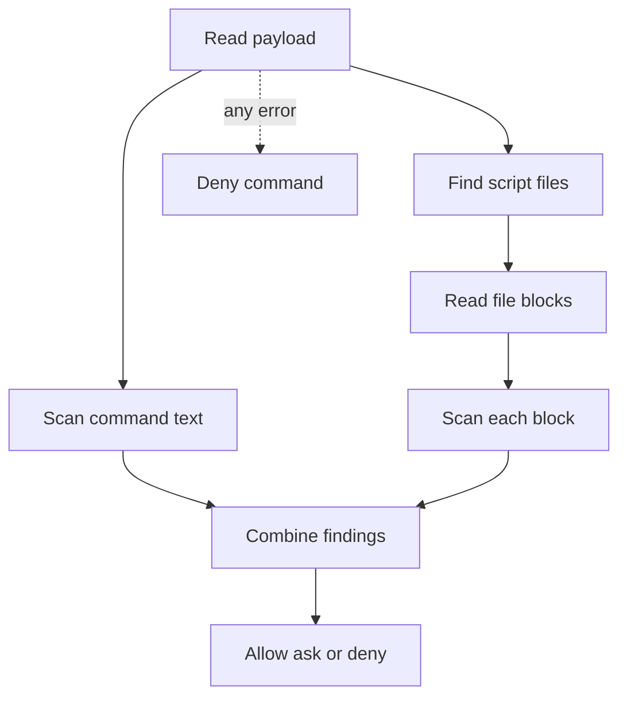
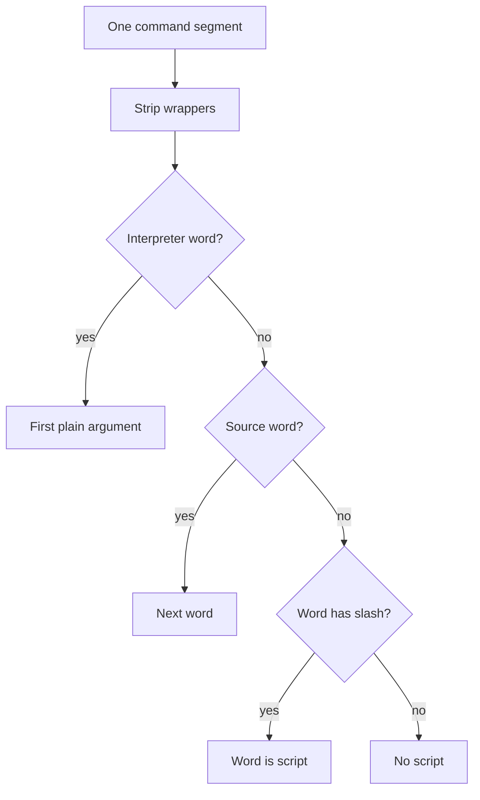

## Purpose

A PreToolUse hook for the Bash tool. Before a Bash command runs, it scans the command text, and the script files the command names, with the shared PHI rules, and answers deny, ask or warn according to the strongest finding. It exists so that patient data typed into a command, or sitting in a script the command is about to run, is caught before the command runs. Script files are only read, never run.

## Dependencies

**Depends on.**

- [[phi_patterns]] ([phi_patterns](phi_patterns.md)): supplies `LEVEL_RANK`, `pre_tool_decision` and `scan_levels`. It is imported inside `main` after the hooks folder is put on the import path {src:hooks/pre-tool-bash-scan-phi.py:315} {src:hooks/pre-tool-bash-scan-phi.py:316}.
- Standard library: `glob`, `itertools`, `json`, `os`, `re`, `shlex`, `stat`, `sys`, `typing` {src:hooks/pre-tool-bash-scan-phi.py:47-55}.
- The hook's own environment variables, which are expanded inside script paths {src:hooks/pre-tool-bash-scan-phi.py:243}.
- Input is the PreToolUse JSON on stdin: `tool_input.command` and `cwd` {src:hooks/pre-tool-bash-scan-phi.py:318-323}.

**Used by.**

- Product code: `settings.json` binds it to the `Bash` matcher {src:settings.json:48} {src:settings.json:52}.
- Tests: [test_hooks](../tests/hooks/test_hooks.md) {src:tests/hooks/test_hooks.py:143}, [test_phi_hook_levels](../tests/hooks/test_phi_hook_levels.md) {src:tests/hooks/test_phi_hook_levels.py:26}, [test_phi_safety_speed](../tests/hooks/test_phi_safety_speed.md) {src:tests/hooks/test_phi_safety_speed.py:42}.
- Searched 2026-11-19: every file under the repo except `.git`, `docs/` and `__pycache__` for the file name. The only other hit is a checklist sentence in `tests/hooks/e2e-wiring-checklist.md`.

## Behavior

**Main flow.** The hook reads the payload and takes `tool_input.command` {src:hooks/pre-tool-bash-scan-phi.py:318} {src:hooks/pre-tool-bash-scan-phi.py:319}. A blank command returns with no output {src:hooks/pre-tool-bash-scan-phi.py:320} {src:hooks/pre-tool-bash-scan-phi.py:321}. Otherwise the command text is scanned as a source named `Bash command text` {src:hooks/pre-tool-bash-scan-phi.py:322}. Each script path found adds a source named `script file` plus the base name, with its findings sorted strongest first {src:hooks/pre-tool-bash-scan-phi.py:324-326}. `pre_tool_decision` turns the sources into output, and the hook prints it only when there is one {src:hooks/pre-tool-bash-scan-phi.py:327-329}.

**What the decision looks like.** deny blocks the command, ask makes Claude Code prompt the user, and warn carries no permission decision, only a visible message and context {src:hooks/phi_patterns.py:546-548} {src:hooks/phi_patterns.py:549-555}. The message names rule labels and source names, never the matched text {src:hooks/phi_patterns.py:529-530}.

**Fails closed.** The whole `main()` call sits in a `try`. Any exception (bad JSON, import error, scan error) prints a deny with the exception type name {src:hooks/pre-tool-bash-scan-phi.py:340-346}. The process then exits 0 in every case, so the decision travels only in the printed JSON {src:hooks/pre-tool-bash-scan-phi.py:347}. `main()` runs when the file is loaded, not behind a `__name__` check {src:hooks/pre-tool-bash-scan-phi.py:340} {src:hooks/pre-tool-bash-scan-phi.py:341}.

**Splitting the command.** Newlines become ` ; ` and the text is tokenised with `shlex` with punctuation as separate tokens {src:hooks/pre-tool-bash-scan-phi.py:109-113} {src:hooks/pre-tool-bash-scan-phi.py:124}. If a quote is unbalanced, the hook parses line by line, and a line that still fails is split on whitespace, so tokenising never fails {src:hooks/pre-tool-bash-scan-phi.py:125-134}. Tokens made only of `( ) ; < > | &` start a new segment {src:hooks/pre-tool-bash-scan-phi.py:101} {src:hooks/pre-tool-bash-scan-phi.py:147-149}. The word after a lone `<` is kept as a redirect file; `<<` and `<<<` are different tokens and are not {src:hooks/pre-tool-bash-scan-phi.py:150} {src:hooks/pre-tool-bash-scan-phi.py:151}.

**Finding the script in one segment.** Leading `VAR=value` words are dropped {src:hooks/pre-tool-bash-scan-phi.py:205} {src:hooks/pre-tool-bash-scan-phi.py:206}. So are `uv run` with its value-taking flags {src:hooks/pre-tool-bash-scan-phi.py:207-210} and the wrapper commands `sudo`, `env`, `timeout`, `nice`, `ionice`, `stdbuf`, `nohup`, `time`, `exec` and `command` with their flags {src:hooks/pre-tool-bash-scan-phi.py:71-82} {src:hooks/pre-tool-bash-scan-phi.py:211-213}. For `timeout` the duration word is dropped as well {src:hooks/pre-tool-bash-scan-phi.py:214} {src:hooks/pre-tool-bash-scan-phi.py:215}. What is left decides the script:

- A `python`, `bash`, `sh`, `zsh`, `node`, `ruby` or `perl` command: the script is the first non-option argument {src:hooks/pre-tool-bash-scan-phi.py:66} {src:hooks/pre-tool-bash-scan-phi.py:227} {src:hooks/pre-tool-bash-scan-phi.py:228}. An inline-code flag such as `-c`, or a lone `-`, means there is no script {src:hooks/pre-tool-bash-scan-phi.py:177} {src:hooks/pre-tool-bash-scan-phi.py:178}. A flag that takes a value skips its value word {src:hooks/pre-tool-bash-scan-phi.py:179} {src:hooks/pre-tool-bash-scan-phi.py:180}. Unknown interpreter names use the Python rule {src:hooks/pre-tool-bash-scan-phi.py:166} {src:hooks/pre-tool-bash-scan-phi.py:167}.
- `source` or `.`: the script is the next word {src:hooks/pre-tool-bash-scan-phi.py:229} {src:hooks/pre-tool-bash-scan-phi.py:230}.
- After `uv run`, a command word ending in `.py` is the script {src:hooks/pre-tool-bash-scan-phi.py:231} {src:hooks/pre-tool-bash-scan-phi.py:232}.
- Any other command word that contains a slash is the script {src:hooks/pre-tool-bash-scan-phi.py:233}. A bare command name with no slash gives none, so `cat file` names no file to scan {src:hooks/pre-tool-bash-scan-phi.py:233}.

**Turning words into paths.** `~` and variables set in the hook's own environment are expanded. A word still holding `$` or a backtick names no file {src:hooks/pre-tool-bash-scan-phi.py:243-245}. The word is joined to the working directory (an absolute word stays absolute) {src:hooks/pre-tool-bash-scan-phi.py:246}. A word with `*`, `?` or `[` is a glob: at most 10 matches are kept, and only regular files of 1 MB or less {src:hooks/pre-tool-bash-scan-phi.py:103} {src:hooks/pre-tool-bash-scan-phi.py:247-250} {src:hooks/pre-tool-bash-scan-phi.py:258}. A command over 32768 characters is not parsed at all, so it names no files {src:hooks/pre-tool-bash-scan-phi.py:64} {src:hooks/pre-tool-bash-scan-phi.py:267} {src:hooks/pre-tool-bash-scan-phi.py:268}. Paths are deduplicated and capped at 10 per command {src:hooks/pre-tool-bash-scan-phi.py:61} {src:hooks/pre-tool-bash-scan-phi.py:272-276}.

**Reading a file.** A file with a null byte in its first 8192 bytes counts as binary and yields no text {src:hooks/pre-tool-bash-scan-phi.py:60} {src:hooks/pre-tool-bash-scan-phi.py:286} {src:hooks/pre-tool-bash-scan-phi.py:287}. Otherwise the file is read in blocks of 256 KB, and each block after the first starts with the last 1024 bytes of the block before it {src:hooks/pre-tool-bash-scan-phi.py:58} {src:hooks/pre-tool-bash-scan-phi.py:59} {src:hooks/pre-tool-bash-scan-phi.py:291-295}. A path that is not a regular file gives no findings {src:hooks/pre-tool-bash-scan-phi.py:304} {src:hooks/pre-tool-bash-scan-phi.py:305}. A missing or unreadable file, or a path the system rejects, gives no findings, so those cases never block {src:hooks/pre-tool-bash-scan-phi.py:310} {src:hooks/pre-tool-bash-scan-phi.py:311}. The findings of all blocks are merged {src:hooks/pre-tool-bash-scan-phi.py:306-309}.

## Diagram: module level (L2, required)

## Diagram: function level (L3, optional)

Choosing the script for one command segment is the only branching that the signature does not show.

## Notes

**Header and code disagree.**

- The header says an unparseable command is skipped and the command text alone decides {src:hooks/pre-tool-bash-scan-phi.py:26} {src:hooks/pre-tool-bash-scan-phi.py:27}. The code never skips: when a quote is unbalanced it falls back to line-by-line parsing and then to whitespace splitting, so a script file is still found {src:hooks/pre-tool-bash-scan-phi.py:125-134}.
- The header says a file larger than the block size is "never skipped" {src:hooks/pre-tool-bash-scan-phi.py:28} {src:hooks/pre-tool-bash-scan-phi.py:29}. That holds for a file named directly. A file reached through a glob and larger than 1 MB is dropped {src:hooks/pre-tool-bash-scan-phi.py:258}. The header's glob paragraph does state the 1 MB cap {src:hooks/pre-tool-bash-scan-phi.py:33}.
- The first header bullet lists `python, bash, sh, zsh, node, source, or a path` {src:hooks/pre-tool-bash-scan-phi.py:12} {src:hooks/pre-tool-bash-scan-phi.py:13}. The code also handles `ruby`, `perl`, wrapper commands and `uv run` {src:hooks/pre-tool-bash-scan-phi.py:66} {src:hooks/pre-tool-bash-scan-phi.py:71-82}. The header's later paragraph covers these.

**Known limits, from the header.** PHI that a script builds, fetches or writes at run time is in neither the command nor the file. Split or encoded strings dodge the patterns. Scripts reached through a variable set inside the command, `cd`, `-m module`, `xargs`, pipes or command substitution are not found. A glob past the caps is only partly read. The file can change after the scan {src:hooks/pre-tool-bash-scan-phi.py:35-39}. Output a command prints is scanned by a separate hook, `post-tool-result-scan-phi.py` (no doc yet) {src:hooks/pre-tool-bash-scan-phi.py:40}. Not in the header: files passed as arguments to ordinary commands such as `cat` are not read, only interpreter scripts, sourced files, slash-named commands and `<` redirects {src:hooks/pre-tool-bash-scan-phi.py:233}.

**Unchecked inputs.** The script path comes from the command and is opened with no check on where it points. It can be any readable regular file, inside the working directory or not {src:hooks/pre-tool-bash-scan-phi.py:246} {src:hooks/pre-tool-bash-scan-phi.py:304}. The file is only read, so nothing is run or sent. The base name of that path is placed in the message shown to the user and to Claude, with no check on its content {src:hooks/pre-tool-bash-scan-phi.py:326}. The glob step sorts every match before keeping 10, so a wide glob lists the whole directory first {src:hooks/pre-tool-bash-scan-phi.py:249}. No input reaches a shell, a network address or a second command.

**Shared file writes.** None. The hook writes only to stdout.

**Recovery.** A broken hook denies every Bash command, so fix it in an editor outside Claude Code. The header points to `docs/hooks.md`, section "Recovery if a hook breaks" {src:hooks/pre-tool-bash-scan-phi.py:41} {src:hooks/pre-tool-bash-scan-phi.py:42}.
