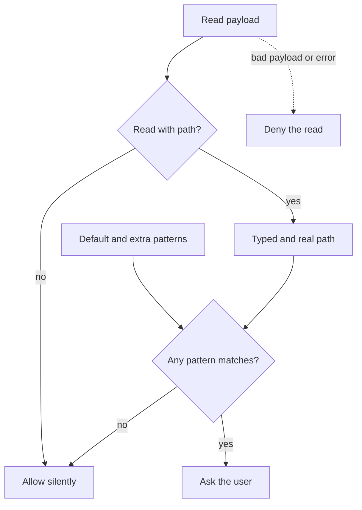

## Purpose

A PreToolUse hook for the Read tool. When Claude is about to read a file whose path matches a list of sensitive path patterns (private keys, `.env` files, the `.ssh` folder), the hook asks the user to confirm first. It looks at the path only, never at file content, so it complements the PHI scan that runs after a read.

## Dependencies

**Depends on.**

- Standard library: `fnmatch`, `json`, `os`, `posixpath`, `sys` {src:hooks/pre-tool-read-ask-sensitive-path.py:27-31}.
- Environment variable `TOLLGATE_SENSITIVE_PATHS`, a comma separated list of extra patterns {src:hooks/pre-tool-read-ask-sensitive-path.py:35} {src:hooks/pre-tool-read-ask-sensitive-path.py:53}.
- Input is the PreToolUse JSON on stdin, using `tool_name` and `tool_input.file_path` {src:hooks/pre-tool-read-ask-sensitive-path.py:86-88} {src:hooks/pre-tool-read-ask-sensitive-path.py:92}.

**Used by.**

- Product code: `settings.json` binds it to the `Read` matcher {src:settings.json:108} {src:settings.json:112}.
- Tests: [test_read_path_hook](../tests/hooks/test_read_path_hook.md) {src:tests/hooks/test_read_path_hook.py:24}.
- Searched 2026-11-19: every file under the repo except `.git`, `docs/` and `__pycache__` for the file name. No other file names it.

## Behavior

**Decision flow.** The hook parses stdin and takes `tool_input.file_path` as a string {src:hooks/pre-tool-read-ask-sensitive-path.py:85-88}. If the payload cannot be read it prints a deny {src:hooks/pre-tool-read-ask-sensitive-path.py:89} {src:hooks/pre-tool-read-ask-sensitive-path.py:90}. If `tool_name` is not `Read`, or the path is empty, it exits 0 and prints nothing, so the read goes on {src:hooks/pre-tool-read-ask-sensitive-path.py:92} {src:hooks/pre-tool-read-ask-sensitive-path.py:93}. If a pattern matches, it prints `permissionDecision: ask` with a reason that names the pattern, so Claude Code prompts the user {src:hooks/pre-tool-read-ask-sensitive-path.py:95-98}. With no match it exits 0 silently {src:hooks/pre-tool-read-ask-sensitive-path.py:99}. `emit` prints the JSON and exits 0 {src:hooks/pre-tool-read-ask-sensitive-path.py:40-48}.

**The pattern list.** The defaults are `.env`, `*.pem`, `*.key` and `.ssh/` {src:hooks/pre-tool-read-ask-sensitive-path.py:36}. Extra patterns from the environment variable are split on commas, trimmed and added to the defaults {src:hooks/pre-tool-read-ask-sensitive-path.py:37} {src:hooks/pre-tool-read-ask-sensitive-path.py:53} {src:hooks/pre-tool-read-ask-sensitive-path.py:54}. An entry starting with `~` is expanded to the home folder {src:hooks/pre-tool-read-ask-sensitive-path.py:55}. All entries are lower-cased and blanks are dropped {src:hooks/pre-tool-read-ask-sensitive-path.py:56}.

**The two path forms.** The typed path (home expanded, normalised) and its symlink-resolved path are both checked, lower-cased, without duplicates {src:hooks/pre-tool-read-ask-sensitive-path.py:61} {src:hooks/pre-tool-read-ask-sensitive-path.py:62} {src:hooks/pre-tool-read-ask-sensitive-path.py:63}. A match on either form counts {src:hooks/pre-tool-read-ask-sensitive-path.py:77-80}.

**How one pattern matches.**

- A pattern ending in `/` matches when that folder name appears anywhere in the path as a whole folder {src:hooks/pre-tool-read-ask-sensitive-path.py:68-70}.
- A pattern without a slash is compared with the file name only {src:hooks/pre-tool-read-ask-sensitive-path.py:71}.
- A pattern with a slash inside is compared with the whole path {src:hooks/pre-tool-read-ask-sensitive-path.py:71}.
- The comparison is `fnmatchcase`, which is case sensitive, but both sides were lower-cased first, so matching ignores case {src:hooks/pre-tool-read-ask-sensitive-path.py:72} {src:hooks/pre-tool-read-ask-sensitive-path.py:56} {src:hooks/pre-tool-read-ask-sensitive-path.py:63}.

**Fails closed.** The `main()` call is wrapped: a `SystemExit` passes through, and any other exception prints a deny that names the exception type {src:hooks/pre-tool-read-ask-sensitive-path.py:102-107}.

## Diagram: module level (L2, required)

## Diagram: function level (L3, optional)

None: no function has branching that the signature does not show. The matching rules are listed under Behavior.

## Notes

**Header and code disagree.** None found. The header's pattern forms, case rule, two-path rule and fail-closed rule each match the code {src:hooks/pre-tool-read-ask-sensitive-path.py:16-21} {src:hooks/pre-tool-read-ask-sensitive-path.py:56} {src:hooks/pre-tool-read-ask-sensitive-path.py:63} {src:hooks/pre-tool-read-ask-sensitive-path.py:102-107}.

**Limits worth knowing.**

- `.env` has no slash and no wildcard, so only a file named exactly `.env` matches. `.env.local` and `prod.env` do not match unless someone adds a pattern such as `.env.*` {src:hooks/pre-tool-read-ask-sensitive-path.py:36} {src:hooks/pre-tool-read-ask-sensitive-path.py:71} {src:hooks/pre-tool-read-ask-sensitive-path.py:72}.
- Bash reads (`cat`, `head`), Grep and Glob never reach this hook, because `settings.json` binds it to `Read` only. The header says the same {src:hooks/pre-tool-read-ask-sensitive-path.py:22} {src:settings.json:108}.
- A payload with a different `tool_name`, or an empty path, is allowed {src:hooks/pre-tool-read-ask-sensitive-path.py:92} {src:hooks/pre-tool-read-ask-sensitive-path.py:93}.
- A relative path is resolved against the hook process's working directory by `realpath` {src:hooks/pre-tool-read-ask-sensitive-path.py:62}.
- In a pattern with a slash inside, `fnmatch` lets `*` match across folder separators {src:docs:python-fnmatch}.

**Unchecked inputs.** The path from the payload goes to `os.path.expanduser`, `normpath` and `realpath`, which look at the file system for symlinks but do not read the file {src:hooks/pre-tool-read-ask-sensitive-path.py:61} {src:hooks/pre-tool-read-ask-sensitive-path.py:62}. Patterns from the environment variable are used as given, with no check on their content {src:hooks/pre-tool-read-ask-sensitive-path.py:53} {src:hooks/pre-tool-read-ask-sensitive-path.py:54}. The message shows the matched pattern, not the path {src:hooks/pre-tool-read-ask-sensitive-path.py:97}. No input reaches a shell command or a network address.

**Shared file writes.** None. The hook writes only to stdout.

**Wider reference.** The overall hook guide has a section for this hook, `docs/hooks.md` section 14 {src:docs:docs/hooks.md}.
