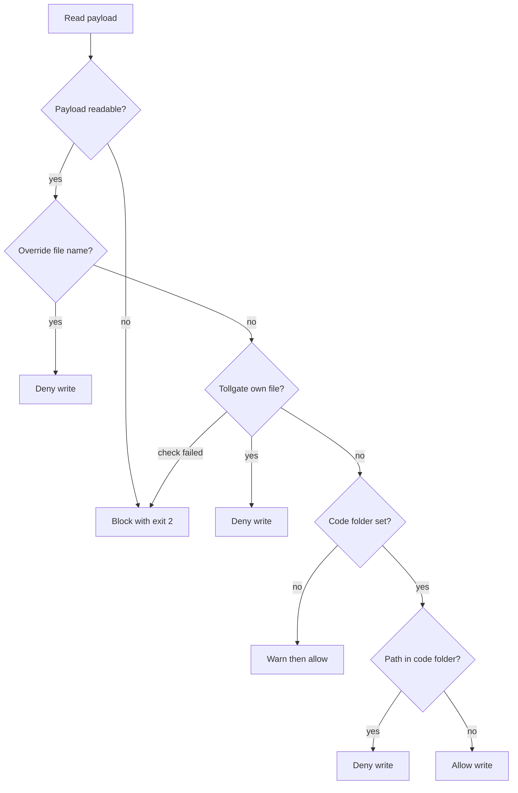

## Purpose

A PreToolUse hook for file writes. It stops the model from writing into three kinds of place: any file whose name ends in `-gate-override.md` (only the owner creates those, from a terminal), Tollgate's own files (user settings, credentials, `~/.claude/tollgate-config`, `~/.tollgate`, `~/.claude/tollgate/` with the connector state file, shell profiles, the files named by `TOLLGATE_CONNECTORS`, `TOLLGATE_PATHS` and `TOLLGATE_CONFIG`, the repo's `hooks` folder and `settings.json`), and the read-only code reference folder named by `TOLLGATE_CODE_DIR`. The hook decides from the target path alone and never looks at what is being written.

## Dependencies

**Depends on.**
- Bash and `python3`. Python parses the JSON payload and resolves symlinks {src:hooks/pre-tool-write-guard-path.sh:15} {src:hooks/pre-tool-write-guard-path.sh:35} {src:hooks/pre-tool-write-guard-path.sh:99} {src:hooks/pre-tool-write-guard-path.sh:100}. Shell tools used: `cat`, `echo`, `basename`, `dirname`, `tr`, `printf` {src:hooks/pre-tool-write-guard-path.sh:12} {src:hooks/pre-tool-write-guard-path.sh:34} {src:hooks/pre-tool-write-guard-path.sh:58} {src:hooks/pre-tool-write-guard-path.sh:26}.
- [protected_paths](lib/protected_paths.md), the shared list of Tollgate's own files, run as a command from the `lib` folder next to this script {src:hooks/pre-tool-write-guard-path.sh:58} {src:hooks/pre-tool-write-guard-path.sh:59}.
- Environment variable `TOLLGATE_CODE_DIR`, the code folder to protect {src:hooks/pre-tool-write-guard-path.sh:86}.
- Input is the PreToolUse JSON on stdin, from which it reads `tool_input.file_path` or `tool_input.notebook_path` {src:hooks/pre-tool-write-guard-path.sh:23}.

**Used by.**
- Product code: `settings.json` binds it to the `Write|Edit|NotebookEdit` matcher {src:settings.json:38} {src:settings.json:42}.
- Tests: [test_guard_hooks](../tests/hooks/test_guard_hooks.md) {src:tests/hooks/test_guard_hooks.py:29}, [test_hooks](../tests/hooks/test_hooks.md) {src:tests/hooks/test_hooks.py:104}, [run](../tests/hooks/run.md) {src:tests/hooks/run.sh:129}, [test_gate_chain](../tests/hooks/test_gate_chain.md) {src:tests/hooks/test_gate_chain.py:28} and [test_security_fixes](../tests/hooks/test_security_fixes.md) {src:tests/hooks/test_security_fixes.py:300} {src:tests/hooks/test_security_fixes.py:307}. [test_self_protection](../tests/hooks/test_self_protection.md) covers the protected-file check {src:tests/hooks/test_self_protection.py:61} {src:tests/hooks/test_self_protection.py:91}.
- Reference: the hook guide has a section for it, see [hooks](../hooks.md).
- Searched 2026-11-21: every file under the repo except `.git`, `docs/`, `__pycache__` and `.venv` for the file name.

## Behavior

**Reading the payload.** The whole stdin is read first {src:hooks/pre-tool-write-guard-path.sh:12}. A small Python step parses it. The payload must be a JSON object. A `tool_input` that is not an object counts as empty. The path is `file_path`, or `notebook_path` when `file_path` is missing or empty. A value that is not text becomes empty {src:hooks/pre-tool-write-guard-path.sh:15-24}. If that step fails, the hook prints a "BLOCKED" message to stderr and exits 2, which blocks the write and prints no JSON {src:hooks/pre-tool-write-guard-path.sh:25-28}.

**Check 1: gate override files.** It runs first, so it holds even when `TOLLGATE_CODE_DIR` is unset, and it is skipped only for an empty path {src:hooks/pre-tool-write-guard-path.sh:33}. It lower-cases the file name of the typed path and of the symlink-resolved path {src:hooks/pre-tool-write-guard-path.sh:34} {src:hooks/pre-tool-write-guard-path.sh:35}. If either name ends in `-gate-override.md`, it prints a deny with a fixed reason and exits 0 {src:hooks/pre-tool-write-guard-path.sh:36-50}.

**Check 2: Tollgate's own files.** For a non-empty path, it runs `lib/protected_paths.py` with the typed path {src:hooks/pre-tool-write-guard-path.sh:57-59}. Exit 0 from the helper means go on {src:hooks/pre-tool-write-guard-path.sh:61}. Exit 10 means protected: a fixed deny is printed and the hook exits 0 {src:hooks/pre-tool-write-guard-path.sh:62-75}. Any other result, such as a crash or a missing helper file, prints a "BLOCKED" message and exits 2, so this check fails closed {src:hooks/pre-tool-write-guard-path.sh:76-79}. What the helper protects is described in [protected_paths](lib/protected_paths.md). Reads are not affected, because this hook only runs for write tools {src:settings.json:38}.

**Check 3: code folder, variable unset.** The hook does not block. It prints a warning on stderr and a `systemMessage` JSON on stdout, then exits 0 {src:hooks/pre-tool-write-guard-path.sh:86-90}. This happens for every write that passed checks 1 and 2, including writes with an empty path, because the empty-path test comes later {src:hooks/pre-tool-write-guard-path.sh:86} {src:hooks/pre-tool-write-guard-path.sh:93}.

**Check 3: code folder, variable set.** An empty path exits 0 {src:hooks/pre-tool-write-guard-path.sh:93} {src:hooks/pre-tool-write-guard-path.sh:94}. Otherwise both the code folder and the target path are resolved with Python `realpath`; if Python fails, the unresolved value is used {src:hooks/pre-tool-write-guard-path.sh:99} {src:hooks/pre-tool-write-guard-path.sh:100}. The code folder gets a trailing slash, so `/code` does not match `/codebackup` {src:hooks/pre-tool-write-guard-path.sh:102} {src:hooks/pre-tool-write-guard-path.sh:103}. The write is denied when the target, with a slash added, starts with that prefix, or equals the folder itself {src:hooks/pre-tool-write-guard-path.sh:105-116}. The reason text is fixed {src:hooks/pre-tool-write-guard-path.sh:112}. A path outside the folder reaches `exit 0` with no output, which allows the write {src:hooks/pre-tool-write-guard-path.sh:119}.

**Exit codes.** 0 for every case except an unreadable payload or a failed protected-file check, which are 2 {src:hooks/pre-tool-write-guard-path.sh:27} {src:hooks/pre-tool-write-guard-path.sh:78} {src:hooks/pre-tool-write-guard-path.sh:119}. A deny travels in the printed JSON, not in the exit code {src:hooks/pre-tool-write-guard-path.sh:49} {src:hooks/pre-tool-write-guard-path.sh:74} {src:hooks/pre-tool-write-guard-path.sh:106-116}.

## Diagram

## Notes

**Header and code disagree.**
- The header says it reads `file_path` {src:hooks/pre-tool-write-guard-path.sh:3}. The code also reads `notebook_path`, the field a notebook edit carries {src:hooks/pre-tool-write-guard-path.sh:23}.
- The header says that on a block it prints JSON and then exits 0 {src:hooks/pre-tool-write-guard-path.sh:8}. An unreadable payload, or a failed protected-file check, blocks with exit 2 and no JSON {src:hooks/pre-tool-write-guard-path.sh:25-28} {src:hooks/pre-tool-write-guard-path.sh:76-79}.
- The header says it blocks writes to the code reference folder {src:hooks/pre-tool-write-guard-path.sh:4}. It does so only when `TOLLGATE_CODE_DIR` is set. When unset, it warns and allows {src:hooks/pre-tool-write-guard-path.sh:86-91}. The gate override and protected-file checks do not depend on that variable {src:hooks/pre-tool-write-guard-path.sh:30-81}.

**Behavior to know.**
- A path that Python cannot resolve falls back to the typed string {src:hooks/pre-tool-write-guard-path.sh:99} {src:hooks/pre-tool-write-guard-path.sh:100}.
- By the code's logic, if `TOLLGATE_CODE_DIR` resolves to `/`, the prefix becomes `/` and every path matches, so every write is denied {src:hooks/pre-tool-write-guard-path.sh:103} {src:hooks/pre-tool-write-guard-path.sh:105}. Not run to confirm.
- The protected-file check gets the typed path with no working directory, so a relative path is resolved against the hook's own folder, not the session's {src:hooks/pre-tool-write-guard-path.sh:59}. A typed path that starts with `-` is never reported protected by the helper {src:hooks/lib/protected_paths.py:86}.
- A hard link to a protected file is not caught: the symlink resolution does not follow hard links {src:hooks/lib/protected_paths.py:46}. Files outside the helper's list, such as `~/.claude/commands` and `CLAUDE.md`, are writable {src:hooks/lib/protected_paths.py:28-32}.
- Bash commands are not covered here. They go through the separate [pre-tool-bash-guard-code-dir](pre-tool-bash-guard-code-dir.md) hook, as the header says {src:hooks/pre-tool-write-guard-path.sh:7}.

**Unchecked inputs.** The target path and `TOLLGATE_CODE_DIR` are passed to Python as arguments, never placed inside shell or Python source, so they cannot change what runs {src:hooks/pre-tool-write-guard-path.sh:35} {src:hooks/pre-tool-write-guard-path.sh:59} {src:hooks/pre-tool-write-guard-path.sh:99} {src:hooks/pre-tool-write-guard-path.sh:100}. Both are used only for comparison. No check exists on the value of `TOLLGATE_CODE_DIR`. All output text is fixed, and the warning is a constant string too {src:hooks/pre-tool-write-guard-path.sh:87}. No input reaches a network address or an outbound message.

**Shared file writes.** None. The hook writes only to stdout and stderr.
