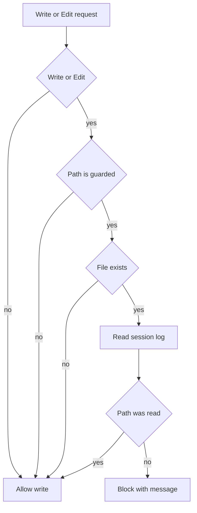

## Purpose

This hook makes Claude read a guarded file before it overwrites or edits it. By default the guarded files are the ticket state files, whose names end in `-state.md`. It protects them from blind writes that would replace content Claude never saw. It is the checking half of a pair: the recording half is `post-tool-read-record.py` (no doc yet), which notes each read.

## Dependencies

**Depends on.**
- `hooks/read_guard_common.py` for the guard pattern, the path normaliser and the read log location, imported inside `main` {src:hooks/pre-tool-write-require-read.py:36-37}. [[read_guard_common]] / [read_guard_common](read_guard_common.md).
- A read log written by `hooks/post-tool-read-record.py` {src:hooks/post-tool-read-record.py:32-35}. [[post-tool-read-record]] (no doc yet).
- Environment variables read through the helper: `GUARD_REGEX`, `TOLLGATE_HOME`, `TOLLGATE_STATE_DIR` {src:hooks/read_guard_common.py:32} and {src:hooks/read_guard_common.py:37} and {src:hooks/read_guard_common.py:55}.
- Standard library: `json`, `os`, `sys`.

**Used by.**
- Product code: `settings.json` registers it for `PreToolUse` on `Write|Edit` with `onFailure` set to `block` {src:settings.json:98} and {src:settings.json:102-103}.
- Tests: `tests/hooks/test_guard_hooks.py` {src:tests/hooks/test_guard_hooks.py:56} and {src:tests/hooks/test_guard_hooks.py:43-124}; `tests/hooks/test_hooks.py` does not name it (searched with `git grep` on 2026-11-20).

## Behavior

Steps in `main`, in order:
1. Add the hook folder to the import path and import the three helpers {src:hooks/pre-tool-write-require-read.py:36-37}.
2. Read one JSON object from standard input; a non-object raises an error {src:hooks/pre-tool-write-require-read.py:39-41}.
3. If `tool_name` is not `Write` or `Edit`, return 0 {src:hooks/pre-tool-write-require-read.py:24} and {src:hooks/pre-tool-write-require-read.py:42-43}. `NotebookEdit` and `MultiEdit` are not covered.
4. Take `tool_input.file_path`. No path, or a path that does not match the guard pattern, returns 0 {src:hooks/pre-tool-write-require-read.py:44-46}. By default the pattern is `-state\.md$` {src:hooks/read_guard_common.py:23}, and `GUARD_REGEX` replaces it when set {src:hooks/read_guard_common.py:32}.
5. A guarded path that does not exist on disk yet returns 0, so new files are allowed {src:hooks/pre-tool-write-require-read.py:47-48}.
6. Find the read log of this session {src:hooks/pre-tool-write-require-read.py:49}. The file `<state dir>/read_log/<session id>.log` is read as a set of lines {src:hooks/read_guard_common.py:62} and {src:hooks/pre-tool-write-require-read.py:27-32}. No log file means nothing was read {src:hooks/pre-tool-write-require-read.py:29-30}.
7. If the real, symlink-resolved path of the target is in the log, return 0 {src:hooks/pre-tool-write-require-read.py:50-51} and {src:hooks/read_guard_common.py:67}.
8. Otherwise write a message naming the file to standard error and return 2, which blocks the write {src:hooks/pre-tool-write-require-read.py:52-56} and {src:hooks/pre-tool-write-require-read.py:23}.

Any error in `main` prints the error class name and returns 2 {src:hooks/pre-tool-write-require-read.py:59-65}.

## Diagram: module level (L2, required)

## Diagram: function level (L3, optional)

None: no function has branching that the signature does not show. The decision chain is in the diagram above.

## Notes

**Where the code and its own description disagree.**
- The header says "Fails closed on any internal error (bad JSON, unreadable log): exit 2 blocks the write" {src:hooks/pre-tool-write-require-read.py:14}. The code does that: any exception ends with exit code 2 {src:hooks/pre-tool-write-require-read.py:61-64}, and its own comment says "fail closed" {src:hooks/pre-tool-write-require-read.py:62}. The test agrees {src:tests/hooks/test_guard_hooks.py:91-94}. An earlier header said "Fails OPEN"; that wording was removed and no disagreement is left on this point.
- The header says the read is logged "this session" {src:hooks/pre-tool-write-require-read.py:12}. When the payload has no `session_id`, the log name becomes `unknown` {src:hooks/read_guard_common.py:26} and {src:hooks/read_guard_common.py:61}, which every such session shares, so a read in one anonymous session satisfies another.

**Behaviors worth knowing.**
- An invalid `GUARD_REGEX` makes every Write or Edit that has a path fail with exit 2, not only guarded files, because the pattern is compiled for each one {src:hooks/pre-tool-write-require-read.py:45} and {src:hooks/read_guard_common.py:32}. A test covers it {src:tests/hooks/test_guard_hooks.py:96-100}.
- The check proves a read happened in this session, not that the read content is current.
- A file read through the shell is not recorded, because the recorder is wired only to the `Read` tool {src:settings.json:219-223}.
- The existence check uses the expanded path, while the log lookup uses the real path {src:hooks/pre-tool-write-require-read.py:47} and {src:hooks/pre-tool-write-require-read.py:50}.

**Inputs that reach a path, command, network address or outbound text without a check.**
- `GUARD_REGEX` is compiled as given, with no check on the value {src:hooks/read_guard_common.py:32}.
- `session_id` becomes part of a file name but is cleaned first: any character outside letters, digits, `_`, `.`, `-` becomes `_` {src:hooks/read_guard_common.py:27} and {src:hooks/read_guard_common.py:61}.
- `file_path` is used to test existence and is printed back in the block message with no escaping {src:hooks/pre-tool-write-require-read.py:47} and {src:hooks/pre-tool-write-require-read.py:53}.
- The state folder is taken from the path loader or `TOLLGATE_STATE_DIR` with no check {src:hooks/read_guard_common.py:52-56}.
- Nothing is run or sent over a network.

**Shared files.** This hook only reads the log. The recorder appends one line per read with no lock, so two writers at once are not stopped; each write is one short line {src:hooks/post-tool-read-record.py:34-35}.

**Tests.** `ReadBeforeWrite` proves: an unread guarded file is blocked for Write and Edit {src:tests/hooks/test_guard_hooks.py:61-67}; `MultiEdit` is not gated {src:tests/hooks/test_guard_hooks.py:69-70}; read then write is allowed {src:tests/hooks/test_guard_hooks.py:72-74}; a read in another session does not count {src:tests/hooks/test_guard_hooks.py:76-78}; unguarded and new files pass {src:tests/hooks/test_guard_hooks.py:80-84}; a custom pattern works {src:tests/hooks/test_guard_hooks.py:86-89}; bad input blocks the guard and not the recorder {src:tests/hooks/test_guard_hooks.py:91-94}; the paths file beats the variable {src:tests/hooks/test_guard_hooks.py:102-113}. `test_session_id_cannot_escape_state_dir` only asserts that two files do not exist, so it would also pass if the recorder wrote nothing at all {src:tests/hooks/test_guard_hooks.py:121-124}. The tests set `TOLLGATE_STATE_DIR` {src:tests/hooks/test_guard_hooks.py:46} but inherit `TOLLGATE_HOME` and `TOLLGATE_PATHS` from the caller {src:tests/hooks/test_guard_hooks.py:35-36}; if those are set, the loader's folder wins {src:hooks/read_guard_common.py:52-54}, so results depend on the environment of the person running them. They use temporary folders, no machine path.
