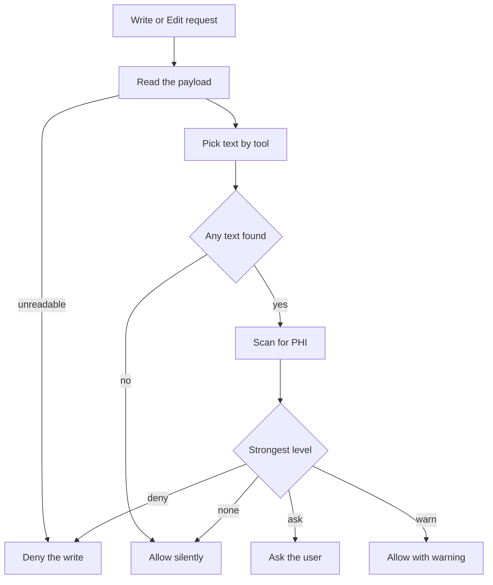

## Purpose

This hook keeps patient identifiers out of files that Claude writes. Claude Code runs it before every Write, Edit or NotebookEdit. It scans the text about to be saved and, depending on how strong the match is, blocks the write, asks the user, or lets it through with a warning. It exists as a safety net for work where real patient data must never land in a note, script or notebook.

## Dependencies

**Depends on.**
- `hooks/phi_patterns.py` for the scanning rules and the decision shape: `scan_levels` and `pre_tool_decision` {src:hooks/pre-tool-write-scan-phi.py:69}. [[phi_patterns]] / [phi_patterns](phi_patterns.md).
- The hook folder is added to the import path first {src:hooks/pre-tool-write-scan-phi.py:68}.
- Standard library: `json`, `os`, `sys`. No environment variable.

**Used by.**
- Product code: `settings.json` registers it for `PreToolUse` on `Write|Edit|NotebookEdit` with `onFailure` set to `block` {src:settings.json:28} and {src:settings.json:32-33}. `phi_patterns.py` names it in its header {src:hooks/phi_patterns.py:8}.
- Tests: `tests/hooks/run.sh` {src:tests/hooks/run.sh:106-122}; `tests/hooks/test_hooks.py` {src:tests/hooks/test_hooks.py:93-99} and {src:tests/hooks/test_hooks.py:125-132}; `tests/hooks/test_phi_hook_levels.py` {src:tests/hooks/test_phi_hook_levels.py:102-110}; `tests/hooks/test_phi_safety_speed.py` {src:tests/hooks/test_phi_safety_speed.py:43} and {src:tests/hooks/test_phi_safety_speed.py:195-246}; `tests/hooks/test_security_fixes.py` does not name it (searched with `git grep` on 2026-11-20).

## Behavior

1. The file imports `phi_patterns` inside a `try` and then runs `main`. Any exception other than a normal exit becomes a deny {src:hooks/pre-tool-write-scan-phi.py:67-74}.
2. `main` reads one JSON object from standard input; if reading or parsing fails it denies with a "could not read the payload" reason {src:hooks/pre-tool-write-scan-phi.py:52-55}.
3. `extract_content` picks the text to scan by tool: `content` for Write, `new_string` for Edit, `new_source` for NotebookEdit {src:hooks/pre-tool-write-scan-phi.py:38-45}. A `MultiEdit` branch reads `edits[].new_string`, kept only so an old payload parses; the settings matcher does not send that tool here {src:hooks/pre-tool-write-scan-phi.py:42-43} and {src:settings.json:28}. Values that are not non-empty text are dropped {src:hooks/pre-tool-write-scan-phi.py:48}. The old text of an Edit is not scanned, and neither is the file path.
4. No text to scan: exit 0 with no output {src:hooks/pre-tool-write-scan-phi.py:57-59}.
5. Otherwise all texts are scanned together and the result becomes one decision named "write content" {src:hooks/pre-tool-write-scan-phi.py:61}. No finding means no output {src:hooks/pre-tool-write-scan-phi.py:62-64}.
6. What the decision looks like comes from `pre_tool_decision`: a deny-level finding gives `deny`, an ask-level finding gives `ask` {src:hooks/phi_patterns.py:549-555}, and a warn-level finding gives a system message and extra context with no permission decision, so the normal permission flow continues {src:hooks/phi_patterns.py:545-548}. The reason lists rule labels and levels only {src:hooks/phi_patterns.py:524-526}.
7. `deny` prints the JSON and exits 0 {src:hooks/pre-tool-write-scan-phi.py:24-32}. The exit code is always 0 for a decision; the block is carried by the JSON.

## Diagram: module level (L2, required)

## Diagram: function level (L3, optional)

None: no function has branching that the signature does not show. The level decision is drawn above and lives in [[phi_patterns]].

## Notes

**Where the code and its own description disagree.** None found. The header says it fails closed on an unreadable payload or any internal error {src:hooks/pre-tool-write-scan-phi.py:11}, and the code does: both paths deny {src:hooks/pre-tool-write-scan-phi.py:55} and {src:hooks/pre-tool-write-scan-phi.py:74}. The header says messages carry labels only {src:hooks/pre-tool-write-scan-phi.py:10}, which matches {src:hooks/phi_patterns.py:526}.

**What is and is not scanned.** Only the new text is scanned. The file path is not {src:hooks/pre-tool-write-scan-phi.py:36-48}. A payload whose `tool_input` is null yields no text and is allowed {src:hooks/pre-tool-write-scan-phi.py:37}; a test confirms it {src:tests/hooks/test_hooks.py:130-132}. A `tool_input` of the wrong type raises inside `main` and is denied {src:hooks/pre-tool-write-scan-phi.py:73-74}; a test confirms it {src:tests/hooks/test_phi_safety_speed.py:212-221}. No size limit is applied to the text before scanning; a speed test covers one megabyte {src:tests/hooks/test_phi_safety_speed.py:179-186}.

**Inputs that reach a path, command, network address or outbound text without a check.** The hook runs no command and opens no file besides its own import. The content is scanned, never executed. Outbound text is the label list from the scanner and fixed wording; the matched text is not copied out {src:hooks/phi_patterns.py:526} and {src:tests/hooks/test_phi_hook_levels.py:92-96}. The unreadable-payload and internal-error messages include only fixed text and the error class name {src:hooks/pre-tool-write-scan-phi.py:55} and {src:hooks/pre-tool-write-scan-phi.py:74}.

**Shared files.** The hook writes no file. No shared-file write exists.

**Tests.** `test_write_phi_denied` and `test_notebook_edit_phi_denied` prove a fake record number is denied for Write and NotebookEdit {src:tests/hooks/test_hooks.py:93-99}. `WriteHookLevels` proves the three levels produce deny, ask and warn shapes, and that the matched text never appears in the reply {src:tests/hooks/test_phi_hook_levels.py:71-96}. `test_f01_*` proves seven bad inputs and wrongly shaped payloads are denied {src:tests/hooks/test_phi_safety_speed.py:206-221}; `test_f02_*` proves a missing or broken `phi_patterns` module denies {src:tests/hooks/test_phi_safety_speed.py:223-238}; `test_f03_non_string_content_does_not_crash` proves non-text content is skipped {src:tests/hooks/test_phi_safety_speed.py:240-246}. In `run.sh`, cases `tc-02`, `tc-03` and `tc-04` have comments saying "deny" but only look for the word `permissionDecision` in the output {src:tests/hooks/run.sh:112-114} and {src:tests/hooks/run.sh:120-122}, so an ask-level reply would also pass them. The tests use `/tmp/x` style paths in payloads only as data {src:tests/hooks/test_phi_hook_levels.py:106}; nothing reads them.
