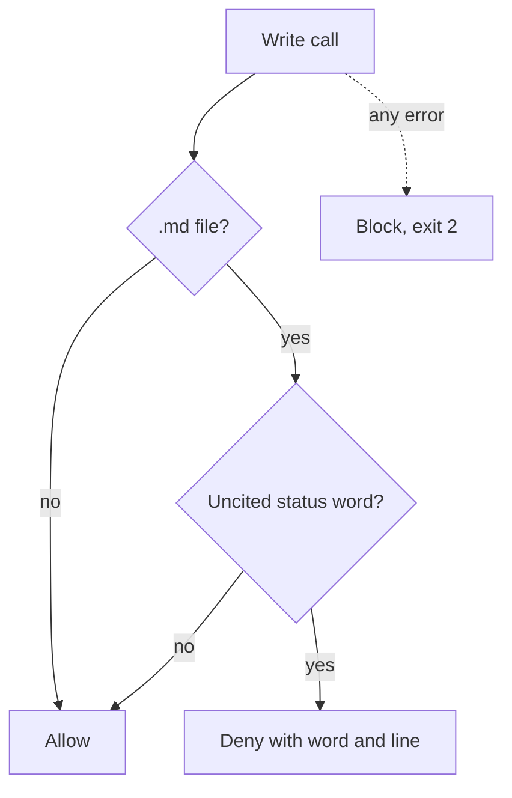

## Purpose

A PreToolUse hook that blocks markdown text which states a status as fact with no source. The four status words are the upper-case forms of done, shipped, approved and complete. {src:hooks/pre_tool_write_scan_claims.py:5} The shared patterns live in [claim_patterns](claim_patterns.md), which is a helper and not a hook. {src:hooks/pre_tool_write_scan_claims.py:88}

## Dependencies

**Depends on.** Standard library `json`, `os` and `sys`, and `hooks/claim_patterns.py` in the same folder, put on the import path from the hook's own location. {src:hooks/pre_tool_write_scan_claims.py:87-88}

**Used by.** Product code: `settings.json` runs it for the matcher `Write|Edit|NotebookEdit`, after `scrub_secrets.py`, with `onFailure` set to `block`. {src:settings.json:174} {src:settings.json:183-184} Tests: `tests/hooks/test_vault_hooks.py` class `ClaimHook` {src:tests/hooks/test_vault_hooks.py:74}, and `tests/hooks/test_security_fixes.py`, which checks a bad payload gives exit code 2. {src:tests/hooks/test_security_fixes.py:314-316} There is no page for `test_vault_hooks` yet. The validate-for-write helper that once ran the same check is removed, so this hook is the only caller of the check.

## Behavior

- The hook reads the tool call from stdin and pulls out the text. For `Write` it takes `content`, for `Edit` it takes `new_string`, for `NotebookEdit` it takes `new_source`. A `MultiEdit` branch exists but is not a current tool name, and `settings.json` does not send it here. {src:hooks/pre_tool_write_scan_claims.py:47-54} {src:settings.json:174}
- Only pairs whose path ends in `.md` and whose text is a non-empty string are kept; all other calls exit 0 with no output. {src:hooks/pre_tool_write_scan_claims.py:58-63} {src:hooks/pre_tool_write_scan_claims.py:69-70}
- The kept texts go to `scan_for_uncited_claims`, which skips frontmatter, fenced code (Mermaid included) and table separator rows, and flags a line with an upper-case status word and no `(source: ...)` or `(unverified` marker. {src:hooks/pre_tool_write_scan_claims.py:72} See [claim_patterns](claim_patterns.md).
- On a finding, the hook prints a deny decision and exits 0. The reason names the first word and its line number, never the line text. Lowercase use of the word is not a claim. {src:hooks/pre_tool_write_scan_claims.py:74-79} {src:hooks/pre_tool_write_scan_claims.py:28-35}
- For an Edit, the scanned text is only `new_string`, so the line number counts inside the new text, not inside the file. {src:hooks/pre_tool_write_scan_claims.py:50}

## Diagram

## Notes

- The hook fails closed. Any import problem or runtime error, including a payload that is not JSON, writes one line to stderr and exits 2, which blocks the write. {src:hooks/pre_tool_write_scan_claims.py:92-94} The header docstring now says "Fails closed: an internal error exits 2", which matches the code. {src:hooks/pre_tool_write_scan_claims.py:7}
- `NotebookEdit` is in the matcher and in the code, but the path it reads is `notebook_path`, which ends in `.ipynb`, never `.md`, so a notebook edit is never scanned. {src:hooks/pre_tool_write_scan_claims.py:54} {src:hooks/pre_tool_write_scan_claims.py:62}
- Scope is the `.md` suffix of the path only; no folder check. A markdown file anywhere on disk is scanned.
- The hook reads only stdin and writes nothing but its own stdout and stderr, so there is no shared-file write.
