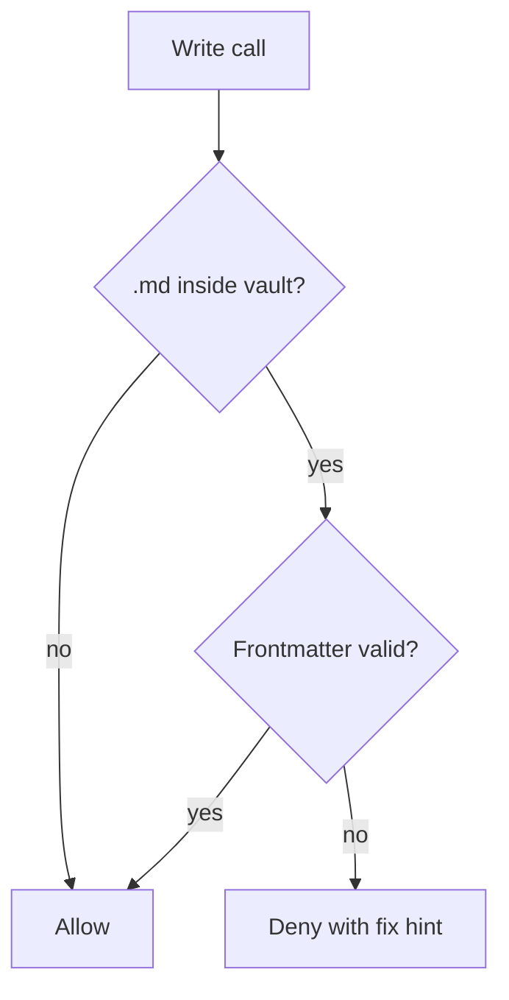

## Purpose

A PreToolUse hook for Write and Edit. (The code also reads a MultiEdit payload, but its own comment says that is not a current tool name {src:hooks/pre_tool_write_vault_frontmatter.py:69}.) It blocks a markdown write into the vault when the frontmatter breaks the vault rules. {src:hooks/pre_tool_write_vault_frontmatter.py:3-8}

## Dependencies

Standard library only. Reads `TOLLGATE_KNOWLEDGE` {src:hooks/pre_tool_write_vault_frontmatter.py:40}. With it unset, the hook allows every write {src:hooks/pre_tool_write_vault_frontmatter.py:109-110}. Tests: `tests/hooks/test_vault_hooks.py` (no doc page).

## Behavior

It acts only on `.md` files whose real path is inside `TOLLGATE_KNOWLEDGE` {src:hooks/pre_tool_write_vault_frontmatter.py:73-78}. It reads the frontmatter block of the new text {src:hooks/pre_tool_write_vault_frontmatter.py:50-59} and denies when:

1. `status` is set and is not ALL_CAPS (for example `active`) {src:hooks/pre_tool_write_vault_frontmatter.py:82-87},
2. `type` is set and contains a hyphen (use an underscore) {src:hooks/pre_tool_write_vault_frontmatter.py:89-94},
3. any field is an empty string (use `null`) {src:hooks/pre_tool_write_vault_frontmatter.py:96-101}.

Text without frontmatter is allowed {src:hooks/pre_tool_write_vault_frontmatter.py:113-114}. A deny prints the standard deny JSON and exits 0 {src:hooks/pre_tool_write_vault_frontmatter.py:27-35}.

**Fails closed.** An internal error (bad JSON on stdin, or any other exception) writes one line to stderr and exits 2, which blocks the write {src:hooks/pre_tool_write_vault_frontmatter.py:121-127}. An unset `TOLLGATE_KNOWLEDGE` still allows, as the header says {src:hooks/pre_tool_write_vault_frontmatter.py:8}, but the payload is parsed before that check, so bad JSON blocks even then {src:hooks/pre_tool_write_vault_frontmatter.py:107} {src:hooks/pre_tool_write_vault_frontmatter.py:109-110}. The earlier version of this page, and the earlier header, said an internal error exits 0; the header now matches the code.

## Diagram

## Notes

For a check after the write, see [vault_doc_standard_check](vault_doc_standard_check.md).
