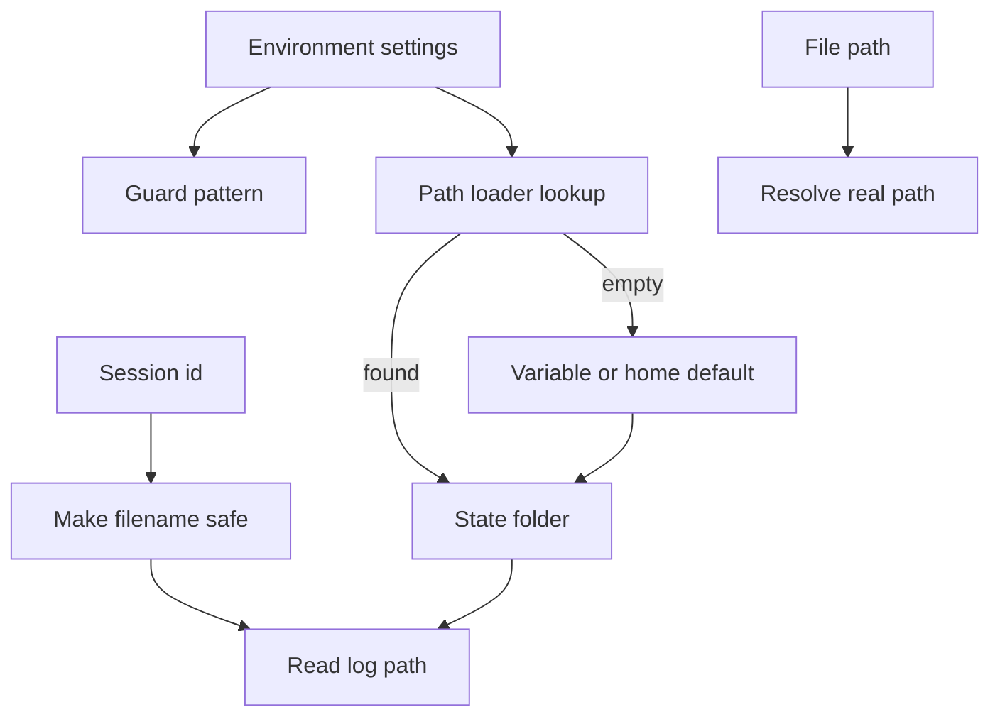

## Purpose

This is the shared helper for the read-before-write guard. Two hooks need to agree on three things: which files are guarded, where the per-session list of files that were read is kept, and how a path is written so that a read and a later write of the same file compare equal. Keeping those rules in one file means the recorder and the checker cannot drift apart. It is a helper, not a hook: it is not registered in `settings.json` and is listed as a helper in the inventory test {src:tests/hooks/check_hook_inventory.py:42}.

## Dependencies

**Depends on.**
- The path loader `core.paths` from `scripts/core/paths.py`, imported only when `TOLLGATE_HOME` is set {src:hooks/read_guard_common.py:37-44}. [[paths]] (no doc yet).
- Environment variables: `GUARD_REGEX` {src:hooks/read_guard_common.py:32}, `TOLLGATE_HOME` {src:hooks/read_guard_common.py:37}, `TOLLGATE_STATE_DIR` {src:hooks/read_guard_common.py:55}, `HOME` through `~` expansion {src:hooks/read_guard_common.py:56}.
- Standard library: `os`, `re`, `sys`.

**Used by.**
- Product code: `hooks/pre-tool-write-require-read.py` {src:hooks/pre-tool-write-require-read.py:37}, [[pre-tool-write-require-read]] / [pre-tool-write-require-read](pre-tool-write-require-read.md); and `hooks/post-tool-read-record.py` {src:hooks/post-tool-read-record.py:24}, [[post-tool-read-record]] (no doc yet).
- Tests: no test imports it. `tests/hooks/test_guard_hooks.py` reaches it through the two hooks {src:tests/hooks/test_guard_hooks.py:43-124}; `tests/hooks/check_hook_inventory.py` lists it as a helper {src:tests/hooks/check_hook_inventory.py:42} (searched with `git grep` on 2026-11-20).

## Behavior

- `guard_pattern()` compiles the regular expression in `GUARD_REGEX`, or the default `-state\.md$` when the variable is unset or empty {src:hooks/read_guard_common.py:23} and {src:hooks/read_guard_common.py:32}. An invalid expression raises an error here.
- `state_dir()` returns the folder that holds the logs. It asks the path loader first and uses the answer when there is one {src:hooks/read_guard_common.py:52-54}. Otherwise it uses `TOLLGATE_STATE_DIR`, and if that is also unset, `~/.tollgate/state` {src:hooks/read_guard_common.py:55-56} and {src:hooks/read_guard_common.py:24}.
- The loader step `_loader_state_dir()` returns an empty string when `TOLLGATE_HOME` is unset {src:hooks/read_guard_common.py:37-39}. Otherwise it puts `<TOLLGATE_HOME>/scripts` at the front of the import path if missing {src:hooks/read_guard_common.py:40-42}, imports `core.paths` and returns `paths.get_path("state")` as text {src:hooks/read_guard_common.py:44-45}. Any exception gives an empty string {src:hooks/read_guard_common.py:46-47}. The loader itself reads `TOLLGATE_STATE_DIR` when the paths file has no `state` entry {src:scripts/core/paths.py:103-105}.
- `read_log_path(session_id)` replaces every character other than letters, digits, `_`, `.`, `-` with `_`, uses `unknown` when the result is empty, and returns `<state dir>/read_log/<name>.log` {src:hooks/read_guard_common.py:27} and {src:hooks/read_guard_common.py:61-62} and {src:hooks/read_guard_common.py:25-26}.
- `normalize(path)` expands `~` and resolves symlinks and relative parts with `realpath` {src:hooks/read_guard_common.py:67}. It does not change letter case.

## Diagram: module level (L2, required)

## Diagram: function level (L3, optional)

None: no function has branching that the signature does not show. The state folder choice is drawn above.

## Notes

**Where the code and its own description disagree.** None found. The header says a `state` line in the paths file wins when the loader can be imported through `TOLLGATE_HOME` {src:hooks/read_guard_common.py:13-14}, and the code does take the loader answer first {src:hooks/read_guard_common.py:52-54}. A test confirms the order {src:tests/hooks/test_guard_hooks.py:102-113}. The default folder matches the loader's own default {src:scripts/core/paths.py:93-94} and {src:scripts/core/paths.py:105}.

**Behaviors worth knowing.**
- A loader that fails to import or to answer is hidden by the blanket exception handler {src:hooks/read_guard_common.py:46-47}, and the folder silently falls back to the variable or the home default. Both hooks call the same function, so they agree unless the failure comes and goes between two calls.
- When no session id is sent, all such sessions share the log `unknown.log` {src:hooks/read_guard_common.py:26} and {src:hooks/read_guard_common.py:61}.
- The log is never trimmed by this file.

**Inputs that reach a path, command, network address or outbound text without a check.**
- `TOLLGATE_HOME` decides which folder is placed at the front of the import path and from which `core.paths` is imported, so a wrong value runs whatever Python code that folder holds, with no check {src:hooks/read_guard_common.py:37-44}.
- `TOLLGATE_STATE_DIR` and the loader answer decide where logs are read and written, with no check {src:hooks/read_guard_common.py:52-56}.
- `GUARD_REGEX` is compiled as given {src:hooks/read_guard_common.py:32}.
- `session_id` is cleaned before it becomes a file name {src:hooks/read_guard_common.py:61}; the test for escape tries `../../evil` {src:tests/hooks/test_guard_hooks.py:121-124}. That test only asserts that two files are absent, so it would also pass if nothing were written.
- Nothing is run or sent over a network.

**Shared files.** This file writes nothing itself. The log folder it names is written by the recorder: one appended line per read, with no lock and no atomic replace {src:hooks/post-tool-read-record.py:33-35}. The sys.path change is a per-process side effect {src:hooks/read_guard_common.py:41-42}.

**Tests.** There is no direct unit test of these functions. The nearest cases are `test_state_folder_from_the_paths_file_wins_over_the_variable` and `test_state_folder_without_the_loader_is_the_variable`, which prove the folder order by looking for the log file in the expected folder {src:tests/hooks/test_guard_hooks.py:102-119}, and `test_custom_guard_regex` and `test_invalid_regex_fails_closed` for the pattern {src:tests/hooks/test_guard_hooks.py:86-100}. They use temporary folders, so no machine path, but the loader case depends on the repository being the loader's `TOLLGATE_HOME` {src:tests/hooks/test_guard_hooks.py:107}.
