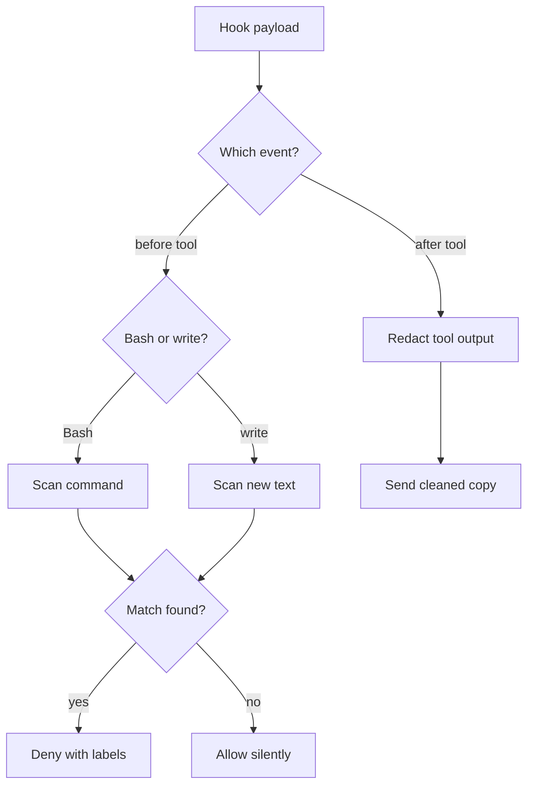

## Purpose

One secret scrubber that works at two moments. Before a tool runs, it blocks a real credential value in a Bash command or in text about to be written to a file. After a tool runs, it redacts credentials from the output and gives Claude the clean copy. It also exposes `scrub_text`, so scripts that write transcripts into the vault apply the same rules. `scrub_secrets.sh` is a thin wrapper that pins the registry file and calls the Python script.

## Dependencies

**Depends on.** Standard library (`json`, `os`, `re`, `sys`). For text that is not plain ASCII it loads `normalize_text` from [phi_patterns](phi_patterns.md), a sibling file; if that import fails the hook exits 2 {src:hooks/scrub_secrets.py:114-117} {src:hooks/scrub_secrets.py:295-297}. It reads the environment variable `SCRUB_REGISTRY_PATH` {src:hooks/scrub_secrets.py:121}, and otherwise the file `secret_var_registry.txt` next to itself {src:hooks/scrub_secrets.py:124}. It reads the hook JSON on stdin {src:hooks/scrub_secrets.py:258}.

**Used by.** Product code:
- `settings.json` binds it three times: PreToolUse on Bash {src:settings.json:168}, PreToolUse on Write, Edit and NotebookEdit {src:settings.json:178}, and PostToolUse on every tool {src:settings.json:232}.
- [post-tool-bash-scan-secrets](post-tool-bash-scan-secrets.md) imports `SPECIFIC_PATTERNS` and `normalize` {src:hooks/post-tool-bash-scan-secrets.py:20}.
- The vault write scan imports the module and calls `scrub_text` {src:scripts/sync/vault_write_scan.py:60} {src:scripts/sync/vault_write_scan.py:67}, see [vault_write_scan](../scripts/sync/vault_write_scan.md).
- The wrapper `scrub_secrets.sh` runs it {src:hooks/scrub_secrets.sh:6}. The inventory check lists both files {src:tests/hooks/check_hook_inventory.py:50} {src:tests/hooks/check_hook_inventory.py:57}.

Tests: `tests/hooks/test_scrub_secrets.py` runs both modes and the wrapper {src:tests/hooks/test_scrub_secrets.py:49} {src:tests/hooks/test_scrub_secrets.py:115} (see [test_scrub_secrets](../tests/hooks/test_scrub_secrets.md)). [test_security_fixes](../tests/hooks/test_security_fixes.md) checks the Plane key and JSON member shapes {src:tests/hooks/test_security_fixes.py:331} {src:tests/hooks/test_security_fixes.py:335}. [test_secret_shapes](../tests/hooks/test_secret_shapes.md) checks each added shape in both modes, the zero-width case and `scrub_text` {src:tests/hooks/test_secret_shapes.py:75} {src:tests/hooks/test_secret_shapes.py:101} {src:tests/hooks/test_secret_shapes.py:129}.

## Behavior

**Choosing the mode.** The payload's `hook_event_name` decides. `PostToolUse`, or no event name with a `tool_response` present, runs the output scrub {src:hooks/scrub_secrets.py:265-267}. `PreToolUse`, or no event name and no `tool_response`, runs the pre-tool scan {src:hooks/scrub_secrets.py:268-269}. Any other event name does nothing and exits 0. Input that is not JSON, or not an object, exits 2 {src:hooks/scrub_secrets.py:257-264}, and any other error exits 2 {src:hooks/scrub_secrets.py:295-297}.

**Normalising.** Before matching, text that is not ASCII has zero-width characters dropped and compatibility and look-alike forms folded {src:hooks/scrub_secrets.py:112-117} {src:hooks/phi_patterns.py:239-244}. Plain ASCII skips this {src:hooks/scrub_secrets.py:114-115}.

**Pre-tool scan of a Bash command.** The command is matched against the specific shapes and the registry shapes {src:hooks/scrub_secrets.py:202} {src:hooks/scrub_secrets.py:207}. A command that exports a secret-looking name with a literal value (`export TOKEN=abc12345`, not `$VAR` or a substitution) is flagged `ENV_SECRET` {src:hooks/scrub_secrets.py:208-209} {src:hooks/scrub_secrets.py:107-109}. Any hit gives a deny that lists the labels, never the matched text {src:hooks/scrub_secrets.py:210-213}. The loose `name = value` shapes are not used here, so `password=...` in a command is not blocked, only the specific shapes and the `export` form {src:hooks/scrub_secrets.py:202} {src:hooks/scrub_secrets.py:92-104}.

**Pre-tool scan of a file write.** The text scanned is the new text only: `content` for Write, `new_string` for Edit, `new_source` for NotebookEdit, and each edit's `new_string` for the old MultiEdit shape {src:hooks/scrub_secrets.py:185-196}. It is matched against the specific shapes, the registry shapes and the quoted-assignment check {src:hooks/scrub_secrets.py:214-219}. Any hit gives a deny with the labels {src:hooks/scrub_secrets.py:220-223}.

**Specific shapes.** These are blocked in commands and writes, and redacted in output: Anthropic, AWS access key (`AKIA` or `ASIA`), Atlassian, Databricks, GitHub (fine-grained and classic), Slack token, OpenAI (plain and `sk-proj`, `sk-svcacct`, `sk-admin`), Plane, Stripe live key, Google API key, npm, Hugging Face, GitLab, SendGrid, JWT, credentials in a URL, Slack webhook, a password given to `curl -u` or `--user`, a Bearer token, a JSON member such as `"api_key": "<20+ characters>"`, Azure storage key, Azure SAS, and a private key header {src:hooks/scrub_secrets.py:50-77}. Order matters: a more specific label comes before a generic one that could match the same text {src:hooks/scrub_secrets.py:48-49}. The word boundary on the AWS shape means `KEY_AKIA...` is caught {src:hooks/scrub_secrets.py:52}. A URL credential is skipped when the password looks like a placeholder, such as `$VAR`, `<pw>`, `password`, `changeme` or `xxx` {src:hooks/scrub_secrets.py:68}. A Bearer token needs 24 or more characters with at least one digit {src:hooks/scrub_secrets.py:72}.

**Quoted assignments in a write.** `password`, `passwd`, `secret`, `token` or `api_key` at the end of a name, then `=` or `:` and a quoted value of 8 or more characters, is flagged `ASSIGNED_SECRET` {src:hooks/scrub_secrets.py:81-87}. The value is skipped when it starts with `<`, `$`, `{`, `%`, `[` or `*`, holds a placeholder word (your, change, example, placeholder, redacted, xxxx, dummy, fake, sample), starts with test, none, null, true, false, env or todo as a whole word, or is a single name of letters, digits and underscores with at least one underscore {src:hooks/scrub_secrets.py:83-86}. This is used only for writes {src:hooks/scrub_secrets.py:79-80} {src:hooks/scrub_secrets.py:217}.

**The registry.** `secret_var_registry.txt` lists variable names, one per line, with `#` comments. A name must be a plain identifier {src:hooks/scrub_secrets.py:127-135}. A missing or unreadable file gives no names and no error {src:hooks/scrub_secrets.py:136-137}. Each name becomes a shape: the name, then `=` or `:`, then a value of 8 or more characters that does not start with `$`, a backtick or `(` and contains no quote or space, labelled `CUSTOM_CRED` {src:hooks/scrub_secrets.py:141-145}. A quoted value does not match, because the value pattern stops at a quote {src:hooks/scrub_secrets.py:143}.

**Output scrub.** Tools that return only internal status are skipped {src:hooks/scrub_secrets.py:38} {src:hooks/scrub_secrets.py:227-228}. A payload with no `tool_response` or blank text exits 0 {src:hooks/scrub_secrets.py:229-234}. Otherwise all text values in the response are joined {src:hooks/scrub_secrets.py:148-162}, and the specific, loose and registry shapes each replace their matches with `[REDACTED:LABEL]` {src:hooks/scrub_secrets.py:237-241}. The loose shapes catch `Authorization:` and `Bearer:` lines, `name = value` pairs for names such as password and token (16 or more characters), and `export NAME=value` {src:hooks/scrub_secrets.py:92-104}. With a match, it prints one JSON object whose `additionalContext` gives the count, the labels, a request not to use the raw values, and the cleaned text {src:hooks/scrub_secrets.py:244-253}.

**`scrub_text`.** Applies the same three lists to any string and returns the cleaned text with the labels found. With no match it returns the original text, not the folded copy {src:hooks/scrub_secrets.py:272-287}.

**The wrapper.** `scrub_secrets.sh` sets `SCRUB_REGISTRY_PATH` to the file next to it unless the caller already set one, then replaces itself with the Python script {src:hooks/scrub_secrets.sh:4-6}.

## Diagram: module level (L2, required)

## Diagram: function level (L3, optional)

None: no function has branching that the signature does not show.

## Notes

**Where the code and its own description disagree.**
- The header says the registry "lists extra variable names whose values must never appear" {src:hooks/scrub_secrets.py:11-12}. The pattern it builds matches only an unquoted value, so `NAME="value"` is not caught {src:hooks/scrub_secrets.py:143}.
- The header says PreToolUse scans the Bash command for "real credential values" {src:hooks/scrub_secrets.py:6-7}. It does so with the specific shapes only, not the loose name and value shapes {src:hooks/scrub_secrets.py:202}.

**Inputs that reach outbound text.** The tool output is the input. Everything the patterns do not match goes to Claude unchanged, so a credential in a shape not listed is not removed. No input reaches a file path, a command or a network address; the only file opened is the registry, whose path comes from `SCRUB_REGISTRY_PATH` or the folder of the script, and it is read only {src:hooks/scrub_secrets.py:121-131}. No check exists on the value of `SCRUB_REGISTRY_PATH`. A registry name is escaped before it enters a pattern {src:hooks/scrub_secrets.py:143}.

**Known gaps in the shapes.**
- A quoted password made only of letters, digits and underscores with at least one underscore (such as `super_secret_pw`) is skipped by the quoted-assignment check, because the check treats it as a variable name. The `(?i)` flag makes the name rule match lower case too {src:hooks/scrub_secrets.py:83} {src:hooks/scrub_secrets.py:85}. Checked by running the pattern on 2026-11-21.
- A secret typed into the chat cannot be scrubbed, as the header says {src:hooks/scrub_secrets.py:13}.
- Zero-width and look-alike folding runs only on non-ASCII text {src:hooks/scrub_secrets.py:114-115}.

**Writes to shared files.** None. The module writes only to stdout and stderr. Searched 2026-11-21: `hooks/scrub_secrets.py` and `hooks/scrub_secrets.sh` for `open(` with a write mode, `write_text` and `os.replace`; the only `open(` reads the registry.
