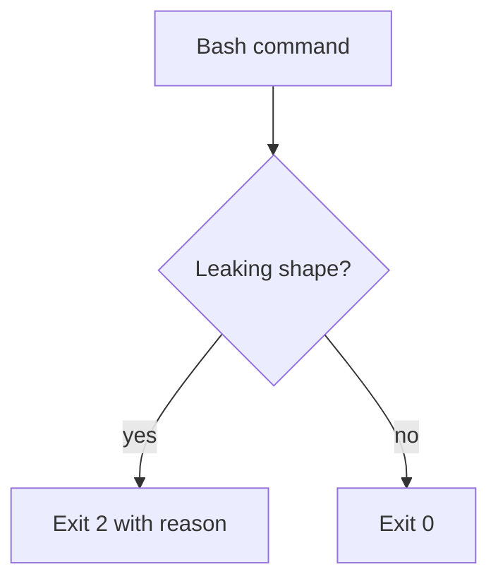

## Purpose

A PreToolUse hook for Bash. It blocks command shapes that print a credential or a private key. {src:hooks/secret-command-guard.sh:1-15}

## Dependencies

`python3` (reads `tool_input.command`) and `grep`. Tests: `tests/hooks/test_secret_command_guard.py` (no doc page).

## Behavior

It blocks, with exit 2 and a message on stderr, when the command:

1. reads or copies an SSH or PEM private key file (a `.pub` file is allowed),
2. contains an inline private key header,
3. runs the key tool with the flag that derives a public key from a private key file,
4. dumps a Databricks credential config,
5. pipes the environment into `grep`, or runs the environment printer,
6. prints (echo, printf, print or cat, with or without quotes or braces) a variable whose name holds KEY, TOKEN, SECRET, PASSWORD or PASSWD,
7. reads a password out of the OS store (`security find-generic-password` or `find-internet-password` with `-w`, or `secret-tool lookup`),
8. runs `gh auth token`,
9. runs a bare environment dump: `env`, `set`, `export -p` or `declare -p` (a prefix such as `env VAR=x cmd`, `set -e`, and a dump cut down to names with `cut -d= -f1` stay allowed),
10. reads a `.env` file (`.env.example`, `.sample`, `.template` and `.dist` are allowed) with cat, less, head, tail and similar readers,
11. reads a private key file by name (`id_rsa` style names, `.pem`, `.key`, `.p12`, `.pfx`) with a reader anywhere in the command, so `f=~/.ssh/id_rsa; cat $f` is caught. A `.pub` file is allowed.

An empty command or a parse failure allows. Credential values typed into a command are caught by [scrub_secrets](scrub_secrets.md), not here.

## Diagram

## Notes

This is a pattern check on the command text, not a sandbox and not a shell parser. A script that prints a secret on its own, a name built from pieces, or a value passed through a chain of variables is not seen. Names that merely contain KEY (for example `KEYBOARD`) are also caught.
