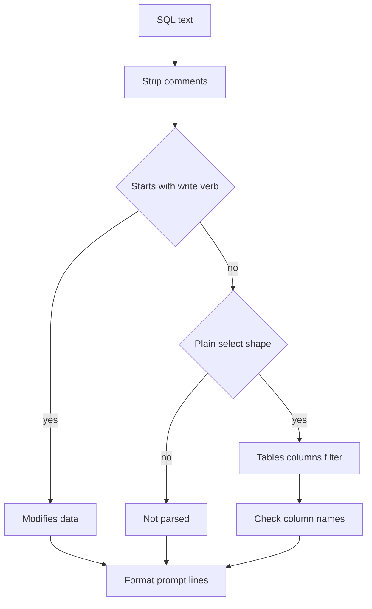

## Purpose

This module turns a SQL statement into a short plain summary for the Databricks approval prompt: which tables, which columns, whether a filter and a row limit are present, whether the query is row level or a roll-up, whether any column looks like patient data, and whether the statement changes data. It reads the text with regular expressions only and never runs the SQL. It is not a hook: it is imported by the Databricks approval hook, which shows its output to the user through Claude.

## Dependencies

**Depends on.**
- `hooks/phi_patterns.py` for `phi_column`, the test of whether a column name looks like patient data {src:hooks/sql_summary.py:18} and {src:hooks/phi_patterns.py:558-563}. [[phi_patterns]] / [phi_patterns](phi_patterns.md).
- Standard library: `re`, `dataclasses`.

**Used by.**
- Product code: `hooks/pre-tool-bash-databricks-ask.py` imports `summarize_sql` and `format_sql_summary` when it builds a reason {src:hooks/pre-tool-bash-databricks-ask.py:234} and {src:hooks/pre-tool-bash-databricks-ask.py:238}. [[pre-tool-bash-databricks-ask]] / [pre-tool-bash-databricks-ask](pre-tool-bash-databricks-ask.md). It is not wired in `settings.json` and is listed as a helper in the inventory test {src:tests/hooks/check_hook_inventory.py:43}.
- Tests: no test imports it (searched with `git grep` on 2026-11-20). `tests/hooks/test_hooks.py` reaches it through the hook {src:tests/hooks/test_hooks.py:226-241}.

## Behavior

**`summarize_sql(sql)` returns a `SqlSummary`** {src:hooks/sql_summary.py:33-43}:
1. Comments (`/* */` and `--` to end of line) are replaced by spaces and the trailing `;` is removed {src:hooks/sql_summary.py:46-48} and {src:hooks/sql_summary.py:77-78}.
2. If the text starts with `insert`, `update`, `delete`, `merge`, `drop`, `create`, `alter`, `truncate`, `replace`, `grant` or `revoke`, the result is "not parsed, modifies data" with the tables it can see {src:hooks/sql_summary.py:21} and {src:hooks/sql_summary.py:79-80}.
3. If the text does not fit the shape `select [distinct] <columns> from <rest>`, or contains a `;`, or starts with `with`, or contains `(select`, the result is "not parsed" with the tables it can see {src:hooks/sql_summary.py:24-27} and {src:hooks/sql_summary.py:81-84}.
4. Otherwise it fills in {src:hooks/sql_summary.py:85-98}: the column list, split on commas outside parentheses {src:hooks/sql_summary.py:51-63}; whether `*` or `x.*` is selected {src:hooks/sql_summary.py:93}; the `where` text {src:hooks/sql_summary.py:87} and {src:hooks/sql_summary.py:66-68}; the first word after `limit` {src:hooks/sql_summary.py:96}; whether the select list has a count, sum, avg, min, max or approx-count-distinct call, or the statement has a `group by` {src:hooks/sql_summary.py:20} and {src:hooks/sql_summary.py:95}; and the names of columns that look like patient data, found among the identifiers of the select list and the `where` text {src:hooks/sql_summary.py:71-73} and {src:hooks/sql_summary.py:97}.

**`format_sql_summary(summary)` returns lines for the prompt** {src:hooks/sql_summary.py:114-131}:
- A write statement gives a "MODIFIES DATA" line and the tables {src:hooks/sql_summary.py:117-118}.
- An unparsed statement gives "Could not parse, review the SQL below" and the tables seen {src:hooks/sql_summary.py:119-120}.
- A parsed select gives five lines: tables, columns (the first 12, then "+N more"), filter ("none (whole table)" when empty), shape and limit ("no LIMIT" is flagged), and PHI {src:hooks/sql_summary.py:121-131} and {src:hooks/sql_summary.py:29} and {src:hooks/sql_summary.py:101-105}.
- A table with a three-part name whose first part has the word `prod` set off by `_`, `-` or the ends gets a "PRODUCTION catalog" warning {src:hooks/sql_summary.py:30} and {src:hooks/sql_summary.py:108-111}.
- `select *` with no named PHI column prints "unknown (ALL columns requested)" {src:hooks/sql_summary.py:122-123}.

## Diagram: module level (L2, required)

## Diagram: function level (L3, optional)

None: no function has branching that the signature does not show. The decision chain of `summarize_sql` is drawn above.

## Notes

**Where the code and its own description disagree.**
- The header says anything beyond a plain select, "CTE, subquery, multiple statements", is reported as unparsed and "never guessed" {src:hooks/sql_summary.py:7-8}. A statement joined with `union` is not caught by any of the four tests {src:hooks/sql_summary.py:82-83}. Run on 2026-11-20, `SELECT id FROM a UNION SELECT ssn FROM b` came back as parsed, with tables `a` and `b`, columns `id` only, and the line "no known PHI columns requested". The second select's columns are never passed to the PHI check, which reads only the first select list and the `where` text {src:hooks/sql_summary.py:97}.
- The header says "Standard library only" {src:hooks/sql_summary.py:7}. The module imports `phi_patterns`, a file in the same repo {src:hooks/sql_summary.py:18}. That file itself uses only the standard library {src:hooks/phi_patterns.py:39-44}, so no outside package is needed.
- The docstring of `format_sql_summary` says "Parsed facts only; never inferred" {src:hooks/sql_summary.py:115}. The line "no known PHI columns requested" {src:hooks/sql_summary.py:121} is a statement about the parts the code looked at, not a fact about the whole query. Also, the `aggregated` flag is set by any matching function call in the select list, so a window call such as `count(*) over (...)` gives "aggregated" although rows stay row level; run on 2026-11-20 with `SELECT name, count(*) OVER (PARTITION BY x) FROM t`.

**Other limits (from the code).**
- The PHI check reads the select list and `where` text only, not `join ... on`, `group by`, `order by` or `having` {src:hooks/sql_summary.py:97}.
- A `;` inside a string value, such as `'x;y'`, makes the statement "not parsed" {src:hooks/sql_summary.py:82}. That is the safe direction. A test uses such a value but only checks that some reason exists {src:tests/hooks/test_hooks.py:235-236}.
- Statements such as `copy into` or `optimize` that write data but are not in the verb list {src:hooks/sql_summary.py:21} are reported as "could not parse", not as "MODIFIES DATA".
- The production warning needs a three-part name {src:hooks/sql_summary.py:110}. A two-part name, or a table in the session's default catalog, is never flagged.
- Words in a string value count as identifiers for the PHI check {src:hooks/sql_summary.py:22} and {src:hooks/sql_summary.py:72}, which can cause a false warning. That is also the safe direction.
- No size cap is applied before the regular expressions run {src:hooks/sql_summary.py:76-77}; speed was not measured here.

**Inputs that reach a path, command, network address or outbound text without a check.** The module opens no file, runs nothing and contacts nothing. Its output is text for the approval prompt, and that text contains the table names, the column names, the full `where` text with any literal values in it, and the PHI column names {src:hooks/sql_summary.py:109} and {src:hooks/sql_summary.py:127} and {src:hooks/sql_summary.py:121}. None of it is scanned for PHI values before it is shown, so a patient value typed into a `where` clause is repeated in the prompt.

**Shared files.** None written.

**Tests.** There is no direct test of this file. Through the hook, `test_summary_facts` proves the table, the production warning, the filter, "no LIMIT" and a named PHI column appear for one three-part query {src:tests/hooks/test_hooks.py:226-229}; `test_unparsed_and_writes` proves a `with` query shows "Could not parse" and a `delete` shows "MODIFIES DATA" {src:tests/hooks/test_hooks.py:231-233}. Not covered by any test: `union`, window calls, joins, `distinct`, more than 12 columns, comments inside the SQL, or two-part names.
