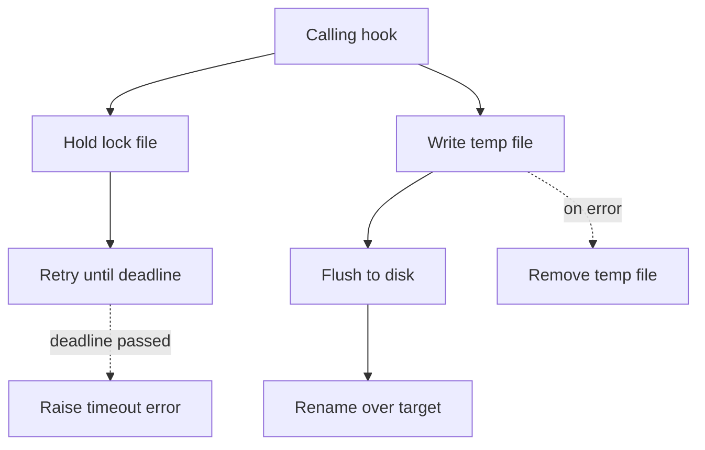
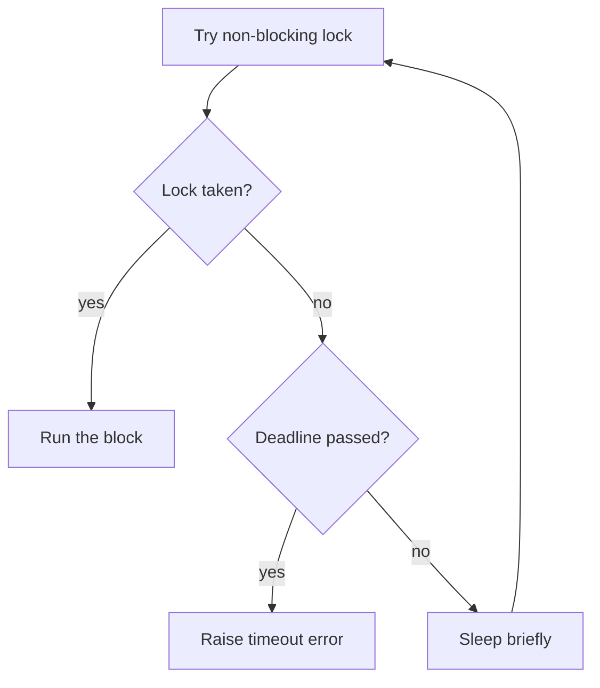

## Purpose

Two small helpers for code that keeps a shared state file. One writes a file so that a reader never sees half of it. The other holds a lock for a whole read, change and rewrite cycle so that two processes do not overwrite each other's change. The module uses only the standard library.

## Dependencies

**Depends on.** Standard library only: `contextlib`, `fcntl`, `logging`, `os`, `tempfile`, `time`, `typing` {src:hooks/state_file_io.py:13-19}. `fcntl` exists only on POSIX systems, so the module cannot be imported on Windows {src:hooks/state_file_io.py:14}. It imports nothing else from the repo.

**Used by.**

- Product code: none. Searched 2026-11-19: every file under the repo except `.git`, `docs/`, `__pycache__` and `.venv` for `state_file_io`, `write_state_atomic` and `locked_state`. The only hits outside this file are tests and an inventory list.
- Tests: [test_state_file_io](../tests/hooks/test_state_file_io.md) {src:tests/hooks/test_state_file_io.py:23}, [test_gate_hook](../tests/hooks/test_gate_hook.md) imports `write_state_atomic` {src:tests/hooks/test_gate_hook.py:36}.
- Inventory: [check_hook_inventory](../tests/hooks/check_hook_inventory.md) lists the file by name {src:tests/hooks/check_hook_inventory.py:44}.

## Behavior

**`write_state_atomic(path, content)`.** It makes a temp file in the same folder as the target, named with the prefix `.state-` and the suffix `.tmp` {src:hooks/state_file_io.py:38} {src:hooks/state_file_io.py:39-41} {src:hooks/state_file_io.py:24} {src:hooks/state_file_io.py:25}. It writes the content as UTF-8, flushes, and calls `fsync` on the file {src:hooks/state_file_io.py:43-46} {src:hooks/state_file_io.py:26}. Then it renames the temp file over the target with `os.replace` {src:hooks/state_file_io.py:47}. A reader sees either the old file or the new one, because the rename is one step on the same volume {src:docs:python-os-replace}.

If anything fails after the temp file exists, including `KeyboardInterrupt` and other `BaseException` types, the temp file is removed, an error is logged and the exception is raised again, so the original file stays as it was {src:hooks/state_file_io.py:48-51}. A temp file that is already gone is ignored during cleanup {src:hooks/state_file_io.py:55-57}. On success it logs at debug level {src:hooks/state_file_io.py:52}.

**`locked_state(path, timeout_seconds)`.** A context manager. It opens a sibling file named `path` plus `.lock` in append mode, which creates it if missing {src:hooks/state_file_io.py:22} {src:hooks/state_file_io.py:69} {src:hooks/state_file_io.py:70}. It then takes an exclusive lock on that sibling file {src:hooks/state_file_io.py:72} {src:hooks/state_file_io.py:85}. The default wait is 10 seconds {src:hooks/state_file_io.py:21} {src:hooks/state_file_io.py:62}. On leaving the block it releases the lock and closes the file, also when the block raised {src:hooks/state_file_io.py:73-78}.

**Waiting for the lock.** The wait is a loop: try a non-blocking lock, and if another process holds it, check the deadline, then sleep 0.05 seconds and try again {src:hooks/state_file_io.py:82} {src:hooks/state_file_io.py:85} {src:hooks/state_file_io.py:87} {src:hooks/state_file_io.py:93} {src:hooks/state_file_io.py:23}. Past the deadline it logs an error and raises `TimeoutError` {src:hooks/state_file_io.py:88-92}. The lock file is closed in that case too {src:hooks/state_file_io.py:77} {src:hooks/state_file_io.py:78}.

## Diagram: module level (L2, required)

## Diagram: function level (L3, optional)

Waiting for the lock has a retry loop and a deadline.

## Notes

**Docstring and code disagree.** None found. The module docstring, the `write_state_atomic` docstring and the `locked_state` docstring each match the code {src:hooks/state_file_io.py:3-6} {src:hooks/state_file_io.py:32-37} {src:hooks/state_file_io.py:64-68}.

**The two helpers are independent.** `write_state_atomic` does not take the lock, and `locked_state` does not write anything {src:hooks/state_file_io.py:38-52} {src:hooks/state_file_io.py:69-78}. The module docstring's promise that the lock serializes cycles holds only when every writer wraps its cycle in `locked_state`. The lock is advisory, so a writer that skips it is not stopped {src:docs:python-fcntl}. Used alone, `write_state_atomic` is atomic for readers but two simultaneous writers can still overwrite each other: the last rename wins {src:hooks/state_file_io.py:47}.

**Behavior of the temp file.** `mkstemp` creates the file with owner-only permissions, and the rename puts that file in place of the old one. A state file that had wider permissions would be narrowed on its first rewrite {src:hooks/state_file_io.py:39} {src:docs:python-tempfile}. The code does not sync the folder after the rename, so after a power loss the rename may not have reached the disk. Searched 2026-11-19: `hooks/state_file_io.py` for `fsync`; the only call is on the file at line 46. If `path` is a symlink, the rename replaces the symlink itself, not the file it points to {src:hooks/state_file_io.py:47} {src:docs:python-os-replace}.

**Failures outside the cleanup.** If `mkstemp` fails, for example because the folder does not exist, the error is raised at once, with no log line and nothing to remove {src:hooks/state_file_io.py:39-41}. If the lock file cannot be opened, the error is raised the same way {src:hooks/state_file_io.py:70}. The lock file is never deleted, so each locked state file leaves a `.lock` sibling behind. Searched 2026-11-19: `hooks/state_file_io.py` for `unlink` and `remove`; the only call is for the temp file at line 57.

**Unchecked inputs.** `path` and `content` are used as given. `path` decides which folder the temp file and the lock file are created in, with no check on where it points {src:hooks/state_file_io.py:38} {src:hooks/state_file_io.py:69}. `timeout_seconds` is not validated {src:hooks/state_file_io.py:82}. No input reaches a shell command or a network address.

**Shared file writes.** This module is the write path for shared state files. The write is atomic. Nothing stops two writers at once unless both use `locked_state`, as described above.
