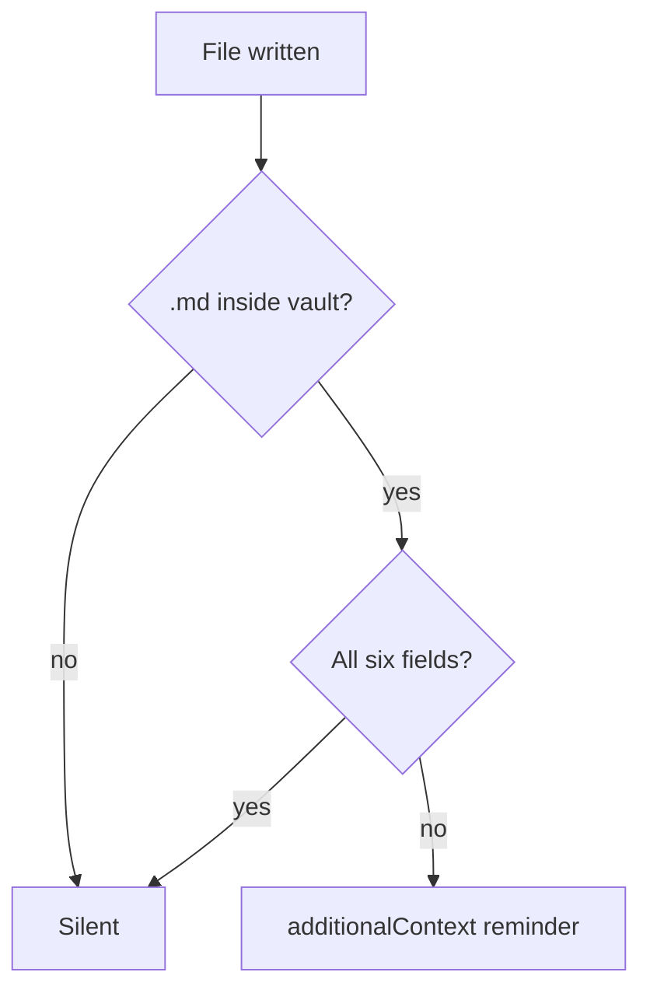

## Purpose

A PostToolUse hook for Write, Edit and MultiEdit. After a vault markdown file is written, it reminds Claude when the frontmatter is missing or incomplete. It never blocks. {src:hooks/vault_doc_standard_check.sh:1-10}

## Dependencies

`python3`, `awk`, `grep`. Reads `TOLLGATE_KNOWLEDGE`. With it unset, the hook does nothing. Tests: `tests/hooks/test_vault_hooks.py` (no doc page).

## Behavior

It skips files that are not `.md`, do not exist, or sit outside the vault folder. If the first line is not `---`, it says the file has no frontmatter. Otherwise it checks six fields: `doc_type`, `status`, `date`, `last_updated`, `tags`, `links`, and names the missing ones as `additionalContext`.

## Diagram

## Notes

This is a reminder after the fact. The hard check before the write is [pre_tool_write_vault_frontmatter](pre_tool_write_vault_frontmatter.md).
