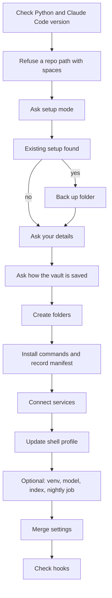

## Purpose

One time setup for a new machine, and the same script updates and removes an install. It asks a few questions, creates the notes vault and working folders, installs the command files (`commands/tg-*.md`) and a personal `CLAUDE.md`, optionally connects Jira, Notion and Slack, adds an environment block to the shell profile, merges the hooks into `~/.claude/settings.json`, and optionally builds the Python environment, the vault search index and a nightly index job. {src:install.sh:1} It records what it installed in a manifest, so an update removes what upstream dropped and `--uninstall` removes only Tollgate's own entries. {src:install.sh:26} It is safe to run again: it backs files up and skips work already done. {src:install.sh:3}

## Dependencies

| Need | Use |
|---|---|
| `python3` 3.12 or newer | Checked by running it, not by `command -v`, because the macOS stub exists but fails. Exit 1 if it fails {src:install.sh:148} {src:install.sh:155}. The message says what was found (or that no working `python3` exists) {src:install.sh:150}, that `python3 --version` must print 3.12 or newer {src:install.sh:151}, to put the 3.12 folder first on `PATH` and re-run {src:install.sh:152}, then gives a macOS line (`brew install python@3.12`, then use the `python3` in brew's bin folder) {src:install.sh:153} and a Linux line (install `python3.12`; deadsnakes on Ubuntu, pyenv or uv elsewhere; see [prerequisites](prerequisites.md)) {src:install.sh:154}. The installer does not take `TOLLGATE_PYTHON` as an input to choose its Python: it checks the `python3` on `PATH` {src:install.sh:148}. It only writes the name for the venv python it finds, see Environment variables below {src:install.sh:1768}. The test runners do read it, see Notes |
| `installer/merge_settings.py` and `settings.json` | The settings merge {src:install.sh:1769}. See [merge_settings](installer/merge_settings.md) and [settings](settings.md) |
| `installer/manifest.py` | Records the installed command files, the scheduled job and the version in `~/.claude/tollgate/manifest.json` {src:install.sh:1164} |
| `scripts/core/paths.py` | The one table of vault folder names. The installer takes the folder list from it {src:install.sh:1017} |
| `scripts/core/tg_path` | Prints the meetings folder written to the profile and `CLAUDE.md` {src:install.sh:908-909}, and the state folder used to find an existing venv {src:install.sh:174-175} {src:install.sh:1571-1572}. See [tg_path](scripts/core/tg_path.md) |
| `git` | Optional. Scripts folder tracking, repo cloning and `git init` on the vault. Skipped with a note if missing {src:install.sh:1043} |
| `security` (macOS), `secret-tool` (Linux), `cmdkey` (Windows shells) | Credential storage {src:install.sh:257} {src:install.sh:262} {src:install.sh:271} |
| `claude` CLI, `npx` | Optional. Register the MCP servers {src:install.sh:1491} {src:install.sh:1484}. The three npx packages are held in the variables `MCP_REMOTE_PKG`, `NOTION_MCP_PKG` and `SLACK_MCP_PKG`, each with an exact version {src:install.sh:1468} {src:install.sh:1469} {src:install.sh:1470} |
| `scripts/core/setup_venv.sh`, `scripts/requirements.txt`, `scripts/search/rebuild.sh` | Optional Python environment and search index {src:install.sh:1616} {src:install.sh:1631}. The venv step installs only `scripts/requirements.txt` (bounded versions of `chromadb`, `pyyaml` and `beautifulsoup4`) {src:scripts/core/setup_venv.sh:57} {src:scripts/requirements.txt:9} {src:scripts/requirements.txt:10} {src:scripts/requirements.txt:11}. `scripts/requirements-epub.txt` (`ebooklib`, licensed AGPL-3, for epub books) and `scripts/requirements-extras.txt` (`anthropic` and `aiohttp`, for the index context pass) are never installed by the installer; you run `pip install -r` on them yourself {src:scripts/requirements-epub.txt:5} {src:scripts/requirements-extras.txt:4} {src:scripts/requirements-extras.txt:5} |
| `scripts/cron/setup_cron.py`, `launchctl` | Optional nightly index job, macOS only {src:install.sh:1674} |

An existing search environment (venv) on an older Python is also refused with exit 1 and must be rebuilt: delete the folder named in the message and re-run. Nothing is deleted for you. The check runs before any backup or wipe of an existing `~/.claude`, and again once the notes folder is known {src:install.sh:172-183} {src:install.sh:634} {src:install.sh:914}. A refused run can already have created `~/.claude` and its saved-answers file, but writes no vault, settings or paths file and deletes nothing.

Setup guide: [setup](setup.md). Tests: [installer tests](installer/tests.md), [vault git tests](tests/installer/test_vault_git.md).

## Behavior

Answers it asks for: the notes folder (`TOLLGATE_KNOWLEDGE`), your initials (`TOLLGATE_INITIALS`), the ticket prefix (`TOLLGATE_TICKET_PREFIX`) and how the vault is saved (`vault_git`: none, local or remote). Initials and prefix are letters only and are saved in upper case. A bad answer is asked again; a bad flag stops the run with exit 2 before anything is written. The first three go into the saved config file, the settings `env` block and the shell profile block. The vault git answer goes into the paths file. {src:install.sh:107-111} {src:install.sh:929-931} {src:install.sh:984} There is no question about a command prefix: commands always install as `tg-*.md`.

Flags and environment:

- `--vault PATH`, `--vault-git none|local|remote`, `--initials AB`, `--ticket-prefix T`, `--name "Full Name"`: give the answer up front, so that question is not asked. With `--non-interactive` the result is the same as typing the same answers. `--flag=value` also works. `TOLLGATE_VAULT_GIT` gives the vault git answer too; the flag wins. {src:install.sh:24} {src:install.sh:116}
- `--restore-settings`: puts the newest `settings.json.bak.*` back and exits. The file it replaces is kept as `settings.json.before-restore.<time>`. {src:install.sh:186}
- `--uninstall`: removes only what the manifest lists, then exits. See Uninstall below. {src:install.sh:472}
- `--with-venv` or `--skip-venv`: build, or never build, the Python environment and the search index without asking. {src:install.sh:1637} {src:install.sh:1639}
- `--with-cron`: schedule the nightly index job without asking (macOS only). {src:install.sh:1684}
- `--strict`: stop with exit 1, instead of a warning, when Claude Code is older than 2.1.295 or not found. {src:install.sh:465}
- `--help`: prints every flag and exits 0. {src:install.sh:83}
- `--non-interactive` or `TOLLGATE_NONINTERACTIVE=1`: every prompt takes its default, service connections are skipped, and an existing setup is always migrated, never cleaned. {src:install.sh:19} The script wraps `read` so that prompt reads return an empty answer, and the migrate or clean question returns `m`. {src:install.sh:125} {src:install.sh:137}
- `--dry-run`: prints what would change and exits 0 before any file is written or any secret is asked for. {src:install.sh:756}
- Strict mode is on: `set -euo pipefail`. {src:install.sh:4}

Prompts, in order:

1. Press Enter to start. {src:install.sh:521}
2. Advanced setup, yes or no. Default no, which means simple mode. {src:install.sh:529}
3. If `~/.claude` already has content: keep and update, or start fresh (simple mode); or migrate or clean (advanced mode). Start fresh sets clean mode, which wipes `~/.claude` after a verified backup. {src:install.sh:594} {src:install.sh:621} {src:install.sh:599} {src:install.sh:625}
4. Advanced migrate only: confirm the migration plan. {src:install.sh:719}
5. Name, job title, company, industry. Name is required and re-asked until given. {src:install.sh:793} {src:install.sh:794}
6. Initials and ticket prefix. Initials default to the first letters of the name, at most three. {src:install.sh:805} {src:install.sh:824} {src:install.sh:829}
7. Notes folder path, simple mode. Advanced mode asks for a base folder, then the notes folder. {src:install.sh:865} {src:install.sh:876} {src:install.sh:882}
8. How the vault is saved: `none`, `local` or `remote`. If you choose `local` or `remote` and the vault is not a git repo, it asks whether to run `git init` on it (default yes). {src:install.sh:971} {src:install.sh:991}
9. Advanced only: track scripts with git, a scripts repo URL, repo URLs to mirror, Cursor rule on or off per rule, a code reference directory. {src:install.sh:1040} {src:install.sh:1064} {src:install.sh:1091} {src:install.sh:1211} {src:install.sh:1285}
10. For Jira and Confluence, Notion: browser sign in, API key or skip. For Slack: API key or skip; the prompt says the npm package is unsupported and kept for now. {src:install.sh:1328} {src:install.sh:1356} {src:install.sh:1383} {src:install.sh:1375} {src:install.sh:1379}
11. Vault search. Simple mode asks whether to set it up (default no). Advanced mode always does it unless `--skip-venv`. After the environment is built it offers the local embedding model (default yes). {src:install.sh:1647} {src:install.sh:1655} {src:install.sh:1595}
12. Nightly index job. Asked only on macOS in simple mode (default no). Advanced mode schedules it only with `--with-cron`. {src:install.sh:1690}

Saved answers: name, title, company, domain, the folder stem, the base folder, the code folder, the three answers above and the paths of the folder map and connector files go to `~/.claude/tollgate-config` and are read back on the next run. {src:install.sh:840} {src:install.sh:919} {src:install.sh:929} {src:install.sh:1292} The folder stem names the folders beside the vault (`<stem>-scripts`, `<stem>-code`, `<stem>-dev`, `<stem>-library`). A new install uses `tollgate`. A re-run of an older install keeps the stem it saved, so its folders are not renamed. {src:install.sh:835}

Claude Code version check: before any question it reads `claude --version`. If Claude Code is older than 2.1.295, or cannot be found, it warns that the PHI and secret hooks will not fail closed (a hook that cannot start would let the action through). With `--strict` it exits 1 instead. {src:install.sh:8} {src:install.sh:449} {src:install.sh:457}

Existing setup handling: on a first install over an existing `~/.claude`, a migration and a clean start, the whole `~/.claude` folder is copied to `~/.claude.backup.<timestamp>` and the file counts are compared. On an update of an install Tollgate made earlier (a manifest exists) there is no full copy: files are backed up one at a time as `<name>.bak.<time>`. {src:install.sh:376} {src:install.sh:639} Only the newest 3 full copies and the newest 3 per file backups are kept; only names with the 14 digit time stamp are ever deleted. {src:install.sh:12} {src:install.sh:354} {src:install.sh:363} Clean mode wipes `~/.claude` only after a verified backup, and exits 1 if the backup fails. {src:install.sh:644} {src:install.sh:403} Migrate mode keeps memory files and leaves custom commands exactly where they are in `~/.claude/commands`: nothing is copied into this repo, and they are not in the manifest, so an update or `--uninstall` never removes them. A re-run with a custom command present no longer stops. {src:install.sh:1236} {src:install.sh:742}

Folders it creates, under the base folder (default `$HOME/Developer/<name-slug>`): {src:install.sh:855}

- The notes vault, which sits in the base folder unless you type another path in simple mode or reuse a detected vault in advanced mode. {src:install.sh:858} {src:install.sh:882} The folder list comes from `scripts/core/paths.py dirs`, not from a list in the installer: `00-landing`, `01-system-map` (with `clients`, `pipelines`, `architecture`, `data-model`, `platform-learning`), `02-tickets`, `03-knowledge-base` (with `decisions`, `learnings`, `patterns`, `whiteboard`), `04-education`, `05-conversations`, `06-chat-threads`, `08-reference`, `memory`, `output`. A line of the same name in the paths file changes a folder name. {src:install.sh:1017} {src:install.sh:1027} {src:scripts/core/paths.py:308-313}
- No `meetings` folder is made at install: the folder list leaves it out {src:scripts/core/paths.py:310-312}, and the sync script makes the folder on first use {src:scripts/sync/sync_meetings.py:237}. `TOLLGATE_MEETINGS` and the `{MEETINGS_DIR}` text in `CLAUDE.md` hold whatever `scripts/core/tg_path meetings` prints for this vault: a `meetings:` line in the paths file when there is one, else `<vault>/meetings`. If that helper fails, the installer falls back to `<vault>/meetings`. {src:install.sh:908-909} {src:scripts/core/paths.py:126-127} {src:scripts/core/paths.py:102} {src:install.sh:1255} {src:install.sh:1525}
- `<stem>-scripts`, `<stem>-code` (read only mirror) and `<stem>-dev` (working checkouts). {src:install.sh:916} {src:install.sh:1032}
- `<stem>-library`, beside the vault and outside it, for epubs and documents. The installer adds one `references: <that path>` line to the paths file, only if the file has no `references:` line yet. It never changes or reorders existing lines. {src:install.sh:943} {src:install.sh:945}

Vault git setting: the answer is written as one `vault_git: <mode>` line in the paths file; an older `vault_git` line is replaced, nothing else is reordered. The default is the line already saved, else the mode detected from the vault folder, else `local`. In an unattended run with no mode given, the mode follows the folder: a vault with no `.git` becomes `none`. If the mode is not `none` and the vault has no `.git`, the installer runs `git init` on it: after a yes in an interactive run, without asking when `--vault-git` was given. It never adds a remote and never pushes. For `remote` it prints the `git remote add` line for you to run. Commands print vault git lines for you to run; none of them are run by Tollgate. {src:install.sh:966} {src:install.sh:979} {src:install.sh:984} {src:install.sh:987} {src:install.sh:1006} See [variables](variables.md) and [tg_vault_git](scripts/core/tg_vault_git.md).

Files it writes or changes:

| Target | What |
|---|---|
| `~/.claude/commands/` | The shipped `tg-*.md` command files, copied under the same name, with name and company filled in. Every `$TOLLGATE_HOME/` in a command, whatever script follows it, is replaced with the absolute repo path, so an installed command never reads `$TOLLGATE_HOME` when it runs. For `tg-search` this is the same path the settings permission rule holds. A guard (`_LEGACY_SED`) maps leftover per-install prefix text to `tg-`. No file is renamed or prefixed {src:install.sh:1148} {src:install.sh:1143} {src:install.sh:1155} |
| `~/.claude/CLAUDE.md` | Rendered from the repo `CLAUDE.md` with identity and paths filled in. The workspace path is escaped like the other values {src:install.sh:1258} {src:install.sh:1270} |
| `~/.claude/projects/<slug>/memory` | A symlink to the repo `memory` folder. A real folder already there is moved aside as `memory.bak.<time>` {src:install.sh:1132} |
| `<vault>/.cursor/rules` and `rules-disabled` | Cursor rules, enabled or disabled {src:install.sh:1173} |
| `~/.claude/credentials.sh` | A loader script that reads tokens from the OS store and exports them. It holds no token values {src:install.sh:1403} |
| Shell profile | A block marked `# Tollgate (managed block)`. Blocks from older installs, which start with `# Tollgate (`, in `.zshrc`, `.bash_profile`, `.bashrc` and `.profile` are removed first, with a dated backup {src:install.sh:1524} {src:install.sh:1539} |
| `<base>/<stem>.code-workspace` | VS Code workspace with the vault, repo and scripts folders {src:install.sh:1732} |
| `~/.claude/settings.json` | Merged hooks and permissions, after a dated copy (`settings.json.bak.<time>`, made by `merge_settings.py --backup`). Undo with `--restore-settings` {src:install.sh:1769} |
| `~/.claude/tollgate-config` | The saved answers. Names and folders only, never a secret {src:install.sh:840} |
| `~/.claude/tollgate/paths.yaml`, `connectors.yaml` | Created empty if missing. The installer then adds the `references:` and `vault_git:` lines to the paths file {src:install.sh:936} |
| `~/.claude/tollgate/manifest.json`, `installed-version` | What Tollgate installed (command files, hooks, permission rules, env names, scheduled job) and the version that did it {src:install.sh:1164} {src:install.sh:1783} |
| `~/.claude/tollgate/removed/removed.<time>` | Copies of command files an update or uninstall removed {src:install.sh:1166} |
| `<state folder>/venv`, the index folder | The Python environment and the search index, if chosen. The folders come from the path loader (`state` and `index`; defaults `~/.tollgate/state` and `~/.tollgate/index`) {src:install.sh:1572} {src:install.sh:1628} |
| `~/Library/LaunchAgents/` job file | The nightly index job, only after a yes or `--with-cron` {src:install.sh:1674} |

Repo path with whitespace: the installer exits 1 before it writes anything when the repo folder path holds a space, tab or newline, and tells you to move the repo. The reason is that the rewritten command calls hold the repo path unquoted, because a quoted path would no longer match the permission rule. The check sits right after the Python check and before the backup, the prompts and every write. {src:install.sh:160-165} {src:install.sh:148}

New files (empty, created once, never overwritten): `~/.claude/tollgate/paths.yaml` (`TOLLGATE_PATHS`, read by the path loader) and `~/.claude/tollgate/connectors.yaml` (`TOLLGATE_CONNECTORS`, filled in when a connector is first used). They sit under `~/.claude` because they are per machine and the vault may be shared or synced. `TOLLGATE_HOME` is the repo folder; its `scripts/` folder holds the scripts tree. {src:install.sh:925} {src:install.sh:938}

Update and manifest: after the commands are installed, `manifest.py sync-commands` records their names. A command file the manifest lists that this version no longer ships (dropped, or installed earlier under a prefixed name such as an old `ab-ticket.md`) is moved to the `removed` folder. Only names the manifest lists are ever removed; a command file of your own is never touched. {src:install.sh:1164} The settings merge records the hook entries, permission rules and env names it added in the same manifest, and removes any it added earlier that the template no longer has. {src:install.sh:1769} The version is written to `installed-version` only when it changes. {src:install.sh:1782}

Running it twice: the second run changes no file, the manifest included. Rendered commands and `CLAUDE.md` are replaced only when the content differs (then the old one is backed up). The shell profile block is rewritten only when it differs. The settings file is written, and backed up, only when the merge changes it. The one thing an install over an existing `~/.claude` adds on purpose is the full `~/.claude.backup.<time>` copy, and only when there is no manifest yet. {src:install.sh:415} {src:install.sh:1552} {src:install.sh:639}

Uninstall: `./install.sh --uninstall` reads the manifest, backs up `settings.json`, removes the hooks, permission rules and env names it lists, moves the command files it lists into `~/.claude/tollgate/removed/`, removes the scheduled job it made, then deletes the manifest and `installed-version`. With no manifest it removes nothing and exits 0. It leaves `CLAUDE.md`, `tollgate-config`, `credentials.sh`, the shell profile block, the memory link, your notes and your own commands and settings. `--dry-run` with it prints the plan and changes nothing. {src:install.sh:472} {src:install.sh:486} {src:install.sh:497}

Environment variables written to the shell profile: `TOLLGATE_MEETINGS`, `TOLLGATE_SCRIPTS`, `TOLLGATE_KNOWLEDGE`, `CLAUDE_DOTFILES`, `TOLLGATE_CODE_DIR`, `TOLLGATE_INITIALS`, `TOLLGATE_TICKET_PREFIX`, `TOLLGATE_HOME`, `TOLLGATE_PATHS` and `TOLLGATE_CONNECTORS`, plus a line that sources `credentials.sh`. There are no per install prefix variables and no `TOLLGATE_SKILL_PREFIX`. {src:install.sh:1524} {src:install.sh:1535} The paths and the three folder values go through `_dq`, which puts a backslash before a backslash, a double quote, a dollar sign or a backtick and turns line breaks into spaces, so a path with those characters still sources back to the same text and cannot add a line. The initials and the ticket prefix are not passed through it, since they are letters only. {src:install.sh:552} {src:install.sh:1525-1529} {src:install.sh:1532-1534} {src:install.sh:1530} The profile file is `.zshrc` for zsh, `.bash_profile` or `.bashrc` for bash, `.profile` otherwise. {src:install.sh:1515} The settings `env` block gets `TOLLGATE_KNOWLEDGE`, `TOLLGATE_CODE_DIR`, `CLAUDE_DOTFILES`, `TOLLGATE_INITIALS`, `TOLLGATE_TICKET_PREFIX`, `TOLLGATE_HOME`, `TOLLGATE_PATHS` and `TOLLGATE_CONNECTORS`, and `TOLLGATE_PYTHON` (the venv python) when a venv exists, so editors started without the shell profile still work. An old `TOLLGATE_SKILL_PREFIX` in the settings is removed. {src:install.sh:1768} {src:install.sh:1769} {src:installer/merge_settings.py:418} {src:installer/merge_settings.py:219}

Tokens: they are never written to a file by the script's normal path. On macOS the `security` tool prompts on the terminal, so the value is not in the process list. {src:install.sh:257} On Linux they go to Secret Service through `secret-tool`. Without it the installer refuses to store a token, writes no file, and prints `sudo apt install libsecret-tools`. {src:install.sh:262} {src:install.sh:266} {src:install.sh:267} On Windows shells they go to Credential Manager through `cmdkey`, which receives the token on its command line, where other processes on the machine can see it. {src:install.sh:271} The loader reads from the same store at shell start. {src:install.sh:1417}

Services: the Atlassian and Notion browser option registers a remote server with `claude mcp add --scope user`. API key options register an `npx` command that sources `credentials.sh` and then runs `npx -y` on a pinned package. Slack has no browser option. {src:install.sh:1475} {src:install.sh:1496} {src:install.sh:1488} {src:install.sh:1493} The pins are `mcp-remote@0.16.5` (Atlassian key option, followed by the Atlassian URL), `@notionhq/notion-mcp-server@2.6.1` and `@modelcontextprotocol/server-slack@2025.4.25` {src:install.sh:1468} {src:install.sh:1469} {src:install.sh:1470} {src:install.sh:1497} {src:install.sh:1501} {src:install.sh:1503}. The reason, given in the script, is that an unpinned name would run whatever was published last, with the stored keys in its environment {src:install.sh:1464}. To bump one, edit the version in those three lines, using a release at least 14 days old, and re-run `tests/installer/run.sh` {src:install.sh:1466} {src:install.sh:1467}. Re-running the installer replaces the earlier registration under the same name, so an install made before the pins gets the pinned command {src:install.sh:1474}. The `-y` flag only skips the npx install prompt {src:install.sh:1488}. If the `claude` CLI is missing it prints a note and skips all registration. {src:install.sh:1491} Non interactive mode always skips services. {src:install.sh:301}

Search environment: the Python environment is built by `scripts/core/setup_venv.sh` into `<state folder>/venv`, with `scripts/requirements.txt`. Then the installer offers the local embedding model: it installs `sentence-transformers` and runs `download_model.py --yes-download` once. The default is yes when asked. An unattended run skips it unless `TOLLGATE_DOWNLOAD_MODEL=1`, and `TOLLGATE_DOWNLOAD_MODEL=0` always skips it. A failure prints one line and the install goes on with the built-in embedder, which needs no download. Then `scripts/search/rebuild.sh` builds the index. A venv from an earlier run is reused for `TOLLGATE_PYTHON` even when this run skipped the step. {src:install.sh:1616} {src:install.sh:1582} {src:install.sh:1599} {src:install.sh:1631} {src:install.sh:1662} The workspace file writes one VS Code setting, which hides `__pycache__` folders, and none for the index folder. {src:install.sh:1749-1750}

Nightly job: macOS only. `setup_cron.py --job nightly-index --yes-install-job` writes a launchd job that rebuilds the index at 2:00 AM, and the job name is recorded in the manifest so `--uninstall` removes it. It is never loaded without a yes or `--with-cron`. On other systems it prints a note and skips. {src:install.sh:1674} {src:install.sh:1676} {src:install.sh:1684} {src:install.sh:1669}

Hook permissions: before the merge it runs `chmod +x` on every `*.py` and `*.sh` file in the repo `hooks` folder. {src:install.sh:1764}

Verification: after the merge, the script checks that each hook path in `~/.claude/settings.json` is executable and prints a note for each one that is not. It does not exit non zero for that. {src:install.sh:1797} {src:install.sh:1805}

Exit behavior:

| Exit | When |
|---|---|
| 1 | `python3` missing or older than 3.12 {src:install.sh:155} |
| 1 | The repo folder path contains whitespace {src:install.sh:164} |
| 1 | An existing search environment (venv) runs on Python older than 3.12 {src:install.sh:182} |
| 1 | Clean mode and the backup failed {src:install.sh:645} |
| 1 | Clean aborted because no verified backup exists {src:install.sh:405} {src:install.sh:653} |
| 1 | `--strict` and Claude Code is older than 2.1.295 or not found {src:install.sh:467} |
| 1 | The vault folder list could not be read from `paths.py` {src:install.sh:1021} |
| 2 | An unknown flag, a flag with no value, or a bad `--initials`, `--ticket-prefix` or `--vault-git` value {src:install.sh:90} {src:install.sh:99} {src:install.sh:110} {src:install.sh:120} |
| 0 | Migration plan declined {src:install.sh:724} |
| 0 | Dry run finished {src:install.sh:771} |
| 0 | `--help`, or `--uninstall` finished {src:install.sh:83} {src:install.sh:499} |
| 0 | Normal finish. Any other failing command stops the script through `set -e` {src:install.sh:4} |

What it does NOT do:

- It does not write token values to any repo or config file on macOS, and it does not accept a token as a script argument. The Windows `cmdkey` call is the exception noted above. {src:install.sh:257}
- It does not wipe `~/.claude` in non interactive mode. {src:install.sh:137}
- It does not post to Jira, Notion or Slack. It only stores credentials and registers servers. {src:install.sh:1496}
- It does not run `git add`, `git commit` or `git push` on the vault, and it never adds a remote. It runs `git init` on the vault only for a vault mode other than `none`. {src:install.sh:987} {src:install.sh:996}
- It does not install the git hooks into other repos. It prints the copy command only in advanced mode. {src:install.sh:1700}
- It does not move the repo folder. It suggests a `mv` command in advanced mode. {src:install.sh:900}
- It does not install Node, git or the Claude CLI. It prints a note when they are missing. {src:install.sh:1485} {src:install.sh:1492}
- It does not download a model or schedule a job unless you say yes (or pass the flag or variable that says so). {src:install.sh:1587} {src:install.sh:1684}
- It does nothing at all to disk in dry run. {src:install.sh:756}

## Diagram

## Notes

Needs bash. Reads use a function that overrides the `read` builtin. {src:install.sh:125} The end to end test runs the script on macOS system bash 3.2. {src:tests/e2e/run.sh:41} That test and the hook test runner read `TOLLGATE_PYTHON` (a path to a `python3`) and put its folder first on `PATH`, so a 3.12 python can be chosen for a test run without changing the shell {src:tests/e2e/run.sh:27} {src:tests/e2e/run.sh:28} {src:tests/hooks/run.sh:12}. See [e2e run](tests/e2e/run.md).

The Slack MCP package is marked by npm as no longer supported. It is still registered, pinned to its last release {src:install.sh:1470}. The pin stops a changed release from running with the stored keys, but it does not give the package any further fixes. Whether to replace it is an open question. The marking lives in the npm registry, not in this repo, so no line here can be cited for it (npm reported `deprecated: Package no longer supported` on 2026-11-21). The installer tells the user this at the Slack question, in both the simple and the full prompt: the npm package is unsupported and kept for now {src:install.sh:1375} {src:install.sh:1379}. When the key option was chosen, the final summary shows `(unsupported npm package, kept for now)` after the Slack line {src:install.sh:1725}.

The pinned versions are checked by `tests/installer/test_mcp_pins.py`, see [test_mcp_pins](tests/installer/test_mcp_pins.md). The reworded Python message is checked by [test_python_hint](tests/installer/test_python_hint.md) and the requirements files by [test_requirements](tests/installer/test_requirements.md).

Disagreements and risks found in the code:

- The script says tokens live in the keychain and not in files. {src:install.sh:1450} On Linux without `secret-tool` nothing is stored: the installer refuses and tells you to install `libsecret-tools`. No `.secrets` file is ever written.
- Fixed: non interactive mode with no name now uses `Tollgate User` (or `--name`) instead of asking forever. {src:install.sh:788}
- In dry run, the setup mode and existing setup prompts still run, and the backup step only prints. {src:install.sh:529} {src:install.sh:380}
- Advanced mode resets `CODE_DIR` to the answer of a later prompt, after the `<stem>-code` folder was already created and after `CLAUDE.md` was rendered with that folder, so the guarded path in the profile and settings can differ from the one in `CLAUDE.md`. {src:install.sh:1032} {src:install.sh:1264} {src:install.sh:1286}
- In advanced mode the `Meetings:` line printed before the folders are made shows `<vault>/meetings` {src:install.sh:893}, while the value written to the profile and `CLAUDE.md` comes from `tg_path meetings` and differs when the paths file has a `meetings:` line {src:install.sh:908-909}.
- The unquoted `{WORKSPACE_FILE}` bug is fixed: the path is escaped for `sed`, so `&`, `|` and `\` in it reach `CLAUDE.md` intact {src:install.sh:1257} {src:install.sh:1270}.

Inputs that reach a file, a command or outbound text, and whether they are checked:

- The repo path: refused when it holds whitespace, otherwise written unchecked into the rewritten commands, where `sed` escapes `\`, `&` and `|` only {src:install.sh:160-165} {src:install.sh:340} {src:install.sh:1155}. Other shell characters in a repo path, such as a quote or a dollar sign, are not checked, so a path like that would make an unquoted command call misbehave when Claude Code runs it.
- The vault path, base folder and code folder: used in `mkdir` and written to the profile through `_dq` and to the saved config through `_dq` {src:install.sh:1027} {src:install.sh:1525-1529} {src:install.sh:929}. No check on the value. The VS Code workspace file is the exception: it writes the vault, repo and scripts paths into JSON text with no escaping, so a double quote or backslash in one of them gives a workspace file that is not valid JSON {src:install.sh:1737} {src:install.sh:1741} {src:install.sh:1745}.
- Repo URLs and the scripts remote URL are passed to `git clone` and `git remote` with no check on the value {src:install.sh:1107} {src:install.sh:1069}.
- Name, title, company and industry are escaped for `sed` before use {src:install.sh:1136-1139}.
- Tokens are never placed on a command line on macOS and Linux. On Windows shells `cmdkey` receives them as an argument {src:install.sh:257} {src:install.sh:262} {src:install.sh:271}.

Writes to shared files: nothing in the script takes a lock, so two installs run at the same moment can interleave (searched `install.sh` for `flock`, `lockf` and lock folders, 2026-11-20). The saved config is replaced with `cat >` and then appended to with `>>`, neither atomic {src:install.sh:839} {src:install.sh:919} {src:install.sh:935}. The paths file is appended to for `references:` {src:install.sh:946}, and rewritten through a temporary file and `mv` for `vault_git:` {src:install.sh:984} {src:install.sh:985}. Rendered commands and `CLAUDE.md` are moved into place with `mv` from a temporary file in the same folder {src:install.sh:418}. The shell profile is appended to, and older blocks are cut out with `sed -i` after a backup {src:install.sh:1560} {src:install.sh:1544}. `credentials.sh` and the workspace file are written in place {src:install.sh:1403} {src:install.sh:1732}. The settings file is handled by the merge script, see [merge_settings](installer/merge_settings.md).
