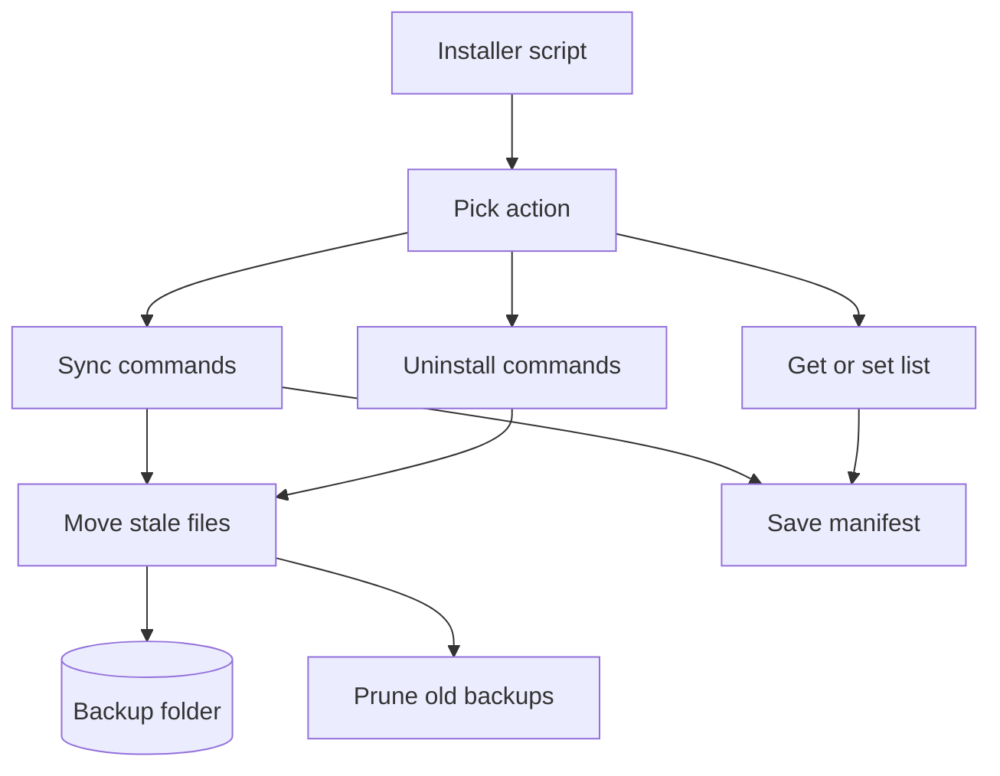

## Purpose

The installer copies command files into the user's `~/.claude` folder. This script keeps a small JSON file, the manifest, that lists what Tollgate put there. On the next update it removes only command files that Tollgate installed earlier and no longer ships, and on uninstall it removes only Tollgate's own command files. A command file the user wrote themselves is never touched because it is not in the manifest.

## Dependencies

**Depends on.** Standard library only: `argparse`, `json`, `os`, `shutil`, `sys`. The manifest file itself, whose path is passed with `--manifest`.

**Used by.**
- Product code: `install.sh` runs it four ways: `uninstall-commands` and `get-list --key cron` during uninstall {src:install.sh:488} {src:install.sh:494}, `get-list --key commands` to learn which command files Tollgate owns {src:install.sh:732}, `sync-commands` after installing commands {src:install.sh:1164}, and `set-list --key cron` after a scheduled job is set up {src:install.sh:1676}.
- Product code: `installer/merge_settings.py` imports `manifest` and calls its `load` and `save` for the hooks, permissions and env sections {src:installer/merge_settings.py:383-384} {src:installer/merge_settings.py:390-392}. Page: [[merge_settings]] and [merge_settings](merge_settings.md).
- Tests: `tests/installer/test_manifest.py` {src:tests/installer/test_manifest.py:24}.
- Searched with `git grep -E "manifest\.py|manifest import|import manifest"`, excluding `docs/`, on 2026-11-20.

## Behavior

**Manifest shape.** One JSON object. This script owns the keys `commands` and `version`, and the generic `set-list` can store any other key (the installer uses `cron`) {src:installer/manifest.py:13-19} {src:install.sh:1676}.

**`load(path)`** returns the parsed object, or an empty dict when the file is missing, unreadable, invalid JSON, or not an object {src:installer/manifest.py:42-48}.

**`save(path, data)`** writes the data as JSON with sorted keys and a final newline {src:installer/manifest.py:53}. If the file already holds exactly that text, it does nothing and returns False {src:installer/manifest.py:54-58}. Otherwise it creates the parent folder, writes `<path>.tmp`, and renames it over the target with `os.replace` {src:installer/manifest.py:60-64}, returning True {src:installer/manifest.py:65}.

**`safe_name(name)`** accepts a name only if it is non-empty, has no folder part, ends in `.md` and does not start with a dot {src:installer/manifest.py:68-70}.

**`remove_files`** skips any name that fails `safe_name` {src:installer/manifest.py:87-88}, skips a name whose file or link does not exist {src:installer/manifest.py:89-91}, and otherwise moves the file into the backup folder (created if needed) {src:installer/manifest.py:92-93}. It returns the names moved, and when any were moved it prunes old backup folders {src:installer/manifest.py:95-97}.

**`prune_siblings`** lists the folders next to the backup folder, sorts them by name, and deletes all but the newest three by name order {src:installer/manifest.py:75-80}. The backup folders are named `removed.<date and time>` by `install.sh` {src:install.sh:1166}, so name order is time order.

**`sync-commands`** compares the commands in the manifest with the names passed on the command line. Names in the manifest but not in the new list are stale and are moved to the backup folder, each with a printed line {src:installer/manifest.py:102-106}. The manifest then stores the new sorted, de-duplicated list and, when `--version` is given, the version {src:installer/manifest.py:103} {src:installer/manifest.py:107-110}. It always returns 0 {src:installer/manifest.py:111}.

**`uninstall-commands`** moves every command in the manifest to the backup folder, then stores an empty list {src:installer/manifest.py:115-119}.

**`get-list`** prints the values stored under `--key`, one per line {src:installer/manifest.py:138-140}. **`set-list`** stores the given values under `--key`, sorted and de-duplicated {src:installer/manifest.py:141-142}.

**Arguments.** `main` uses `parse_intermixed_args`, so command names may follow the options {src:installer/manifest.py:132}.

## Diagram: module level (L2, required)

## Diagram: function level (L3, optional)

None: no function has branching that the signature does not show.

## Notes

- **Description and code disagree (nothing else is removed).** The header says that nothing else is ever removed besides the old command file {src:installer/manifest.py:21-22}. `prune_siblings` also deletes older backup folders, and it deletes every folder next to the backup folder beyond the newest three, whoever made them {src:installer/manifest.py:78-80}. With the installer's layout that parent folder is `removed/` under the state folder {src:install.sh:489}.
- **Description and code disagree (prune docstring).** The docstring says it keeps the newest `keep` folders and that `path` itself counts {src:installer/manifest.py:74}. The code ranks by folder name, not by age, and counts every folder in the parent, whether or not it is `path` {src:installer/manifest.py:78-80}. If `path` sorts older than three siblings it can be the one deleted.
- **Unrecorded names.** `sync_commands` stores the new names without `safe_name` {src:installer/manifest.py:103}. A name with a folder part would be recorded but is never removed later, because removal checks it {src:installer/manifest.py:87-88}.
- **Unchecked inputs.** `--manifest`, `--commands-dir`, `--backup-dir` and `--key` are used as given {src:installer/manifest.py:126-130}. `commands_dir` and `backup_dir` are not required by argparse for the actions that need them (they default to None): with stale or listed files, `os.path.join(None, name)` raises `TypeError` {src:installer/manifest.py:89} {src:installer/manifest.py:127-128}. `set-list` without `--key` stores under the key `None`, and the later `json.dumps` with `sort_keys=True` fails when that key is compared with string keys {src:installer/manifest.py:141-142} {src:installer/manifest.py:53}. Command names that reach `os.path.join` are checked by `safe_name` first {src:installer/manifest.py:87-89}, so a name cannot leave the commands folder. No shell command or network address is used.
- **Shared file writes.** The manifest is rewritten through a temp file and `os.replace`, which is atomic for readers {src:installer/manifest.py:61-64}. The temp name is fixed (`<path>.tmp`) and nothing takes a lock {src:installer/manifest.py:61}, so two writers at once could share the temp file. Each action reads the whole manifest and writes it back {src:installer/manifest.py:101} {src:installer/manifest.py:110}, so two overlapping runs can lose one run's change; `merge_settings.py` does the same through `load` and `save` {src:installer/merge_settings.py:390-392}. The installer runs these steps one after another, so no overlap is expected.
- `get-list` on a key holding an object (such as `permissions`) prints the object's keys, and on a string it prints each character {src:installer/manifest.py:139}.
- The return value of `save` is ignored by every caller in this file {src:installer/manifest.py:110} {src:installer/manifest.py:119} {src:installer/manifest.py:142}.
