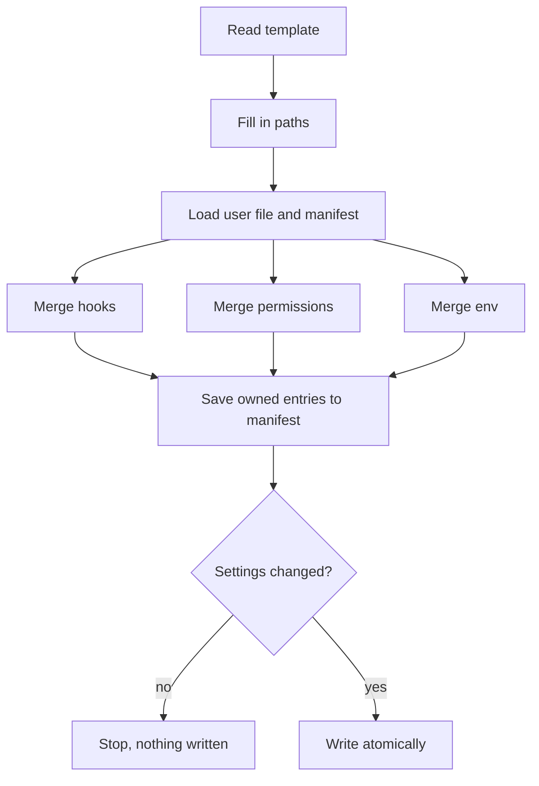

## Purpose

Merges the repo `settings.json` template into the user's `~/.claude/settings.json` without losing the user's own settings. It replaced an earlier text overwrite that discarded every user key. {src:installer/merge_settings.py:28} It also records which hooks, permission rules and env names Tollgate added, so a later run can remove what upstream dropped and `--uninstall` can remove only Tollgate's entries. {src:installer/merge_settings.py:13} It is a command line script, run by the installer. {src:installer/merge_settings.py:395}

## Dependencies

**Depends on.** Standard library: `glob`, `json`, `os`, `shlex`, `shutil`, `stat`, `sys`, `tempfile`, `time`. {src:installer/merge_settings.py:62} The manifest file is read and written through [[manifest]] ([manifest](manifest.md)), imported only when a manifest path is given. {src:installer/merge_settings.py:383} The template it reads is described in [[settings]] ([settings](../settings.md)).

**Used by.** Product code: `install.sh` calls it for the merge, the restore and the uninstall. {src:install.sh:1769} {src:install.sh:187} {src:install.sh:486} Tests: `tests/installer/test_merge_settings.py` ([[test_merge_settings]], [test_merge_settings](../tests/installer/test_merge_settings.md)).

## Behavior

Command line:

```text
merge_settings.py [--backup] [--set KEY=VALUE]... [--template FILE]... [--manifest FILE]
                  TEMPLATE TARGET REPO_DIR VAULT_DIR SCRIPTS_DIR CODE_DIR
merge_settings.py --restore TARGET [BACKUP_FILE]
merge_settings.py --uninstall --manifest FILE [--backup] TARGET
```

There is no skill prefix argument any more: commands have the fixed `tg-` names. {src:installer/merge_settings.py:9}

- `--set KEY=VALUE` (repeatable): adds the value to the `env` block and also fills `$KEY` in the template. The installer uses it for `TOLLGATE_INITIALS`, `TOLLGATE_TICKET_PREFIX`, `TOLLGATE_HOME`, `TOLLGATE_PATHS`, `TOLLGATE_CONNECTORS`, and `TOLLGATE_PYTHON` when a venv exists. {src:install.sh:1768} {src:install.sh:1771}
- `--template FILE` (repeatable): another repo settings fragment, folded into the template before the merge. Hook groups are added without duplicates, list permissions are unioned, env keys are overlaid, and any other key is added only when the base lacks it. {src:installer/merge_settings.py:156}
- `--manifest FILE`: the owned entries manifest. The merge removes entries it added earlier that the template no longer has, then writes the new list of what it owns. {src:installer/merge_settings.py:421} {src:installer/merge_settings.py:423}
- `--backup`: when the file exists and the merge would change it, copy it to `settings.json.bak.<time>` first. When the merge changes nothing, nothing is written and no backup is made. Only the newest 3 `settings.json.bak.*` files are kept. {src:installer/merge_settings.py:427} {src:installer/merge_settings.py:424} {src:installer/merge_settings.py:73} {src:installer/merge_settings.py:302}
- `--restore`: copy the newest `settings.json.bak.*` (or the named file) back. The file it replaces is kept as `settings.json.before-restore.<time>`. Exit 1 when there is no backup. {src:installer/merge_settings.py:312} {src:installer/merge_settings.py:325}
- `--uninstall`: remove every entry the manifest lists from the settings file and keep the user's own. With `--backup` the file is copied first. With no manifest, or when no listed entry is present, nothing is written and the exit code is 0. {src:installer/merge_settings.py:362} {src:installer/merge_settings.py:364} {src:installer/merge_settings.py:369}
- Wrong number of positional arguments: it prints the usage line and returns 2. {src:installer/merge_settings.py:404}

Steps in `main`:

1. Read the template JSON. A missing or invalid template is not caught, so Python raises. {src:installer/merge_settings.py:408}
2. Fold each `--template` fragment into it. {src:installer/merge_settings.py:410}
3. Replace `$CLAUDE_DOTFILES`, `$TOLLGATE_KNOWLEDGE`, `$TOLLGATE_SCRIPTS` and `$<NAME>` for every `--set` name inside every string of the parsed tree, so a path with quotes cannot break the JSON. Longer names are replaced first, so one name that holds another does not break. A literal `$$` is hidden during the replacement and comes back as one `$`, so `$$TOLLGATE_HOME` installs as the text `$TOLLGATE_HOME`. {src:installer/merge_settings.py:413} {src:installer/merge_settings.py:416} {src:installer/merge_settings.py:85}
4. Build the env values: `TOLLGATE_KNOWLEDGE`, `TOLLGATE_CODE_DIR`, `CLAUDE_DOTFILES`, then every `--set` value. {src:installer/merge_settings.py:418} {src:installer/merge_settings.py:419}
5. Load the existing target file with `load_user`, then merge with `merge_full`, which also returns what Tollgate now owns. {src:installer/merge_settings.py:420} {src:installer/merge_settings.py:421}
6. Save the owned entries to the manifest, if one was named. {src:installer/merge_settings.py:423}
7. If the target exists and the merge changed nothing, print `Settings already up to date; nothing written.` and return 0. {src:installer/merge_settings.py:424}
8. Otherwise make the backup if asked, write the result atomically and return 0. {src:installer/merge_settings.py:427} {src:installer/merge_settings.py:429}

Merge rules in `merge_full`:

| Part | Rule |
|---|---|
| `hooks` | Tollgate owned groups are dropped from the user's hooks, then the template groups are appended. User groups are kept. {src:installer/merge_settings.py:128} |
| `permissions` list keys (`allow`, `ask`, `deny`, `additionalDirectories`) | Union, user items first, order kept. A rule Tollgate added earlier that the template no longer has is removed. A rule the user already had before Tollgate added it is never claimed as owned, so it is never removed. A rule listed twice in the template is kept once. {src:installer/merge_settings.py:72} {src:installer/merge_settings.py:194} {src:installer/merge_settings.py:199} {src:installer/merge_settings.py:191} |
| retired `allow` rules | Two broad allow rules an early Tollgate shipped are removed from `allow` on update even when the manifest does not list them, unless the current template has them. A match is exact text only, and `$CLAUDE_DOTFILES` is matched both as written and as the repo dir. {src:installer/merge_settings.py:77} {src:installer/merge_settings.py:195} {src:installer/merge_settings.py:196} {src:installer/merge_settings.py:197} |
| other `permissions` keys | User value wins. {src:installer/merge_settings.py:189} |
| `env` | User keys, then template keys, then the installer values. The installer values win on a clash. {src:installer/merge_settings.py:218} |
| `env.TOLLGATE_SKILL_PREFIX` | Removed on every merge. Older installs wrote it; nothing reads it now. {src:installer/merge_settings.py:219} |
| any other key | User value wins. The template adds keys the user lacks. {src:installer/merge_settings.py:214} |

The retired-rule step needs the repo dir, which `merge_full` takes from the `CLAUDE_DOTFILES` env value. {src:installer/merge_settings.py:217}

A hook is Tollgate owned when its script file name also appears in the template, or when the manifest lists it from an earlier run. The file name is the first word of the command that is not an interpreter (`python3`, `bash`, `sh`, `env`, ...), a flag or a `NAME=value` setting, with its folder removed. This is how stale paths from a moved repo get replaced. A hook that is not a command (for example a prompt hook) is owned only when it is identical to a template hook. Only the owned hooks are removed: a user hook in the same group stays. {src:installer/merge_settings.py:100} {src:installer/merge_settings.py:114} {src:installer/merge_settings.py:134} An event left with no groups after removal is dropped before the template groups are added. {src:installer/merge_settings.py:145}

What the manifest gets: the sorted hook identities, the permission rules the merge added (per list key), and the env names (template keys plus the installer values). {src:installer/merge_settings.py:220}

`load_user` returns an empty dict when the target is missing. When the file cannot be read or is not valid JSON, it prints a message to stderr and starts from empty. {src:installer/merge_settings.py:256} {src:installer/merge_settings.py:264} A file that holds valid JSON that is not an object also gives an empty dict, with no message. {src:installer/merge_settings.py:262} The backup is made by the script itself with `--backup`, because an unreadable file differs from the merged result.

`write_atomic` resolves symlinks to the real file, creates the folder if needed, writes a temp file in the same folder, then swaps it in with `os.replace`. The output is indented by two spaces with a final newline. {src:installer/merge_settings.py:269} {src:installer/merge_settings.py:272} {src:installer/merge_settings.py:277} {src:installer/merge_settings.py:281}

## Diagram: module level (L2, required)



## Diagram: function level (L3, optional)

None: no function has branching that the signature does not show, except the hook ownership check, which the Behavior section covers.

## Notes

Ownership is by file name only. A user hook whose script has the same file name as a Tollgate hook, in any folder, is removed on every merge. {src:installer/merge_settings.py:140}

The settings file keeps the file mode it had before the merge. A new file gets the default mode of a temp file, which is owner only. {src:installer/merge_settings.py:271} {src:installer/merge_settings.py:275}

The merge is idempotent for hooks: running it twice leaves one copy of each Tollgate group, and a second run writes nothing and makes no backup. {src:installer/merge_settings.py:140} {src:installer/merge_settings.py:424}

Where the code and its own description disagree: the change log says an old `TOLLGATE_SKILL_PREFIX` is removed because the manifest lists it, but the code removes it on every merge and never reads the manifest for it. {src:installer/merge_settings.py:10} {src:installer/merge_settings.py:219}

Unchecked inputs: the template, target and backup paths and the `--set` names and values are used as given, with no check on their value. The paths go to `open`, `shutil.copyfile` and `os.replace` {src:installer/merge_settings.py:408} {src:installer/merge_settings.py:297}, and `--set` values are written into the settings file. {src:installer/merge_settings.py:415} The installer is the only caller found, and it quotes them. {src:install.sh:1769}

Shared file writes: the settings file and the manifest are written by an atomic temp file swap, but nothing stops two runs at once, so the last writer wins. {src:installer/merge_settings.py:277} Backup pruning deletes older `.bak.*` files by name sort. {src:installer/merge_settings.py:304}

Retired `allow` rules are removed only when the text matches exactly, so a user rule that only starts the same way is kept. {src:installer/merge_settings.py:197}
