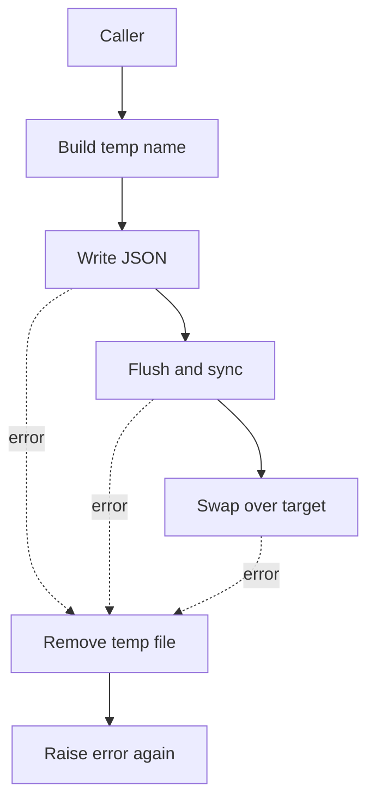

## Purpose

This module holds one function that saves a Python dictionary as a JSON file so that a reader never sees a half written file. The cache folder is read by one script while connectors rewrite its files, so every cache file is written through this function.

## Dependencies

**Depends on.** Standard library only: `json`, `os`, `pathlib`, `typing`. No file in the repo is imported.

**Used by.**
- Product code: `scripts/cache/daily_brief.py` imports it {src:scripts/cache/daily_brief.py:47} and calls it to write the brief {src:scripts/cache/daily_brief.py:188}. Page: [[daily_brief]] and [daily_brief](daily_brief.md). `scripts/connectors/comms/comms_common.py` imports it {src:scripts/connectors/comms/comms_common.py:29} and calls it to write each connector's cache file {src:scripts/connectors/comms/comms_common.py:55}. The page for that file does not exist: [[comms_common]] (no doc yet).
- Tests: `tests/scripts/cache/test_cache.py` imports it {src:tests/scripts/cache/test_cache.py:26}.
- Searched with `git grep -E "cache_write|atomic_replace"` on 2026-11-20, excluding `docs/`.

## Behavior

`atomic_replace(path, data)` builds a temp file name in the same folder as the target: a dot, the target name, the process id, and `.tmp` {src:scripts/cache/cache_write.py:24}. It writes `data` as JSON with two space indent and `default=str`, so any value JSON cannot encode is written as its string form {src:scripts/cache/cache_write.py:26-27}. It then flushes and calls `os.fsync` on the open file {src:scripts/cache/cache_write.py:28-29} and renames the temp file over the target with `os.replace` {src:scripts/cache/cache_write.py:30}. Because the rename is the last step, a reader sees either the old file or the whole new one.

On any `Exception` the temp file is removed (a missing temp file is not an error) and the original exception is raised again {src:scripts/cache/cache_write.py:31-33}. The function returns nothing {src:scripts/cache/cache_write.py:18}. The parent folder is not created here: the docstring leaves that to the caller {src:scripts/cache/cache_write.py:22}, and a missing folder makes `open` fail {src:scripts/cache/cache_write.py:26}, which takes the cleanup path above.

## Diagram: module level (L2, required)

## Diagram: function level (L3, optional)

None: no function has branching that the signature does not show.

## Notes

- **Description and code disagree (interrupts).** The docstring says that if the write is interrupted before `os.replace()` the temp file is removed {src:scripts/cache/cache_write.py:21}. The code removes it only for `Exception` {src:scripts/cache/cache_write.py:31}. `KeyboardInterrupt` and `SystemExit` are not `Exception` subclasses, so Ctrl-C during the write leaves `.<name>.<pid>.tmp` behind, and so does a hard kill of the process. The target file is still safe in both cases.
- **Description and code disagree (two writers).** The change log says the process id in the temp name keeps two writers from colliding {src:scripts/cache/cache_write.py:8}. That holds for two processes. Two threads of one process share the process id {src:scripts/cache/cache_write.py:24} and would share the temp name. Nothing in the file takes a lock, so with two writers on the same target the last rename wins and the earlier data is lost without any error.
- **Shared file write.** The target is replaced atomically {src:scripts/cache/cache_write.py:30}. There is no `fsync` of the folder after the rename, so after a power cut the rename itself may not survive {src:scripts/cache/cache_write.py:29-30}. Leftover temp files are not cleaned up by a later run.
- **Unchecked inputs.** `path` is used as given to build the temp name and to open and replace files {src:scripts/cache/cache_write.py:24-30}; no check on its value exists, so a caller can write anywhere the process may write. `data` is not checked either; unencodable values become strings {src:scripts/cache/cache_write.py:27}. No shell command, network address or outbound text is involved.
- Temp file names start with a dot and end in `.tmp`, so the `*.json` search in `daily_brief.py` does not pick them up {src:scripts/cache/daily_brief.py:149}.
