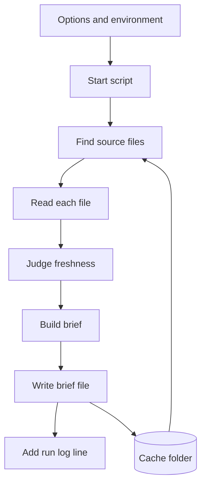
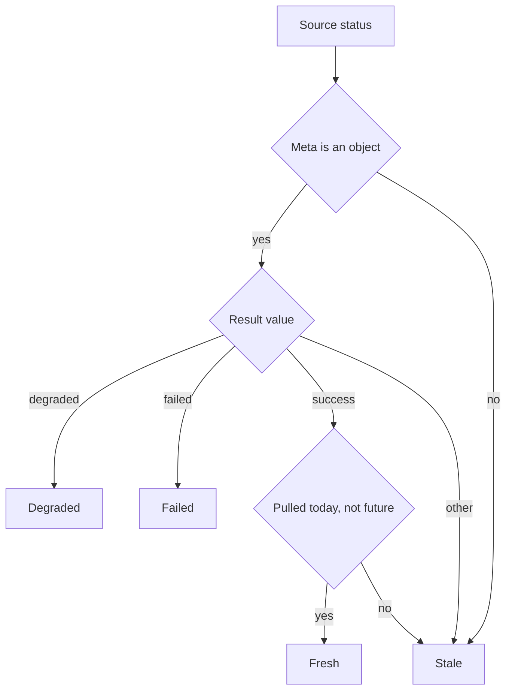

## Purpose

This script gathers the small cache files that connectors write, one per source such as a calendar or a tracker, and combines them into one file, `daily_brief.json`. For each source it records whether the data is fresh, old, partly failed, failed or missing, so a person or another tool can read one file instead of many. It knows nothing about any particular tool: a source is any `<name>.json` file in the cache folder.

## Dependencies

**Depends on.**
- `core.paths` (`NotSetUp`, `get_path`) {src:scripts/cache/daily_brief.py:46}. [[paths]] (no doc yet).
- [[cache_write]] and [cache_write](cache_write.md) for `atomic_replace` {src:scripts/cache/daily_brief.py:47}.
- [[run_log]] and [run_log](run_log.md) for `LogReason`, `LogResult` and `append` {src:scripts/cache/daily_brief.py:48}.
- Standard library: `argparse`, `json`, `os`, `pathlib`, `sys`, `datetime`, `enum`, `typing`, and `zoneinfo` (imported only when `TOLLGATE_TZ` is set) {src:scripts/cache/daily_brief.py:81}.
- Environment variables: `TOLLGATE_TZ` {src:scripts/cache/daily_brief.py:78} and `TOLLGATE_BRIEF_SOURCES` {src:scripts/cache/daily_brief.py:200}.
- Files: `<cache folder>/<name>.json` for each source, read {src:scripts/cache/daily_brief.py:103}.

**Used by.**
- Product code: none imports or runs this script. `scripts/connectors/comms/comms_common.py` names it in a docstring as the reader of the cache files it writes {src:scripts/connectors/comms/comms_common.py:12}. No scheduler entry, command file or installer line was found (searched with `git grep -n daily_brief`, excluding `docs/`, 2026-11-20).
- Tests: `tests/scripts/cache/test_cache.py` imports it {src:tests/scripts/cache/test_cache.py:27} and runs it as a subprocess {src:tests/scripts/cache/test_cache.py:172}. `tests/scripts/connectors/comms/test_jira.py` only names the format in a test title {src:tests/scripts/connectors/comms/test_jira.py:64}.

## Behavior

**Run flow.** `main` reads `--source` names (repeatable) and `TOLLGATE_BRIEF_SOURCES` (comma separated), joined into one list of required names {src:scripts/cache/daily_brief.py:198-200}. It finds the cache folder with `get_path("cache")`; on `NotSetUp` it prints `not set up` and returns 2 {src:scripts/cache/daily_brief.py:201-205}. Otherwise it calls `run` and returns 0, even if the write failed, so a scheduler does not retry in a loop {src:scripts/cache/daily_brief.py:206-207}.

**Finding sources.** `discover_sources` takes the stem of every `*.json` file in the cache folder except `daily_brief.json`, adds the required names even if no file exists, and sorts them {src:scripts/cache/daily_brief.py:149-151}.

**Reading a source.** `_read_cache_file` returns `ABSENT` when the path is not a file {src:scripts/cache/daily_brief.py:100-101}. It returns `UNREADABLE` for invalid JSON, an OS error, or JSON that is not an object {src:scripts/cache/daily_brief.py:102-108}. An absent source becomes a block with status `missing`, an unreadable one a block with status `stale`; both have empty data and a reject count of 0 {src:scripts/cache/daily_brief.py:158-161} {src:scripts/cache/daily_brief.py:127-128}.

**Status of a readable source.** `_classify` decides from `_meta` only {src:scripts/cache/daily_brief.py:112-124}:
1. `_meta` is not an object: `stale` {src:scripts/cache/daily_brief.py:113-114}.
2. `result` is `degraded`: `degraded`; `failed`: `failed`. These two win before any time check {src:scripts/cache/daily_brief.py:116-119}.
3. `result` is `success`, `pulled_at` parses with a time zone, falls on today's local date, and is not later than now: `fresh` {src:scripts/cache/daily_brief.py:120-123}.
4. Anything else: `stale` {src:scripts/cache/daily_brief.py:124}.

`_parse_pulled_at_local` returns nothing when the value is not a string, will not parse, or has no time zone {src:scripts/cache/daily_brief.py:90-96}. `local_tz` uses the zone named in `TOLLGATE_TZ`, and falls back to the system zone (then UTC) when the variable is empty, the name is unknown, or the zone library is missing {src:scripts/cache/daily_brief.py:78-85}.

**Block contents.** For a readable source the block copies `pulled_at`, `result` and `reason` from `_meta`, takes `reject_count` only when it is a real integer (a boolean counts as 0), and takes `data` only when it is a list {src:scripts/cache/daily_brief.py:131-144}.

**Writing.** `run` builds the payload with the time it was assembled, a fixed `success` and `write_ok` result, and all blocks {src:scripts/cache/daily_brief.py:168-177}. It creates the cache folder if needed and writes `daily_brief.json` with `atomic_replace` {src:scripts/cache/daily_brief.py:187-188}. If either step raises, only the logged result changes, to `failed` with reason `schema_invalid` {src:scripts/cache/daily_brief.py:189-190}. It then always appends one line to the run log {src:scripts/cache/daily_brief.py:191-192} and returns the payload {src:scripts/cache/daily_brief.py:193}.

## Diagram: module level (L2, required)

## Diagram: function level (L3, optional)

## Notes

- **Description and code disagree (status wording).** The header says stale covers a `pulled_at` that is not today, in the future or unreadable {src:scripts/cache/daily_brief.py:26}. That holds only when `result` is `success` or unknown: a `degraded` or `failed` source reports that status whatever its date {src:scripts/cache/daily_brief.py:116-119}. A source with a result other than the three known words is `stale` {src:scripts/cache/daily_brief.py:124}.
- **Description and code disagree (log reason).** When the write fails, the run log gets reason `schema_invalid` {src:scripts/cache/daily_brief.py:190}, which names a data format problem, not a write problem. The payload that `run` returns still says `success` {src:scripts/cache/daily_brief.py:172-173}, even when the file was not written.
- **Description and code disagree (exit code).** The comment says the script returns 0 even on a write failure {src:scripts/cache/daily_brief.py:207}. A failure of the log write is not inside the `try`, so `append` raising would end the script with a traceback instead {src:scripts/cache/daily_brief.py:191-192}.
- **Unreachable branch.** The `not set up` exit {src:scripts/cache/daily_brief.py:203-205} cannot be taken for the cache folder: `get_path("cache")` resolves from the home folder and raises nothing {src:scripts/core/paths.py:106-107}. A test says the same {src:tests/scripts/cache/test_cache.py:183}.
- **Python version.** `datetime.fromisoformat` accepts a trailing `Z` only from Python 3.11 {src:docs:https://docs.python.org/3/library/datetime.html#datetime.datetime.fromisoformat}. On the 3.12 minimum a `pulled_at` such as `2026-11-20T10:00:00Z` parses, so the failure branch {src:scripts/cache/daily_brief.py:93-95} is reached only for other malformed values; on 3.9 or 3.10 it would have failed and the source been reported `stale`. The hand-made string enum {src:scripts/cache/daily_brief.py:54-60} was written for 3.9, where `enum.StrEnum` is missing; on 3.12 `StrEnum` exists, but the code is unchanged and still works.
- **Unchecked inputs reaching a file path.** Source names from `--source` and `TOLLGATE_BRIEF_SOURCES` go straight into `cache_dir / f"{n}.json"` with no check {src:scripts/cache/daily_brief.py:200} {src:scripts/cache/daily_brief.py:151}. A name such as `../x` makes the script read `x.json` outside the cache folder and copy its `data` list into the brief. The data in each source is copied as it is: this script runs no personal data check, and relies on the connectors to run it {src:scripts/cache/daily_brief.py:143}. The time zone name from `TOLLGATE_TZ` goes to `ZoneInfo` unchecked, but a bad value is caught {src:scripts/cache/daily_brief.py:80-84}. No shell command or network address is involved.
- **Shared file writes.** `daily_brief.json` is replaced atomically {src:scripts/cache/daily_brief.py:188}, with no lock: two runs at once leave the later one in place. The run log line goes through the lock in [[run_log]] {src:scripts/cache/run_log.py:90}. The script only reads the source files, which connectors replace atomically through `atomic_replace`.
- The sources are sorted by name, so the output order does not depend on file order {src:scripts/cache/daily_brief.py:151}.
- `_StrEnum` is defined again here and in `scripts/cache/run_log.py` {src:scripts/cache/run_log.py:31}.
