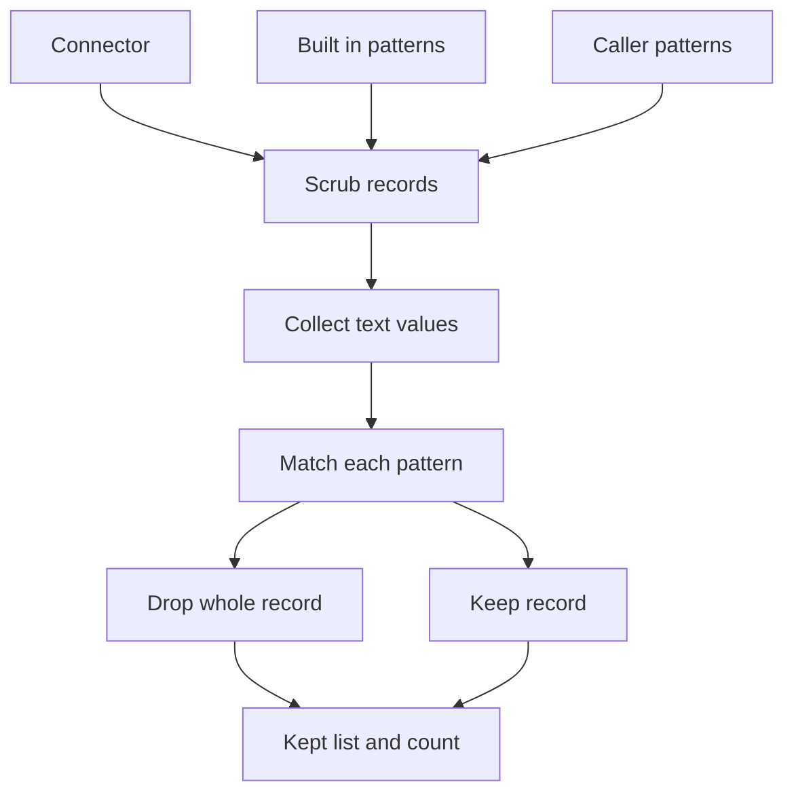

## Purpose

This module checks a list of records for personal health or identity patterns, such as a social security number or a titled patient name, and removes any record that matches. It exists so that connectors that pull data from outside tools do not store those records in the local cache. It is a pattern filter only: it cannot tell that a value is a person's data, only that the text has the shape of one.

## Dependencies

**Depends on.** Standard library only: `re`, `typing`. No file in the repo is imported.

**Used by.**
- Product code: `scripts/connectors/comms/comms_common.py` imports `scrub` {src:scripts/connectors/comms/comms_common.py:31} and re-exports it {src:scripts/connectors/comms/comms_common.py:34}. The calendar, commits and jira connectors call it through that module {src:scripts/connectors/comms/calendar_connector.py:228}, {src:scripts/connectors/comms/commits_connector.py:142}, {src:scripts/connectors/comms/jira_connector.py:122}. [[comms_common]] (no doc yet).
- Tests: `tests/scripts/cache/test_cache.py` {src:tests/scripts/cache/test_cache.py:108}.
- Searched with `git grep -E "scrub\(|phi_guard"` under `scripts`, `tests`, `commands`, `hooks` and `installer` on 2026-11-20. No call to `scrub` was found in the slack or notion connectors.

## Behavior

Six compiled patterns are defined, and all six sit in the list `PHI_PATTERNS` {src:scripts/cache/phi_guard.py:31-38}:
- `SSN_PATTERN`: nine digits, with an optional space or hyphen after the third and fifth digit {src:scripts/cache/phi_guard.py:19}.
- `MRN_PATTERN`: the capital letters `MRN`, an optional `:`, space or `#`, then 6 to 10 digits {src:scripts/cache/phi_guard.py:20}.
- `PT_ID_PATTERN`: capital `PT`, an optional separator, then 5 to 10 digits {src:scripts/cache/phi_guard.py:21}.
- `DOB_SLASH_PATTERN`: any `d/d/yyyy` style date, with no birth word needed {src:scripts/cache/phi_guard.py:22}.
- `DOB_ISO_PATTERN`: a year-month-day date, matched only when it follows `DOB`, `date of birth`, `born` or `d/o/b`; this one ignores letter case {src:scripts/cache/phi_guard.py:23-26}.
- `TITLED_NAME_PATTERN`: `Mr`, `Mrs`, `Ms`, `Dr`, `Patient` or `Pt`, an optional dot, then a word that starts with a capital letter {src:scripts/cache/phi_guard.py:27-29}.

`_record_strings` walks a record with a stack and returns every string it finds inside nested dicts and lists, looking at dict values and list items only {src:scripts/cache/phi_guard.py:41-53}. `_contains_phi` returns True when any pattern matches any of those strings {src:scripts/cache/phi_guard.py:56-62}.

`scrub(payload, source, extra_patterns=None)` joins the built in list with the caller's extra patterns {src:scripts/cache/phi_guard.py:76}, then checks each record whole. A record with any match is dropped and counted; others are kept in their original order {src:scripts/cache/phi_guard.py:79-83}. It returns the pair (kept records, number dropped) {src:scripts/cache/phi_guard.py:84}. It does not change the input list and logs nothing, so matched values are never printed {src:scripts/cache/phi_guard.py:77-84}.

## Diagram: module level (L2, required)

## Diagram: function level (L3, optional)

None: no function has branching that the signature does not show.

## Notes

- **Description and code disagree (writes to disk).** The description says the module drops records before they are written to disk {src:scripts/cache/phi_guard.py:3}. The module writes nothing and only returns a list {src:scripts/cache/phi_guard.py:84}. Whether a dropped record stays out of the cache depends on each caller using the returned list; the slack and notion connectors were not found calling `scrub` (search above).
- **Description and code disagree (reject counts).** The docstring says reject counts surface in `daily_brief.json` {src:scripts/cache/phi_guard.py:73}. This module only returns the count; it is the connector that writes it into its own cache file, and `daily_brief.py` copies it from there {src:scripts/cache/daily_brief.py:134-135}.
- **Unused argument.** `source` is accepted and never read in the function body {src:scripts/cache/phi_guard.py:67}. The comment calls it reserved.
- **What is not covered.** Only string values are scanned. Dict keys, numbers (a nine digit SSN stored as an integer) and any type other than `str`, `dict` and `list` are skipped {src:scripts/cache/phi_guard.py:47-52}. Names without a title are not caught, as the file itself says {src:scripts/cache/phi_guard.py:18}. `MRN`, `PT` and the title words match capital letters only {src:scripts/cache/phi_guard.py:20-21}, so `mrn 1234567` passes.
- **Over matching.** `DOB_SLASH_PATTERN` matches any slash date {src:scripts/cache/phi_guard.py:22}. `SSN_PATTERN` matches any standalone nine digit number {src:scripts/cache/phi_guard.py:19}. `TITLED_NAME_PATTERN` matches ordinary phrases such as `Patient Intake` or `Dr Who` {src:scripts/cache/phi_guard.py:28}. Each such record is dropped whole.
- **Unchecked inputs.** `payload`, `source` and `extra_patterns` are used as given {src:scripts/cache/phi_guard.py:76-80}; no check on their types exists. No file path, shell command, network address or outbound text is involved.
- **Shared files.** The module writes no file.
- A record that holds itself (a list inside itself) would make the walk run forever, because there is no visited set {src:scripts/cache/phi_guard.py:44-52}. Records come from parsed JSON, which cannot hold itself.
