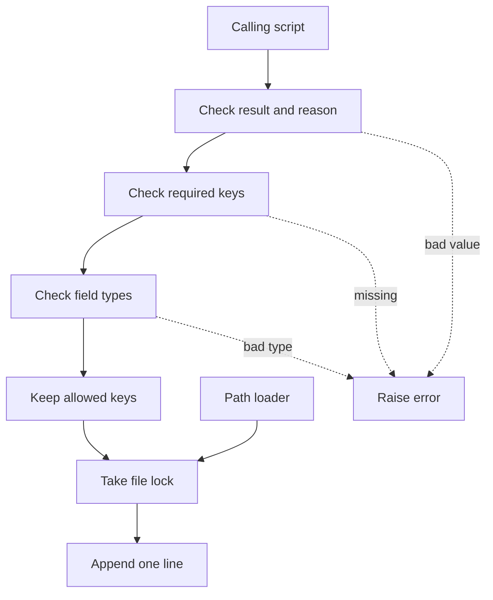

## Purpose

This module keeps one log file of one JSON line per script run, so a person can see when each scheduled script ran and how it ended. It accepts only a fixed set of fields and fixed result and reason words, so the log stays short and does not collect error text.

## Dependencies

**Depends on.**
- `core.paths` (`get_path`) {src:scripts/cache/run_log.py:23}, used to find the logs folder {src:scripts/cache/run_log.py:61}. [[paths]] (no doc yet).
- Standard library: `fcntl`, `json`, `pathlib`, `sys`, `datetime`, `enum`, `typing`.

**Used by.**
- Product code: `scripts/cache/daily_brief.py` imports `LogReason`, `LogResult` and `append` {src:scripts/cache/daily_brief.py:48}. Page: [[daily_brief]] and [daily_brief](daily_brief.md). `scripts/connectors/comms/comms_common.py` imports the same three names {src:scripts/connectors/comms/comms_common.py:30} and calls `append` in `log_run` {src:scripts/connectors/comms/comms_common.py:59}. [[comms_common]] (no doc yet).
- Tests: `tests/scripts/cache/test_cache.py` {src:tests/scripts/cache/test_cache.py:29}, and `tests/scripts/connectors/comms/comms_base.py` reads the log file {src:tests/scripts/connectors/comms/comms_base.py:113}.
- Searched with `git grep -E "run_log"` on 2026-11-20, excluding `docs/`.

## Behavior

The module defines two string enums. `LogResult` has `success`, `degraded` and `failed` {src:scripts/cache/run_log.py:40-43}. `LogReason` has ten words: `auth_ok`, `auth_failed`, `api_ok`, `api_timeout`, `api_4xx`, `api_5xx`, `schema_invalid`, `phi_rejected`, `phi_rejected_all` and `write_ok` {src:scripts/cache/run_log.py:46-56}. Both use a local `_StrEnum` because `enum.StrEnum` needs Python 3.11 {src:scripts/cache/run_log.py:31-37}. The local class was written for the old 3.9 minimum; `StrEnum` exists on the 3.12 minimum, but the code is unchanged. Six keys are allowed in a record: `script`, `start_ts`, `end_ts`, `result`, `reason`, `reject_count` {src:scripts/cache/run_log.py:26-28}.

`logfile()` returns `run_log.jsonl` inside the logs folder from the path loader {src:scripts/cache/run_log.py:59-61}.

`append(record, path=None)` works in this order:
1. It checks `result` against `LogResult` and raises `ValueError` if it is missing or not one of the values {src:scripts/cache/run_log.py:71-74}.
2. It does the same for `reason` against `LogReason` {src:scripts/cache/run_log.py:75-78}.
3. It raises `ValueError` listing any of the six keys that are absent {src:scripts/cache/run_log.py:80-82}.
4. It checks the field types: `script` must be a non-empty ASCII string with no newline {src:scripts/cache/run_log.py:97-98}; `start_ts` and `end_ts` must be strings that `datetime.fromisoformat` accepts {src:scripts/cache/run_log.py:100-107}; `reject_count` must be a non-negative `int` and not a `bool` {src:scripts/cache/run_log.py:109-111}.
5. It drops every key not in the allowed set {src:scripts/cache/run_log.py:86}, creates the parent folder if needed {src:scripts/cache/run_log.py:88}, opens the file in append mode, takes an exclusive `flock`, writes one JSON line and flushes {src:scripts/cache/run_log.py:89-92}. The lock is released when the `with` block closes the file.

The target is `path` when given, otherwise `logfile()` {src:scripts/cache/run_log.py:87}.

## Diagram: module level (L2, required)

## Diagram: function level (L3, optional)

None: no function has branching that the signature does not show.

## Notes

- **Description and code disagree (no raw text).** The change log says the fixed key list and fixed reason words mean no raw error text is ever written {src:scripts/cache/run_log.py:8}. `script` is a free text field: any ASCII string without a newline passes {src:scripts/cache/run_log.py:97-98}, and it is written as given {src:scripts/cache/run_log.py:91}. The timestamp strings are also written as given once `fromisoformat` accepts them {src:scripts/cache/run_log.py:105}. A caller could put error text in `script`.
- **Description and code disagree (docstring is short).** The `append` docstring names only `result` and `reason` as raising `ValueError` {src:scripts/cache/run_log.py:67-68}. The code also raises for missing keys and bad types {src:scripts/cache/run_log.py:82-84}.
- **Shared file write.** Every run of every script appends to the same `run_log.jsonl`. The write takes an exclusive `flock` and the file is opened for append {src:scripts/cache/run_log.py:89-92}, so two writers do not interleave a line when both use this function. The lock is advisory: a program that writes the file without calling `flock` is not stopped. There is no `fsync` and no size limit or rotation, so the file grows without end.
- **Unchecked inputs.** `path`, when passed, is opened for append with no check on its value {src:scripts/cache/run_log.py:87-89}. The `script` string is checked only for type, emptiness, newline and ASCII {src:scripts/cache/run_log.py:97}. No shell command or network address is involved.
- **Platform.** `import fcntl` {src:scripts/cache/run_log.py:13} exists on Unix only, so the module cannot be imported on Windows.
- **Python version.** Before Python 3.11, `fromisoformat` rejected a timestamp ending in `Z` {src:docs:https://docs.python.org/3/library/datetime.html#datetime.datetime.fromisoformat}. The minimum is now 3.12, so a `Z` timestamp is accepted and the `ValueError` at {src:scripts/cache/run_log.py:105} is reached only for other malformed values.
- `_StrEnum` is defined again in `scripts/cache/daily_brief.py` {src:scripts/cache/daily_brief.py:54}.
