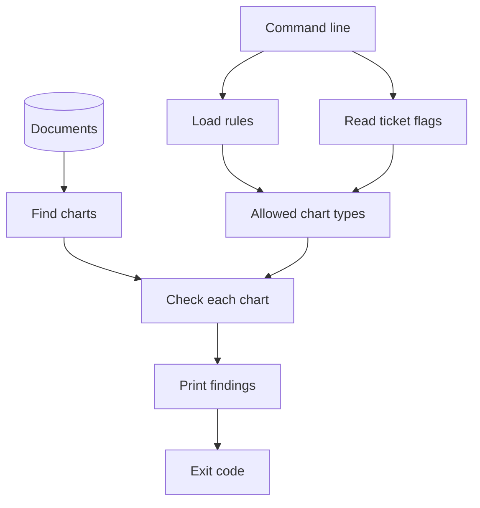
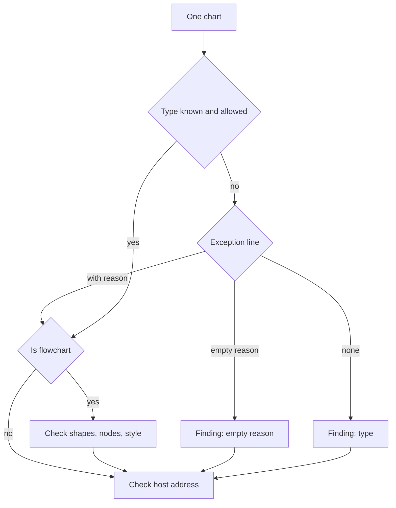

## Purpose

This command reads one or more Markdown documents, finds the Mermaid charts in them, and reports each chart that breaks the chart standard: a chart type the writer's role may not use, a shape that is not allowed, too many boxes, a per-box style line, or a host address. It exists so that a document writer can check its own charts before finishing, and so that the check gives line numbers and reasons without copying any text from the document. The file has no `.py` extension; it is a Python script run directly (it starts with a `python3` shebang), so it is described here with the module template.

## Dependencies

**Depends on.**
- [[chart_rules]] and [chart_rules](chart_rules.md), imported as `chart_rules` {src:scripts/chart/chart_check:28-30}, and through it `chart_rules.json`.
- `core.paths` (`get_path`, `ticket_folder`), imported only when `--ticket` is used {src:scripts/chart/chart_check:207}. [[paths]] (no doc yet).
- Standard library: `argparse`, `pathlib`, `re`, `sys`.
- Files: the documents given on the command line, the optional `--state` file and the optional `--rules` file {src:scripts/chart/chart_check:264} {src:scripts/chart/chart_check:188} {src:scripts/chart/chart_check:241}.

**Used by.**
- Product code: `commands/tg-doc-gen.md` runs it as a final check on a written page {src:commands/tg-doc-gen.md:229}, and `commands/tg-whiteboard.md` runs it with `--require-chart` {src:commands/tg-whiteboard.md:141}.
- Tests: `tests/scripts/chart/test_chart_check.py` runs it as a subprocess and also loads it as a module {src:tests/scripts/chart/test_chart_check.py:46-48}.
- Searched with `git grep -E "chart_check|chart_rules"`, excluding `docs/`, on 2026-11-20.

## Behavior

**Command line.** `--role` is required; `--ticket` or `--state` (not both) name where to find ticket flags; `--require-chart` demands at least one chart; `--rules` points to another rules file; one or more files follow {src:scripts/chart/chart_check:226-234}. A bad command line does not exit through the usual argparse path: `error` is replaced to raise `CannotFinish` {src:scripts/chart/chart_check:221-223}.

**Exit codes.** 0 is clean, 1 is findings, 2 is cannot finish {src:scripts/chart/chart_check:64}. `main` turns `CannotFinish` into a stderr line with the stage and error type {src:scripts/chart/chart_check:277-280}, and any other exception into the same line with stage `read` {src:scripts/chart/chart_check:281-282}; both return 2 {src:scripts/chart/chart_check:283}.

**Run flow.** `run` loads the rules {src:scripts/chart/chart_check:240-243}. With `--state` it uses that file; with `--ticket` it checks the key against `^[A-Za-z][A-Za-z0-9]*-[0-9]+$` {src:scripts/chart/chart_check:46} {src:scripts/chart/chart_check:249-250} and looks for `<ticket folder>/<KEY>-state.md` {src:scripts/chart/chart_check:205-212}. If that file exists, `read_flags` reads `key: value` lines in its front matter and keeps those whose value is the word true or false {src:scripts/chart/chart_check:184-202}, and `widened_types` adds the types those flags unlock {src:scripts/chart/chart_check:255-256}. It looks up the allowed types for the role {src:scripts/chart/chart_check:257-260}, then reads each file and prints findings per file, setting the exit status to 1 if there are any {src:scripts/chart/chart_check:262-271}.

**Finding charts.** `extract_charts` walks the text line by line, handles Windows line endings {src:scripts/chart/chart_check:72}, opens a fence on three or more backticks or tildes {src:scripts/chart/chart_check:43}, removes `>` quote prefixes {src:scripts/chart/chart_check:74}, and keeps a chart only when the fence's first word is `mermaid` {src:scripts/chart/chart_check:78} and the fence is closed by a matching line {src:scripts/chart/chart_check:82-86}. An unclosed fence is dropped without a finding {src:tests/scripts/chart/test_chart_check.py:226}.

**Checks per chart** {src:scripts/chart/chart_check:148-174}:
1. The type comes from the first word, ignoring a front matter block and comment lines {src:scripts/chart/chart_check:92-115}. A type that is unknown or not allowed is a finding, unless the chart holds a `%% exception: <reason>` line with a non-empty reason; an empty reason is its own finding {src:scripts/chart/chart_check:157-163}.
2. For flowcharts only: a forbidden shape in any line after quoted text is blanked {src:scripts/chart/chart_check:166-167}, more nodes than the limit {src:scripts/chart/chart_check:168-169}, or a line starting with `style ` {src:scripts/chart/chart_check:170-171}.
3. For every chart type: an IPv4 looking address anywhere in the chart body {src:scripts/chart/chart_check:172-173}.
4. With `--require-chart` and no chart in a file: one finding at chart 0, line 0 {src:scripts/chart/chart_check:151-152}.

`describe` prints one line per finding with chart number, line number and a fixed reason sentence, then the allowed types, then how to add an exception {src:scripts/chart/chart_check:177-181}. The reason text is fixed; no text from the document is printed. The file name is printed first {src:scripts/chart/chart_check:270}.

## Diagram: module level (L2, required)

## Diagram: function level (L3, optional)

## Notes

- **Node count is a guess.** The cap is meant to count distinct boxes {src:scripts/chart/chart_check:168-169}, but `count_nodes` finds names with regular expressions, not a Mermaid parser {src:scripts/chart/chart_check:135-145}. Two verified misses (run on 2026-11-20 with Python 3.12): an unquoted edge label such as `A -- text --> B` counts `text` as a box, giving 3 for a chart of 2; and any line that starts with `graph`, `flowchart` or `subgraph` is skipped whole because those words have no word boundary in `SKIP_LINE` {src:scripts/chart/chart_check:51} {src:scripts/chart/chart_check:138-139}, so `graphStore --> B` counts 0. A box named like that is not counted and one edge label can push a chart over the limit.
- **Exception lines cover the type only.** The help text says to add an exception line to keep a chart outside the allowed list {src:scripts/chart/chart_check:180}, which is accurate for the type, but a reader may expect more: it silences only the type finding. Shape, node, style and host checks still run on that chart {src:scripts/chart/chart_check:157-173}. An empty exception reason is reported only when the type was not allowed anyway {src:scripts/chart/chart_check:158-161}.
- **Host address check.** The pattern flags any four groups of digits separated by dots, so a version number such as `1.2.3.4` is flagged too {src:scripts/chart/chart_check:48} {src:scripts/chart/chart_check:172}. It also scans comments and quoted labels {src:scripts/chart/chart_check:172}.
- **Unknown ticket is silent.** With `--ticket`, a key whose folder or state file is not found just means no widening, with no message {src:scripts/chart/chart_check:205-212} {src:scripts/chart/chart_check:255}. The result is stricter, not looser.
- **One bad file ends the run.** An unreadable file raises at once {src:scripts/chart/chart_check:263-266}, so findings already printed for earlier files are followed by exit 2, and later files are not checked.
- **Unchecked inputs.** The document paths, `--state` and `--rules` values are opened with no check on their value {src:scripts/chart/chart_check:264} {src:scripts/chart/chart_check:188} {src:scripts/chart/chart_check:241}. The `--role` string is checked only against the rules file {src:scripts/chart/chart_check:257-260}. `--ticket` is checked against a key pattern before use {src:scripts/chart/chart_check:249-250}. Output carries only the file's base name, chart and line numbers and fixed sentences, and error lines carry only the exception type name {src:scripts/chart/chart_check:270} {src:scripts/chart/chart_check:278}. No shell command or network address is used.
- **Shared files.** The script writes only to standard output and standard error. It writes no file.
- **Description and code agree on the main promise.** The header says findings never repeat text from the document {src:scripts/chart/chart_check:6-7}; the output code prints only the file name, numbers and fixed sentences {src:scripts/chart/chart_check:178}. No disagreement was found between the header and the code.
- Tests flagged for this file: `test_executable_with_shebang` depends on the file mode and the exact shebang text {src:tests/scripts/chart/test_chart_check.py:72-74}, and so fails if the file is checked out without the execute bit.
