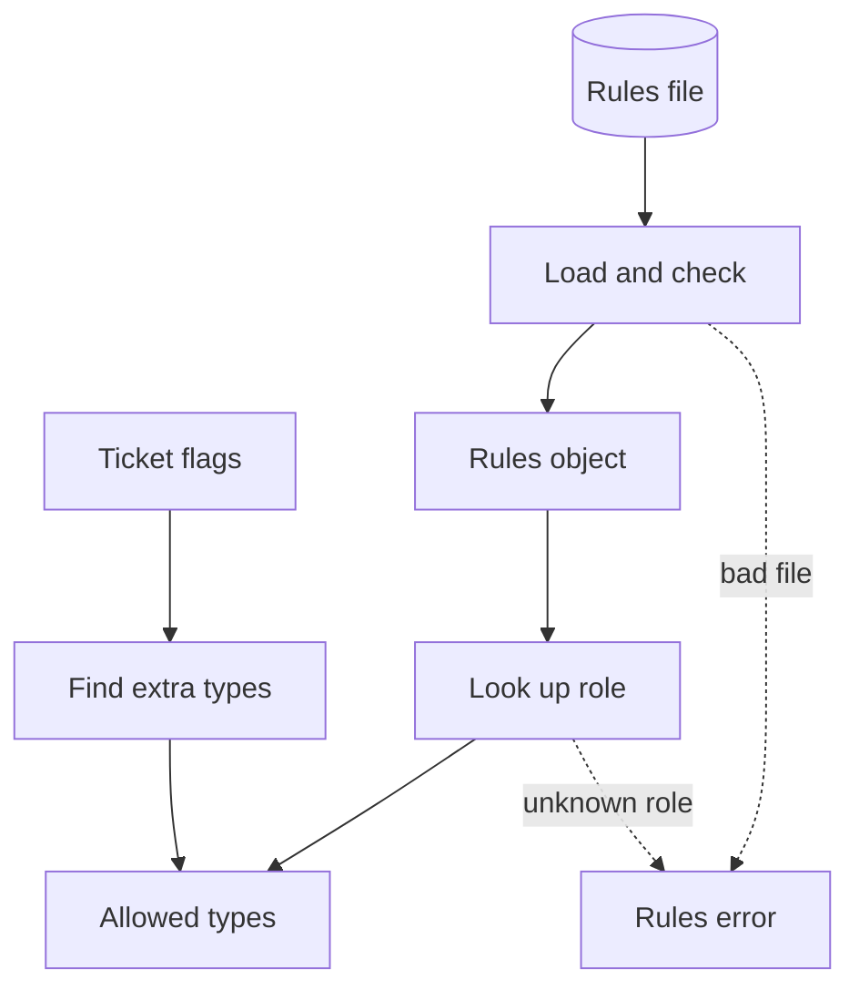

## Purpose

This module reads the chart rules file, `chart_rules.json`, checks that it is well formed, and answers one question: which kinds of chart may a given role use. Keeping the rules in a data file means a verdict changes by editing the file and not the code. The module does not look at any document.

## Dependencies

**Depends on.**
- `scripts/chart/chart_rules.json`, found next to this file {src:scripts/chart/chart_rules.py:18}.
- Standard library: `json`, `pathlib`, `re`, `dataclasses`.

**Used by.**
- Product code: `scripts/chart/chart_check` imports `ChartRulesError`, `allowed_for_role`, `load_rules` and `widened_types` {src:scripts/chart/chart_check:28-30}. Page: [[chart_check]] and [chart_check](chart_check.md).
- Tests: no test file imports this module by name. `tests/scripts/chart/test_chart_check.py` reaches it through `chart_check` {src:tests/scripts/chart/test_chart_check.py:207-208}.
- Searched with `git grep -E "chart_check|chart_rules"`, excluding `docs/`, on 2026-11-20. Command files `commands/tg-doc-gen.md` and `commands/tg-whiteboard.md` run `chart_check`, not this module.

## Behavior

`load_rules(path=None)` reads the JSON file at `path`, or the default file when no path is given {src:scripts/chart/chart_rules.py:37-39}. An unreadable file or invalid JSON raises `ChartRulesError`, naming only the error type {src:scripts/chart/chart_rules.py:40-41}; a top level that is not an object also raises {src:scripts/chart/chart_rules.py:42-43}. It then checks and builds four things:
1. **Types.** Each entry needs a name matching `^[a-z][a-z0-9_]*$` and a non-empty `keywords` list {src:scripts/chart/chart_rules.py:19} {src:scripts/chart/chart_rules.py:47-49}. A keyword may belong to one type only; a repeat raises {src:scripts/chart/chart_rules.py:50-53}. A file with no types raises {src:scripts/chart/chart_rules.py:55-56}.
2. **Roles.** Each role maps to a list of known type names; an unknown name raises {src:scripts/chart/chart_rules.py:57-61}.
3. **Widen lists.** The `ticket_widen` section maps a ticket flag to extra type names, checked the same way {src:scripts/chart/chart_rules.py:62-66}.
4. **Limits.** `max_flowchart_nodes` defaults to 12, and `forbidden_flowchart_shapes` defaults to an empty tuple {src:scripts/chart/chart_rules.py:71-72}.

The result is a frozen `ChartRules` object {src:scripts/chart/chart_rules.py:26-32}.

`allowed_for_role(rules, role, widened)` returns the role's types joined with any widened types, and raises `ChartRulesError` for a role that is not in the file {src:scripts/chart/chart_rules.py:76-80}. `widened_types(rules, flags)` collects the types of every flag whose value is exactly `True` (`flags.get(flag) is True`) {src:scripts/chart/chart_rules.py:83-89}.

What the shipped rules file says: the role `document-writer` may use `class`, `sequence` and `flowchart` {src:scripts/chart/chart_rules.json:129-133}; the flag `touches_data_model` widens by `er` {src:scripts/chart/chart_rules.json:174-178}; the node limit is 12 {src:scripts/chart/chart_rules.json:179}; the forbidden shapes are `((`, `{{` and `([` {src:scripts/chart/chart_rules.json:180-184}.

## Diagram: module level (L2, required)

## Diagram: function level (L3, optional)

None: no function has branching that the signature does not show.

## Notes

- **Description and code disagree (pure lookups).** The description says the module does pure lookups {src:scripts/chart/chart_rules.py:4}. `load_rules` reads a file from disk {src:scripts/chart/chart_rules.py:39}. The statement holds only for the other two functions.
- **Unused data.** The rules file gives each type a `question` text {src:scripts/chart/chart_rules.json:10}. No Python file under `scripts/chart` reads a key named `question` (searched with `grep -rn question scripts/chart`, 2026-11-20; the only hit is in the JSON). The `_note` key is read nowhere either.
- **Errors that escape the check.** The module promises `ChartRulesError` on any problem {src:scripts/chart/chart_rules.py:36}. Three cases raise other errors: a `types` or `roles` value that is a list and not an object fails with `AttributeError` at `.items()` {src:scripts/chart/chart_rules.py:46} {src:scripts/chart/chart_rules.py:58}; a `max_flowchart_nodes` that is not a number fails with `ValueError` from `int()` {src:scripts/chart/chart_rules.py:71}; a keyword that is a list fails with `TypeError` on the lookup {src:scripts/chart/chart_rules.py:51}. `chart_check` catches these in its general handler and reports stage `read` {src:scripts/chart/chart_check:281-283}.
- **Unchecked inputs.** `path` is opened as given, with no check on its value {src:scripts/chart/chart_rules.py:37-39}; in the product it comes from the `--rules` option {src:scripts/chart/chart_check:233}. The file content is only read, so no file is written. A `forbidden_flowchart_shapes` value that is a string becomes a tuple of single characters {src:scripts/chart/chart_rules.py:72}. No shell command, network address or outbound text is involved.
- **Shared files.** None written.
- Role names are not checked against the roles in the commands; a role missing from the file is rejected only when asked for {src:scripts/chart/chart_rules.py:78-79}.
