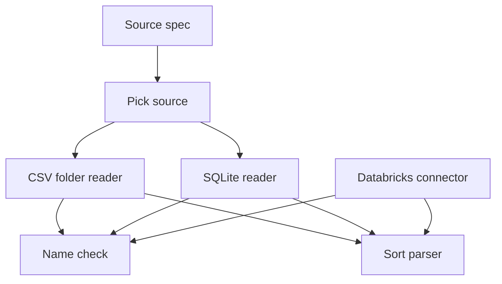

## Purpose

The data source seam for the report generator. It defines the two questions a report asks of any data store (rows for a table, one summary row per id), a check that keeps table and column names safe, and two small sample stores (a folder of CSV files and a SQLite file) used by tests and demos. A real database connector plugs in by subclassing the same interface.

## Dependencies

**Depends on.**
- Standard library: `csv`, `pathlib`, `re`, `sqlite3`.
- No other repo file is imported.

**Used by.**
- Product code: `scripts/connectors/data/databricks.py` imports `DataSource`, `parse_sort` and `validate_identifier` {src:scripts/connectors/data/databricks.py:34}. It uses the identifier check on table, catalog, schema and parameter names {src:scripts/connectors/data/databricks.py:158} and {src:scripts/connectors/data/databricks.py:205}, and the sort parser {src:scripts/connectors/data/databricks.py:232}. It sets `label` to `databricks` and implements both methods {src:scripts/connectors/data/databricks.py:217} {src:scripts/connectors/data/databricks.py:225} {src:scripts/connectors/data/databricks.py:250}. [[databricks]] (no doc yet).
- Nothing in product code calls `open_source`, `CsvSource` or `SqliteSource` (searched with `git grep` for those names and for `data_source`, 2026-11-20, excluding `docs/`).
- Tests: none found. No file under `tests/` names `CsvSource`, `SqliteSource`, `open_source` or `data_source` (same search). The module description says the sample sources are "used by tests and demos" {src:scripts/chart/data_source.py:3-5}, which the search does not support.

## Behavior

**Identifier check.** `validate_identifier` accepts only a string made of letters, digits and underscores, matched by `^[A-Za-z0-9_]+$` {src:scripts/chart/data_source.py:19}. Anything else raises `ValueError` {src:scripts/chart/data_source.py:25-26}. It returns the value unchanged on success {src:scripts/chart/data_source.py:27}.

**Sort parser.** `parse_sort` returns `None` for an empty or `None` sort {src:scripts/chart/data_source.py:32-33}. Otherwise it splits on whitespace, validates the first word as the column {src:scripts/chart/data_source.py:34-35}, defaults the direction to `ASC` {src:scripts/chart/data_source.py:36} and rejects any direction other than `ASC` or `DESC` {src:scripts/chart/data_source.py:37-38}.

**Interface.** `DataSource` has a default `label` of `unnamed` {src:scripts/chart/data_source.py:50}. `fetch_rows` and `fetch_summary` both raise `NotImplementedError` {src:scripts/chart/data_source.py:54} {src:scripts/chart/data_source.py:58}.

**CSV source.** `CsvSource` reads `<folder>/<table>.csv` {src:scripts/chart/data_source.py:78}. The table name is validated first {src:scripts/chart/data_source.py:77}. A missing file gives an empty list, not an error {src:scripts/chart/data_source.py:79-80}.
- `fetch_rows` validates the id column {src:scripts/chart/data_source.py:85}, keeps rows whose stripped id is in the wanted set {src:scripts/chart/data_source.py:89-90}, and renames columns by the column map {src:scripts/chart/data_source.py:91}. It then sorts each id's rows {src:scripts/chart/data_source.py:94}. When `limit` is truthy it keeps `limit + 1` rows so the caller can see that rows were cut {src:scripts/chart/data_source.py:95-96}.
- `fetch_summary` returns one dict per wanted id, keeping the last matching row if an id repeats {src:scripts/chart/data_source.py:103-106}.

**SQLite source.** `SqliteSource` opens the file through a `file:` URI with `mode=ro`, so the connection is read-only {src:scripts/chart/data_source.py:118}.
- Table, column, variable and id-column names are validated and wrapped in double quotes {src:scripts/chart/data_source.py:122}.
- Ids go in as bound `?` parameters {src:scripts/chart/data_source.py:136-138} {src:scripts/chart/data_source.py:142}.
- A sort variable must appear in the column map, else `ValueError` {src:scripts/chart/data_source.py:132-134}. The sort direction can only be `ASC` or `DESC` {src:scripts/chart/data_source.py:37-38}.
- Duplicate ids are dropped and an empty id list returns `{}` without a query {src:scripts/chart/data_source.py:125-127}.
- The limit is applied in Python while reading rows, allowing up to `limit + 1` per id {src:scripts/chart/data_source.py:146-147}.
- `fetch_summary` selects the listed columns, with no sort or limit {src:scripts/chart/data_source.py:154-157}.

**Factory.** `open_source` splits the spec on the first colon and builds `CsvSource` for `csv:<folder>` or `SqliteSource` for `sqlite:<file>`. Any other kind, or an empty target, raises `ValueError` {src:scripts/chart/data_source.py:169-174}.

## Diagram: module level (L2, required)

## Diagram: function level (L3, optional)

None: no function has branching that the signature does not show.

## Notes

**Code and description disagree.**
- Description says the sample sources are "used by tests and demos" {src:scripts/chart/data_source.py:3-5}; no test or other caller was found (see Used by).
- The two sample sources behave differently on the same bad input. A missing table returns empty from CSV {src:scripts/chart/data_source.py:79-80}, but a missing SQLite file raises `sqlite3.OperationalError` on connect {src:scripts/chart/data_source.py:118}. A sort column missing from the column map raises in SQLite {src:scripts/chart/data_source.py:133-134} but is ignored in CSV, where every row sorts as empty {src:scripts/chart/data_source.py:66}.

**Edge cases.**
- `parse_sort` crashes on a sort made only of spaces: the value is truthy, so `sort.split()` returns an empty list and `parts[0]` raises `IndexError` {src:scripts/chart/data_source.py:32-35}.
- Extra words after the direction are silently ignored, so `name DESC junk` is accepted {src:scripts/chart/data_source.py:34-36}.
- CSV sorting compares text, not numbers, so `10` sorts before `9` {src:scripts/chart/data_source.py:66}. Empty values sort last in ascending order and first in descending order {src:scripts/chart/data_source.py:66}.
- The id alias `_id` is not reserved. A variable named `_id` passes validation {src:scripts/chart/data_source.py:19} and would collide with the alias {src:scripts/chart/data_source.py:137} and the `pop` {src:scripts/chart/data_source.py:144}.
- The `with self._connect() as conn` blocks end a transaction but do not close the connection (Python `sqlite3` documentation) {src:docs:https://docs.python.org/3/library/sqlite3.html#sqlite3-connection-context-manager} {src:scripts/chart/data_source.py:140}.
- The limit is applied after all matching rows are read, so it does not reduce database work {src:scripts/chart/data_source.py:142-147}.

**Inputs that reach a path, command or address.**
- The CSV folder comes from the caller (for `open_source`, the text after `csv:`) and is used as a path with no check {src:scripts/chart/data_source.py:73} {src:scripts/chart/data_source.py:171}. The table name is checked, so it cannot add path parts {src:scripts/chart/data_source.py:77-78}.
- The SQLite file path comes from the text after `sqlite:` and goes into the URI with no escaping and no check {src:scripts/chart/data_source.py:118}. A path holding `?` or `#` would change the URI options. This is unchecked.
- Names that reach SQL are all validated and quoted {src:scripts/chart/data_source.py:122}, direction is limited to two words {src:scripts/chart/data_source.py:37-38}, and values are bound {src:scripts/chart/data_source.py:136-142}. Columns for the CSV source are used only as dict keys and are not validated {src:scripts/chart/data_source.py:91} {src:scripts/chart/data_source.py:106}. `limit` is not type-checked; it is only compared {src:scripts/chart/data_source.py:96} {src:scripts/chart/data_source.py:146}.

**Shared file writes.** None. The module only reads {src:scripts/chart/data_source.py:81} {src:scripts/chart/data_source.py:118}.
