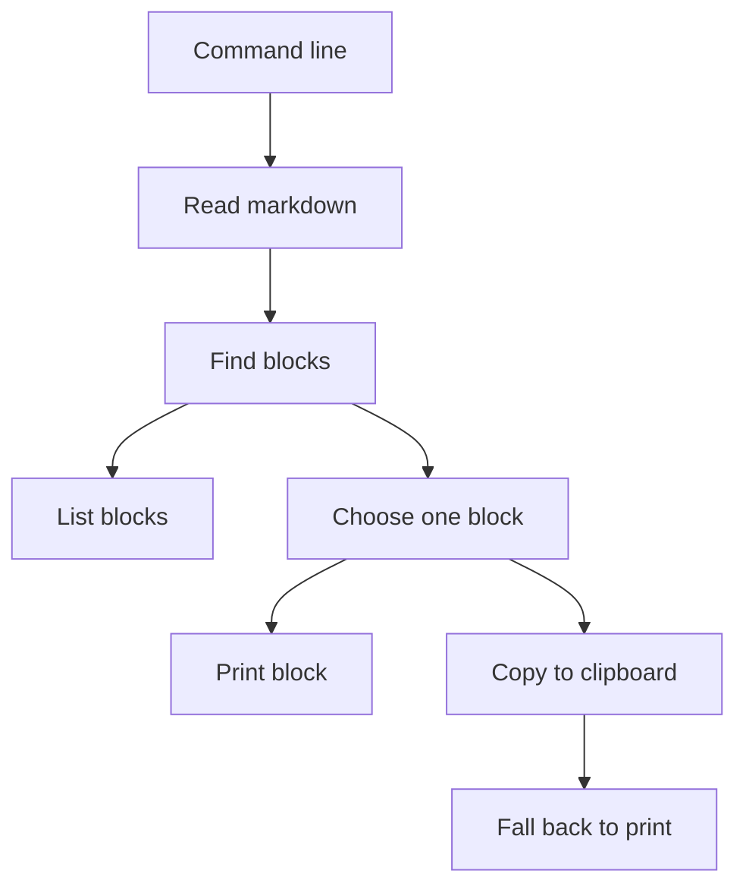

## Purpose

A small command line tool that pulls one fenced `mermaid` block out of a markdown file and copies it to the clipboard without the fence lines, ready to paste into a diagram editor. With no block number it lists the blocks instead. It exists so a person does not have to select the text by hand.

## Dependencies

**Depends on.**
- Standard library: `argparse`, `re`, `shutil`, `subprocess`, `sys`, `pathlib`.
- System programs, found at run time: `pbcopy`, `wl-copy` or `xclip` {src:scripts/chart/mermaid_block.py:25}.
- No other repo file is imported.

**Used by.**
- Product code: none. `git grep` for `mermaid_block` outside `docs/` and `tests/` (2026-11-20) finds only the file itself. The name `extract_first_mermaid_block` in `scripts/connectors/plane/plane_comment_builder.py` is a different function.
- Tests: `tests/scripts/chart/test_mermaid_block.py` imports it {src:tests/scripts/chart/test_mermaid_block.py:19} and calls `main` {src:tests/scripts/chart/test_mermaid_block.py:29}. It also replaces `clipboard_command` to simulate no clipboard {src:tests/scripts/chart/test_mermaid_block.py:61-62}.

## Behavior

**Reading.** `read_blocks` reads the file as UTF-8 {src:scripts/chart/mermaid_block.py:30} and returns every match of the fence pattern plus every level-two heading {src:scripts/chart/mermaid_block.py:31}. The fence pattern needs the text "```mermaid" followed at once by a newline, and ends at the next three backticks {src:scripts/chart/mermaid_block.py:23}. The heading pattern matches lines that start with `## ` {src:scripts/chart/mermaid_block.py:24}.

**Labels.** `label_for` returns the Nth level-two heading for block N, or `(no heading)` when there are fewer headings than blocks {src:scripts/chart/mermaid_block.py:36}.

**List mode.** With no block number, each block prints as `N. heading  (K lines)`, with ` [has subgraph]` added when the word `subgraph` appears in the block {src:scripts/chart/mermaid_block.py:41-43}. The line count is taken after trimming {src:scripts/chart/mermaid_block.py:42}.

**Clipboard.** `clipboard_command` returns the first of the three tools that `shutil.which` finds {src:scripts/chart/mermaid_block.py:48-50}, or `None` {src:scripts/chart/mermaid_block.py:51}. `copy_to_clipboard` runs it with the text on standard input and no shell {src:scripts/chart/mermaid_block.py:60}. It returns `False` when there is no tool, or when the tool fails to start or exits non-zero {src:scripts/chart/mermaid_block.py:57-58} {src:scripts/chart/mermaid_block.py:61-62}.

**Main flow.**
1. A missing file prints an error and returns 1 {src:scripts/chart/mermaid_block.py:73-75}.
2. A file with no blocks prints an error and returns 1 {src:scripts/chart/mermaid_block.py:78-80}.
3. No block number lists the blocks and returns 0 {src:scripts/chart/mermaid_block.py:82-84}.
4. A number outside 1 to the block count prints an error and returns 1 {src:scripts/chart/mermaid_block.py:86-88}.
5. `--stdout` prints the trimmed block and returns 0 {src:scripts/chart/mermaid_block.py:90-93}.
6. Otherwise it copies. When the copy fails it prints a notice to standard error, prints the block to standard output and returns 0 {src:scripts/chart/mermaid_block.py:95-98}. On success it prints `Copied block N: heading` {src:scripts/chart/mermaid_block.py:100}.

## Diagram: module level (L2, required)



## Diagram: function level (L3, optional)

None: no function has branching that the signature does not show.

## Notes

**Code and description disagree.**
- `label_for` says it returns the "heading that precedes block `index`" {src:scripts/chart/mermaid_block.py:35}. The code takes the Nth heading in the file, not the nearest heading before the block {src:scripts/chart/mermaid_block.py:36}. If a section holds two blocks, or a section holds none, every later label is wrong.
- The description says it falls back to standard output "when no clipboard tool exists" {src:scripts/chart/mermaid_block.py:6}. The code also falls back when a tool exists but fails {src:scripts/chart/mermaid_block.py:61-62}, and the message then says "Clipboard unavailable" {src:scripts/chart/mermaid_block.py:96}.

**Edge cases.**
- The fence pattern has no line-start anchor, so an example fence quoted inside another code block, or an indented fence, also counts {src:scripts/chart/mermaid_block.py:23}. A file with Windows line endings, or text after `mermaid` on the fence line, finds nothing {src:scripts/chart/mermaid_block.py:23}.
- The heading pattern also matches `## ` lines inside code blocks {src:scripts/chart/mermaid_block.py:24}, which shifts labels.
- A block that itself holds three backticks is cut short {src:scripts/chart/mermaid_block.py:23}.
- Block number `0` or a negative number gets the range error, because the check is `1 <= n <= count` {src:scripts/chart/mermaid_block.py:86}.

**Inputs that reach a path, command or address.**
- The `file` argument is opened with only an `is_file` check, so any readable text file can be read {src:scripts/chart/mermaid_block.py:73} {src:scripts/chart/mermaid_block.py:30}. It is a person's own command line argument.
- The clipboard command is chosen from a fixed list and run without a shell {src:scripts/chart/mermaid_block.py:25} {src:scripts/chart/mermaid_block.py:60}. The block text goes only to its standard input. No unchecked input reaches a shell command or network address.

**Shared file writes.** None. The module reads one file and writes only to the clipboard and standard streams {src:scripts/chart/mermaid_block.py:60} {src:scripts/chart/mermaid_block.py:97-98}.
