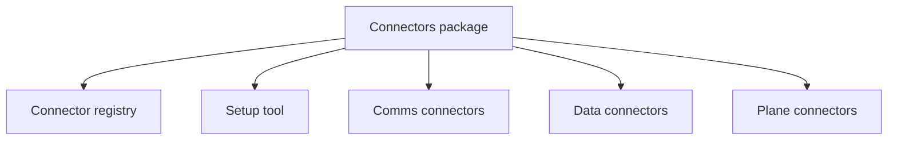

## Purpose

An empty package marker. It makes the `scripts/connectors/` folder a regular Python package so that other code can write `from connectors import registry`.

## Dependencies

**Depends on.** Nothing. The file has 0 bytes and 0 lines (checked with `wc -c` and `wc -l`, 2026-11-20).

**Used by.**
- Product code: every file that imports from the `connectors` package, for example `scripts/connectors/connect.py` {src:scripts/connectors/connect.py:29}, `scripts/connectors/data/databricks.py` {src:scripts/connectors/data/databricks.py:33}, `scripts/connectors/data/secrets_tool.py` {src:scripts/connectors/data/secrets_tool.py:31} and `scripts/connectors/plane/cli.py` {src:scripts/connectors/plane/cli.py:19}. The comms connectors import `connectors.registry` too {src:scripts/connectors/comms/calendar_connector.py:35}. Found with `git grep` for `from connectors` (2026-11-20).
- Tests: for example `tests/scripts/connectors/test_connectors.py` {src:tests/scripts/connectors/test_connectors.py:28} and `tests/scripts/connectors/comms/comms_base.py` {src:tests/scripts/connectors/comms/comms_base.py:27}.

## Behavior

None. The file holds no code, so nothing runs when it is imported. Its only effect is that the folder is a regular package. Since Python 3.3 a folder without this file also imports, as a namespace package {src:docs:https://docs.python.org/3/reference/import.html#namespace-packages}, so the marker is a convention rather than a requirement.

## Diagram: module level (L2, required)

## Diagram: function level (L3, optional)

None: no function has branching that the signature does not show.

## Notes

- Code and description: no description exists to compare, since the file is empty.
- Inputs that reach a path, command or address: none, no code.
- Shared file writes: none, no code.
